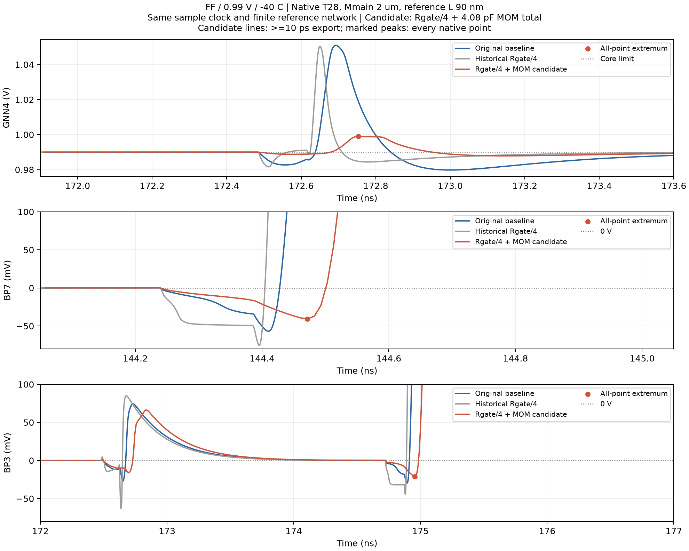
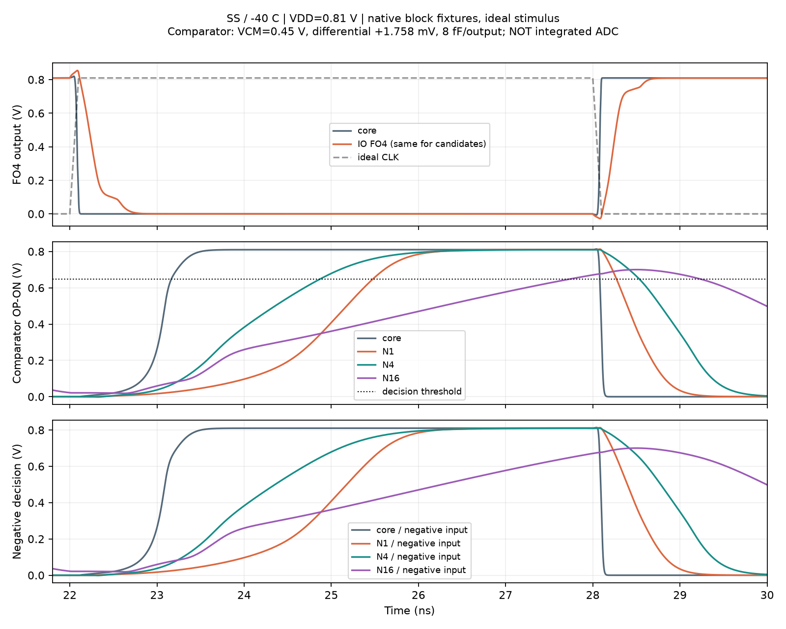

# 参考栅极电荷缓冲修复试验

**整机尚未修好，缓冲电容版不采用。** 用户已确认保留 **0.81–0.99 V** 供电范围，用物理电路或耐压器件解决，不降低测试电压、放宽模型限值或增加理想内部电源。下面保留栅极电容试验，后附固定供电条件下的器件筛选。

## 条件与改动

原版 L90 / Mmain 2 µm ADC，FF、0.99 V、−40°C；200 ns，两帧差分输入 +0.81 / −0.81 V。输入共模 0.45 V，参考为 0.9 / 0 V，各保留 50 Ω 源阻抗和 4 pF 去耦。外部供电、参考源和采样时钟仍理想，内部 SAR 时序及开关均为 T28 器件；无失配、瞬态噪声和 PEX。

在 32 路参考栅极各增加按位权缩放的 PDK MOM 电容，同时使用 Rgate/4。新增电容合计约 **4.084 pF**，复用 CDAC 已验证的 MOM 单元几何。1833 个 MOS 的连接、尺寸、外部激励及采样时钟不变，没有理想 keeper 或钳位源。灰线是已有 Rgate/4 结果，可单独观察新增电容的效果。

## 波形与结果

从上到下：bit7 空闲复位对 GNN4 的扰动、转换期 BP7 的下冲、包含后续各位复位的 BP3 下冲。底板两行放大负压附近，不展示完整 0.9 V 建立过程。候选折线为最小间隔 10 ps 的紧凑导出，圆点和下表峰值来自全部原生时间点。

| 冷角指标 | 原版 | Rgate/4 加 MOM |
| --- | ---: | ---: |
| GNN4 峰值 | 1.050940 V | 0.999016 V |
| BP7 最低电压 | −56.939 mV | −40.632 mV |
| BP3 全程最低电压 | −27.090 mV | −20.988 mV |
| 参考开关最坏端电压 | 1.050940 V | 1.030632 V |
| 两帧码字 | 243 / 12 | 243 / 12 |

GNN4 的超电源幅度由 60.94 降至 9.02 mV，约减少 **85%**。新增栅极电容提供了电荷缓冲，较小的串联电阻有利于回流；相比只减小 Rgate，本版没有把 BP7 下冲进一步加深。但更慢的交接仍保留负向偏移，不能称为钳位到零。

参考开关的新最坏点是 **144.47140 ns、XSP7.MP_HIGH 的 |Vbd|**：bulk 为 0.99 V，BP7 为 −40.632 mV，因此端电压为 1.030632 V。GNN4 不再是最坏点，不等于参考模块合格。BP3 的全程最低点移到 **174.95548 ns** 的后续复位过程，不能只检查最早的 bit7 窗口。

两帧比较/写入/更新/参考捕获次数均为 8/8/8/16，原生 monitor 与独立码字解码一致。紧凑波形估算 14/14 个底板建立窗口通过，最慢约 2.293 ns、比较前最大残差约 0.642 mV；原版分别为 2.217 ns / 0.499 mV。**本轮建立时间是插值估计，不作为最终全分辨率时序验收。** 外部采样窗口未改，最终候选仍需精确复核实际 SEQ_SAMPLE 边沿。

第一帧关闭前 0.2 ns 的跟踪误差仍约 −1.978 mV，固定 41.8 ns 的保持误差约 −1.695 mV。初始 DC 求解仍有容差放宽警告，启动帧与稳态采样问题尚未分开闭合。

## 整机剩余问题

| 模块 | 候选最坏端电压 | 本轮筛查线 | 结论 |
| --- | ---: | ---: | --- |
| 参考开关 | 1.030632 V | 0.99 V | 未通过 |
| 参考驱动 | 1.056952 V | 0.99 V | 未通过 |
| 比较器 | 1.043639 V | 0.99 V | 未通过 |
| 数字控制 | 1.078642 V | 0.99 V | 未通过 |
| Bootstrap | 1.852423 V | 1.98 V | 仅本轮两帧未超限 |

扫描包含全部 1833 个 MOS 的 10998 个端电压对，共 318574 个原生时间点。存在大量共享节点/重复端对，超限端对数不能解读成同样数量的独立故障。CMI 警告保留；上述数十 mV 的超限不能归因于浮点舍入，也不能用码字正确抵消。

新增 4.08 pF 相对约 2.05 pF 的双边 CDAC 并不便宜，面积和驱动能耗代价尚未量化。仅凭本次改善，不扩大电容扫参，也不启动该未通过候选的全码和频谱批次。

## 已确认的供电约束

FF 电源上限 0.99 V 与原生日志中的核心管端电压上限 0.99 V 重合。它解释了为什么多处切换尖峰都触线，但本次试验不能证明所有原供电范围内的电路办法都不可行。

用户选择保留原供电范围。输入、参考范围以及 40 ns 采样窗口和关闭沿也不改；允许评估局部耐压器件及保护结构，但必须同时验证速度、功耗、漏电和合法尺寸。

没有替换冻结基线或 Virtuoso 原理图。以下测试均为独立网表，不代表整机已经采用这些器件。

## 复核与位置

Spectre 21.1.0.509、X CX、4 线程；实际 reltol=1e−7、maxstep=10 ps、vabstol=10 nV、iabstol=100 fA、gear2only，与原版一致。原生 exit0/PASS；仿真约 733 s、分析约 147 s。进程组峰值约 323 MiB / 110 MiB，解析器自身约 7.2 MiB。

统一 managed 入口执行，原始数据留在独立 SSD 目录；回收 14 个文件、约 20.11 MB，逐文件 SHA256 核对，无跳过文件。早期 live collect 的日志校验冲突已通过完成后只重做回收解决，未重跑仿真。稀疏 PSF、GROUP 电流及“未导出窄峰仍计入极值”的解析测试通过。

- 配方和冻结记录：`management/recipes/sar8fix-c1r4-ffcold.yaml`、`management/runs/sar8fix-c1r4-ffcold.yaml`。
- 指标和回执：`verification/sar8_physical_repair/`；脚本：`scripts/sar8_physical_repair/`。
- 远端：`/server_local_ssd/chenzc_intern25/sar-adc-t28/runs/sar8fix-c1r4-ffcold`。
- 本地紧凑结果：`output/managed_execution/runs/sar8fix-c1r4-ffcold/collected/`。

## 固定供电下的器件筛选

先跑小型模块测试，避免把低压下不能工作的耐压管直接接回整机。原核心管作为同场对照；普通 IO 管使用 `nch_18_mac/pch_18_mac`，L=150 nm、单元 W=320 nm；under-drive 管使用 `nch_18ud12_mac/pch_18ud12_mac`，L=105 nm、单元 W=320 nm。几何和寄生参数读取自当前 PDK CDF 默认值，原生仿真接受这些参数，但这不是版图 DRC。

五点为 TT/0.9 V/27°C、SS/0.81 V/−40°C、SS/0.81 V/125°C、FF/0.99 V/−40°C、FF/0.99 V/125°C。仅 MOS corner 改变，MOM/电阻保持 TT，无失配、噪声和 PEX。以下结果不能与完整 ADC 的原波形直接等同。

### 参考开关与逻辑

参考开关驱动 128 个 MOM 单元到地，高参考保留 50 Ω 和 4 pF；理想 GN/GP 共用测试波形，未包含原来的 BBM 驱动或整片 CDAC 顶板耦合。普通 IO 管的“两份单元/位权”方案在 MSB 对应总宽 81.92 µm，L=150 nm，不是与原核心管等 W/L 比较。

| PVT | NMOS Ron | PMOS Ron | 低端建立 | 高端建立 |
| --- | ---: | ---: | ---: | ---: |
| TT | 18.12 Ω | 53.16 Ω | 0.140 ns | 0.731 ns |
| SS 冷 | 55.09 Ω | 70.88 Ω | 0.464 ns | 0.894 ns |
| SS 热 | 44.29 Ω | 75.53 Ω | 0.310 ns | 0.869 ns |
| FF 冷 | 8.80 Ω | 37.73 Ω | 0.079 ns | 0.610 ns |
| FF 热 | 13.00 Ω | 45.09 Ω | 0.092 ns | 0.663 ns |

Ron 用静态 10 mV 压降除以器件电流；建立时间从测试栅压的半电源交越算到残差持续进入 ±1.758 mV，目标为当时实际参考节点电压。较大宽度降低 Ron，但也加大瞬态注入。本表只说明普通 IO 参考开关值得继续测试，**不证明完整 CDAC 的下冲或参考负载已修复**。当前 off 电流测试也是 10 mV VDS，仅是近轨漏电，不能拿来代替 0.9 V 关断漏电。

FO4 表示一个反相器驱动四个同型反相器。SS 冷角下降传播延迟：核心管约 **33.7 ps**，普通 IO 管 **202.6 ps**，under-drive 管 **209.2 ps**。IO 逻辑可以翻转，但直接全量替换会明显改变异步转换和复位时序，不能仅凭耐压通过采用。

### 比较器不能直接整体换管

测试保留原 StrongARM 连接，输入共模 0.45 V，差分输入 ±1.758 mV，两个输出各带约 8.008 fF PDK MOM，无后级逻辑。延迟从 CLK 半电源上升沿算到正确极性的输出差达到 0.8 VDD，并检查复位前仍保持。**1.9 ns 是本次模块筛选窗口，不是重新定义的整机规格。**

| PVT | 原核心管 | 全普通 IO | 全 under-drive |
| --- | ---: | ---: | ---: |
| TT | 0.320 ns | 窗口内未判决 | 窗口内未判决 |
| SS 冷 | 1.115 ns | 窗口内未判决 | 窗口内未判决 |
| SS 热 | 0.377 ns | 窗口内未判决 | 窗口内未判决 |
| FF 冷 | 0.274 ns | 窗口内未判决 | 窗口内未判决 |
| FF 热 | 0.184 ns | 0.965 ns | 0.782 ns |

正、负输入的结果一致；无失配下的对称性不能代替 offset/噪声验证。普通 IO 与 under-drive 在低供电、低输入共模下的输入放大和再生速度不足，是这批整体换管方案的限制；尚未通过工作点电流把各阶段延迟完全拆开。

从上到下为 FO4 输出、比较器正输入差的输出差、MSB 等效负载电压。中间虚线是 0.8 VDD 判决线；参考开关一行画的是一份单元/位权，数表选择的是两份，不应混读。

混合方案保留核心输入对，在其漏端增加普通 IO cascode，其他比较器 MOS 换普通 IO。cascode 分别为 2/4/8 个 320 nm 单元。SS 冷角核心输入管最大端电压约 0.531/0.546/0.640 V，保护有效，但 1.9 ns 均未判决；延长独立测试窗口到 5.9 ns 后，输出差也仅约 0.144/0.237/0.352 V，仍未达到 0.648 V 判决线。

这只改变独立模块测试时长，ADC 的采样窗口、关闭沿和冻结电路均未改。

### 原生 NMOS 比较器候选

另一个候选把输入对及 NMOS 再生管换成 `nch_na18_mac`，其余管使用普通 1.8 V 器件，保持 StrongARM 连接；没有增加理想偏置源或改变输入共模。原生 NMOS 的 CDF 默认单元为 L=800 nm、W=500 nm。

较合适的 **N4** 尺寸为：每只输入 NMOS 并联 8 单元，总 W=4 µm；每只 NMOS 再生管并联 4 单元，总 W=2 µm。尾管是普通 IO NMOS，L=150 nm、总 W=1.28 µm；每只 PMOS 为普通 IO 管，L=150 nm、总 W=0.64 µm。

| PVT | N4 决策时间 | 比较器全部 MOS 最坏端电压 |
| --- | ---: | ---: |
| TT | 1.358 ns | 1.032 V |
| SS 冷 | 2.820 ns | 0.894 V |
| SS 热 | 2.752 ns | 0.912 V |
| FF 冷 | 0.797 ns | 1.152 V |
| FF 热 | 1.697 ns | 1.142 V |

这些是 **5.9 ns 独立窗口**中的结果，正、负小输入差均完成判决。五点峰值低于本项目对标称 1.8 V 管使用的 1.98 V 诊断筛查线；该线不是寿命认证。此候选没有使用 under-drive 管，后者的适用 SOA 尚未核定。

SS 冷角缩为 N1 时需要 3.426 ns，增为 N16 反而需要 5.683 ns，说明不能靠继续扩大所有 W 获得速度。N4 的栅面积和负载显著大于原核心管输入对，当前理想输入源不会暴露其对 CDAC 的反冲和采样负担。

上图第一行是独立 FO4 逻辑测试，三个 N 候选的 FO4 电路相同；后两行分别展示正、负差分输入的判决。N4 在约 24.87 ns 跨过判决线，时钟半电源上升沿在 22.05 ns。到 28 ns 后开始复位，此时输出差返回零，不是转换误差。

### 采用前仍须完成

1. N4 输入共模扫描、输入符号逐周期翻转、复位残留、真实后级负载及输入反冲；分开量化尾管放电与再生阶段，先优化局部尺寸，避免整片放大。
2. 参考 IO 开关补测 0.9 V 关断压差下的漏电，接入实际 BBM 栅控及完整 CDAC；检查所有位的负向偏移和建立时间。
3. 耐压驱动/控制逻辑接回原异步链路，核对 60 ns 转换预算和下一次采样前的复位。外部采样窗口和关闭沿保持原约束。
4. 形成统一候选后，才做整机全端应力、功耗、五点 PVT、全码及 1024 点频谱回归。原基线和 OA 尚未替换，整机修复未完成。

### 本轮复核

完成 13 组 managed 模块测试：器件类别五点、SS 冷角混合结构短/长窗口、原生 NMOS 短窗口及长窗口五点。所有仿真和流式分析原生 PASS/exit0，逐项校验冻结输入和回收文件 SHA256，原始波形保留在各自 SSD 目录。FF 核心管对照产生的 CMI 警告保留，不能把整个测试台称为应力合格。

共核对 322993 个原生时间点，回收 169 个文件、97.71 MB；单组仿真峰值约 293.3 MiB，分析进程组峰值约 115.5 MiB，流式解析器约 6.2 MiB。仿真与分析串行，回收不下载原始大波形。

实际 Spectre X CX 设置为 reltol=1e−8、maxstep=5 ps、vabstol=10 nV、iabstol=100 fA、gear2only。虽然资源上限允许四线程，原生日志说明设计过小，实际关闭多线程。没有与之前不同容差/规模的整机仿真做“等精度加速”比较。

本地分析曾发现循环变量覆盖比较窗口结束时间的问题，已修正并对所有结果重算，增加逐候选窗口一致性、判决保持及 Ron 并联缩放校验；没有重跑原生仿真。一次在原生仿真结束前请求分析被管理入口拒绝，完成后使用原 ID 重试，仅启动一次分析。

配方与回执按 `sar8fix-ioscreen-*`、`sar8fix-hybscreen-*`、`sar8fix-hyblong-*`、`sar8fix-natscreen-*`、`sar8fix-natlong-*` 保存。脚本为 `scripts/sar8_physical_repair/io_*.py`，指标和完整性复核为 `verification/sar8_physical_repair/*_analysis.json` 与 `*_review.json`。原生输入/小波形位于 `output/managed_execution/runs/<ID>/`。
