# 8 bit ADC 物理过压修复

**整机尚未修好。** 当前 IO 参考开关、N4 比较器和四管 IO 接收级在 TT、SS 冷角的两帧测试中码字与全管端压筛查通过；SS 冷角复位裕量变窄，正在补验跨周期尾部。FF 核心驱动/逻辑过压和首帧预充协议仍待关闭，未替换基线或同步 OA。

保留 **0.81–0.99 V** 供电范围，不降低测试电压、放宽模型限值或增加理想内部电源。以下按试验顺序保留电容候选、器件筛选、五点合龙及最新接收级对照；电容缓冲版不采用。

## 条件与改动

原版 L90 / Mmain 2 µm ADC，FF、0.99 V、−40°C；200 ns，两帧差分输入 +0.81 / −0.81 V。输入共模 0.45 V，参考为 0.9 / 0 V，各保留 50 Ω 源阻抗和 4 pF 去耦。外部供电、参考源和采样时钟仍理想，内部 SAR 时序及开关均为 T28 器件；无失配、瞬态噪声和 PEX。

在 32 路参考栅极各增加按位权缩放的 PDK MOM 电容，同时使用 Rgate/4。新增电容合计约 **4.084 pF**，复用 CDAC 已验证的 MOM 单元几何。1833 个 MOS 的连接、尺寸、外部激励及采样时钟不变，没有理想 keeper 或钳位源。灰线是已有 Rgate/4 结果，可单独观察新增电容的效果。

## 波形与结果

从上到下：bit7 空闲复位对 GNN4 的扰动、转换期 BP7 的下冲、包含后续各位复位的 BP3 下冲。底板两行放大负压附近，不展示完整 0.9 V 建立过程。候选折线为最小间隔 10 ps 的紧凑导出，圆点和下表峰值来自全部原生时间点。

| 冷角指标 | 原版 | Rgate/4 加 MOM |
| --- | ---: | ---: |
| GNN4 峰值 | 1.050940 V | 0.999016 V |
| BP7 最低电压 | −56.939 mV | −40.632 mV |
| BP3 全程最低电压 | −27.090 mV | −20.988 mV |
| 参考开关最坏端电压 | 1.050940 V | 1.030632 V |
| 两帧码字 | 243 / 12 | 243 / 12 |

GNN4 的超电源幅度由 60.94 降至 9.02 mV，约减少 **85%**。新增栅极电容提供了电荷缓冲，较小的串联电阻有利于回流；相比只减小 Rgate，本版没有把 BP7 下冲进一步加深。但更慢的交接仍保留负向偏移，不能称为钳位到零。

参考开关的新最坏点是 **144.47140 ns、XSP7.MP_HIGH 的 |Vbd|**：bulk 为 0.99 V，BP7 为 −40.632 mV，因此端电压为 1.030632 V。GNN4 不再是最坏点，不等于参考模块合格。BP3 的全程最低点移到 **174.95548 ns** 的后续复位过程，不能只检查最早的 bit7 窗口。

两帧比较/写入/更新/参考捕获次数均为 8/8/8/16，原生 monitor 与独立码字解码一致。紧凑波形估算 14/14 个底板建立窗口通过，最慢约 2.293 ns、比较前最大残差约 0.642 mV；原版分别为 2.217 ns / 0.499 mV。**本轮建立时间是插值估计，不作为最终全分辨率时序验收。** 外部采样窗口未改，最终候选仍需精确复核实际 SEQ_SAMPLE 边沿。

第一帧关闭前 0.2 ns 的跟踪误差仍约 −1.978 mV，固定 41.8 ns 的保持误差约 −1.695 mV。初始 DC 求解仍有容差放宽警告，启动帧与稳态采样问题尚未分开闭合。

## 电容候选的剩余问题

| 模块 | 候选最坏端电压 | 本轮筛查线 | 结论 |
| --- | ---: | ---: | --- |
| 参考开关 | 1.030632 V | 0.99 V | 未通过 |
| 参考驱动 | 1.056952 V | 0.99 V | 未通过 |
| 比较器 | 1.043639 V | 0.99 V | 未通过 |
| 数字控制 | 1.078642 V | 0.99 V | 未通过 |
| Bootstrap | 1.852423 V | 1.98 V | 仅本轮两帧未超限 |

扫描包含全部 1833 个 MOS 的 10998 个端电压对，共 318574 个原生时间点。存在大量共享节点/重复端对，超限端对数不能解读成同样数量的独立故障。CMI 警告保留；上述数十 mV 的超限不能归因于浮点舍入，也不能用码字正确抵消。

新增 4.08 pF 相对约 2.05 pF 的双边 CDAC 并不便宜，面积和驱动能耗代价尚未量化。仅凭本次改善，不扩大电容扫参，也不启动该未通过候选的全码和频谱批次。

## 已确认的供电约束

FF 电源上限 0.99 V 与原生日志中的核心管端电压上限 0.99 V 重合。它解释了为什么多处切换尖峰都触线，但本次试验不能证明所有原供电范围内的电路办法都不可行。

用户选择保留原供电范围。输入、参考范围以及 40 ns 采样窗口和关闭沿也不改；允许评估局部耐压器件及保护结构，但必须同时验证速度、功耗、漏电和合法尺寸。

没有替换冻结基线或 Virtuoso 原理图。以下测试均为独立网表，不代表整机已经采用这些器件。

## 复核与位置

Spectre 21.1.0.509、X CX、4 线程；实际 reltol=1e−7、maxstep=10 ps、vabstol=10 nV、iabstol=100 fA、gear2only，与原版一致。原生 exit0/PASS；仿真约 733 s、分析约 147 s。进程组峰值约 323 MiB / 110 MiB，解析器自身约 7.2 MiB。

统一 managed 入口执行，原始数据留在独立 SSD 目录；回收 14 个文件、约 20.11 MB，逐文件 SHA256 核对，无跳过文件。早期 live collect 的日志校验冲突已通过完成后只重做回收解决，未重跑仿真。稀疏 PSF、GROUP 电流及“未导出窄峰仍计入极值”的解析测试通过。

- 配方和冻结记录：`management/recipes/sar8fix-c1r4-ffcold.yaml`、`management/runs/sar8fix-c1r4-ffcold.yaml`。
- 指标和回执：`verification/sar8_physical_repair/`；脚本：`scripts/sar8_physical_repair/`。
- 远端：`/server_local_ssd/chenzc_intern25/sar-adc-t28/runs/sar8fix-c1r4-ffcold`。
- 本地紧凑结果：`output/managed_execution/runs/sar8fix-c1r4-ffcold/collected/`。

## 固定供电下的器件筛选

先跑小型模块测试，避免把低压下不能工作的耐压管直接接回整机。原核心管作为同场对照；普通 IO 管使用 `nch_18_mac/pch_18_mac`，L=150 nm、单元 W=320 nm；under-drive 管使用 `nch_18ud12_mac/pch_18ud12_mac`，L=105 nm、单元 W=320 nm。几何和寄生参数读取自当前 PDK CDF 默认值，原生仿真接受这些参数，但这不是版图 DRC。

五点为 TT/0.9 V/27°C、SS/0.81 V/−40°C、SS/0.81 V/125°C、FF/0.99 V/−40°C、FF/0.99 V/125°C。仅 MOS corner 改变，MOM/电阻保持 TT，无失配、噪声和 PEX。以下结果不能与完整 ADC 的原波形直接等同。

### 参考开关与逻辑

参考开关驱动 128 个 MOM 单元到地，高参考保留 50 Ω 和 4 pF；理想 GN/GP 共用测试波形，未包含原来的 BBM 驱动或整片 CDAC 顶板耦合。普通 IO 管的“两份单元/位权”方案在 MSB 对应总宽 81.92 µm，L=150 nm，不是与原核心管等 W/L 比较。

| PVT | NMOS Ron | PMOS Ron | 低端建立 | 高端建立 |
| --- | ---: | ---: | ---: | ---: |
| TT | 18.12 Ω | 53.16 Ω | 0.140 ns | 0.731 ns |
| SS 冷 | 55.09 Ω | 70.88 Ω | 0.464 ns | 0.894 ns |
| SS 热 | 44.29 Ω | 75.53 Ω | 0.310 ns | 0.869 ns |
| FF 冷 | 8.80 Ω | 37.73 Ω | 0.079 ns | 0.610 ns |
| FF 热 | 13.00 Ω | 45.09 Ω | 0.092 ns | 0.663 ns |

Ron 用静态 10 mV 压降除以器件电流；建立时间从测试栅压的半电源交越算到残差持续进入 ±1.758 mV，目标为当时实际参考节点电压。较大宽度降低 Ron，但也加大瞬态注入。本表只说明普通 IO 参考开关值得继续测试，**不证明完整 CDAC 的下冲或参考负载已修复**。当前 off 电流测试也是 10 mV VDS，仅是近轨漏电，不能拿来代替 0.9 V 关断漏电。

FO4 表示一个反相器驱动四个同型反相器。SS 冷角下降传播延迟：核心管约 **33.7 ps**，普通 IO 管 **202.6 ps**，under-drive 管 **209.2 ps**。IO 逻辑可以翻转，但直接全量替换会明显改变异步转换和复位时序，不能仅凭耐压通过采用。

### 比较器不能直接整体换管

测试保留原 StrongARM 连接，输入共模 0.45 V，差分输入 ±1.758 mV，两个输出各带约 8.008 fF PDK MOM，无后级逻辑。延迟从 CLK 半电源上升沿算到正确极性的输出差达到 0.8 VDD，并检查复位前仍保持。**1.9 ns 是本次模块筛选窗口，不是重新定义的整机规格。**

| PVT | 原核心管 | 全普通 IO | 全 under-drive |
| --- | ---: | ---: | ---: |
| TT | 0.320 ns | 窗口内未判决 | 窗口内未判决 |
| SS 冷 | 1.115 ns | 窗口内未判决 | 窗口内未判决 |
| SS 热 | 0.377 ns | 窗口内未判决 | 窗口内未判决 |
| FF 冷 | 0.274 ns | 窗口内未判决 | 窗口内未判决 |
| FF 热 | 0.184 ns | 0.965 ns | 0.782 ns |

正、负输入的结果一致；无失配下的对称性不能代替 offset/噪声验证。普通 IO 与 under-drive 在低供电、低输入共模下的输入放大和再生速度不足，是这批整体换管方案的限制；尚未通过工作点电流把各阶段延迟完全拆开。

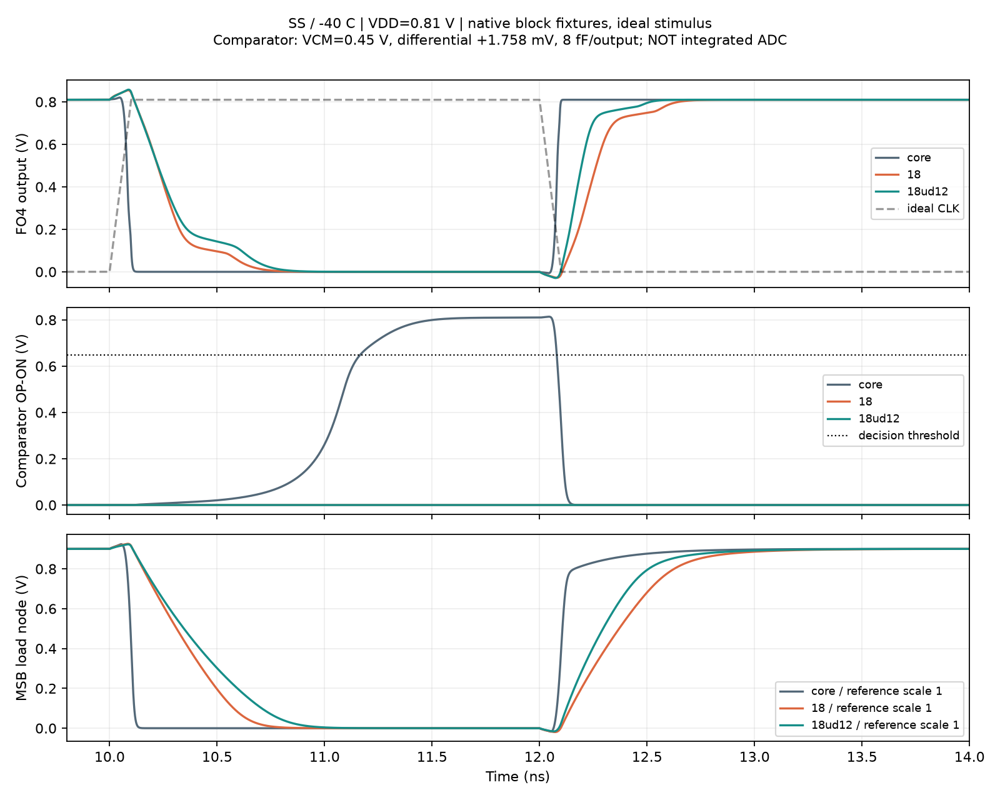

从上到下为 FO4 输出、比较器正输入差的输出差、MSB 等效负载电压。中间虚线是 0.8 VDD 判决线；参考开关一行画的是一份单元/位权，数表选择的是两份，不应混读。

混合方案保留核心输入对，在其漏端增加普通 IO cascode，其他比较器 MOS 换普通 IO。cascode 分别为 2/4/8 个 320 nm 单元。SS 冷角核心输入管最大端电压约 0.531/0.546/0.640 V，保护有效，但 1.9 ns 均未判决；延长独立测试窗口到 5.9 ns 后，输出差也仅约 0.144/0.237/0.352 V，仍未达到 0.648 V 判决线。

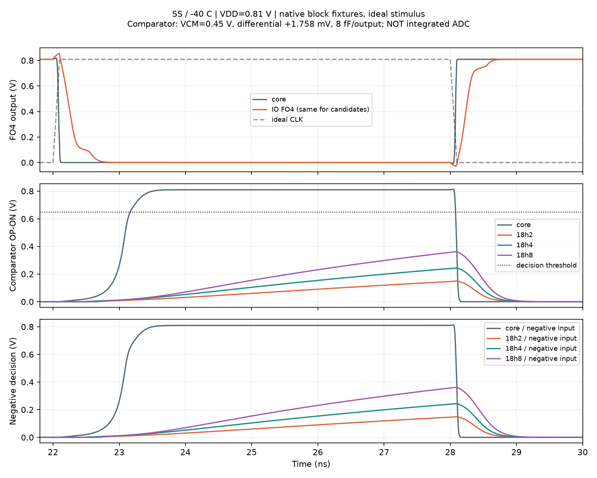

这只改变独立模块测试时长，ADC 的采样窗口、关闭沿和冻结电路均未改。

### 原生 NMOS 比较器候选

另一个候选把输入对及 NMOS 再生管换成 `nch_na18_mac`，其余管使用普通 1.8 V 器件，保持 StrongARM 连接；没有增加理想偏置源或改变输入共模。原生 NMOS 的 CDF 默认单元为 L=800 nm、W=500 nm。

较合适的 **N4** 尺寸为：每只输入 NMOS 并联 8 单元，总 W=4 µm；每只 NMOS 再生管并联 4 单元，总 W=2 µm。尾管是普通 IO NMOS，L=150 nm、总 W=1.28 µm；每只 PMOS 为普通 IO 管，L=150 nm、总 W=0.64 µm。

| PVT | N4 决策时间 | 比较器全部 MOS 最坏端电压 |
| --- | ---: | ---: |
| TT | 1.358 ns | 1.032 V |
| SS 冷 | 2.820 ns | 0.894 V |
| SS 热 | 2.752 ns | 0.912 V |
| FF 冷 | 0.797 ns | 1.152 V |
| FF 热 | 1.697 ns | 1.142 V |

这些是 **5.9 ns 独立窗口**中的结果，正、负小输入差均完成判决。五点峰值低于本项目对标称 1.8 V 管使用的 1.98 V 诊断筛查线；该线不是寿命认证。此候选没有使用 under-drive 管，后者的适用 SOA 尚未核定。

SS 冷角缩为 N1 时需要 3.426 ns，增为 N16 反而需要 5.683 ns，说明不能靠继续扩大所有 W 获得速度。N4 的栅面积和负载显著大于原核心管输入对，当前理想输入源不会暴露其对 CDAC 的反冲和采样负担。

上图第一行是独立 FO4 逻辑测试，三个 N 候选的 FO4 电路相同；后两行分别展示正、负差分输入的判决。N4 在约 24.87 ns 跨过判决线，时钟半电源上升沿在 22.05 ns。到 28 ns 后开始复位，此时输出差返回零，不是转换误差。

### 采用前仍须完成

1. N4 输入共模扫描、输入符号逐周期翻转、复位残留、真实后级负载及输入反冲；分开量化尾管放电与再生阶段，先优化局部尺寸，避免整片放大。
2. 参考 IO 开关补测 0.9 V 关断压差下的漏电，接入实际 BBM 栅控及完整 CDAC；检查所有位的负向偏移和建立时间。
3. 耐压驱动/控制逻辑接回原异步链路，核对 60 ns 转换预算和下一次采样前的复位。外部采样窗口和关闭沿保持原约束。
4. 形成统一候选后，才做整机全端应力、功耗、五点 PVT、全码及 1024 点频谱回归。原基线和 OA 尚未替换，整机修复未完成。

### 本轮复核

完成 13 组 managed 模块测试：器件类别五点、SS 冷角混合结构短/长窗口、原生 NMOS 短窗口及长窗口五点。所有仿真和流式分析原生 PASS/exit0，逐项校验冻结输入和回收文件 SHA256，原始波形保留在各自 SSD 目录。FF 核心管对照产生的 CMI 警告保留，不能把整个测试台称为应力合格。

共核对 322993 个原生时间点，回收 169 个文件、97.71 MB；单组仿真峰值约 293.3 MiB，分析进程组峰值约 115.5 MiB，流式解析器约 6.2 MiB。仿真与分析串行，回收不下载原始大波形。

实际 Spectre X CX 设置为 reltol=1e−8、maxstep=5 ps、vabstol=10 nV、iabstol=100 fA、gear2only。虽然资源上限允许四线程，原生日志说明设计过小，实际关闭多线程。没有与之前不同容差/规模的整机仿真做“等精度加速”比较。

本地分析曾发现循环变量覆盖比较窗口结束时间的问题，已修正并对所有结果重算，增加逐候选窗口一致性、判决保持及 Ron 并联缩放校验；没有重跑原生仿真。一次在原生仿真结束前请求分析被管理入口拒绝，完成后使用原 ID 重试，仅启动一次分析。

配方与回执按 `sar8fix-ioscreen-*`、`sar8fix-hybscreen-*`、`sar8fix-hyblong-*`、`sar8fix-natscreen-*`、`sar8fix-natlong-*` 保存。脚本为 `scripts/sar8_physical_repair/io_*.py`，指标和完整性复核为 `verification/sar8_physical_repair/*_analysis.json` 与 `*_review.json`。原生输入/小波形位于 `output/managed_execution/runs/<ID>/`。

## 真实负载单变量检查

测试直接使用完整 ADC 作为负载：保留 512 个 MOM 单元、实际 BBM 栅极驱动、Bootstrap、异步时序及后级逻辑。参考候选只替换 32 只参考 MOS；比较器候选只替换 StrongARM 的 11 只 MOS，原输出 MOM 和后级缓冲均保留。两组均不改变外部电源、输入、参考或采样时钟。它们是诊断网表，尚未同步 OA 或替换基线。

所有 1833 只 MOS 的 10998 个端电压对仍逐原生时间点检查。电源能量用原生时间点的 `V×I` 梯形积分，按 100 ns 帧切分；比较器另外积分全部 MOS 端口的吸收能量。主要电源功耗统计 VDD 和参考供能，输入与外部时钟能量单列，不重复相加。时钟交越用原生点插值；绘图抽稀到约 20 ps，图上的反冲形状和建立时间估计不替代全点应力检查。

### 普通 IO 参考开关接入完整 CDAC

FF / 0.99 V / −40°C，参考 0.9 V，输入与参考均保留 50 Ω，参考去耦 4 pF；无噪声、失配和 PEX。候选沿用独立测试的 scale2 尺寸，未加 MOM 栅电容或降低栅极电阻。

| 检查项 | 原核心 L90 参考开关 | 普通 IO scale2 |
| --- | ---: | ---: |
| GNN4 栅极峰值 | 1.05094 V | 1.04136 V |
| BP7 最低电压 | −56.939 mV | −82.311 mV |
| 参考开关最坏端电压 | 1.05094 V / 0.99 V 筛查线 | 1.07231 V / 1.98 V 筛查线 |
| 下一次比较前最坏底板残差 | 约 0.499 mV | 约 0.739 mV |
| 两帧码字 | 243 / 12 | 243 / 12 |

耐压改善来自实际更换器件，并非消除所有尖峰。更换后下冲更大，但本次 14 个逐位建立窗口均在下一次比较前进入 ±1.758 mV；最长约 2.33 ns。复位结束后、下一次采样前，底板目标残差小于 0.00006 mV。198 ns 的 MSB 高端 PMOS 处于约 0.9 V 关断压差，漏端电流约 −0.231 nA，节点已经平稳；这是 FF 冷角测量，不代表热角漏电已通过。

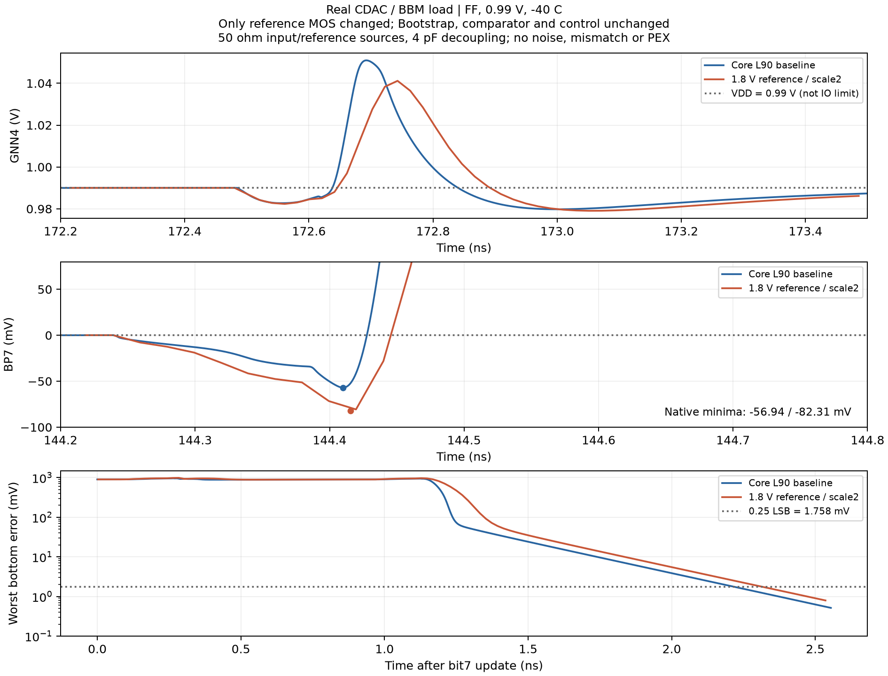

从上到下是空闲复位时 GNN4 的抬升、转换时 BP7 下冲，以及 bit7 更新后全部底板中最坏的建立残差。上图 0.99 V 虚线表示电源电平，不是 IO 管的耐压线。下图以各自 bit7 更新沿对齐；原生峰值用点标出。

第二帧的 VDD 供能为 15.811 pJ，高参考供能为 1.548 pJ，100 ns 内合计平均约 **0.174 mW**。它低于当前 1 mW 目标，但只有两帧指定输入，尚不是最坏活动模式功耗。原比较器的全部端口吸收能量约 0.1505 pJ/帧。

实际 `SEQ_SAMPLE` 第二帧窗口约 38.41049 ns，与同角原版一致；外部时钟的 40 ns 采样相位未改。关闭沿差异小于 0.001 ps 的数值比较分辨率，没有进一步压缩采样窗口。启动帧关闭前误差仍约 −1.979 mV，单独保留。

参考开关的端压筛查通过，不等于整机通过：未替换的参考驱动、比较器、数字逻辑峰值分别仍约 **1.058 / 1.044 / 1.079 V**，超过核心管的 0.99 V 筛查线。

### 同测量口径的 SS 冷角原版对照

SS / 0.81 V / −40°C，原电路未改。首帧码字 241，保持误差约 −12.808 mV；第二帧码字 12，保持误差约 +0.332 mV，转换约 40.627 ns。首帧现象与此前 L90/Mmain 2 µm 的记录一致，不能记成新比较器造成的问题，也不能用第二帧通过掩盖启动限制。

该对照的全 MOS 端压筛查通过；第二帧 VDD 加参考平均供能约 0.1004 mW，比较器端口吸收能量约 0.0929 pJ/帧。N4 接入结果与这组相同保存、积分和时间口径的对照比较，而不是直接与理想输入源的独立比较器图比较。

本阶段运行、指标与配方使用 `sar8fix-loaded-*`。电路种子保存在 `netlist/experiments/sar8_physical_repair/loaded_seed/`，与原基线电路、观察器逐字节一致；没有复制 PDK 模型或原始波形。生成器已验证可从该受控种子重现三组冻结输入。

### N4 比较器接入真实负载

SS / 0.81 V / −40°C，仅替换比较器，参考开关仍为核心 L90，输入及参考网络同上。下表用第二帧比较正常周期；每帧 100 ns。

| 检查项 | 原核心比较器 | N4 耐压比较器 |
| --- | ---: | ---: |
| 两帧码字 | 241 / 12 | 243 / 12 |
| 第二帧转换时间 | 40.627 ns | 44.102 ns |
| 第二帧保持点误差 | +0.332 mV | +0.338 mV |
| 最后一位参考复位时刻 | 193.890 ns | 197.366 ns |
| VDD 加参考平均功耗 | 100.354 µW | 102.527 µW |
| 比较器吸收能量 | 0.0929 pJ | 0.2088 pJ |
| 第一位比较至写入前最大顶板差模变化 | 0.292 mV | 9.248 mV |
| 最后一位写入时较高的原始输出 | 0.753 V | 0.403 V |

保持点固定为第二帧 141.8 ns，在首次比较之前；不能把随后逐次逼近的顶板变化都算作保持误差。N4 的实际采样窗口约 37.84072 ns，与原版差小于 0.001 ps，关闭沿也未发生有意义的移动。

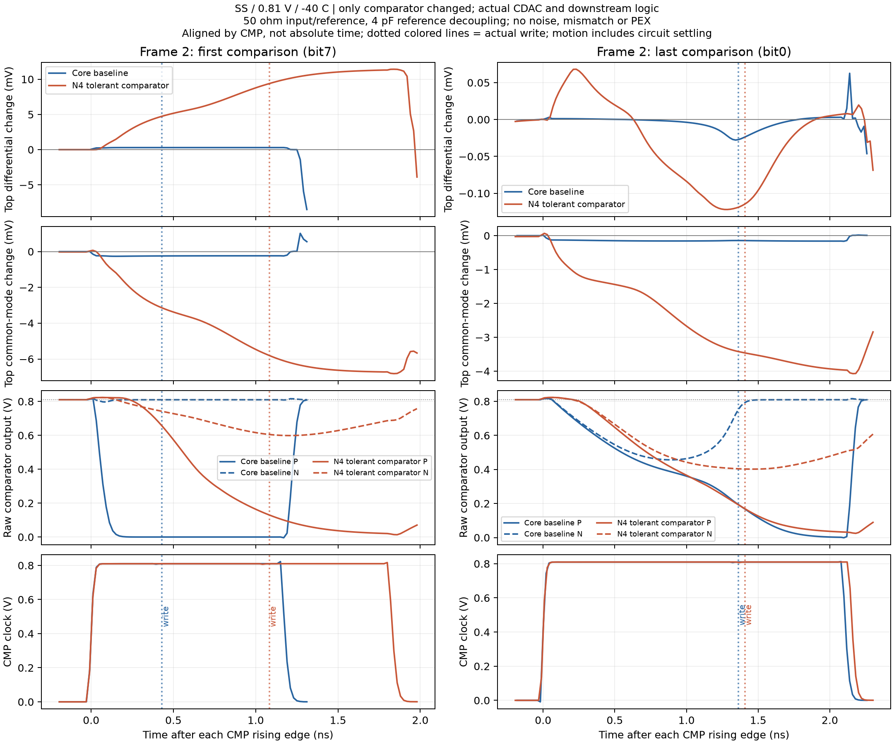

左右分别是第二帧第一位和最后一位，按各自比较时钟上升沿对齐。前两行把比较前电压作为零基准；第三行保留原始输出电压，第四行是实际比较时钟。彩色竖虚线标出各自的写入时刻。写入后继续画出的变化可能包含 DAC 更新，不能归入纯比较器反冲。

N4 大输入差时的顶板扰动明显增大，但不能直接宣布有 9.248 mV 最终转换误差：首次判决远离零点，后续电荷会重新分配。最后一位输入差为原版 −2.207 mV、N4 −4.582 mV，仍为同一符号。新增输入电容改变 DAC 传输与动态耦合是待验证的原因，两个码字不能代替全码/频谱回归。

对第一位比较前 20 ps 至写入前 20 ps 的输入栅电流做紧凑波形积分，两侧约吸收 0.860 / 10.253 fC，差约 9.394 fC。按每侧 CDAC 标称约 1.025 pF 估算，差模变化约 9.16 mV，与波形的 9.25 mV 同量级且符号一致，支持输入管动态栅电荷是主要来源。该估算使用约 20 ps 波形，并非完整节点 KCL 分解；功耗和应力仍使用全原生点。

原始输出的高电平下降更值得关注：N4 最后一位写入时输出约 0.403/0.169 V，后级实际已产生有效判决，但数字接口裕量变小。独立模块采用的 `差分输出 ≥0.8 VDD` 是诊断线，并非整机接收器的真实翻转电压；不能因为未跨这条线就把正确转换判成失败，也不能因为两个码字正确就认定所有输入都安全。下一单变量对照只将两只交叉耦合 PMOS 的并联数从 2 增至 4，核对再生波形、写入时刻和功耗，其余器件及采样时序不动。

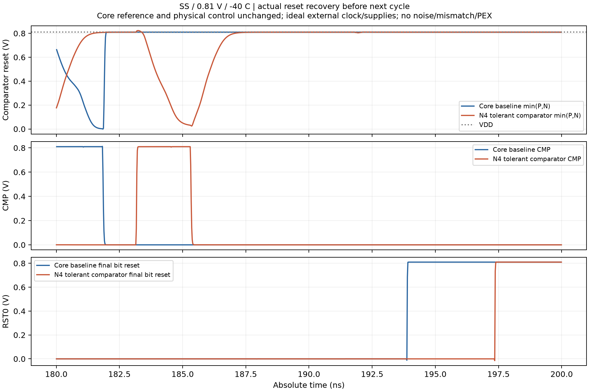

N4 每次比较前的输出与内部节点已回到约电源电平，第二帧最后一次参考复位也在下轮采样前完成。14 个逐位建立窗口通过，最坏比较前底板残差约 0.133 mV。该 SS 冷角全管端压筛查通过；这不是 FF 角结论。

首帧从 DC 工作点开始，没有模拟真实电源爬升。N4 首帧码字变好不能作为上电复位已解决的证据；原版首帧异常继续保留。

### 合龙五点与数值检查

参考 IO scale2 与 N4 已合并为独立网表，完成 TT/0.9 V/27°C、SS/0.81 V/−40°C、SS/0.81 V/125°C、FF/0.99 V/−40°C、FF/0.99 V/125°C 五点。该批保留原核心驱动与控制，只检验两类耐压候选的相互作用；整机核心管过压仍须修复，不能将这批诊断回归称为最终验收。

另外，同一参考候选比较了实际 `reltol=1e−7` 与 `1e−5`。放宽后代码/事件一致、最大事件差约 0.483 ps、第二帧功耗差约 0.00261%，但全部端压对中峰值最大差达到 **1.004 mV**，超过预设 0.1 mV 一致性门限。因此五点仍用原严格设置；不同精度的耗时不作为等精度加速结论。数值复核见 `verification/sar8_physical_repair/loaded_numerical_calibration.json`。

### 五点合龙实测

全部原生仿真、流式分析已完成并校验回收散列。下表功耗和转换时间取第二帧；电压应力检查覆盖两帧的全部 1833 只 MOS，不只检查新换的耐压管。

| 工况 | 首帧 / 第二帧码字 | 转换时间 | VDD 加参考功耗 | 整机端压筛查 |
| --- | ---: | ---: | ---: | --- |
| TT，0.90 V，27°C | 243 / 12 | 33.55 ns | 0.147 mW | 4 只接收管、8 个端压对超限 |
| SS，0.81 V，−40°C | 243 / 12 | 44.10 ns | 0.103 mW | 通过 |
| SS，0.81 V，125°C | **242** / 12 | 43.81 ns | 0.159 mW | 通过，但首帧码字失败 |
| FF，0.99 V，−40°C | 243 / 12 | 28.34 ns | 0.180 mW | 驱动 / 控制仍超限 |
| FF，0.99 V，125°C | 243 / 12 | 33.89 ns | 0.709 mW | 驱动 / 控制仍超限 |

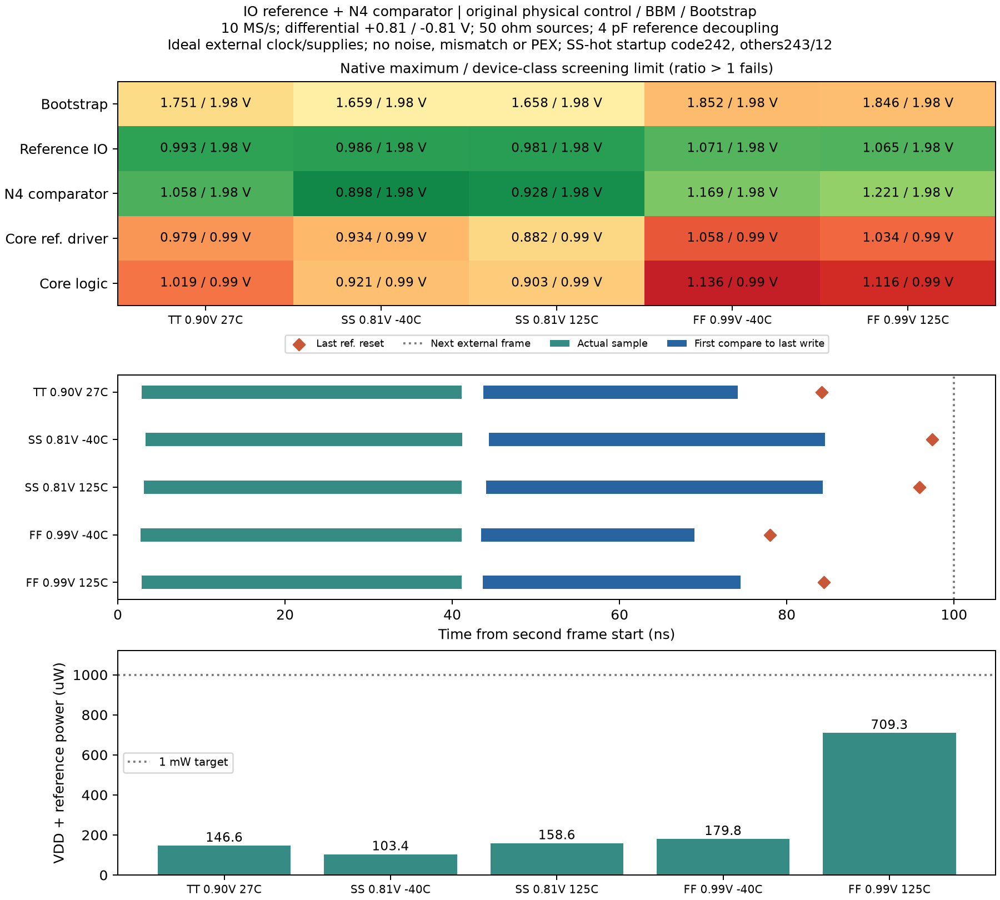

新参考开关、N4 比较器和原 Bootstrap 在这五点都低于各自 1.98 V 筛查线；每个角的 14 个底板建立窗口均通过，最大比较前残差为 0.747 mV。参考复位均在下一轮采样前结束，最紧的是 SS 冷角，最后一位复位约在 197.367 ns。图中时间轴以第二帧起点 100 ns 为零点；复位标记不是完整第三帧验证。

FF 冷/热角分别有 1736/1719 只核心 MOS 的最坏端压超过 0.99 V **至少 1 mV**，不是少数数值舍入越界。主要剩余任务是核心驱动与数字链路的耐压处理，不能只换参考开关后宣布整机合格。热角 0.709 mW 尚低于 1 mW 目标，但这个结果仅对应本次两帧，不是最坏活动模式。

### 比较器接收端的过压

TT 的 8 个超限端压对全部位于 `XCTRL.XTIM.X002/X003.X000`，也就是直接接收 `COMP_P/N` 的两级缓冲中的第一级反相器。最大约 1.01858 V；FF 冷角这个接口达到约 1.13576 V。

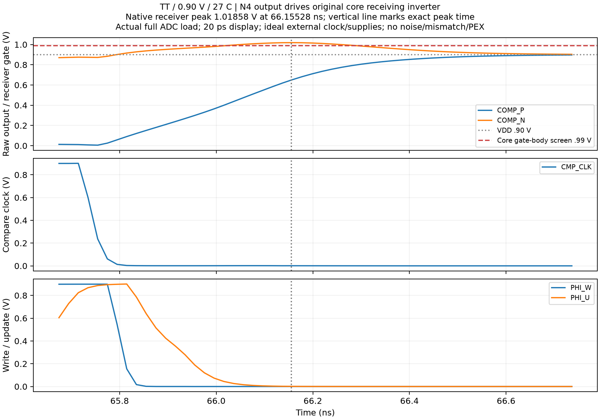

过冲出现在比较器时钟下降、两个输出恢复高电平的复位阶段，而非首次判决瞬间。N4 自身使用耐压管，这个输出对它尚安全；后面直接相连的核心管栅极却不安全。下一对照只将这两个接收反相器的 4 只 MOS 换为普通 IO 管，保持第二级反相器、其他逻辑和采样链路不变，检查应力是否消除以及接收延迟是否挤占复位时间。

PMOS 再生管加倍的单变量对照不采用：SS 冷角末位写入时较高输出从 0.40272 V 变为 0.40156 V，没有改善此时的接口裕量；比较器每帧吸收能量从 0.20885 增至 0.21685 pJ。同样在比较沿后 1.8 ns 观察，输出虽从 0.435 升至 0.466 V，但更晚的恢复不能代替写入时刻的验证。

### 首帧不是正常采样周期

SS 热角首帧在 41.8 ns 保持点已经有 −9.978 mV 误差，首次比较尚未开始。其高输入侧 `VINP=0.855 V`，Bootstrap 栅压从 DC 初态到采样关闭前都约为 **0.763 V**，没有正常自举导通；第二帧经过预充，另一侧栅压约为 **1.657 V**，正常周期保持误差为 +0.283 mV。

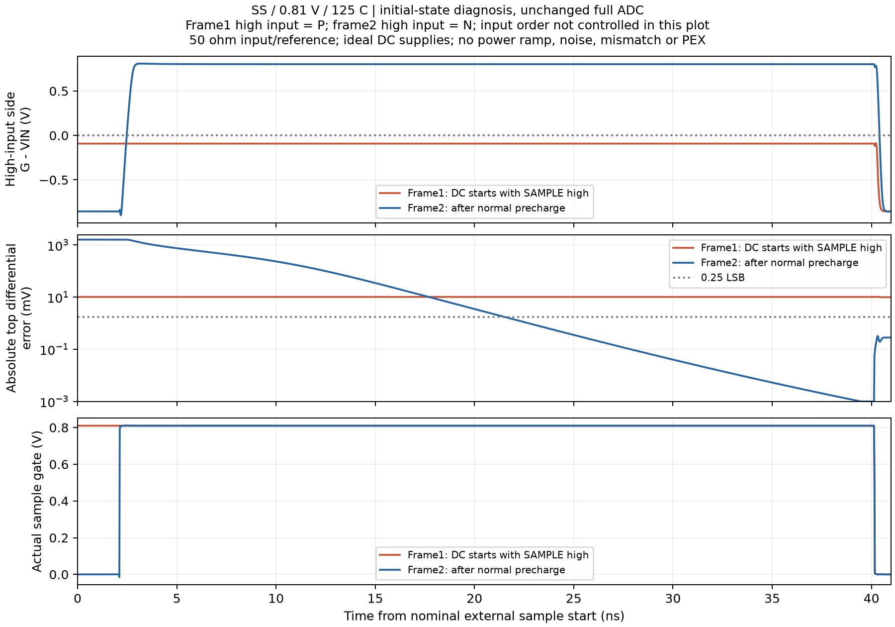

这组测试从采样信号为高的 DC 工作点开始，没有先执行预充低相位，也没有电源爬升。因此不能把首帧固定偏差直接归因于正常导通 Ron，更不能因另一个角首帧恰好正确就认为上电复位合格。

仅交换输入极性的 SS 热角对照已完成：首帧得到 **13，预期 12**，保持误差 **+9.966 mV**；正常预充后的第二帧得到 243，保持误差 −0.283 mV。首帧高输入侧换到 N 侧后，栅压仍约 0.763 V；下一帧 P 侧正常自举到约 1.657 V。两组 DUT 散列完全相同，时钟、供电和阻抗也相同。

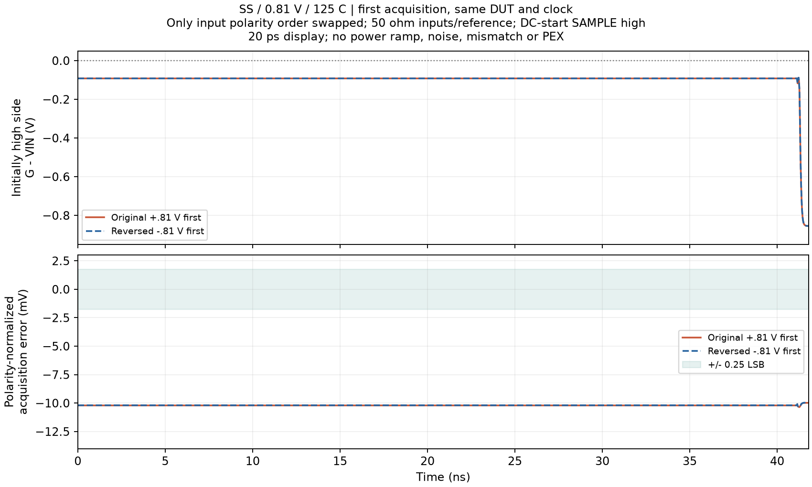

下图将负输入的符号翻转后比较，两条约 −10 mV 曲线几乎重合，支持初始缺少预充而非某一侧专属故障。原生日志保留初始 DC 收敛放宽警告；这仍不是实际电源爬升/POR 验证。启动协议需要明确并验证，不通过丢弃失败码字宣称修复。

本批细节见 `verification/sar8_physical_repair/loaded_pvt_review.json`。三张汇总、接口与启动诊断图已检查；原始波形保持在各 managed SSD 运行目录，未改原 OA。

### 耐压接收级实测

只替换两个接收反相器的四只管：普通 IO，L=150 nm，NMOS/PMOS 总宽度 0.64/1.28 µm；第二级核心反相器及其他电路不变。

**TT 的过压已在本次两帧测试中消除：超限端压对由 8 降为 0。** 两帧仍为 243/12，14 个底板建立窗口通过。第二帧转换从 33.549 增至 34.095 ns，VDD 加参考功耗约 144.880 µW；实际采样沿与窗口基本不变。这仅关闭 TT 的已知接收端问题，不代表 FF 或整机最终通过。

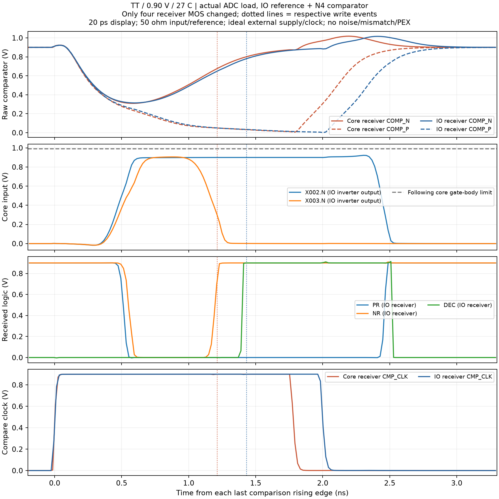

SS 冷角两帧仍为 243/12，全部端压对和 14 个底板建立窗口通过。第二帧转换时间从 44.103 增至 **47.388 ns**；功耗约 103.960 µW。采样关闭沿差小于 0.001 ps，实际采样窗口变化约 −0.0045 ps，没有有意义的窗口压缩。末位写入时比较器原始输出约 0.477/0.040 V，接收后的 NR/PR 为约 0.810/0 V。

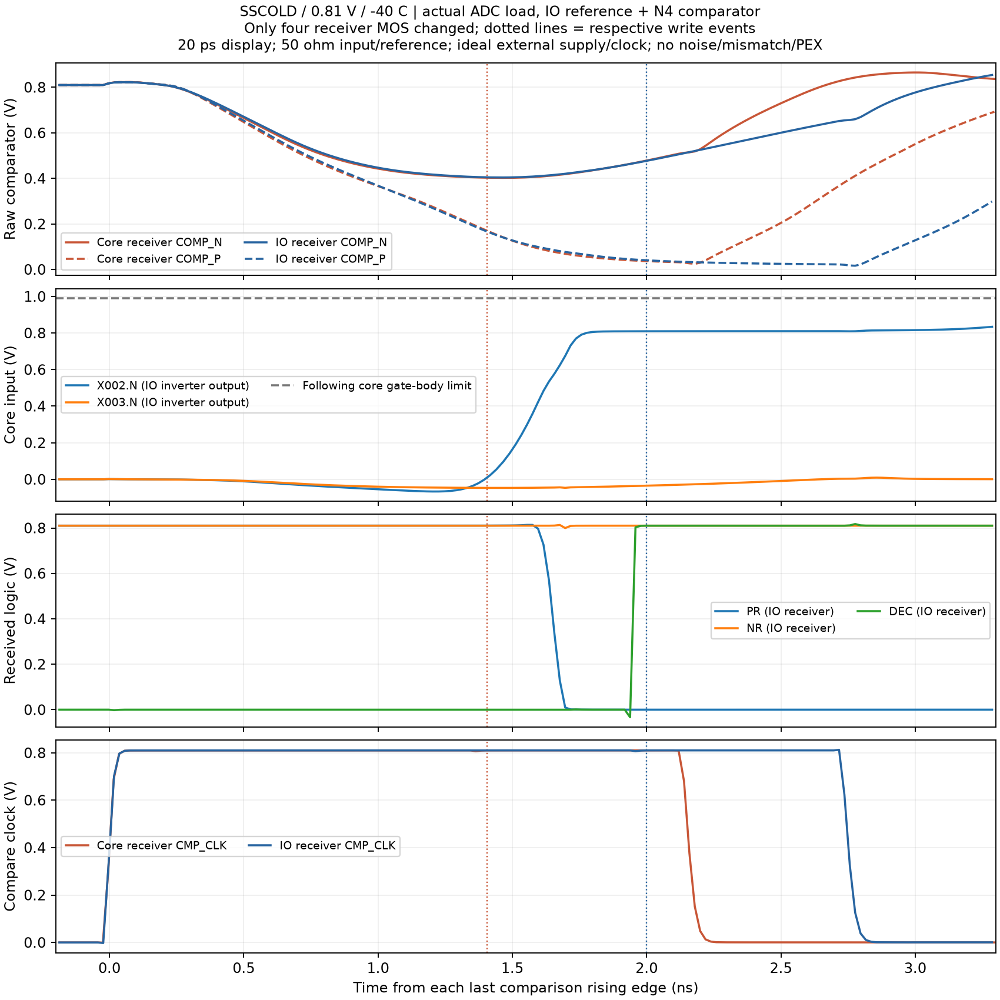

上到下依次是原始比较器输出、IO 反相器输出（接到后级核心管的栅极）、接收逻辑、比较时钟；各自按末位比较沿对齐，竖虚线是各自写入时刻。耐压接口有效，但付出了延迟。

首轮最后一级复位信号在 **100.757 ns** 才拉起，已跨过 100 ns 的帧边界；全部底板约在 101.821 ns 回到固定复位目标，下一次实际采样在 103.322 ns，仍有约 **1.50 ns** 裕量。这里底板建立采用约 20 ps 的绘图波形估计，时钟沿用原生点交越。200 ns 截止无法覆盖第二轮末尾同类过程，因此追加 210 ns 观察，并另测接收级并联数减半；不改采样时钟，不用截止时尚未复位的状态直接宣告通过或失败。

### 后续逻辑器件的耐压依据

独立四管原生告警测试已确认 `nch_18ud12_mac/pch_18ud12_mac` 的六种端压告警门限均为 **1.32 V**，不是普通 IO 的 1.98 V，也不是由名字猜测。该测试刻意施加过高偏压，只用于读取诊断门限，没有接入 ADC；记录见 `verification/sar8_physical_repair/ud12_native_limits.json`。

它提供了后续核心逻辑耐压改造的器件候选，但 SS 冷角 FO4 延迟约 209/127 ps，明显慢于核心管的 34/29 ps。不能直接全部替换后宣称解决；还需保证转换、参考复位、采样沿和功耗。FF 核心逻辑过压、启动协议及完整性能回归仍未关闭。
