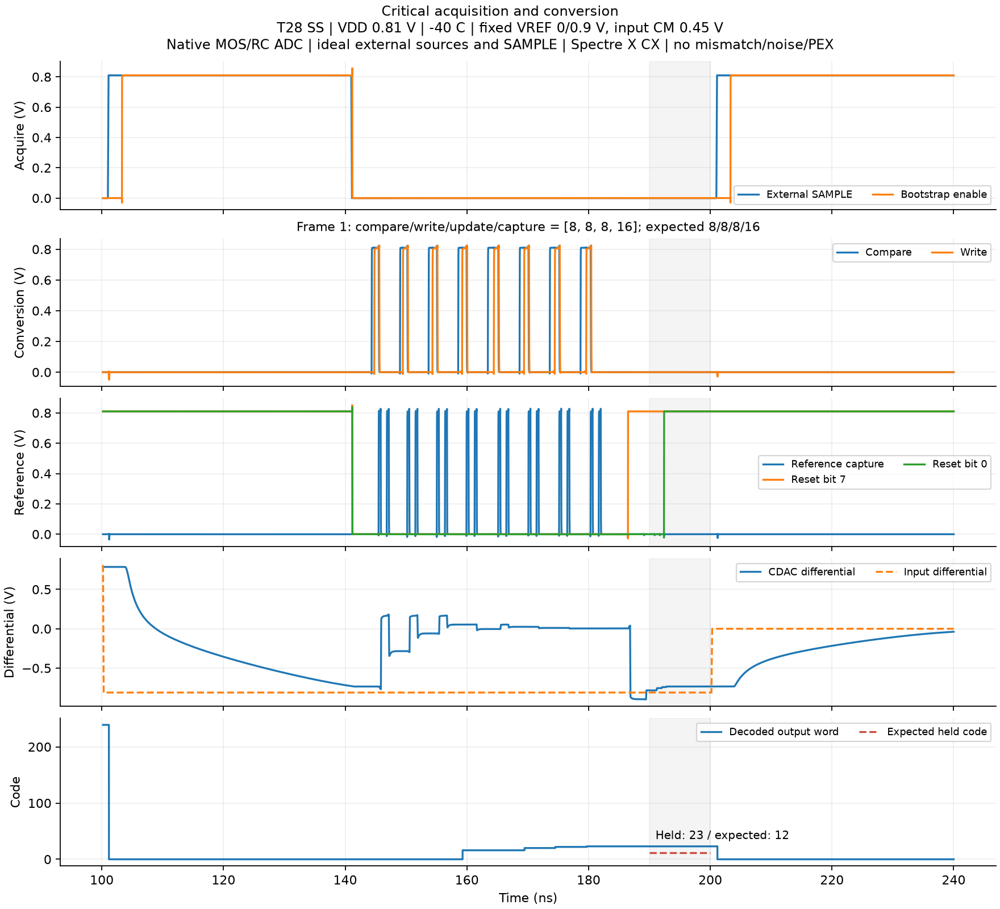
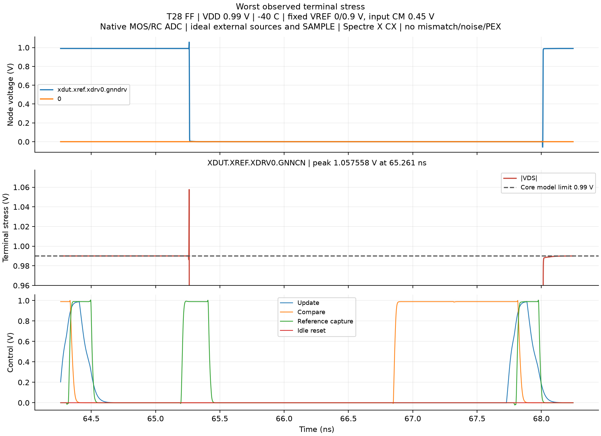

# 8 bit ADC 首批 PVT 风险筛查

五个 MOS PVT 点、10 项短仿真、60 帧全部正常完成。**时序能闭合，但精度和器件应力未通过全部条件；暂不进入版图，也不扩大到完整矩阵。** 电路、尺寸、PDK 和 OA 均未改动。

## 核对与测试条件

冻结空闲段分步复位候选 `027b951`，DUT SHA256 为
`ef0fc74a3df306a366261bd5ce6bbe01f6b4386007c0b86c3150e09c28f976ea`。
StrongARM 连接及尺寸与原基线一致，使用整机真实 MOM 加逻辑负载。
远端实际加载的模型文件及本地/远端网表已做哈希核对。

名义 CDAC 从 18 个倍率器件展开为 512 个独立单元后，4 帧码字与历史版本一致，最大保持差异 17.2 µV（0.00244 LSB）。代表性 nMOS 和独立 MOM 的 4 个种子均有实际电流/电容散布，同种子重复结果一致。这只证明统计激活和名义等价，不是整机失配验收。

- 每角：6 帧静态/翻转，另加 6 帧连续 4.501953125 MHz、−1 dBFS 正弦。
- 静态差分输入：`+0.81, −0.81, 0, +0.25 LSB, −0.25 LSB, 0.123046875 V`；零点允许 127 或 128。
- 固定 VREF=0/0.9 V、输入共模=0.45 V、10 MS/s；SAMPLE 幅度跟随 VDD。获取前完成输入阶跃，采样关闭沿未改。
- MOS 使用 TT/SS/FF；MOM、电阻等保持 TT。不是完整无源角覆盖。
- 外部电源、输入、参考源和 SAMPLE 理想；保留输入每侧 50 Ω、参考每轨 50 Ω/4 pF。ADC 内部为原冻结 MOS/RC 电路。
- 无失配、无瞬态噪声、无 PEX。本次不计算 ENOB、DNL/INL；短正弦码差也不直接当作失真，PVT 会改变采样相位。

## 五点结果

“后续静态”指帧 1–5；启动帧 0 单列，并非偷偷丢弃。
core 峰值取静态与正弦两例中 445 个选定 MOS 的六对端压最大值，其他器件另由全电路原生 CMI 检查。

| MOS / VDD / 温度 | 最长转换 | 最短获取 | 后续静态码 | core 峰值 | CMI |
| --- | ---: | ---: | --- | ---: | --- |
| TT / 0.90 V / 27°C | 30.26 ns | 38.26 ns | 通过本组样点 | 0.97855 V | 无 |
| SS / 0.81 V / −40°C | 41.39 ns | 37.84 ns | 失败，最大偏离 11 码 | 0.97958 V | 无 |
| SS / 0.81 V / 125°C | 35.09 ns | 38.04 ns | 通过本组样点 | 0.92709 V | 无 |
| FF / 0.99 V / −40°C | 26.91 ns | 38.41 ns | 通过本组样点 | 1.05756 V | 有 |
| FF / 0.99 V / 125°C | 28.74 ns | 38.27 ns | 失败，偏离 2 码 | 1.04950 V | 有 |

60 帧均满足 8 比较/8 写入/8 更新/16 捕获，转换小于 60 ns；检查到的分步复位位于最终捕获之后，输出在复位过程中保持。通过这些时序检查不代表采样准确。

五角启动首码相对理想码 243 的偏差依次为 **−2、−4、−2、−1、+2 码**。测试台从 SAMPLE 初始高电平和 DC 工作点启动，并非已经验证的真实上电复位过程。必须明确初始化及首个有效样本的接口要求；不能将此直接等同于硅片上电失效，也不能用暖机后的性能保证首码准确。

## 三个需要处理的问题

### SS 冷角采样未建立

满幅反转至 −0.81 V 后，主开关关闭前 0.2 ns 的差分误差为 **+82.3 mV**；141.8 ns、首次比较之前仍为 **+76.6 mV**，输出 23，理想值为 12。下一帧回到零输入还残留 −31.2 mV，输出 123。

误差在关断前已存在，首先指向大信号获取能力和历史依赖，不应先归咎于关断注入或比较器计时。两侧主开关此时 VGS 约 0.797/0.802 V；具体的导通能力、体效应与寄生贡献仍需分项验证。

图中 CDAC 差分只在获取/比较前保持阶段与输入作直接比较。转换过程中其逐位变化是正常 DAC 操作；灰色区是输出观测窗口，不是模拟采样保持的全部时段。

### FF 高压角端电压超限

原生模型明确报告 core 的 VGS/VGD/VGB/VDS/VBD/VBS 上限为 0.99 V。
FF 冷角的代表峰值为 `XDUT.XREF.XDRV0.GNNCN` 的 VDS：**65.261 ns 时 1.05756 V**，发生在逐位转换中，并非空闲段复位。
采样时钟缓冲在约 41 ns 也有超限；比较器和数字时序节点同样涉及，不能只修改参考复位来解决。

core 全时间步筛查与原生 CMI 都显示风险。FF 日志的全类别 suppressed warning 总数达到百万级，不等于同样数量的独立故障，也不能用可见的几十条 CMI 当作总数。IO 仍用历史 1.98 V 筛查线，本组观测最大约 1.85819 V；这不是 foundry 可靠性签核。

### FF 高温有转换精度偏差

同样输入 −0.81 V，关断前仅约 **0.45 µV** 差分误差，141.8 ns 保持误差约 **+0.256 mV**，但输出为 **10 而非 12**。采样已基本建立，仍不能排除参考/CDAC 实际步长、转换阶段电荷误差或比较器判决偏差。该问题与 SS 冷角获取不足分开定位，不提前指定单一根因。

## 求解精度与数据边界

首批 CX 日志实际生效：reltol=1e-4、vabstol=1 µV、iabstol=1 pA、maxstep=6 ns、gear2only；不是网表请求的 10 ps maxstep。时序和应力均使用原生自适应样本，未用 1 ns 抽点证明峰值。

两个额外的 200 ns/reltol=1e-7 全节点复核因存储增长超预估而主动停止，原始部分波形保留，不能计为完整通过。替代的前 80 ns 复核均正常结束，仅保存 5 个代表 MOS 及控制节点，不替代完整帧或全器件验收。

替代复核使用 `preset_override`；全局请求 reltol=1e-6，conservative 瞬态实际采用 **1e-7**，maxstep=10 ps、vabstol=10 nV、iabstol=100 fA。冷/热角原代表端压分别为 **1.057992/1.049920 V**，相对 CX 筛查增加 **0.434/0.423 mV**，两角仍有原生 CMI。收紧求解精度未消除过压；这也不是两种设置等精度的速度比较。

完整 PSF 留在远端任务目录，本地只回收无抽点时序、所有选定端压极值、各组最坏事件窗口和日志。未删除已有原始数据，未覆盖 R4 或 TT 最终性能基线。

本轮新增数据：远端约 **16.78 GiB**、本地约 **0.69 GiB**，包含主动停止的复核原始记录，低于计划的 20/5 GiB 上限。远端路径为 `/tmp/virtuoso_bridge_chenzc_intern25/90590/sar8_pvt_mismatch_20261024`；这是临时仿真目录，不是长期归档，后续清理前应另行归档需要保留的原始 PSF。

## 下一步

1. SS 冷角：固定本次反转激励，分查 Bootstrap 大信号充放电和 CDAC 负载，先解决关断前的建立残差。
2. FF 高压角：按驱动节点和工作相位定位过冲，检查所有受影响的 core 端压，而非只看参考开关。
3. FF 高温：逐 bit 对照实际 CDAC 差分、参考电压及比较器决策，定位采准但输出码偏离的环节。
4. 明确启动有效码约定；修正后重跑同一短批次，再决定其余 PVT、失配和长性能验证。原比较器失配风险尚未重新定量。

数据入口：[汇总](../verification/sar8_pvt_mismatch/results.json)、[版本与模型](../verification/sar8_pvt_mismatch/audit.json)、[测试配置](../verification/sar8_pvt_mismatch/setup.json)、[网表身份核对](../verification/sar8_pvt_mismatch/provenance.json)。
脚本：`scripts/sar8_pvt_mismatch/`；本地证据：`output/sar8_pvt_mismatch/`。
