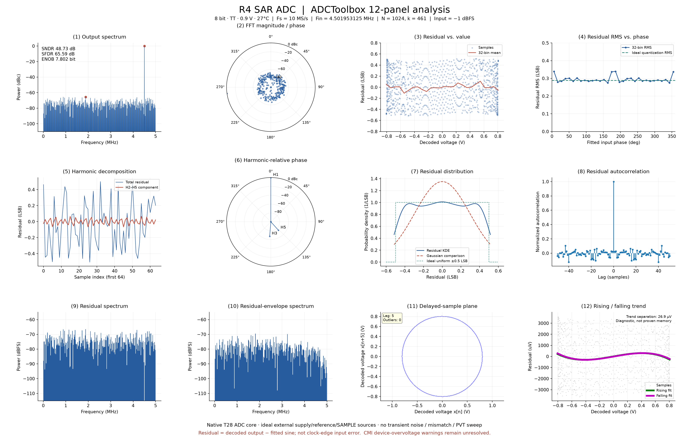

# R4：ADCToolbox 12-panel 分析

使用已经验证的 **1024 个连续正弦输出码**，没有重新仿真、调整电路或校准码字。
按 ADCToolbox 0.9.1 的 3×4 dashboard 分析结构调用库内算法，统一坐标、图例和归一化。

## 测试条件与计算口径

- R4 原生 T28 管级 ADC；TT、0.9 V、27°C，8 bit，10 MS/s。
- 输入 −1 dBFS，4.501953125 MHz；1024 点包含 461 个整周期。
- 外部电源、参考源、SAMPLE 为理想激励；输入每侧 50 Ω，参考每轨 50 Ω＋4 pF。
- 无瞬态噪声、失配或 PVT 扫描。参考开关 CMI 过压仍未解决。
- 码字映射：`V = −0.9 + (code + 0.5) × 1.8/256`，1 LSB = 7.03125 mV。
- FFT：矩形窗，去 DC，不合并邻近 bin；H2–H5 按混叠位置计入 THD。
  SNR 使用库的 `nf_method=3`，从总残差功率中排除这些谐波，不使用默认噪底估计。
- 残差：输出减去固定频率的最小二乘正弦，允许拟合幅度、相位和 DC。
  它不是输入在 SAMPLE 50% 边沿处与输出的直接差，也不包含被拟合吸收的固定相移/增益/偏置。
  第 12 图保留库内自动频率微调，作为独立趋势诊断，不用于主指标。

原生 dashboard 默认 Hann 窗、PDF 从信号摆幅推算 LSB，残差谱还可能自归一化；
本图明确改为相干 FFT、实际 1.8 V 满量程及统一 ADC dBFS。
第 9/10 图用同一正弦拟合残差及 Hilbert 包络方法，以矩形 FFT 展示；包络去 DC。
没有修改已安装的库。

## 指标

| 指标 | 本次结果 | 含义 |
| --- | --- | --- |
| SNDR | **48.729 dB** | 基波相对全部非 DC、非基波功率，包含失真 |
| ENOB | **7.802 bit** | `(SNDR−1.76)/6.02`，未做满幅补偿 |
| SNR，排除 H2–H5 | **48.799 dB** | 剩余项仍含量化误差和未排除的杂散，不等于热噪声 SNR |
| SFDR | **65.593 dB** | 基波与最大单根杂散之比；杂散位于 1.884766 MHz |
| THD，H2–H5 | **−66.658 dBc** | 四个谐波的合计功率相对基波 |
| H3 / H5 | −67.447 / −74.457 dBc | 三次、五次谐波，均在混叠后的频点测量 |
| 拟合残差 RMS | **2.0754 mV = 0.29517 LSB** | 包含量化误差、失真及其他确定性误差 |
| 理想量化 RMS 基准 | 2.0297 mV = 0.28868 LSB | `LSB/√12`，均匀量化误差近似，不是本记录的逐码预测 |
| 残差最大绝对值 | 0.51562 LSB | 相对于拟合正弦，不是静态 INL |
| H2–H5 分量 RMS | 0.2634 mV | 从记录中拟合提取的低阶谐波合成分量 |

H2/H4 接近数值底，库返回的约 −149 dBc 不作为可信的物理失真指标。
“noise floor” 在该库中是积分剩余功率；不把它与图上单个 FFT bin 的高度混为一谈，
也不将其换算的 NSD 宣称为器件热噪声密度。

## 从上到下、从左到右读图

| 图 | 看什么 | 本次观察与边界 |
| --- | --- | --- |
| 1 输出频谱 | 动态性能主判据 | 与之前的独立 FFT 一致，SNDR 48.729 dB |
| 2 FFT 幅相 | 各频点幅度和记录相位 | 诊断视角；其角度不是电路延迟测量 |
| 3 残差随幅度 | 均值是否呈系统弯曲 | 残差约 ±0.5 LSB，32 箱均值有小幅起伏；不是静态 INL |
| 4 残差随相位 | 某些相位是否误差增大 | 大部分接近量化 RMS；局部有起伏，不能据此归因为 jitter |
| 5 时域谐波分解 | 低阶谐波与总残差大小 | H2–H5 分量明显小于总残差；画出前 64 个采样点 |
| 6 谐波相位 | 谐波大小及相对基波的相位 | H3 高于 H5；低于 −100 dBc 的项不显示 |
| 7 残差分布 | 均匀还是高斯形状 | 更接近均匀量化分布，而非高斯热噪声；KDE 边缘有平滑扩展 |
| 8 自相关 | 是否有重复/相关结构 | 非零延迟最大绝对相关约 0.125，不能宣称完全白噪声 |
| 9 残差谱 | 去基波后还剩什么 | 保留量化谱线和小杂散，纵轴仍相对 ADC 满量程 |
| 10 残差包络谱 | 误差幅度有无周期变化 | 是幅度调制诊断，不单独生成 ADC 的 ENOB/SNR |
| 11 延迟采样平面 | 输出是否有明显离群点 | 库选 lag=5，未检出离群点；不是模拟电压-导数相平面 |
| 12 上升/下降趋势 | 两个方向的残差趋势是否分离 | 拟合曲线平均间距约 26.9 µV；不能据此证明或排除电路记忆效应 |

每箱数据有限，32 箱是展示折中。AM/PM 分解的箱级拟合 R² 仅约 0.145，
因此不报告为真实 AM 噪声或 jitter 数值。本次数据也不适合用正弦码密度替代已完成的全码静态扫描。
静态 DNL ±0.02344 LSB、端点 INL 最大 0.02103 LSB 仍以
[独立转换边界扫描](sar8_r4_performance.md)为准。

## 结论

**该标称工况下，输出码动态误差接近理想 8-bit 量化水平，低阶谐波不是主要限制。**
残差 RMS 比均匀量化近似高约 2.25%；这不等于已经分离出额外电路噪声。
−1 dBFS 时理想量化 SNDR 估计约 48.92 dB，因此 7.802 bit 不能简单解释为电路丢了 0.198 bit。

这是一份性能诊断，不是整机合格报告：参考开关过压、噪声、PVT、失配和版图验证仍未闭环。
本次正弦数据有原生瞬态 PASS、完整 1024 点及逐帧核对，但整个进程的最终退出摘要缺失；
保留这一证据边界，不因图好看而抹去原始运行异常。

复现：项目 Python 运行 `scripts/sar8_r4_performance/toolbox_panel.py`。
数值与源数据哈希：`verification/sar8_r4_performance/toolbox_panel.json`。
已核对原 FFT 的 SNDR/SFDR、去谐波 SNR、残差 Parseval 功率、LSB 归一化和分解重构。
