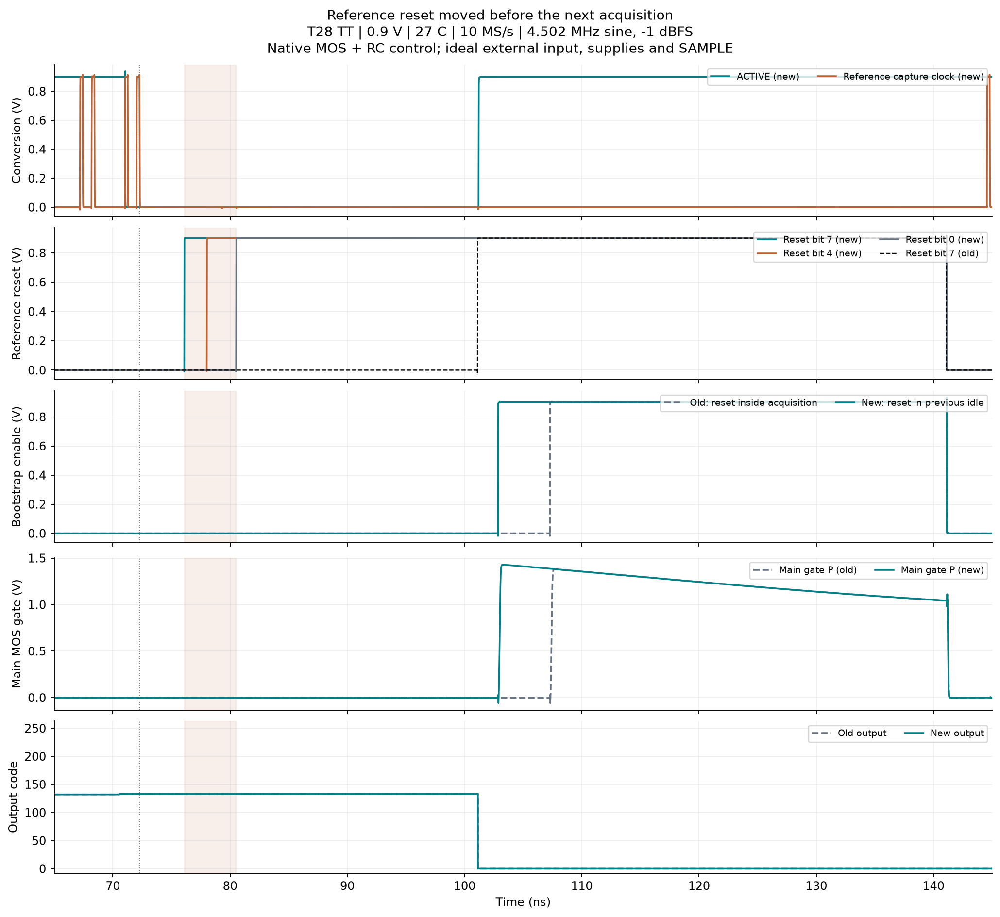
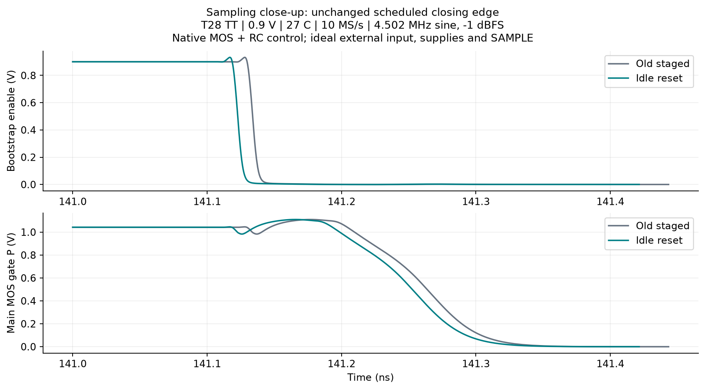
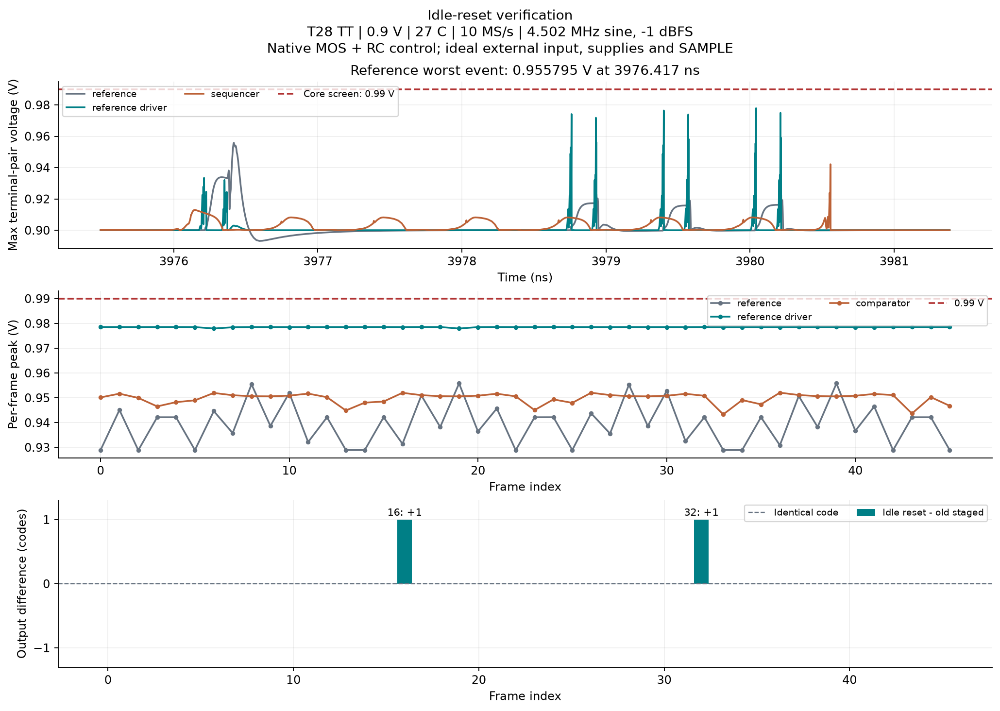

# R4：把参考分步复位移到转换后的空闲段

**本轮名义条件验证通过。** 参考分步复位移到约 76.1–80.7 ns，采样控制
窗口由 33.848 ns 恢复为至少 **38.262 ns**。没有重新安排关闭相位，但
实测控制下降沿最多提前 **11.094 ps**，不是数学上的零偏移。
4.6 µs、46 帧独立功能/时序检查通过，参考最大端电压 **0.955795 V**，
无 CMI；严格 200 ns 复核通过。保留为候选，不替换 R4。

## 改了什么

保留高位先、P/N 成对的八步参考复位，CDAC、Bootstrap、比较器、3x
参考通过管及原参考驱动尺寸不变。新增原生逻辑从 SAR `ACTIVE` 低电平
识别转换结束，经 RC 延时后发起参考预复位；复位保持到下一轮采样结束。
延时是名义保护时间，不是模拟建立完成检测，仍需后续 PVT 验证。

只提前参考存储寄存器的复位。SAR 数据寄存器仍由原 SAMPLE 复位，因此
上一轮数字结果在参考预复位期间保持有效，不需要为了这次实验新增输出库。
原来已有的“下一轮 SAMPLE 开始后清零输出”行为不变；外部仍须在有效窗口取数。

Bootstrap 采样控制不再等待当轮末级参考复位。单独复制原下降路径的
AND、buffer 与开启延时，恢复约 38.29 ns 的采样窗口，同时不更改外部
SAMPLE 及转换启动相位。晶体管负载变化带来约 11 ps 的实测偏移，不能
表述为波形数学上完全重合，也不能把控制沿直接等同于有效采样孔径。

全部新增控制是 T28 原生 MOS/电阻/MOM，没有新增理想时钟或行为级驱动。
外部 SAMPLE、电源和正弦源仍理想。只改独立网表候选，未修改 Virtuoso OA。

## 短测时序

第一轮转换到第二轮采样的实测时间如下。表中的绝对时间从仿真起点算起。

| 事件 | 时间 |
| --- | ---: |
| 末次参考捕获下降沿 | 72.282 ns |
| bit7 参考复位 | 76.097 ns |
| bit0 参考复位 | 80.522 ns |
| 下一轮 Bootstrap 开启 | 102.861 ns |
| 下一轮 Bootstrap 关闭 | 141.123 ns |

复位开始距最后一次捕获约 3.816 ns；完成到下一次采样开启约 22.34 ns。
参考字已恢复 128，再开始采样；原输出码在整个预复位期间不变。
启动帧没有“上一轮空闲段”，由 DC 初始化开始，但没有从功能/应力检查中剔除。

阴影标记新方案八步复位区间，竖虚线为末次参考捕获结束。图底部输出在
约 101 ns 清零是原下一轮采样初始化，不是提前复位参考导致输出丢失。

## 验证条件与短测结果

T28 TT、0.9 V、27 °C，10 MS/s；连续 4.501953125 MHz、−1 dBFS 正弦。
输入每侧 50 Ω，参考每轨 50 Ω + 4 pF。没有瞬态噪声、失配或版图寄生。
6 帧码字为 `133, 46, 181, 108, 112, 177`，与 A、原高位分步方案及
冻结 R4 同索引一致。每帧独立检查 8 次比较、8 次写入、8 次更新、16 次
捕获，复位顺序、前后保护时间、码字保持和 H/L 逻辑非交叠均通过。
沿用原测试的前四帧预热约定；预热帧仍计入时序与应力检查，但不把这六帧
当作动态性能测试，码字相同也不代表已验证 SNDR/ENOB。

| 选定器件组 | 普通 600 ns | 普通 4.6 µs | 严格 200 ns | 筛查线 |
| --- | ---: | ---: | ---: | ---: |
| 参考通过管 | 0.945082 V | 0.955795 V | 0.945141 V | 0.99 V |
| 参考驱动 | 0.978546 V | 0.978547 V | 0.979260 V | 0.99 V |
| 比较器 | 0.951655 V | 0.952065 V | 0.951718 V | 0.99 V |
| 复位/采样时序 | 0.959576 V | 0.959576 V | 0.960643 V | 0.99 V |
| Bootstrap IO | 1.735264 V | 1.751946 V | 1.670955 V | 1.98 V |

不同持续时间覆盖不同输入相位，不能用短窗较低峰值声称器件应力改善。

共 445 只选定 MOS，每只检查六种端对；其他数字内部器件仍依赖原生 CMI，
不是全芯片可靠性认证。普通 600 ns 的参考最坏点为 P bit6 PMOS 的 Vgb，出现在
176.498 ns，即新的空闲段复位时刻。参考驱动余量仍只有约 11.45 mV。

Spectre 21.1 X CX、4 线程；短测日志实际 maxstep=6 ns、reltol=1e-4、
vabstol=1 µV、iabstol=1 pA、gear2only。保存全部原生自适应点，不只保存
1 ns strobes；CX 覆盖了请求的部分容差，不能将其称为等精度加速。

## 严格容差复核

200 ns 共保存 324663 点，2 帧原生记录与独立解码一致，均为 `133, 46`。
复位顺序、末次捕获保护、输出保持、采样窗口以及 445 只选定 MOS 应力
均通过，无 CMI。实际设置是 10 ps、reltol=1e-7、vabstol=10 nV、
iabstol=100 fA；并非只有网表请求，而是原生日志确认。

参考峰值为 0.945141 V @ 176.483499 ns，与普通短测相差约 0.060 mV。
参考驱动峰值 0.979260 V，剩余 10.740 mV；比较器 0.951718 V，新增/
原有时序 0.960643 V。严格测试覆盖了普通 600 ns 的参考最坏复位事件，
不等于完整 4.6 µs 的严格验证。原始 4.25 GB PSF 下载后 SHA256 与远端一致。

## 连续 46 帧重放

原生仿真完成 4.6 µs、46 帧，零错误、无 CMI，每帧原生监测有效。完整
9.72 GB PSF 已下载并与远端 SHA256 一致，741399 个保存点已独立核对：
46 帧均满足 8/8/8/16 次时序、输出稳定与空闲段复位检查，45 个启动后
采样窗口均恢复，445 只选定 MOS 的六种端对全程通过。

复位开始距最后一次参考捕获至少 3.815 ns；每次下一轮采样前参考字都已
为 128，首次比较前各位复位均已释放。输出保持检查延续到下一次 SAMPLE
上升前 50 ps（最后一帧到记录结束），没有被提前的参考复位清掉。

参考最坏点为 **P bit5 PMOS 的 Vgb=0.955795 V @ 3976.416832 ns**，
位于空闲段的分步复位，剩余 34.205 mV。该长程最坏事件没有做同条件
严格重放；200 ns 严格结果不能替代它。普通长测实际 maxstep=46 ns，
其余有效容差同普通短测；保留所有原生自适应点，不宣称等精度加速。

相对上一版高位先分步复位，索引 16：205→206，索引 32：70→71；其余
44 帧相同。这两帧的新码与 A 对照一致。不能表述为逐位完全不变，也不能
从 46 帧推出静态无失码或频谱性能不变。
相对 A，另有索引 13、26 各 +1 码；相对冻结 R4 是索引 9、13、26 各
+1 码、索引 36 −1 码。三种对照不是同一个版本，详细数值分别保存。

在相同的帧内 41.8 ns、首次比较前，原生被动监测记录的顶板差分电压变化
分别为 +0.182895 mV、+0.217379 mV，约 0.026、0.031 LSB。这与边界附近
的量化翻码相容，不等于模拟保持误差增加了整整 1 LSB；但这不是对原因的
唯一归因，尚未拆分窗口长度、关闭沿微移和初始化历史各自的贡献。

## 边界与文件

这验证的是把初始化挪到空闲段能否恢复窗口、保持数字结果并控制端电压。
预复位后 CDAC 不再保持本轮最终 SAR 残差；若在 98 ns 观察顶板模拟电压，
它已经属于下一轮初始化状态，不能再用它判断本轮量化残差。输出码仍有效。
新候选尚未重新跑全码/1024 点频谱，不能沿用 R4 的 SNDR/ENOB。

- 候选定义：`netlist/sar8_r4_idle/idle_cells.scs`，依赖冻结 R4 叶单元。
- 复现与分析：`scripts/sar8_r4_idle/`。
- 数值与来源：`verification/sar8_r4_idle/results.json`。
- 原生网表、日志、PSF 与波形：`output/sar8_r4_idle/<case>/`，本地保留不入 Git。
