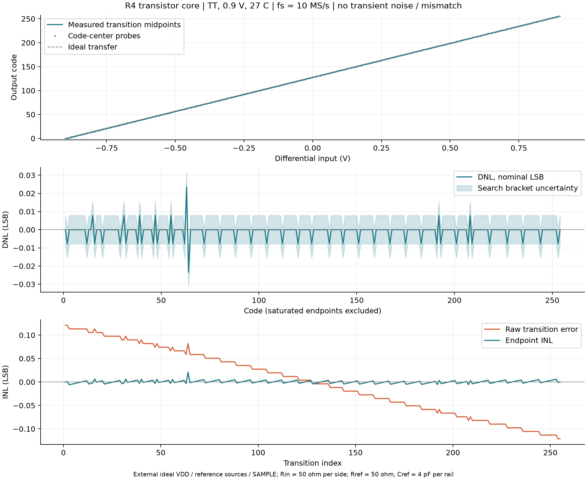
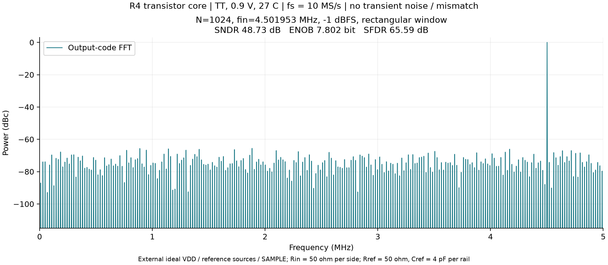
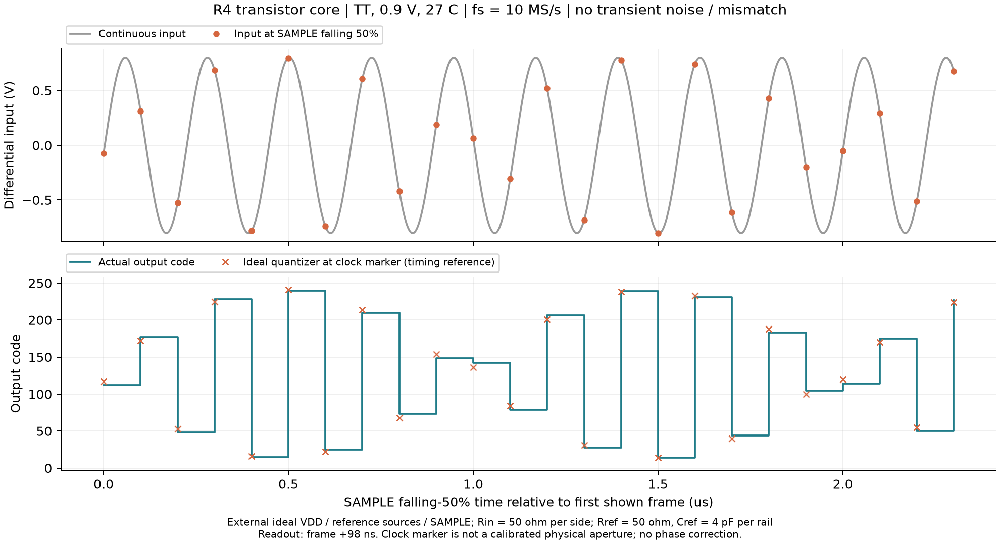

# R4 全码扫描与正弦频谱

保持 `sar_adc8_join_r4` 的器件、连接和全部 MOS 参数不变。
测试条件：TT、0.9 V、27°C、10 MS/s；无瞬态噪声、无失配。
电源、参考源和外部 SAMPLE 为理想测试台源；输入每侧 50 Ω，参考每轨 50 Ω＋4 pF。

| 指标 | 实测 |
| --- | --- |
| 观察到的输出码 | 256/256 |
| 转换边界 / 码中心 | 255/255 / 256/256 |
| DNL，标称 LSB | -0.02344 至 0.02344 LSB |
| 最大原始转换边界偏差 | 0.12109 LSB |
| 最大端点 INL | 0.02103 LSB |
| 最大边界搜索区间 | 0.007813 LSB |
| SNDR / ENOB | 48.729 dB / 7.8021 bit |
| SFDR | 65.593 dB |
| 逐帧时序完整性 | 通过 |

器件应力告警涉及的测试：static_cx_033_064_r2, static_cx_065_096, static_cx_097_128_r2, sine_cx_1024_k461。
因此该版本尚未通过器件应力要求；频谱/线性度数值保留为性能诊断，不能据此宣布整机通过。

长跑采用 Spectre X CX。默认预设会重定义部分网表精度设置；每次运行的实际
reltol、积分方法和最大步长均从原生日志读取并保存在结果中。
与严格 APS 的短例对照用于评估数值偏差；速度比较不是等容差比较。

静态测试使用真实输出反馈二分搜索全部 255 个转换边界，并检查全部码中心。
DNL 排除两端饱和码的宽度；同时列出未经增益/偏置修正的转换偏差和端点 INL。
测试要求全部初始搜索区间有效：True。
所有码中心均返回预期码：True；本次总计验证 3618 帧（含预热）。
边界区间宽度约 0.0078125 LSB，因此图中的细小锯齿部分受搜索分辨率限制，
不能据此解释为同量级的真实器件非线性。原始边界偏差主要呈斜率变化，
端点增益误差约 -0.09535%；这不等同于已定位到某一个模块。

动态测试为连续 −1 dBFS 正弦，1024 点，fin=4501953.125000 Hz。
矩形窗相干 FFT，去除 DC，SNDR 包含谐波；ENOB=(SNDR−1.76)/6.02，
不做满幅补偿或码字校准。直接 FFT 与 ADCToolbox 交叉核对。
−1 dBFS 下理想 8 bit 的量化信噪比估计约 48.92 dB；本次 7.802 bit
是未作满幅补偿的 ENOB，不应直接理解为丢失了 0.198 bit 的电路精度。

码字按内部 SAMPLE 下降沿的 50% 时刻标注，实际读出位于每帧 98 ns。
该时钟标记不是经校准的物理孔径；理想量化码仅作时序参照，其与输出的逐点差异
混合了采样路径相移和转换误差，不能全部称为保持误差。FFT 未做相位/增益校准。
每个有效帧检查 8 次比较、8 次写入、8 次 UPDATE、16 次参考捕获，
并检查 90–98 ns 输出稳定性及读出电平。
全部案例未发现瞬态 LTE 放宽/收敛失败诊断；`static_cx_161_192_r2` 有初始 DC
求解容差放宽记录，保留在结果中，不将其混写为瞬态失败或隐去。

原始结果在 `output/sar8_r4_performance/`，完整数值、有效求解器设置、告警和哈希
在 `verification/sar8_r4_performance/results.json`。长测试使用稀疏保存，
不能据此宣称全部内部节点峰值应力通过。PVT、失配、噪声和版图仍未覆盖。
首个参考过压已另行高分辨率定位于采样启动/参考码复位交叠，见
[参考开关过压诊断](sar8_r4_reference_stress.md)。未因此修改本次冻结电路。

本批次曾发生 SSH 中断。正弦及第一段静态数据从原任务回收，以原生
`logStatus PASS`、完整帧数、PSF 结束标记和完整时长确认分析完成；原始 bridge
失败记录保留，未伪造进程退出码。正弦缺少整个进程的最终零错误摘要，
但原生瞬态 PASS 和全部 1024 点已验证。其余恢复案例、原案例映射及退出码
见 `output/sar8_r4_performance/recovery_20261022_r2.json` 和逐案例 recovery 字段。
