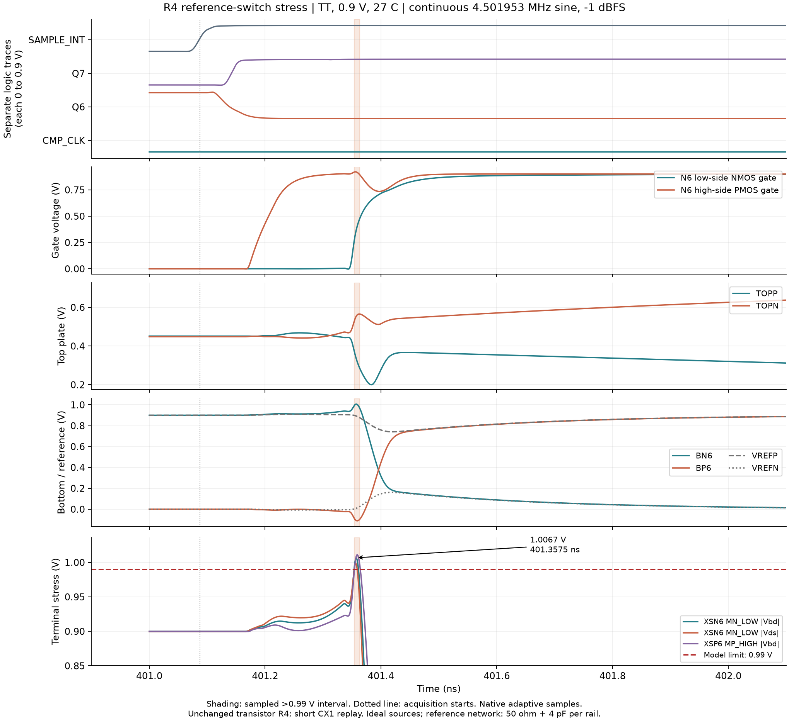
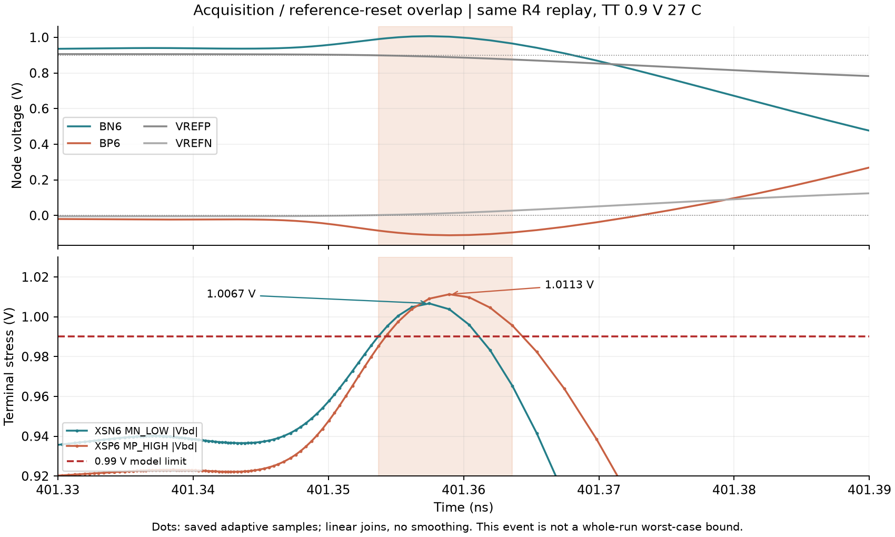

# R4 参考开关过压：采样启动与参考码复位交叠

## 结论

首次告警位于约 **401.354 ns**，是新一帧采样启动后、参考码复位换轨时的底板越轨，
不是比较器判决阶段。负侧 bit 6 底板 `BN6` 冲到 **1.0067 V**，正侧 `BP6`
下冲到 **−0.1113 V**，使 0.9 V 核心参考开关的体漏/漏源电压超过模型 **0.99 V** 限值。
不能因为输出码正确而判定电路可靠性合格；也不能把此告警等同于已经发生器件击穿。

测试：冻结 `sar_adc8_join_r4` 网表，T28 TT、0.9 V、27°C，10 MS/s，
连续 4.501953125 MHz、−1 dBFS 正弦。内部电路为晶体管级；外部输入、采样时钟、
电源为理想源，参考源经过每轨 50 Ω / 4 pF 网络。无瞬态噪声、失配或版图寄生。

## 哪个器件、哪个端点

以下器件位于 `XDUT.XCDAC`，bit 编号从 0 开始；bit 6 为 64 权重。

| 器件 | D / G / S / B | 本窗口峰值 | 时间 |
|---|---|---:|---:|
| `XSN6.MN_LOW` | BN6 / GNN6 / VREFN / VSS | \|Vbd\| = 1.006685 V | 401.357459 ns |
| 同上 | 同上 | \|Vds\| = 0.998577 V | 401.356180 ns |
| `XSP6.MP_HIGH` | BP6 / GPP6 / VREFP / VDD | \|Vbd\| = 1.011292 V | 401.358945 ns |
| 同上 | 同上 | \|Vds\| = 1.001442 V | 401.357459 ns |

`MN_LOW` 为 `nch_mac`，`MP_HIGH` 为 `pch_mac`，L = 30 nm，bit 6 multi = 192。
这些是参考开关，不是 Bootstrap 内的 1.8 V IO 管。

在 BN6 峰值处，VREFP = 0.89237 V、VREFN = 0.00908 V、VDD = 0.9 V。
因此不是参考源自己升到了 1 V：**电容底板超出了供电轨**。
此处 BN6 对固定地衬底的应力大于对略抬高 VREFN 的应力。
同理 BP6 负向下冲，使接 0.9 V 阱的 PMOS 承受超过 1 V 的体漏电压。

## 时序与机理

1. **401.087 ns：采样开始。** `SAMPLE_INT` 上升，同时启动 Bootstrap 采样路径与参考码复位。
   上一帧输出为 108 (`01101100`)，参考寄存器回到 128 (`10000000`)；不是逐次逼近时的一位更新。
2. **401.136–401.143 ns：参考位复位。** Q6 下降、Q7 上升。
   bit 6 从 BN6 接高参考、BP6 接低参考，切换到相反状态。
3. **约 401.20–401.36 ns：参考开关交接。** N6 高侧 PMOS 栅极 GNP6 先升高关断，
   低侧 NMOS 栅极 GNN6 延后升高；两栅的 50% 时刻分别为 401.20165 和 401.36162 ns。
   这只是时序标记，不应当作精确导通阈值或死区宽度。
4. **401.354–401.364 ns：底板短暂越轨。** 此时顶板也快速运动，参考栅正在换态，
   新参考通路尚未把底板牢固拉到目标轨。BN6 先冲高再拉低，BP6 先下冲再拉高。
   `CMP_CLK` 与 `CAP_CLK` 均为低，无比较/更新边沿。
5. **之后：重新钳到目标参考并建立。** 401.6 ns 的 BN6 ≈ 0.0888 V、BP6 ≈ 0.8136 V，
   分别接近当时受负载扰动的 VREFN ≈ 0.0870 V、VREFP ≈ 0.8152 V。

与波形相符的解释是：**参考交接的高阻/弱约束窗口与顶板运动、栅极跳变重叠，
电容耦合和开关注入使底板瞬时越轨，随后新参考通路将其拉回。**
目前已定位阶段与端点，但尚未通过单变量对照分离 CDAC 顶板耦合、参考栅馈通、
多位复位和 Bootstrap 开通各自贡献；不把其中任意一项宣称为已证明的唯一原因。

## 证据与边界

- 原 1024 点长仿真记录首个 CMI 告警约 401.354 ns；原有 1 ns strobe 不足以显示尖峰。
  本图来自同一输入历史、同一 DUT 从 0 跑到 450 ns 的独立短重放，并非从稀疏原图插值猜峰值。
- Spectre X CX / 1 线程，原生日志完整结束：0 errors、18 warnings；其中 CMI 未消除。
  前四帧输出 133 / 46 / 181 / 108，与长仿真一致；DUT 文本与哈希校验通过。
- 保存 398–450 ns 的 4004 个原生自适应样本。峰值前后 25 ps 内最大保存间隔 3.248 ps。
  超限样本区间：NMOS Vbd 为 401.353720–401.360422 ns；PMOS Vbd 为
  401.354368–401.363609 ns。不是严格插值后的持续时间，也未作步长收敛证明。
- 实际 reltol = 1e-4、vabstol = 1 µV、iabstol = 1 pA、gear2only、sigglobal。
  CX 未采用请求的 10 ps maxstep，日志实际为 4.5 ns；事件附近自适应细化至皮秒。
  短 stop 和线程数不同，不宣称与生产长跑的数值轨迹完全一致，也不作速度比较。
- 本图不是整个 1024 点过程的最坏应力包络。原日志还涉及 bit 5，以及后续约 2.5014 µs、
  4.5014 µs 的 bit 1–3 栅体过压；后者没有被这次 450 ns 重放覆盖，仍待单独定位。
- 脚本：`scripts/sar8_r4_refstress/`；数值与哈希：`verification/sar8_r4_refstress/results.json`；
  原始证据：`output/sar8_r4_refstress/replay01/`。未修改电路、OA、PDK 或正在执行的静态批次。

下一项建议实验：保持尺寸不变，将“参考复位完成”和“Bootstrap 采样导通”错开，
与原时序逐项比较底板越轨、参考栅应力和获取时间；本次仅诊断，未实施时序修复。
