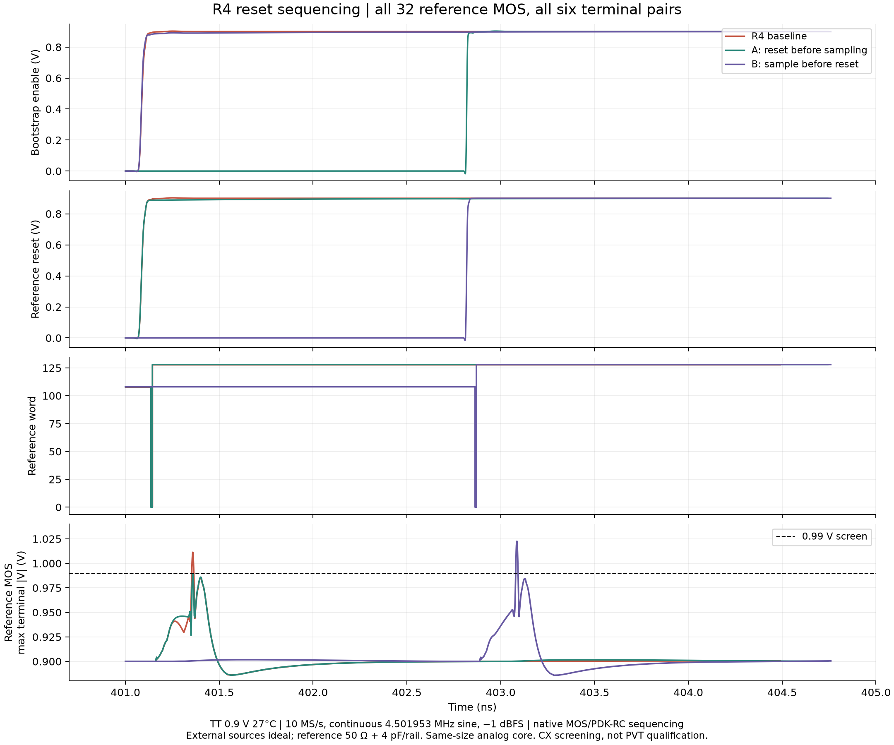
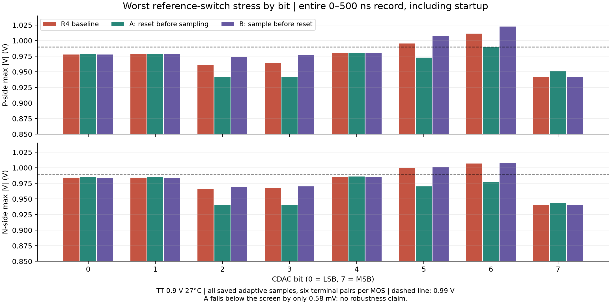
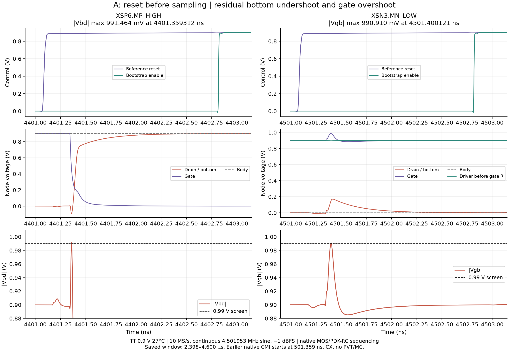

# R4 参考复位与采样错峰实验

先复位参考、再开启 Bootstrap 能减小过压，但不是完整修复：500 ns 短程峰值降至 0.98942 V，仅剩 0.58 mV 裕量；延长运行后再次触发 0.99 V 限值。反向顺序更差。本轮不替换 R4 基线。

## 改了什么

| 版本 | 参考初始化 | Bootstrap 开启 |
| --- | --- | --- |
| R4 原版 | 原 SAMPLE_INT | 原 SAMPLE_INT |
| A 先复位后采样 | 原 SAMPLE_INT | 延后约 1.732 ns |
| B 先采样后复位 | 延后约 1.732 ns | 原 SAMPLE_INT |

新增的是原生 T28 RC 延时、逻辑门和缓冲器，不是理想时序源。延时单元复用既有两级 RC 结构，两只 MOM 的 `multi` 从 10 调到 20；原模拟电路、3x 参考开关及 SAR 比较/写入/更新时序不变。

A 的 Bootstrap 使能下降沿也延后约 25 ps，控制高电平窗口由约 40 ns 缩至 38.29 ns。这是控制沿测量，不等同于主开关实际孔径；本轮只筛查电气应力与基本转换功能，不沿用 R4 的 FFT 指标。

## 同条件短程结果

TT、0.9 V、27 °C、10 MS/s；连续 4.501953125 MHz、−1 dBFS 正弦。输入每侧 50 Ω，参考每轨 50 Ω + 4 pF；外部输入、电源和 SAMPLE 理想。Spectre X CX，保存 0–500 ns 自适应点，包括启动阶段。

| 版本 | 参考 MOS 最大端电压 | 时刻 | 相对 0.99 V 限值 | 五帧输出与时序 |
| --- | ---: | ---: | ---: | --- |
| R4 | 1.011292 V | 401.358945 ns | 超出 21.292 mV | 通过 |
| A | 0.989420 V | 401.358603 ns | 仅余 0.580 mV | 通过 |
| B | 1.022525 V | 403.086396 ns | 超出 32.525 mV | 通过 |

三组最坏器件均为 `XCDAC.XSP6.MP_HIGH`，最坏端对为 body–drain。五帧码字均为 `133, 46, 181, 108, 112`，与基线一致；每帧独立核对 8 次比较、8 次写入、8 次更新、16 次捕获及输出稳定性。前四帧属于原性能测试的预热区，不能用这五帧代表动态性能。

三组峰值对应 P 侧底板 BP6 分别跌至 −111.292、−89.420、−122.525 mV，而 PMOS body 固定在 0.9 V。这里的最坏过压来自底板负向尖峰拉大 `Vbd`，不是 0.9 V 供电本身升高。

从上到下：Bootstrap 使能、参考复位、参考寄存器码字、32 只参考 MOS 的六种端对电压最大值。最后一行是所有器件应力的包络，不是一根物理节点电压；虚线为 0.99 V。

逐 bit 图取完整 0–500 ns 记录，不只看原先报警的 bit6。A 的 bit0、bit1、bit4 栅压也已接近限值，不能只处理一个器件。

## 能确认的原因

A 的剩余峰值在 401.359 ns，而 Bootstrap 实际开启在 402.819 ns。此时采样控制尚未开启，参考复位切换仍然能产生尖峰。B 将参考复位移后，主要尖峰也随之移到 403.086 ns，且变得更高。

这些结果支持：原问题包含参考切换与采样开启的叠加，但参考多位初始化切换本身也存在应力风险。它不是单纯把 Bootstrap 开晚就能解决的问题。当前保存的是电压，没有用电流积分分解各条电荷注入路径，不能据此唯一认定某个寄生电容贡献。

## 延长运行与数值复核

A 的 4.6 µs 连续重放正常结束，原生日志为 0 errors。最早在 **501.359 ns** 就记录 `XSP6.MP_HIGH Vbd=991.063 mV`，不需要等到几个微秒后才暴露问题。日志值是报警样点，不能代替波形峰值。

长重放从 2398 ns 起保存自适应波形，覆盖已知 2.5/4.5 µs 事件；之前保留逐帧监测及原生日志，但不宣称未保存区间的独立波形或应力检查通过。

| 保存区间内的残余问题 | 峰值 | 时刻 | 节点证据 |
| --- | ---: | ---: | --- |
| P 侧 bit6 PMOS，Vbd | 0.991464 V | 4401.359312 ns | BP6 为 −91.464 mV，body 为 0.9 V |
| N 侧 bit3 NMOS，Vgb | 0.990910 V | 4501.400121 ns | 栅极 0.990910 V，栅电阻前驱动输出仅 0.902865 V |

两类峰值都发生在延后采样开启之前。右图直接证明过冲集中在栅电阻后的节点，不是驱动器输出了同等幅度的过压；与底板瞬态同步，支持寄生耦合叠加有限栅极钳制的解释。具体电荷路径仍需电流证据。

右图对应参考字 `117 → 128`。bit3 的 Q3 始终处于逻辑 0，自身并没有切换命令，BN3 却被扰动至约 +169 mV，GNN3 随之冲高。这也解释了为什么不能仅按“哪些 bit 在翻转”来筛查过压。

46 帧原生监测时序有效，已保存的帧索引 24–45 独立波形检查通过。与原 R4 正弦记录相比，帧索引 9 由 240 变为 241，索引 36 由 204 变为 203，其余相同（索引从 0 计）。它们是待复核的 1 LSB 差异；控制孔径和数值设置均有变化，不能直接解释为性能改善或退化。

三组短程 CX 实际使用 `reltol=1e-4`、`vabstol=1 µV`、`iabstol=1 pA`、`maxstep=5 ns`；长程 maxstep 为 46 ns，均不是网表请求的 10 ps。窄尖峰依赖自适应细分保存。

500 ns 严格复核已完成，使用 `-preset_override` 后实际为 **maxstep=10 ps、reltol=1e-7、vabstol=10 nV、iabstol=100 fA**。A 的最大参考应力为 **0.989263 V @ 401.358985 ns**，与普通 CX 相差约 0.158 mV；五帧码字和时序检查通过，无 CMI。它支持短程结果，但不能消除长程已经发现的失败，也不是全工作区间的收敛或可靠性证明。两种设置不构成等精度速度比较。

严格复核的 3.916 GB 原始 PSF 保留不动。原生仿真完成后，为限制内存占用停止了本地整文件解析，改用本任务流式读取器；基线全部 129 个向量逐点一致，严格记录保留全部 731726 个自适应/附加采样点。原生日志 0 errors、logStatus PASS、PSF END、完整帧与时长均核验，未捏造未保存的原进程退出码。

## 下一轮方向

保留 A 作为较好的实验起点，优先验证参考初始化分步切换：采样关闭期间，逐个差分 bit 对复位、保留参考非交叠，再开启采样。转换阶段原有逐位动作不改。分步不能保证消除单个 MSB 大跳变，仍要检查各次切换，而不是只看 401 ns 一次事件。

如果错开多位复位后仍有栅极过冲，再对参考栅驱动强度、栅极电阻和边沿速度做小范围扫描。增大电阻并非必然更安全：它可能减慢底板跳变，也可能削弱对栅极耦合的钳制。更改前先补保存驱动电流，区分栅极过冲与底板负压。

候选通过后才补完整 1024 点正弦、静态边界及 PVT/失配；码字正确不能代替端电压合格。本轮没有 OA 修改，也没有宣布器件寿命或可靠性签核通过。

## 复现入口

- 原 R4：`netlist/sar8_physical/dut.scs`，哈希见候选 provenance。
- 候选单元：`netlist/sar8_r4_reset/variants.scs`，依赖原 R4 定义及外部 PDK。
- 执行与分析：`scripts/sar8_r4_reset/`；已存在 case 禁止重复提交。
- 数值摘要：`verification/sar8_r4_reset/short_comparison.json`、`followup.json` 和 `late_event.json`。
- 原始网表、日志、波形与分析：`output/sar8_r4_reset/<case>/`，本地保留、不入 Git。

参考 MOS 检查覆盖 32 只、全部六种端对；另查比较器、Bootstrap 与新增延时逻辑共 85 只选定 MOS。并未覆盖全部数字控制/参考驱动内部 MOS；外部理想供给、无瞬态噪声、无 PVT/失配、无版图寄生的条件仍保留。
