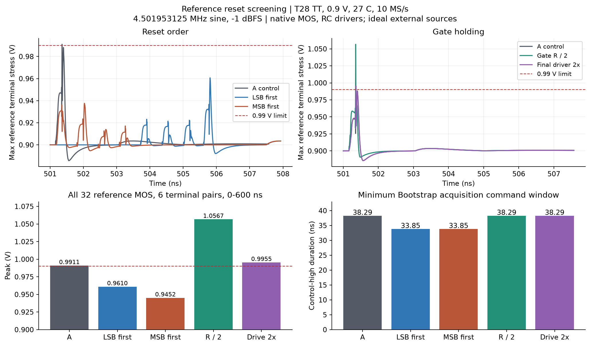
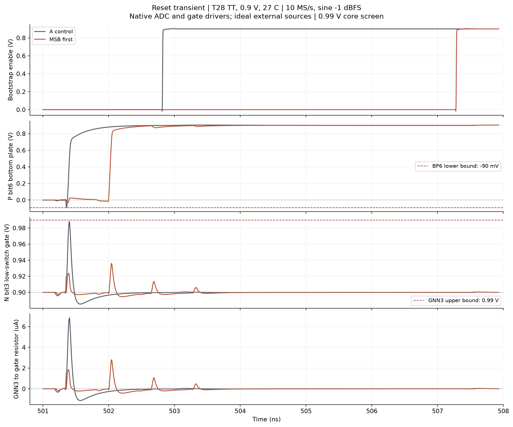
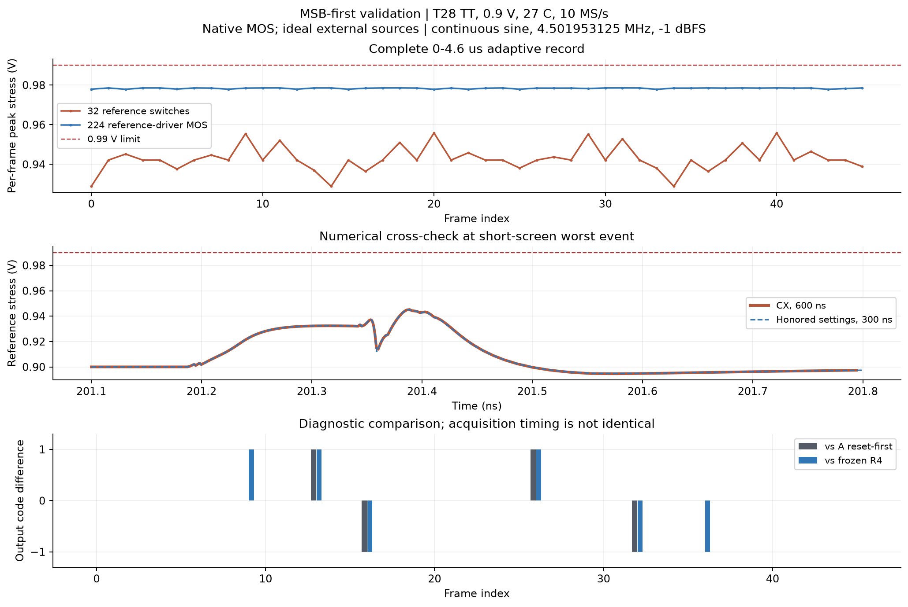

# R4 参考分步复位与栅极驱动对比

本轮选择“高位先逐对复位，再开启 Bootstrap”：**4.6 µs、46 帧**名义正弦重放的最大参考端电压为 **0.955838 V**，相对 0.99 V 余 **34.162 mV**，独立时序和选定器件应力检查通过。300 ns 严格复核也通过。低位先复位短测有改善；单独减小栅电阻或增强驱动则仍超限。本轮保留为候选，不替换 R4 基线。

## 测试条件与电路改动

T28 TT、0.9 V、27 °C、10 MS/s；连续 4.501953125 MHz、−1 dBFS 正弦。输入每侧 50 Ω，参考每轨 50 Ω + 4 pF。外部输入、电源和 SAMPLE 理想，内部 ADC、参考驱动及新增时序均为原生 PDK 器件；没有加入理想时序驱动，也未改 PDK 或 Virtuoso OA。

模拟采样、CDAC、比较器和 3x 参考通过管保持不变。A 是上一轮“先复位、后采样”候选，不是原 R4；它在全部 bit 同时初始化后延迟约 1.73 ns 开启 Bootstrap。

分步方案复制参考寄存器单元，仅把各 bit 的异步复位拆开。七级原生 RC 延时产生八个复位时刻，每个 bit 的差分 P/N 对一起动作，保留原非交叠逻辑。最后一位复位后，再经 A 的延时开启 Bootstrap。转换期间比较、写码、参考捕获的逻辑结构不变。

`RST_DONE` 只是末级复位命令的标志，并非闭环检测“模拟参考已经建立”。这里仍是固定 RC 时序，延时与实际建立时间的余量需要后续 PVT 检查。

| 实验 | 相对 A 的唯一主要改动 |
| --- | --- |
| A 对照 | 无，全部 bit 同时复位 |
| 低位先复位 | bit0 → bit7，逐对复位 |
| 高位先复位 | bit7 → bit0，逐对复位 |
| 栅电阻减半 | 每段原生电阻的并联 `m` 翻倍；其寄生也随模型变化 |
| 末级驱动 2x | 末级驱动 MOS 的 `multi` 翻倍，前级及栅电阻不变 |

分步延时单元的两只 MOM `multi=6`；A 的末段等待单元保持 `multi=20`。相对 A 新增 108 只逻辑/延时 MOS，还需考虑电容、面积和功耗代价；本轮没有优化这些代价。

## 同条件短测结果

全部保存 0–600 ns 自适应点。参考应力取 32 只参考 MOS、六种端对的最大绝对电压，不是单一节点电压。核心器件筛查线为 0.99 V，Bootstrap IO 器件为 1.98 V。

| 版本 | 最大参考端电压 | 最坏器件与端对 | 时刻 | 相对 0.99 V |
| --- | ---: | --- | ---: | ---: |
| A 对照 | 0.991063 V | P bit6 PMOS，Vbd | 501.359 ns | 超 1.063 mV |
| 低位先复位 | 0.961044 V | P bit3 PMOS，Vgb | 205.809 ns | 余 28.956 mV |
| 高位先复位 | 0.945182 V | P bit4 PMOS，Vgb | 201.389 ns | 余 44.818 mV |
| 栅电阻减半 | 1.056698 V | N bit6 NMOS，Vbd | 501.354 ns | 超 66.698 mV |
| 末级驱动 2x | 0.995498 V | N bit6 NMOS，Vbd | 501.363 ns | 超 5.498 mV |

五组 6 帧均为 `133, 46, 181, 108, 112, 177`。独立波形检查每帧 8 次比较、8 次写入、8 次更新、16 次捕获以及输出稳定区间通过。前四帧是原测试预热区，这六帧不能代表最终频谱性能。

上排展示约 501 ns 的应力过程；左下取完整 600 ns 最大值，右下是最短 Bootstrap 控制高电平窗口。高位先复位分散了原集中尖峰，但消耗更多采样时间。

## 电压与电流证据

从上到下：Bootstrap 开启命令、BP6 底板、GNN3 栅极、从 GNN3 流入栅电阻的电流。灰色为 A，红色为高位先复位；曲线均来自原生仿真，无波形重构。

在 500.8–508 ns 窗口，A 的 BP6 最低 −91.063 mV，高位先复位为 −30.536 mV；相应 PMOS 的 body 固定在 0.9 V，负向底板尖峰因此直接增加 Vbd。不能只检查栅极是否超过电源。

A 的 GNN3 峰值为 0.988165 V，而栅电阻前驱动输出仅 0.902781 V。该时刻电流 **+6.839 µA 从栅极流入电阻**，即驱动路径正在吸收栅极电荷，不是在输出同样高的栅压。高位先复位将该窗口 GNN3 峰值降至 0.936066 V，相应电流为 +2.797 µA。这支持底板瞬态耦合与有限栅极保持能力共同作用，但没有把所有电荷分解到每个寄生电容。

栅电阻减半确实把同一窗口 GNN3 峰值降至 0.969605 V，却使 BN6 冲到 1.056698 V；它改善一个栅极节点，同时恶化底板应力。末级驱动 2x 也不能同时解决所有端对超限。当前不选这两条单独修改路线。

## 时序代价与其他器件

高位先复位的典型复位时刻为周期起点后约 1.101、1.730、2.372、3.013、3.653、4.294、4.935、5.521 ns，间隔约 0.59–0.64 ns。Bootstrap 在约 7.286 ns 开启、41.134 ns 关闭；A 则约 2.819 ns 开启、41.108 ns 关闭。采样控制窗口从 **38.29 ns 缩至 33.85 ns**，约减少 4.44 ns。

采样开启前参考字均已初始化为 128，首次比较前复位全部释放、Bootstrap 控制已关闭。保存点上各 bit 的 H/L 命令均未同时超过 0.45 V；这只是逻辑非交叠检查，不等同于所有通过管导通电流无重叠。复位顺序检查覆盖启动后的五次重新采样；初始帧由 DC 初态开始，不把它算作一次观测到的复位上升沿。

相对 A，关闭控制沿也后移约 27 ps。采样时间和关闭沿均变化，后续码字差异不能直接全部归因于参考过压改善；需要重新核对有效孔径和动态指标。

高位先复位短测的其他选定器件最大端电压：参考驱动 **0.978533 V**、比较器 **0.951641 V**、新增时序 **0.933050 V**、Bootstrap IO **1.724841 V**，均在对应筛查线内。参考开关虽有约 44.8 mV 裕量，参考驱动只剩约 **11.5 mV**；不能把参考开关裕量当作整机裕量。

## 延长重放与数值复核

300 ns 严格复核已经通过：467168 个自适应/附加采样点，3 帧独立时序有效，原生零错误、无 CMI。参考应力峰值为 **0.945142 V @ 201.387839 ns**，与普通 CX 的最大值相差约 **0.041 mV**；该事件中多个 PMOS 栅极应力接近，严格设置下最大者为 P bit6，而普通 CX 为 P bit4。参考驱动严格测试峰值 **0.979259 V**，相对 0.99 V 仅余 **10.741 mV**。

4.6 µs 连续重放完整保存 **724408 点**，46 帧原生监测和独立码字/时序/稳定性检查通过。45 次启动后的采样均满足复位顺序、参考字初始化、复位释放及控制关闭先于首次比较的检查。原生零错误、无 CMI，417 只选定 MOS 的六种端对全程未超筛查线。

长程参考最大值为 **P bit5 PMOS 的 Vgb=0.955838 V @ 4001.388523 ns**。此时栅极 −55.838 mV、body 0.9 V，Bootstrap 尚未开启。剩余尖峰仍在，只是本次记录内没有超限；不能说已消除所有耦合。其他分组峰值为参考驱动 0.978546 V、比较器 0.952042 V、新时序 0.933090 V、Bootstrap IO 1.751934 V。

第一行按每帧取峰值；第二行比较约 201 ns 的普通与严格波形；第三行列出输出码字差异。**约 4001 ns 的长程最坏事件未做同条件严格重放**，300 ns 的数值复核不能替代这一项。

独立波形解码与原生记录一致。相对 A 的码字变化为索引 13：148→149、16：206→205、26：50→51、32：71→70。相对冻结 R4，另有索引 9：240→241、36：204→203；索引从 0 开始。这些 ±1 码变化需要结合有效孔径重新评估，不能沿用 R4 的 SNDR/ENOB。

短测实际设置为 Spectre 21.1、Spectre X CX、4 线程，`maxstep=6 ns`、`reltol=1e-4`、`vabstol=1 µV`、`iabstol=1 pA`；长程 maxstep 为 46 ns。CX 覆盖了网表请求的 10 ps，窄尖峰来自保存的自适应细分点。严格测试使用 `-preset_override`，日志确认实际 **10 ps、1e-7、10 nV、100 fA**。两者不是等精度速度对比；300 ns 复核也不等于严格设置下的完整 4.6 µs 认证。

两份原始 PSF 分别为 9.01 GB 和 5.81 GB，均保留，解压后 SHA256 与远端原始文件一致。长文件首次下载在异常等待后超时，随后用 11 个独立校验的分块恢复同一记录；没有重跑或改动电路。流式读取保留全部点，并检查 PSF END、信号集合、有限值、时间单调性、完整时长、原生退出码与 logStatus PASS。

## 复现与边界

- 冻结依赖：`netlist/sar8_physical/dut.scs`，原 R4 不变。
- 候选单元：`netlist/sar8_r4_staged/msb_first_cells.scs` 与 provenance；该文件替换顶层并补新增单元，不能与原顶层重复定义。
- 脚本：`scripts/sar8_r4_staged/`；已有案例禁止重复提交，重新实验须用新名称。
- 数值：`verification/sar8_r4_staged/results.json`。
- 低位先复位的节点对照：[补充波形](figures/sar8_r4_staged/lsb_reset.png)。
- 原始案例、完整波形和日志：`output/sar8_r4_staged/<case>/`，本地保留、不入 Git。

参考、Bootstrap、比较器、参考驱动和新增时序共检查 417 只选定 MOS 的六种端对；A/驱动单因素组为 309 只。其他数字内部器件仍依赖原生 CMI 报警，不宣称全芯片可靠性覆盖。当前没有 PVT、失配、瞬态噪声、版图寄生或新版本全码/1024 点频谱验证，也未完成面积和功耗优化。下一步需明确有效采样孔径、复核长程最坏事件，再重新验证静态与动态指标；不能直接把旧 R4 的性能标签移到候选上。
