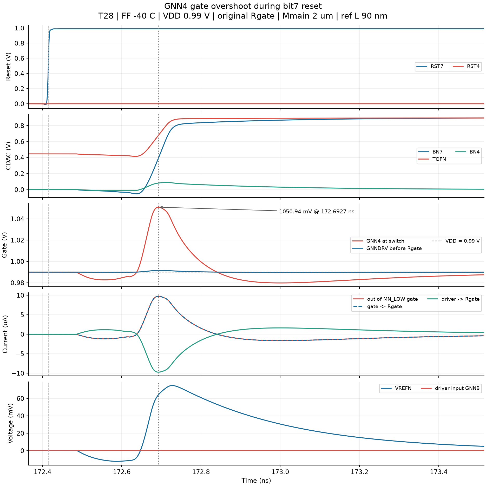
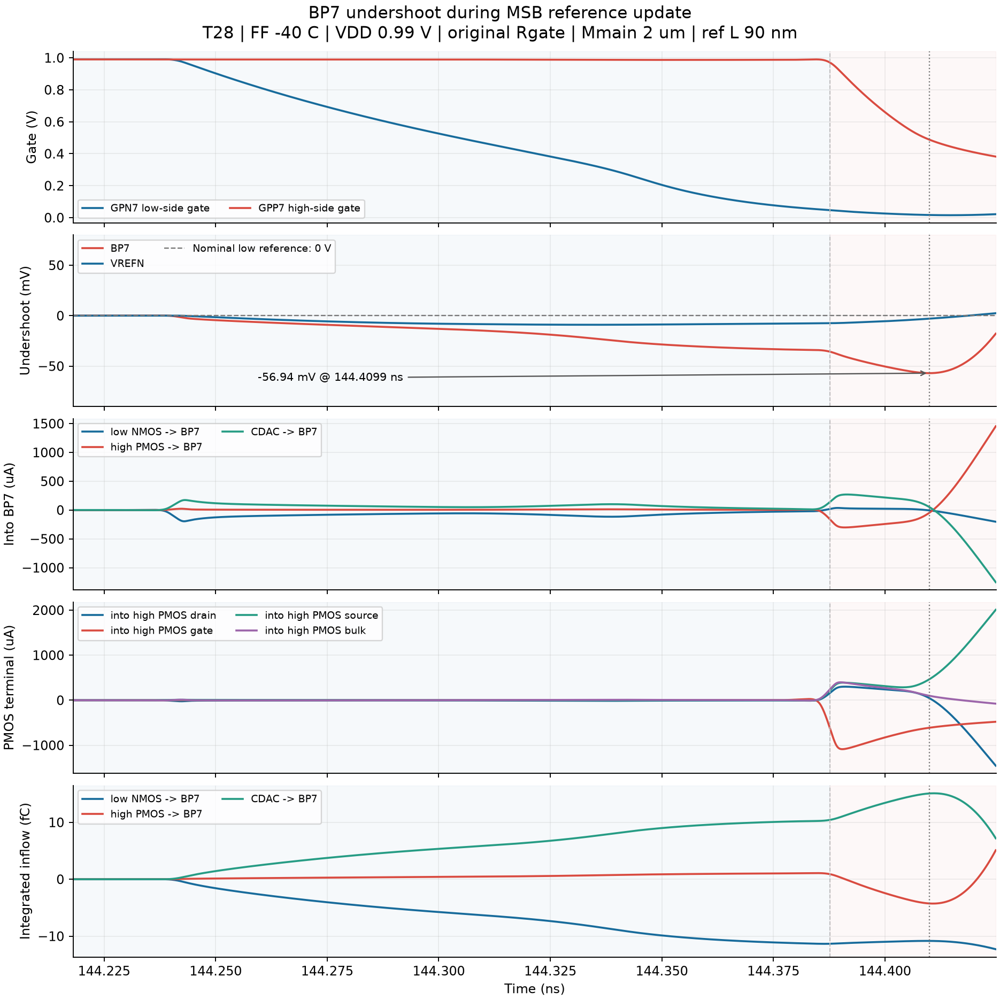
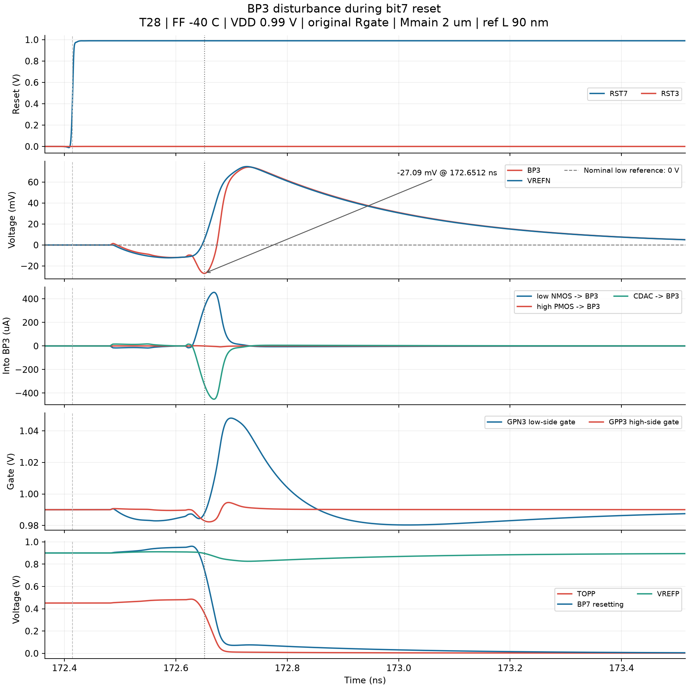

# 原版参考开关的过冲与下冲电流定位

只补测量，不修改电路。使用上一轮 **原版 Rgate**、Mmain=2 µm、参考开关 L=90 nm 的冻结网表；不采用 Rgate/4 候选，不改变器件、时序或采样关闭沿。

冷热角电流一致显示三个不同路径：**GNN4 是漏源网络跳变向栅极回灌；BP7 是低侧关断与高侧栅极下降的两段效应；复位期 BP3 是 CDAC 耦合拉动，低侧开关在回补。** 因此不能把全部异常统称为漏电，也不能只归因于低侧 NMOS。

## 条件与测量

T28 原生晶体管电路，FF，VDD=0.99 V，−40°C / +125°C。每组保留原始 200 ns 历史、两帧差分输入 +0.81 / −0.81 V。外部供电、参考源及采样时钟理想；参考源含原有 50 Ω 源阻抗与 4 pF 去耦，内部 SAR 时序和栅控由物理器件实现。不含版图寄生和失配。

Spectre X CX，4 线程，实际 `reltol=1e-7`、`maxstep=10 ps`、gear2only，电压/电流绝对容差 10 nV / 100 fA。与原版精度相同。网表只更改保存列表和测量选项，`subcktiprobes=no useprobes=no`，没有插入电路探针。

保存 130 个电压、232 条端电流，保留原始求解时间点。电流覆盖参考 MOS 的 D/G/S/B、CDAC、电源参考支路，以及关键栅极电阻和末级驱动器。**原生端电流以流入器件为正，已包含并联倍数；图中的“→ BP”则换算成流入底板为正。** 端电流包含电荷动态，不能直接等同于沟道漏电。

## 1 GNN4 栅极过冲

从上到下：复位命令、CDAC 电压、栅极与驱动器输出、栅极电流、实际低参考及驱动器输入。灰色虚线为 RST7 上升沿，点线为 GNN4 电压峰值。

冷角 RST7 启动复位后，BN7 上升，经 CDAC 顶板及共享参考网络扰动 BN4 和 VREFN。**RST4 尚未动作，GNN4 本应保持高电平。** 在 172.69270 ns：

- GNN4=1.050940 V，超过 0.99 V 筛查线 60.940 mV。
- Rgate 前的驱动器输出仅 0.991483 V；驱动器输入 GNNB 约 1.9 µV，没有逻辑翻转。
- `XSN4.MN_LOW` 栅端向外流出 **9.717 µA**，经 Rgate 流回驱动器；不是驱动器主动把栅极拉到 1.05 V。
- 末级上拉 PMOS 的源端电流约 −9.714 µA，方向为回到 VDD。此刻 BN4=82.147 mV，VREFN=64.205 mV。

同一时刻，`CMOMN4` 向 BN4 注入 362.694 µA，低侧 NMOS 漏端吸收 359.669 µA，其中 345.048 µA 从源端进入共享 VREFN。源端与栅端的回流同时可见，因此扰动可以沿 CDAC、底板、参考 MOS 追踪，而不是只凭栅压峰值猜测驱动器异常。

这条电流路径支持“漏源端变化通过 MOS 的电荷耦合抬高栅压，有限保持阻抗不能及时吸收”的解释。不能仅凭本轮端电流，进一步把 Cgd 与 Cgs 的贡献比例拆开。

## 2 转换期 BP7 下冲分两段

从上到下：两只参考开关的栅压、底板与实际低参考、流入底板的三条支路电流、高侧 PMOS 四端电流、各支路流入电流的累计积分。背景分界以 GPP7 下降至 98% VDD 标记边沿开始，**不是 MOS 导通阈值**；点线为负压最低点。积分以图左端为零，只表示经过各端口的电荷，不能将其总和当作底板储存电荷。

| 冷角阶段 | BP7 状态 | 端口电流积分，流入 BP7 为正 |
| --- | --- | --- |
| GPN7 下降至 GPP7 开始下降，144.24306–144.38770 ns | 先降到 −35.685 mV | 低侧 −10.817 fC，高侧 +0.829 fC，CDAC +9.988 fC |
| GPP7 开始下降至最低点，144.38770–144.40995 ns | 继续降到 −56.939 mV | 低侧 +0.500 fC，高侧 −5.142 fC，CDAC +4.642 fC |

第一段主要来自低侧 NMOS 的关断过程，并伴随低参考轨的负向扰动。**第二段的负向增量主要来自高侧 PMOS 支路，而低侧支路净作用已转为回补。** 不能因低侧先关断，就把整个下冲都算到它头上。

在最陡下冲的 144.38930 ns，高侧 PMOS 从 BP7 抽走约 **276.536 µA**，低侧 NMOS 向 BP7 回补 37.213 µA，CDAC 端口回补 239.323 µA。此时高侧栅极 0.934677 V、高参考 0.905740 V、底板 −0.037935 V；PMOS 的漏、源端电流都流入器件，栅端电流约 −1.029 mA。这不是高参考通过正常导通沟道给底板充电，而是栅极下降时的瞬态电荷耦合；也不能把漏端流入误写成电荷已流到 VREFP。随后高侧向底板充电的电流占主导，底板恢复并建立到高参考。

最低点时 VREFN 只有 −2.933 mV，而 BP7 为 −56.939 mV，相对参考还低 **54.006 mV**。因此参考轨确有扰动，但不是底板负压的全部来源。端电流不能继续拆成纯重叠电容、沟道电荷和结电荷的独立份额。

## 3 复位期 BP3 是另一条路径

这里是 RST7 复位，RST3 尚未动作。BP7 下落带动 TOPP 下落，电流通过 `CMOMP3` 拉动 BP3；低侧开关仍在保持低参考，不是本位正在主动关断。

在 172.65125 ns，BP3=−27.090 mV，VREFN=+5.336 mV。CDAC 从 BP3 抽走 **328.103 µA**，低侧 NMOS 回补 **328.271 µA**，高侧 PMOS 仅抽走约 0.168 µA。GPN3/GPP3 分别为 0.987690 / 0.982999 V，仍对应低参考选通的栅控状态。

这是“其他位复位 → 顶板电压变化 → CDAC 耦合 → 有限低侧保持能力”的路径，不能套用 BP7 本位交接时的两段关断解释，也不是底板简单跟着参考轨一起变负。

## 4 冷热角复核与限制

| 指标 | FF −40°C | FF +125°C |
| --- | ---: | ---: |
| GNN4 峰值 | 1.050940 V | 1.055035 V |
| GNN4 峰值时刻 | 172.69270 ns | 175.04588 ns |
| 峰值时从 MOS 栅端流回驱动器 | 9.717 µA | 9.850 µA |
| BP7 最低电压 | −56.939 mV | −45.028 mV |
| BP7 最低点时刻 | 144.40995 ns | 144.69790 ns |
| GPP7 开始下降时的 BP7 | −35.685 mV | −29.089 mV |
| RST7 窗口内 BP3 最低电压 | −27.090 mV | −35.803 mV |
| BP3 最低点时刻 | 172.65125 ns | 175.00446 ns |
| 最慢底板建立时间 | 2.217 ns | 2.379 ns |
| 比较前最大底板残差 | 0.499 mV | 0.606 mV |
| 建立窗口通过数 | 14/14 | 14/14 |
| 两帧码字 | 243 / 12 | 243 / 12 |

热角的两段 BP7 过程相同：GPP7 下降至底板最低点之间，高侧从底板抽走 3.556 fC，低侧净回补 0.159 fC。复位期 BP3 最低点，CDAC 抽走 343.594 µA，低侧回补 343.744 µA，VREFN 此时为正的 10.528 mV。冷热角幅值不同，但没有出现相反的主要电流方向。

热角分层波形：[GNN4 回灌](figures/sar8_ref_current_probe/baseline_hot_gate.png)、[BP7 两段下冲](figures/sar8_ref_current_probe/baseline_hot_bottom.png)、[BP3 复位耦合](figures/sar8_ref_current_probe/baseline_hot_idle_bottom.png)。

**复现检查：**两组均 native exit0 / tran PASS，节点和器件清单与原版相同。112 个共同电压按同一绝对时间插值对比，最大差分别为 79.13 µV / 0.000832 µV；冷角最大差位于数字 `RST_DONE`，不把不同求解网格称为逐点完全相同。关键过冲/下冲峰值复现到 1 µV 内，采样关闭沿变化均小于 0.001 ps。每帧比较/写入/更新/参考捕获仍为 8/8/8/16。

建立沿用原版口径：16 个底板相对各自最终名义参考进入 ±0.25 LSB（±1.7578 mV），并保持到下次比较前 10 ps。它不是整个转换耗时，也不是加权 ADC INL。

**测量检查：**全部 232 条电流在原生 TRACE 中存在；MOS 四端、底板、关键栅极和参考轨的 KCL 残差均小于 90 pA，参考电阻电流与 50 Ω 欧姆定律相符。原始输入散列、回收文件散列、波形 END/200 ns 与器件清单均核对。六张最终图逐张检查。两组顺序运行，原生进程峰值约 321 / 318 MiB；流式解析器约 6.5 MiB。服务器保留两组共约 9.67 GB 新原始波形，不删除历史数据。

这些数值是切换瞬间的节点偏移，不是最终保持误差或 ADC 码字误差。测量定位了异常来源，没有修复过压。0.99 V 是本项目核心器件的筛查线，不替代 foundry 瞬态 SOA 或寿命验收；两帧码字正确也不等于完整 PVT、全码、频谱或整机应力闭合。

## 证据位置

- 冻结源：`output/sar8_stress_closure/rg1_strict200_ff_m40` 与 `rg1_strict200_ff_125`。
- 本轮输入及回收：`output/sar8_ref_current_probe`；原始波形仍保留在独立远端目录。
- 配置、散列、电流验证和数值：`verification/sar8_ref_current_probe`。
- 可复核脚本：`scripts/sar8_ref_current_probe`；运行登记：`management/runs/2026-10-25-reference-current-probes.json`。

旧网表保存语句的大小写错误使 `save=selected` 自动退回 `allpub`，因此以前有电压、没有这些端电流。本轮修正的是测量保存方式；原始旧案例未改写。执行入口现已统一为 managed 工作流，本任务的旧 launch/reduce 函数已禁用，后续新任务使用统一入口；现有结果仍可只读回收。
