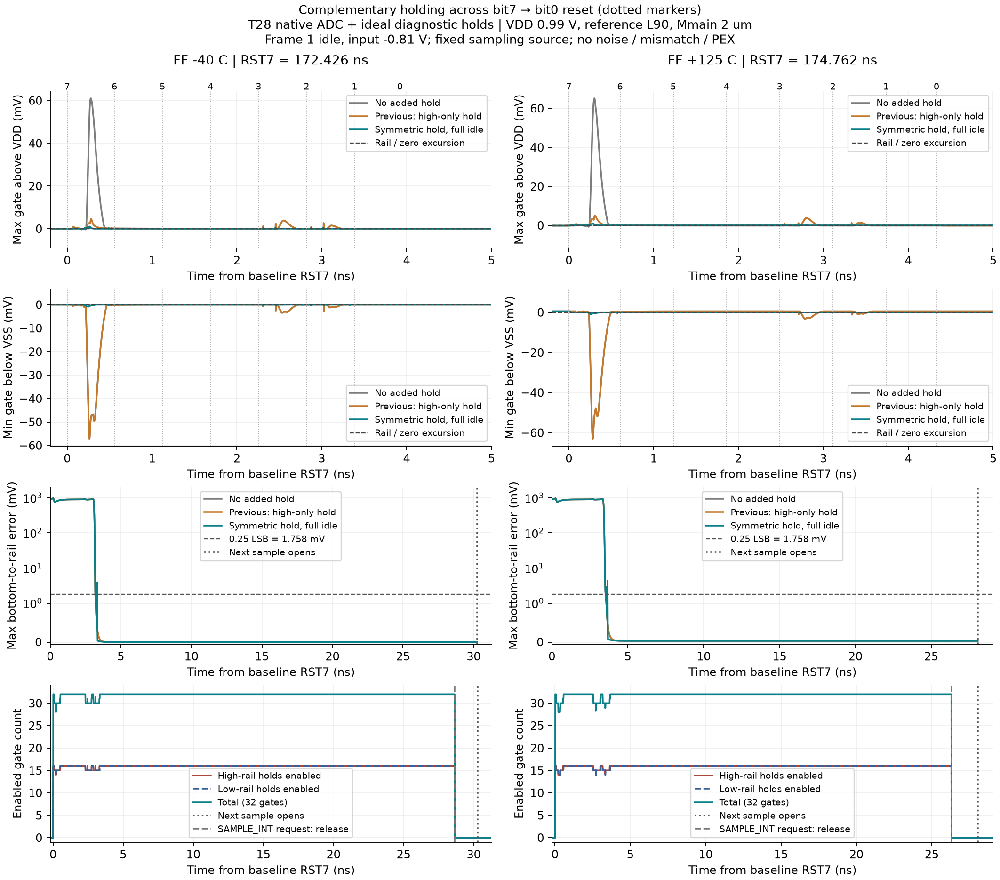
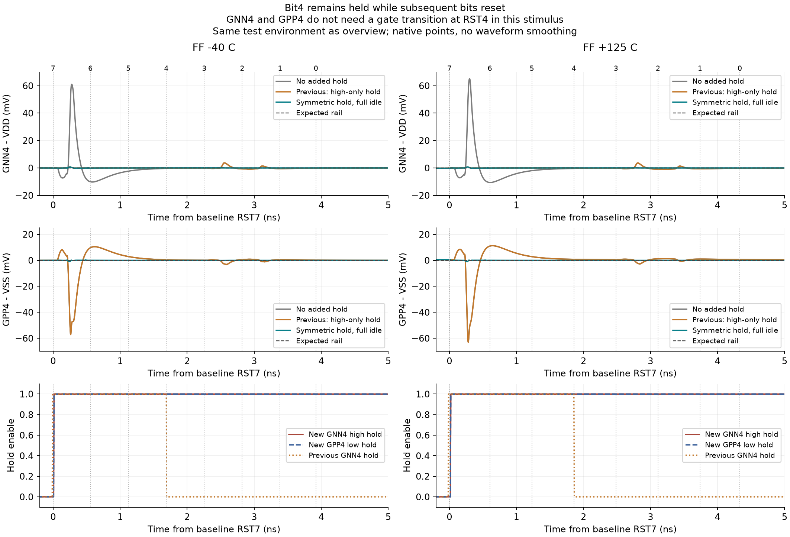
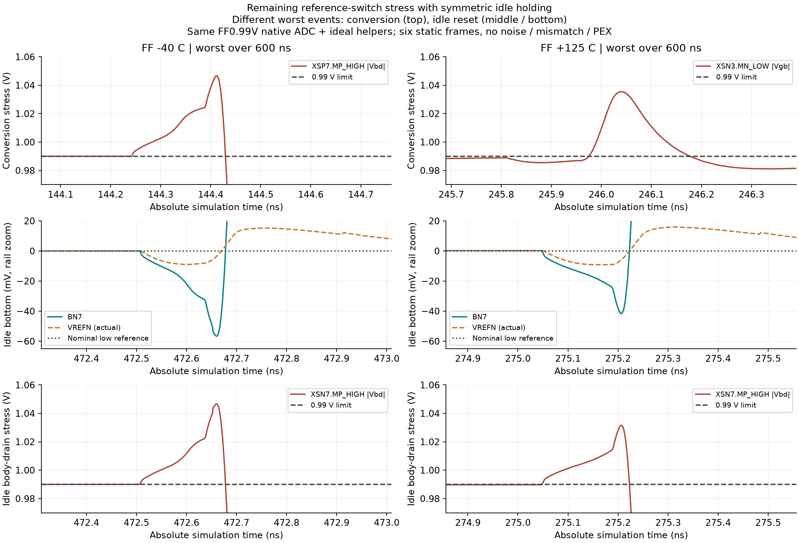

# 参考栅极对称保持的 FF 冷热角验证

高、低两端对称保持，并覆盖后续各位复位，能把空闲复位阶段的栅极正负尖峰从约 60 mV 压到约 1 mV。采样窗口和码字不变，但参考开关仍有底板负向偏移、转换期栅极耦合导致的端电压超限，尚不能判定整机通过 SOA。

## 本轮改动

保留 T28 原生 ADC 的 1833 个 MOS 及其连接、尺寸：Mmain 2 µm、参考开关 L=90 nm，时序、参考源 50 Ω/4 pF 均不变。只在 bit7～bit0 的四路参考栅极上加入**理想诊断保持支路**；不是已实现的晶体管 keeper。

每个栅极可通过有限电阻接向 VDD 或 VSS，阻值为 `400/2^bit Ω`（bit4 为 25 Ω）。末级反相器输入开始切换时释放；命令到达新电平、栅极到达目标的 95% 后重新保持。不再因本位 RST 而撤掉保持，因此本位复位后仍受保护。高低支路互斥，接入边沿为 5 ps。

保持只用于空闲复位。`SAMPLE_INT` 是提前到来的采样请求，它使保持释放；随后 `SEQ_SAMPLE` 才真正驱动 Bootstrap 打开。这两个时刻不能混为一谈，也不能要求保持延续到实际采样打开之后。

## 结果对比

FF、VDD=0.99 V，−40°C / +125°C；每个温度各跑零强度对照、对称保持，共四个 600 ns 案例。输入差分依次为 +0.81、−0.81、0、+¼LSB、−¼LSB、0.123046875 V。以下箭头均为“本轮零强度对照 → 对称保持”。

| 指标 | FF −40°C | FF +125°C |
| --- | ---: | ---: |
| 全部空闲复位期间栅极高于 VDD 的最大幅度 | 61.031 → **1.010 mV** | 65.136 → **0.963 mV** |
| 全部空闲复位期间栅极低于 VSS 的最大幅度 | −57.103 → **−0.849 mV** | −62.943 → **−0.913 mV** |
| 代表帧全部底板最终建立时间 | 3.198 → **3.337 ns** | 3.539 → **3.674 ns** |
| 建立后到下一次实际采样的余量 | 27.069 → **26.930 ns** | 24.536 → **24.401 ns** |
| 整个 600 ns 的最坏参考开关端电压 | 1.051031 → **1.046743 V** | 1.055136 → **1.035509 V** |

建立时间从代表帧 RST7 上升沿起算，要求全部 16 个底板进入各自实际参考电压 ±0.25LSB（1.758 mV），并保持到下一次采样前 20 ps；不是仅看 RST_DONE。本轮增加约 0.14 ns，但没有挤占采样窗口。

所有案例输出 `[243, 12, 127, 128, 127, 145]`，24/24 帧正确；零输入允许 127 或 128。逐帧比较、写入、更新、复位顺序检查通过。两温度新方案的启动后最大保持误差分别为 0.5764 / 0.5171 mV，与对照基本相同。

外部采样源逐字节相同；对称保持与本轮对照的实际采样开、关沿差均小于 0.001 ps。这是仿真数值差，不代表物理测量具有该精度。保持在采样/转换时关闭；所有帧在复位完成后到下一次采样请求前，32 个栅极均保持有效。未发现高低保持重叠或稳定命令反向对抗。

上两行分别看正、负栅极尖峰；第三行看最终建立与采样余量；第四行显示高低保持数量。顶部数字 7～0 是各位复位命令。橙色为上一轮只保持高电平的版本：正尖峰改善后，负尖峰仍在；绿色补齐两端后同时改善。

以 bit4 为例：上一轮橙色保持在 RST4 后撤掉，后面仍有几 mV 的扰动。新方案保持不断，后续 bit3～bit0 复位时也受保护。本输入下 RST4 不要求 GNN4/GPP4 改变目标电平。

## 剩余超限不是同一种问题

| 温度与阶段 | 器件及端电压 | 时刻 | 对应节点 |
| --- | --- | ---: | --- |
| 冷角转换期，全程最坏 | XSP7.MP_HIGH，\|Vbd\|=1.046743 V | 144.411 ns | BP7≈−56.743 mV，bulk=0.99 V |
| 热角转换期，全程最坏 | XSN3.MN_LOW，\|Vgb\|=1.035509 V | 246.040 ns | GNN3≈1.035509 V；此时空闲保持已关闭 |
| 冷角空闲复位 | XSN7.MP_HIGH，\|Vbd\|=1.046679 V | 472.660 ns | BN7≈−56.679 mV |
| 热角空闲复位 | XSN7.MP_HIGH，\|Vbd\|=1.031700 V | 275.206 ns | BN7≈−41.700 mV |

器件名均位于 `XDUT.XCDAC`。栅极钳在电源范围内，不意味着所有端电压都合格：底板接到漏端，底板低于地时，PMOS 的 bulk 到 drain 电压仍会超过 0.99 V。转换期间的耦合也没有被“仅空闲时开启”的保持支路处理。参考驱动、控制器和比较器的既有超限仍保留。

上排是转换期间的最坏应力；中、下排对应另一时刻的空闲复位，分别显示底板负向偏移及其形成的体—漏电压。中排放大低电平附近，不显示随后完整的 0.9 V 上升幅度。

## 结论与下一步

这轮支持“弱保持和提前释放导致复位期栅极耦合”的判断，但不支持“参考开关过压已经解决”。下一步应分开处理：转换期间未切换栅极的保持，以及底板负向偏移；不能简单把所有栅极始终强拉。

实际 keeper 还需设计释放/重新接入电路、输出阻抗及寄生负载。本轮理想支路峰值电流约 2.35 mA，包含末段栅电荷建立，不是实际 keeper 的总电源功耗。保持也改变了建立尾部，因此不能把它描述为完全不影响动态过程。暂不提升为电路基线。

## 验证边界与证据

原生 Spectre 21.1 CX，最多两任务并行、每任务四线程；有效设置为 reltol=1e-4、maxstep=6 ns、gear2only、V/I abstol=1 µV/1 pA。CX 覆盖了网表请求值，不能称为 10 ps 最大步长仿真。约 1 mV 的残余栅极尖峰仍需更严格精度收敛验证。

原生退出码、tran PASS、远端源文件/日志/提取数据散列均通过；零强度模型对历史原生基线的最大峰值差为 11.29 µV、保持误差差为 5.79 µV、采样沿差小于 0.096 ps。历史原始数据未改写。此处 SOA 检查覆盖既有 445 个 MOS 的 2670 个端电压组合，而非全部 1833 个 MOS；没有噪声、失配、PEX、全码或频谱回归。所有案例仍有原生 CMI 警告。

- [数值和逐案例比较](../verification/sar8_ref_symmetric_hold/comparison.json)
- [验证记录](../verification/sar8_ref_symmetric_hold/validation.json)
- [实验计划与审阅](../plan/2026-10-24-sar8-ref-symmetric-hold/plan.md)
- 本地原始提取波形：`output/sar8_ref_symmetric_hold/`；原生 PSF 保留于远端同名日期目录。无 OA/PDK 修改，无 push。
