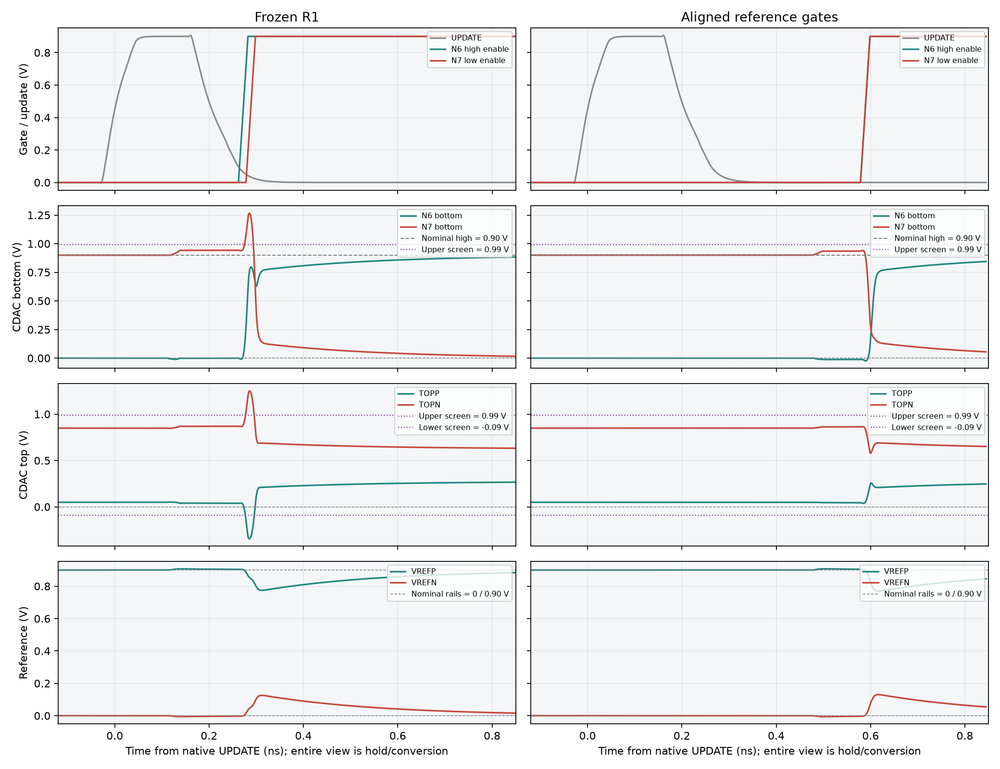
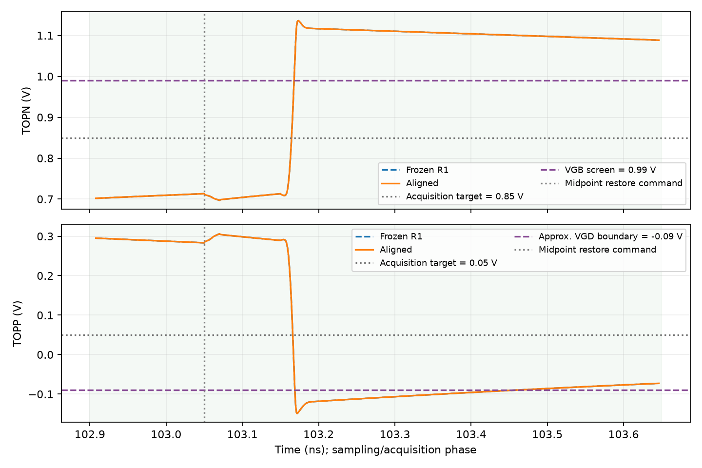

# SAR8 参考换轨对齐实验

在不改变原生拓扑和尺寸的条件下，整字对齐理想参考栅控，消除了本轮两个
负输入案例中原有的转换换轨过压尖峰。**负大输入在下一次采样的中点恢复
仍有比较器过压，整机未通过应力验收。** 冻结 R1 和远端 OA 均未改动。

## 改动范围和仿真条件

原16个理想栅压边界新增同一个提交通知。该通知只观察原生控制器的32个
参考请求；请求全部为合法单轨选择、且整字稳定200ps后，改变选择的bank
同时关断，100ps后同时开启新轨。不改变选择的bank继续接原轨。栅边沿
仍为20ps；SAMPLE上升后2ns恢复中点、下降时保持中点的原约定不变。

没有从Vin计算码字，没有替换StrongARM、Bootstrap、原生控制器或MOM阵列。
所有原生子电路体，以及剔除明确列出的理想栅控语句后的顶层连接，均与
冻结R1一致。这是理想时序边界的实验，不是新增原生同步驱动电路。

两组输入为−800mV和−3.515625mV（负半LSB），每组连续两帧。TT、0.9V、27°C，
Spectre21.1 APS，200ns、最大步长10ps，保存全部求解点；参考50Ω＋4pF/轨，
输入50Ω/侧。模型include和section、电路负载、激励、求解容差均继承R1。
对照为已有的全时间点 `nfull_fine`、`nhalf_fine`，不是抽样显示的峰值。

## 转换保持阶段的对比

以下峰值扫描每侧所有参考管、比较器11管的六组端电压；不是只看某一节点。

| 指标 | −800mV 冻结R1 | −800mV 对齐 | 负半LSB 冻结R1 | 负半LSB 对齐 |
| --- | ---: | ---: | ---: | ---: |
| 参考管最大端电压 | 1.266776V | 0.951088V | 1.266744V | 0.951079V |
| 比较器最大端电压 | 1.250013V | 0.950686V | 0.951506V | 0.951473V |
| TOPN最大值 | 1.250013V | 0.865608V | 0.851855V | 0.467461V |
| TOPP最小值 | −0.344390V | +0.038165V | +0.053676V | +0.436300V |

−800mV第二帧首次更新时，R1的bit6和bit7新轨使能相差15.919ps，关断相差
7.625ps；对齐后，同次变化的P6/P7/N6/N7关断均在144.956042ns，开启均在
145.056042ns，保存精度内偏斜为0。全四帧变化bank均如此，实际门限BBM100ps，
无高低轨使能重叠。物理器件电流响应不因此变成理想同步。



左右横轴分别以各自真实UPDATE为零点，同一尺度；整幅均处于保持转换阶段。
从上到下为更新/新轨使能、CDAC底板、顶板、参考轨。虚线给出名义参考和
端电压筛查基准。原来bit6先接高轨、浮置MSB底板被抬升的尖峰消失；
仍可看到较小的关断耦合和正常电荷重分配，不能称为所有瞬态扰动归零。

这个实验同时实现整字同步提交、忽略短暂全关请求、统一100ps非交叠，并把
本次新轨开启推迟约300ps。R1虽然也设100ps最小间隔，但原生请求间隔使该次
bit6/7实际约150/158ps。因此结果支持这一整套对齐时序有效，不能把改善量
全部归结为某一个独立参数。未做偏斜与BBM的正交扫描。

## 码字和比较前误差

| 输入 | 两帧码字 | R1最大比较前误差 | 对齐后最大比较前误差 |
| --- | --- | ---: | ---: |
| −800mV | 14、14 | 0.806049mV | 0.807895mV |
| 负半LSB | 127、127 | 0.543228mV | 0.560789mV |

四帧均为8次比较、8次写入、8次更新，位序、比较器已判决状态、物理参考
映射及95–99ns读码窗口均通过。误差仍小于0.25LSB＝1.7578125mV，但没有改善；
负大输入增加约1.85µV，负半LSB增加约17.56µV。末次写入约70.28–70.30ns，
没有因为对齐而损失这两个案例的转换完成裕量。

## 尚未消除的采样恢复过压

负大输入约103.05ns发出中点恢复命令，约103.17ns产生另一处顶板过冲：

| 第二帧采样阶段指标 | 冻结R1 | 对齐后 |
| --- | ---: | ---: |
| 比较器最大端电压及TOPN峰值 | 1.136124V | 1.136126V |
| TOPP最小值 | −0.148916V | −0.148911V |
| 参考管最大端电压 | 0.974963V | 0.974975V |

对齐后TOPN峰值位于103.173270ns，SAMPLE＝0.9V、比较器时钟接近0，触发
`MNINN`的VGB及`MNINP`的VGD检查。这不是144–145ns转换换轨问题的残留，
也不是本次新增问题：两版采样恢复曲线几乎重合，TOPN峰值仅差约2µV。
下一轮应单独处理采样恢复时序和采样路径的钳位能力，不继续扩大本轮改动。



负半LSB对齐后为7条既有配置警告，无CMI；负大输入17条警告中10条为CMI，
其后重复项被模拟器抑制。配置项为VACOMP2435×1、SFE2453×2、SFE1131×4；
两组均无LTE警告。保持原模型检查，不以0个仿真错误冒充器件合格。

## 复现与文件

- 模型：`models/veriloga/sar8j_aligned_refgate.va`。
- 准备/仿真：`scripts/integration/reference_alignment.py`；后处理：
  `scripts/integration/reference_alignment_analyze.py`。
- 指纹、逐帧结果及分阶段应力：
  `verification/integration/reference_alignment_results.json`。
- 原始网表、上下文、日志、PSF、波形及对照结果：忽略目录
  `output/sar8_reference_alignment/`，每次使用独立作业目录，不覆盖R1。

```powershell
E:/bridge-Agent-T28/virtuoso-bridge-lite/.venv/Scripts/python.exe scripts/integration/reference_alignment.py prepare nfull nhalf
E:/bridge-Agent-T28/virtuoso-bridge-lite/.venv/Scripts/python.exe scripts/integration/reference_alignment.py run nfull_a200 nhalf_a200
.venv/Scripts/python.exe scripts/integration/reference_alignment_analyze.py nfull_a200 nhalf_a200 --curate
E:/bridge-Agent-T28/virtuoso-bridge-lite/.venv/Scripts/python.exe -m unittest verification.integration.test_reference_alignment -v
```

已有case不可覆盖；离线重复分析可直接执行第三行。其他输入、PVT、失配、
噪声、真实栅驱动、版图和寿命可靠性均不在本次验证范围。尚未采用为新的冻结版。
完全相同参数重跑时，在prepare命令追加 `--suffix replay2`，再run对应的
`nfull_a200_replay2 nhalf_a200_replay2`，以保留已有证据。
