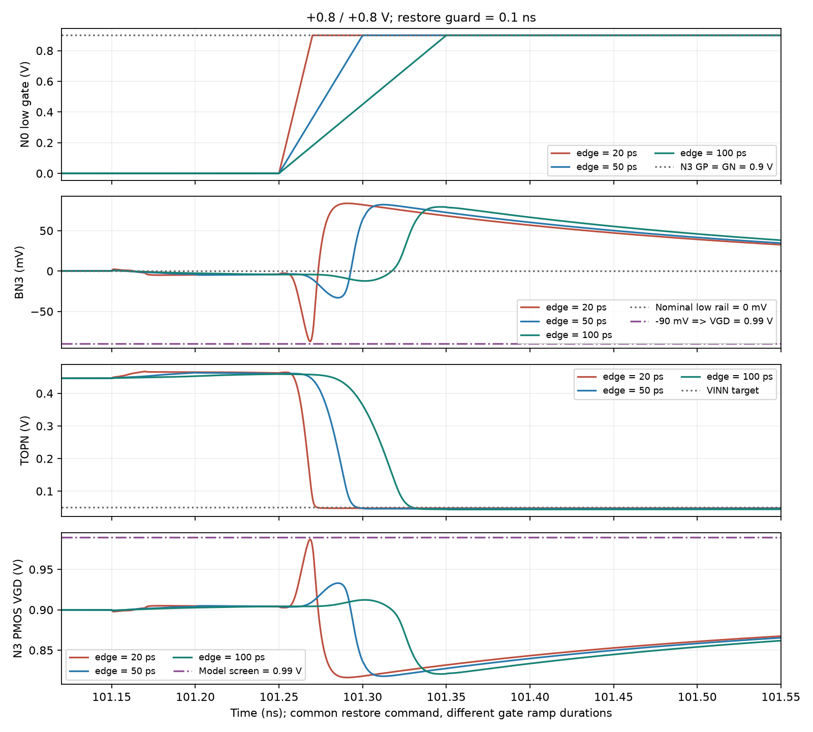
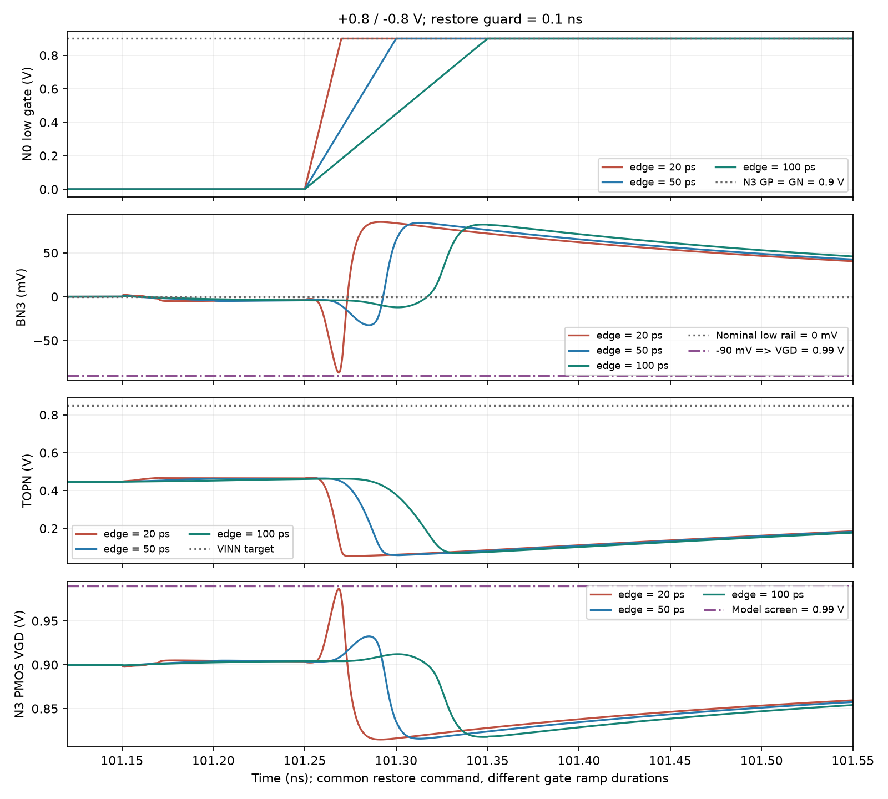
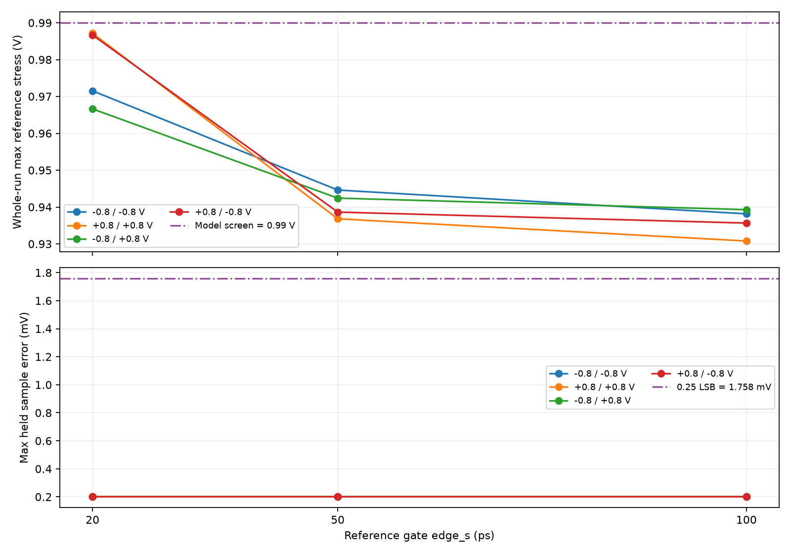

# SAR8 参考栅压边沿与恢复裕量对照

把理想参考栅压边沿从20 ps放缓至50 ps、100 ps，均改善了本轮四种输入下的
参考开关端电压裕量，未损失采样精度或转换功能。四种输入中参考管最坏值
从0.987137 V降至0.944611 V和0.939290 V，距0.99 V筛查限值的最小裕量从
2.863 mV扩大到45.389 mV和50.710 mV。当前建议优先保留50 ps为下一轮候选，
100 ps作为对照；本轮没有修改远端OA或替换R2。

## 电路和仿真条件

保持0.1 ns参考恢复等待、100 ps逻辑非交叠和200 ps请求稳定提交通知。
只在16个已有理想参考栅控实例上增加 `edge_s=50p` 或 `100p`；删除这16处
参数后，网表与对应20 ps基准在换行规范化后完全一致。原生拓扑、W/L、
MOM阵列、3x参考开关、Bootstrap、StrongARM、原生异步控制器及两个
Verilog-A源文件字节不变。这个参数同时作用于采样恢复和转换换轨，不是
只改变恢复边沿，更不是新设计的管级时钟驱动。

Spectre 21.1 APS，TT / 0.9 V / 27°C，每组200 ns、最大步长10 ps，保存全部
求解点。每侧输入50 Ω、每轨参考50 Ω＋4 pF；模型include与section、温度、
容差、保存信号及全部输入激励沿用对应基准。四种连续两帧差分输入为
−0.8/−0.8、+0.8/+0.8、−0.8/+0.8、+0.8/−0.8 V。跨帧100 ps翻转仍在
100.8–100.9 ns完成，第二次采样约101.05 ns开始，保留完整40 ns获取时间。

八组50/100 ps新仿真共16帧、128次比较/写入/更新；四组20 ps只复用已核验
网表、源文件及波形指纹的原始运行，共8帧，不计作新仿真。全部原始运行
result.ok，200 ns数据完整且有限。

## N3峰值确实下降

正大输入第二次参考恢复时，N3高轨PMOS的GP始终为0.9 V，低轨NMOS的GN
也始终为0.9 V。变化发生在其他bank的栅压边沿及N3底板，而不是压低N3的
关断栅压来掩盖VGD。

| 正大输入N3指标 | 20 ps基准 | 50 ps | 100 ps |
| --- | ---: | ---: | ---: |
| BN3最低值 | −87.137 mV | −33.042 mV | −12.284 mV |
| PMOS最大VGD | 0.987137 V | 0.933042 V | 0.912284 V |
| 该峰值时刻 | 101.268687 ns | 101.285450 ns | 101.301518 ns |
| 峰值时VREFN | +48.130 mV | +36.947 mV | +14.798 mV |

同一时刻高轨PMOS体端仍为0.9 V，因此其绝对VDB与VGD同时下降，改善并非
只移动栅压。正到负的N3 VGD也从0.986687 V降至0.932477 V、0.912117 V。



从上到下分别为实际换轨N0的低轨栅压、N3底板、公共TOPN、N3高轨PMOS
VGD。三组使用同一绝对时间轴；虚线给出N3恒定栅压、名义低轨、输入目标
和0.99 V筛查限值。放缓后公共顶板变化更平缓，底板负尖峰减小，与上一轮
“公共顶板电容耦合、低轨开关有限导通电阻”的诊断一致。

本实验同时改变关断/开启边沿持续时间和实际交接门限时刻，没有分别隔离
两个边沿及小幅移相的贡献；结果证明这组参数调整有效，不量化各机制占比。



## 扫描全部器件后的裕量

参考32管、比较器11管均扫描六组两两端电压，并保留初始获取、输入翻转、
第二次恢复/获取、转换及全程最坏值。以下为全200 ns参考管最大值，不局限
于N3或一个很窄的显示窗口。

| 输入序列 | 20 ps | 50 ps | 100 ps |
| --- | ---: | ---: | ---: |
| −0.8 → −0.8 V | 0.971532 V | 0.944611 V | 0.938153 V |
| +0.8 → +0.8 V | 0.987137 V | 0.936810 V | 0.930779 V |
| −0.8 → +0.8 V | 0.966629 V | 0.942421 V | 0.939290 V |
| +0.8 → −0.8 V | 0.986687 V | 0.938626 V | 0.935649 V |
| 四种输入最小参考裕量 | 2.863 mV | 45.389 mV | 50.710 mV |

最坏管已经转移。正大输入50 ps时，参考最坏点为N0低轨NMOS的VDS，
约101.200 ns；100 ps时为N4低轨NMOS的VDS，约101.263 ns。全输入100 ps
的最坏参考点则是负到正时P7低轨NMOS的VDS，约101.267753 ns。不能继续把
N3 VGD当作参考网络唯一约束。

比较器全程最大端电压三种边沿均约0.950686 V。因此，对本次扫描的参考管
和比较器，50/100 ps的最小裕量均约39.314 mV，限制已经转到比较器；进一步
放缓到100 ps并未增加这一合并扫描的最小裕量。

八组新运行均0错误、0CMI、0LTE，仍各有7条既有配置警告
（VACOMP-2435×1、SFE-2453×2、SFE-1131×4）。初始DC的GminDC提示保留；
正到负组还保留Bad pivoting notice，总notice为6，其余为5。未改gmin或
关闭检查，没有瞬态收敛失败。

## 时序和采样误差

逻辑非交叠命令仍是100 ps，但实际50%门限时刻随边沿变化：

| 边沿 | 旧轨关断50% | 新轨开启50% | 50%非交叠 | 1%栅压门限间隔 |
| --- | ---: | ---: | ---: | ---: |
| 20 ps | 101.160 ns | 101.260 ns | 100 ps | 80.4 ps |
| 50 ps | 101.175 ns | 101.275 ns | 100 ps | 51.0 ps |
| 100 ps | 101.200 ns | 101.300 ns | 100 ps | 2.0 ps |

同次变化bank的栅门限偏斜为0；全程没有高低使能同时超过50%或1%门限。
这里的1%间隔是旧使能降到1%与新使能升到1%的时间差，不是晶体管实际
导通阈值，也不是支路贯通电流的直接测量。100 ps边沿下旧栅压刚走完全摆幅，
新栅压就开始变化；不能把它描述成只剩2 ps实际非交叠，50%非交叠仍是100 ps。

差分采样误差定义为 `(TOPP−TOPN)−(VINP_SRC−VINN_SRC)`，使用输入源端
而非串联电阻后的节点作基准。检查点仍是关断前0.1 ns、关断后0.5 ns、
首次实际比较前20 ps。下表为四种输入、各两帧中绝对值最大值。

| 指标 | 20 ps | 50 ps | 100 ps |
| --- | ---: | ---: | ---: |
| 保持后采样误差 | 0.200475 mV | 0.200474 mV | 0.200474 mV |
| 首次比较前误差 | 0.200486 mV | 0.200485 mV | 0.200485 mV |
| 全转换最大比较前残差 | 0.807895 mV | 0.808021 mV | 0.808251 mV |
| 验收参考 | 1.757813 mV | 1.757813 mV | 1.757813 mV |

采样误差约0.201 mV，没有退化；最后几位差异不代表物理精度改善。每帧仍有
8次原生比较、写入、更新，输出码分别为14/14、241/241、14/241、241/14；
位序、比较器判决、物理映射、保持前中点字及读码窗口全部通过。



局部N3尖峰改善不等于所有节点瞬态过冲都单调下降。例如正大输入获取阶段
TOPP最高值从20 ps的0.850206 V变成50 ps的0.851260 V、100 ps的0.855192 V。
这些仍在电源轨内，且完整获取后误差通过；不能宣称所有瞬态扰动归零。

## 候选选择与边界

建议下一轮优先采用“0.1 ns恢复等待＋50 ps参考边沿”作为候选，而不立即
冻结：它已使参考侧不再限制本轮参考/比较器合并扫描的最小裕量，比100 ps
保留更大的栅压全摆幅端点间隔，且改变实际交接时刻更少。100 ps仍是有效的
低参考应力对照，是否用于实际驱动需结合驱动电流、时序及PVT重新评估。

本次只验证四种输入历史的TT名义原理图网表，未覆盖全码、所有输入相位、
PVT、失配、噪声、实际门驱动、完整Bootstrap内部应力、版图或寿命可靠性。
R2活动基线和远端OA均保持原样；没有自动采用候选或调整W/L。

## 文件与复现

- 参数生成及运行：`scripts/integration/reference_edge_slew.py`。
- 原生检查、N3读数、1%门限与绘图：
  `scripts/integration/reference_edge_slew_analyze.py`。
- 上下文、源/网表/波形指纹、逐帧与分阶段结果：
  `verification/integration/reference_edge_slew_results.json`。
- 原始网表、日志、PSF、全波形和绘图片段：忽略目录
  `output/sar8_reference_edge_slew/`。绘图片段保留所选窗口全部原始点，不抽稀。
- 三项针对性测试覆盖16处参数差异、基准/来源不变、全部采样/功能/应力和
  实际门限时序；Python语法检查通过。

```powershell
E:/bridge-Agent-T28/virtuoso-bridge-lite/.venv/Scripts/python.exe scripts/integration/reference_edge_slew.py prepare
E:/bridge-Agent-T28/virtuoso-bridge-lite/.venv/Scripts/python.exe scripts/integration/reference_edge_slew.py run
.venv/Scripts/python.exe scripts/integration/reference_edge_slew_analyze.py nfull_e50ps pfull_e50ps n_to_p_e50ps p_to_n_e50ps nfull_e100ps pfull_e100ps n_to_p_e100ps p_to_n_e100ps --baselines --curate
E:/bridge-Agent-T28/virtuoso-bridge-lite/.venv/Scripts/python.exe -m unittest verification.integration.test_reference_edge_slew -v
```

已有case不可覆盖，前两行仅首次准备/运行。可重复第三行离线分析，不覆盖
原始波形；只重画图和汇总时可执行分析器的 `--curate`。
