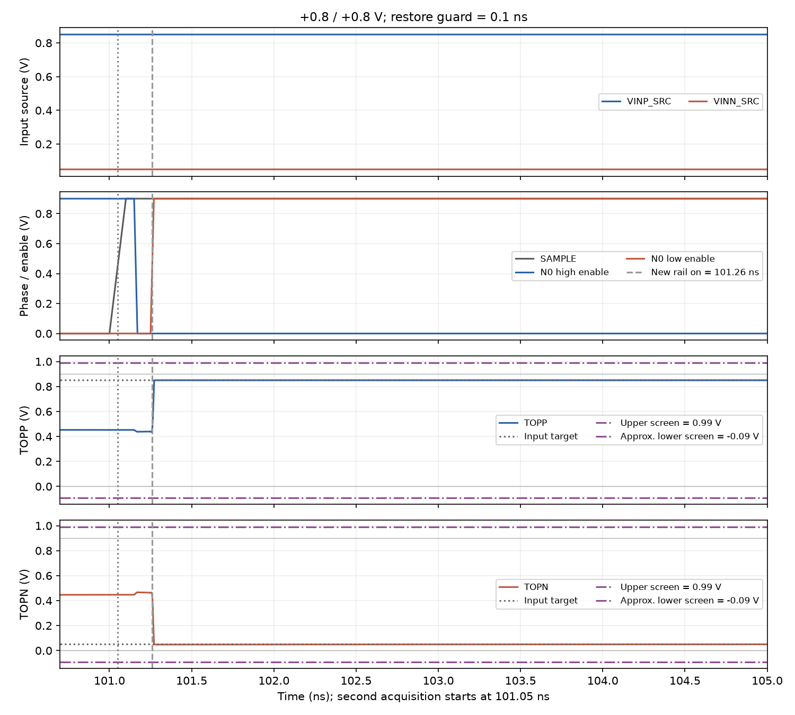
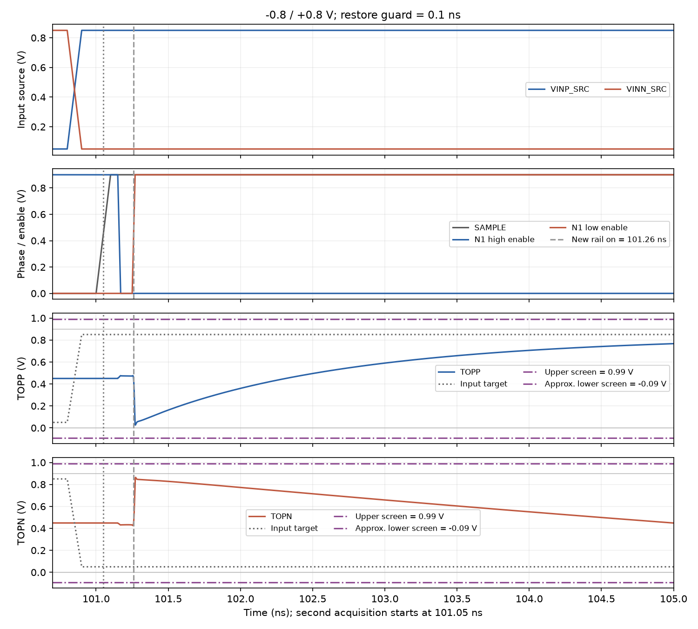
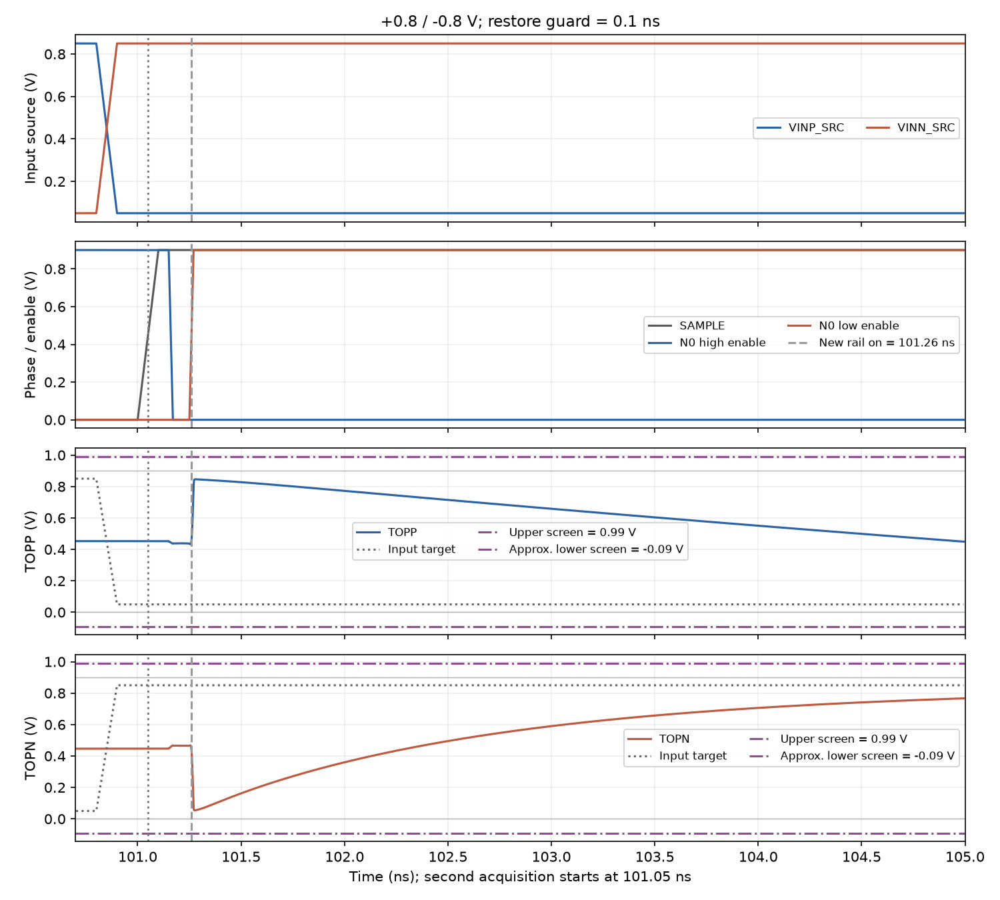
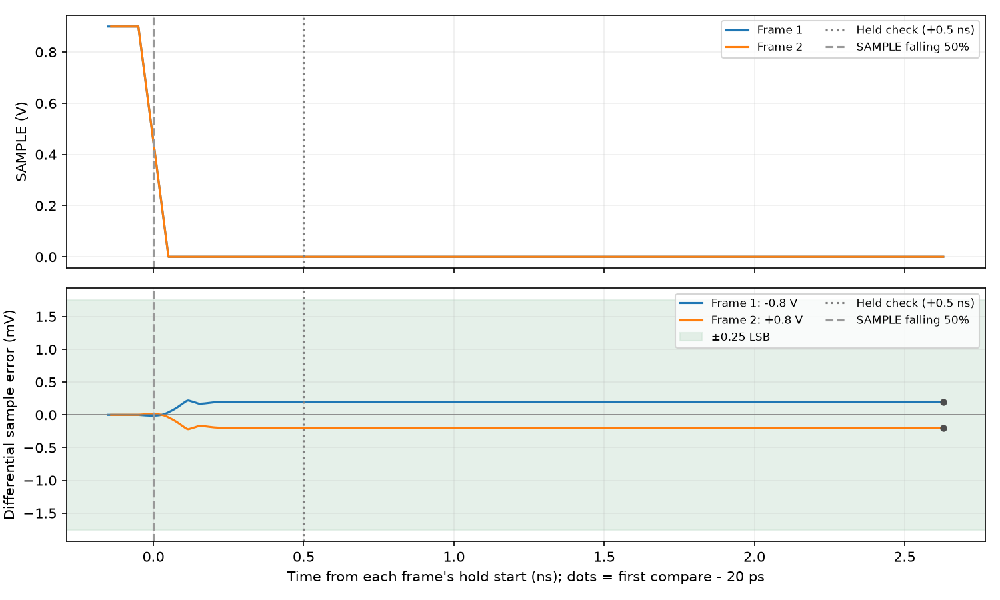

# SAR8 参考恢复候选的正输入和跨帧切换验证

0.1 ns参考恢复候选通过本轮正大输入、负到正、正到负的网表级检查：三组共六帧
均完成正确转换，保持后差分采样误差约0.2005 mV，参考管和比较器均未超过
0.99 V端电压筛查限值。但正大输入的参考管峰值为0.987137 V，仅余2.863 mV
裕量；候选保留，不据此升级为充分验证的冻结版本。

## 条件与输入时序

三组均直接派生自上一轮已核验的 `nfull_g100ps` 网表，只改变VDIFF参数及
两路输入源语句。去除这三处允许变化的语句内容后，文本与候选完全一致；
所有子电路体、连接、尺寸、MOM阵列、3x参考开关和16处100 ps恢复参数不变。
R2及之前实验的源文件、Verilog-A字节、网表、波形和结果指纹均保持不变。

沿用Spectre 21.1 APS，TT / 0.9 V / 27°C，200 ns，最大步长10 ps，保存全部
求解点；输入每侧50 Ω，参考每轨50 Ω＋4 pF，模型include及section、容差、
保存节点集均继承R2。理想栅压、100 ps非交叠、20 ps栅边沿和转换请求稳定
200 ps再提交的时序不变。远端Virtuoso原理图没有修改，仍是原R2时序。

| 场景 | 第一帧差分输入 | 第二帧差分输入 | 实测输出码 |
| --- | ---: | ---: | --- |
| 正大输入 | +0.8 V | +0.8 V | 241 → 241 |
| 负到正 | −0.8 V | +0.8 V | 14 → 241 |
| 正到负 | +0.8 V | −0.8 V | 241 → 14 |

共模固定0.45 V：+0.8 V对应VINP/VINN=0.85/0.05 V，−0.8 V则相反。
跨帧输入在100.8–100.9 ns作100 ps线性翻转，晚于第一帧95–99 ns读码窗口，
早于下一次采样。实际源波形与定义的PWL最大偏差小于1 pV。

第二次SAMPLE约101.05 ns达到50%，旧参考轨约101.16 ns关断、新轨约
101.26 ns开启，实测100 ps非交叠、无重叠、同次变化bank的栅门限偏斜为0。
保持从141.05 ns开始；因此新输入经历完整约40 ns获取时间。

本轮是三个新运行、六个新帧、48次真实比较/写入/更新。上一轮负大输入恒定
两帧只作为带指纹的背景对照保留，不计作新仿真。

## 器件应力和顶板过冲

逐时间点扫描参考32管和比较器11管的六组两两端电压。全200 ns最坏值如下；
这不同于只检查TOPP/TOPN是否落在电源轨内。

| 场景 | 参考管最大端电压 | 距0.99 V裕量 | 比较器最大端电压 | CMI / LTE |
| --- | ---: | ---: | ---: | --- |
| 正大输入 | 0.987137 V | 2.863 mV | 0.950686 V | 0 / 0 |
| 负到正 | 0.966629 V | 23.371 mV | 0.950686 V | 0 / 0 |
| 正到负 | 0.986687 V | 3.313 mV | 0.950686 V | 0 / 0 |
| 上轮负大输入恒定，仅对照 | 0.971532 V | 18.468 mV | 0.950686 V | 0 / 0 |

正大输入的参考最坏点在101.268687 ns，为N3高轨PMOS的VGD；正到负的最坏
点也在N3的VGD，时间为101.268622 ns。负到正则是P3高轨PMOS的VDB，发生
在101.267199 ns。三个点均处于参考恢复，并非后续SAR试位。顶板不过电源轨
不能代替这些局部参考开关的端电压检查。

第二次完整获取窗口101.05–141.05 ns的顶板范围为：

| 场景 | TOPP最低 / 最高 | TOPN最低 / 最高 | 比较器恢复阶段最大端电压 |
| --- | --- | --- | ---: |
| 正大输入 | 0.435684 / 0.850206 V | 0.047716 / 0.467571 V | 0.904522 V |
| 负到正 | 0.025914 / 0.850000 V | 0.049970 / 0.863950 V | 0.904950 V |
| 正到负 | 0.049970 / 0.846205 V | 0.054094 / 0.850000 V | 0.904547 V |

本轮三个窗口内两侧顶板均没有越出0–0.9 V。输入翻转到下一次采样前的
100.8–101.05 ns也没有新的参考/比较器过压：参考端电压最大0.9 V，比较器
约0.9 V。比较器全程0.950686 V的最坏点位于正常转换阶段。

三组原生运行均0个错误、7条既有配置警告，没有CMI或LTE及其抑制重复项。
配置项为VACOMP-2435×1、SFE-2453×2、SFE-1131×4，未关闭模型检查。

初始DC求解均有GminDC影响解的notice；正到负还多一条Bad pivoting提示，
notice总数为5 / 5 / 6。模拟器经初始条件求解后完成完整瞬态，没有瞬态收敛
失败。上述诊断原样保留在日志和结果清单，未调整gmin或求解选项来消除提示；
首帧获取后的检查通过，不等同于初始DC状态或任意上电过程已验证。

## 恢复时序图

各图从上到下为输入源、SAMPLE与一组实际换轨bank使能、TOPP、TOPN；虚线
给出输入目标和筛查参考。正历史码下MSB可能不换轨，因此选N0或N1作为
时序示例，而不是始终画MSB。正式结论覆盖全部bank及内部端电压。







跨帧切换后，参考恢复会使顶板先朝上一帧对应的方向跳变，再通过已进入
跟踪状态的采样路径向新输入建立。图中头几纳秒偏离新输入是获取过程，
不是最终保持采样误差；本轮40 ns获取结束时没有可见的上一帧残留。

## 采样误差与转换残差

差分误差仍定义为 `(TOPP−TOPN)−(VINP_SRC−VINN_SRC)`，不是以串联输入
电阻后的节点作基准。下表取每组两帧中绝对值最大值，保持检查在关断后
0.5 ns，首次比较检查在实际CMP_CLK上升前20 ps。

| 场景 | 关断前0.1 ns | 保持后0.5 ns | 首次比较前 | 后续全转换最大比较前残差 |
| --- | ---: | ---: | ---: | ---: |
| 正大输入 | <0.001 mV | 0.200474 mV | 0.200485 mV | 0.806456 mV |
| 负到正 | <0.001 mV | 0.200461 mV | 0.200469 mV | 0.807895 mV |
| 正到负 | <0.001 mV | 0.200462 mV | 0.200470 mV | 0.807889 mV |

全部小于0.25 LSB＝1.7578125 mV。第二帧保持差分误差依次约−0.200474、
−0.200461、+0.200462 mV，符号随输入极性翻转，大小与恒定输入接近。
各侧误差约−0.36 / −0.56 mV、共模误差约−0.46 mV仍存在，不能说绝对
误差消失。极小的关断前误差只表示本次数值获取已建立，不是噪声或ENOB结论。



横轴对齐各帧保持起点，绿色区为±0.25 LSB，圆点为首次比较前检查。
另两组同格式图保存为同目录下的 `pfull_g100ps_sample_error.png` 和
`p_to_n_g100ps_sample_error.png`。六张图均已检查可读性。

每帧8次比较、写入、更新，比较器判决状态、符号、位序、物理参考映射、
保持前中点字及读码窗口均通过。约0.808 mV是含后续CDAC试位的最坏残差，
不应与约0.201 mV的采样保持误差混用。

## 候选状态与验证边界

0.1 ns通过本轮正负极性及两种前帧历史检查，可以继续保留为候选；最需要
关注的是参考恢复时N3高轨PMOS仅约3 mV的端电压裕量，而非采样精度。
本次输入在采样开始前翻转，并保留完整40 ns获取时间，不代表任意相位输入
跳变或更短获取时间均通过。模型筛查不是器件寿命结论，也未覆盖所有
Bootstrap内部端电压、PVT、失配、噪声或版图。没有修改W/L、引入实际栅驱动
或自动采用候选；远端OA及R2活动基线均不变。

## 文件与复现

- 生成/运行：`scripts/integration/restore_cross_input.py`。
- 应力、源波形、采样误差、实际换轨边沿和绘图：
  `scripts/integration/restore_cross_input_analyze.py`。
- 上下文、源/网表/波形指纹、逐帧结果和分阶段应力：
  `verification/integration/restore_cross_input_results.json`。
- 原始网表、PSF、完整日志及波形：忽略目录 `output/sar8_restore_cross_input/`。
- 四项针对性测试及Python语法检查通过；原R2及候选来源不变检查通过。

```powershell
E:/bridge-Agent-T28/virtuoso-bridge-lite/.venv/Scripts/python.exe scripts/integration/restore_cross_input.py prepare
E:/bridge-Agent-T28/virtuoso-bridge-lite/.venv/Scripts/python.exe scripts/integration/restore_cross_input.py run
.venv/Scripts/python.exe scripts/integration/restore_cross_input_analyze.py pfull_g100ps n_to_p_g100ps p_to_n_g100ps --curate
E:/bridge-Agent-T28/virtuoso-bridge-lite/.venv/Scripts/python.exe -m unittest verification.integration.test_restore_cross_input -v
```

已有case不可覆盖；前两行仅用于首次建立实验，第三行可离线重分析。
