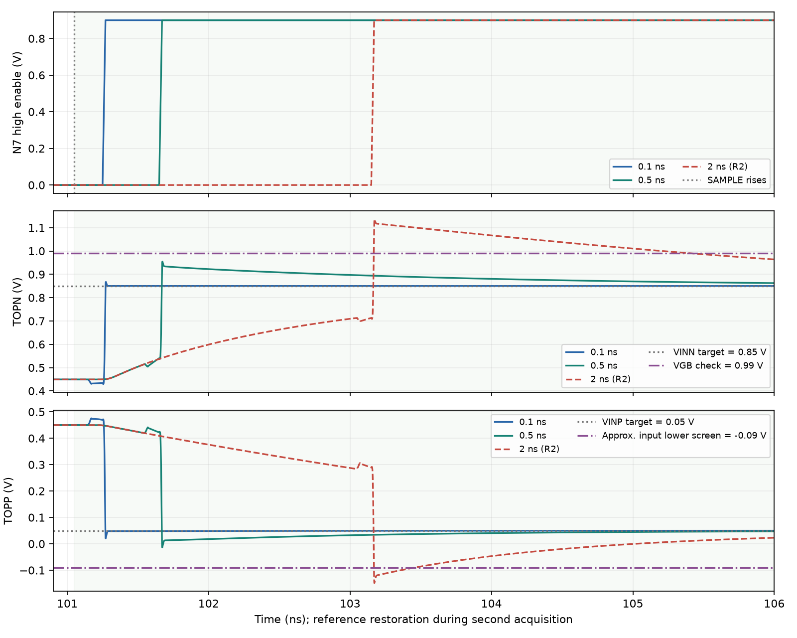
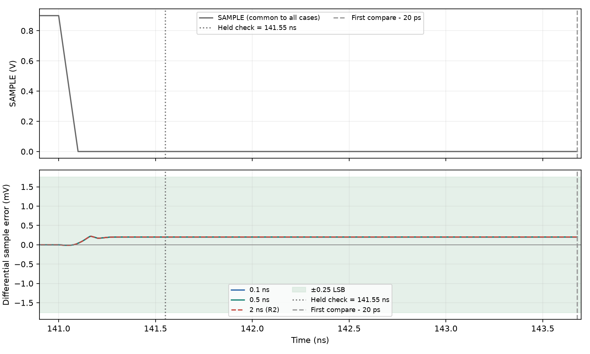

# SAR8 提前参考恢复：0.1 / 0.5 / 2 ns 对照

在负大输入 −800 mV、TT / 0.9 V / 27°C 的本轮案例中，把参考恢复等待从
R2 的 2 ns 缩短到 0.1 ns 或 0.5 ns，均消除了所检查参考管、比较器的
0.99 V 端电压超限；保持后差分采样误差仍约 0.201 mV，没有退化。
0.1 ns 的顶板波形更温和。0.5 ns 仍有轻微电源轨外过冲，不能称为完全无过冲。
本轮仅网表级验证，未修改远端 OA，也未替换当前 R2。

## 改了什么，没改什么

以已保存 OA 导出的 R2 `nfull` 网表为基准，仅在16个理想参考栅控实例上
增加 `restore_guard_s=100p` 或 `500p`。删除这16个参数后，网表文本在
换行规范化后与原 R2 完全一致；原生子电路、连接、尺寸、两个参考控制
Verilog-A 源文件字节均未改变。Bootstrap、StrongARM、原生控制器、MOM
阵列和 3x 参考开关保留；没有用理想 DAC 替代电气负载。

两组新仿真沿用 Spectre 21.1 APS、200 ns、最大步长10 ps，保存全部求解点；
参考每轨50 Ω＋4 pF、输入每侧50 Ω，激励、模型及 section、容差、保存信号
均继承 R2。每组输入连续两帧为 −800 mV（VINP=0.05 V、VINN=0.85 V）。
2 ns 对照复用已核对网表、波形和源文件指纹的 R2 全时间点原始运行，未重复跑。

这里的“恢复”是采样开始后，把上一帧最终参考选择字恢复为下一帧的中点
选择字，不是 Bootstrap 的 BOOT 复位，也不是把电容两端短路清零。第二次
采样约101.05 ns开始；P/N高轨选择字分别从241/14恢复到127/128。

参数是恢复命令等待时间，不是新轨实际开启时间。100 ps非交叠和20 ps栅
边沿不变；实际50%门限读数如下，同次变化的各bank无可测开启/关断偏斜。

| 等待参数 | 旧轨关断 | 新轨开启 | 实测非交叠 |
| --- | ---: | ---: | ---: |
| 0.1 ns | 101.160 ns | 101.260 ns | 100 ps |
| 0.5 ns | 101.560 ns | 101.660 ns | 100 ps |
| 2 ns（R2） | 103.060 ns | 103.160 ns | 100 ps |

没有高低轨使能重叠；转换阶段整字稳定200 ps再提交的 R2 时序也保持不变。

## 恢复瞬间的过压

以下顶板极值和端电压扫描范围为第二次采样101.05–141.05 ns。端电压检查
覆盖参考32管、比较器11管的六组两两端电压，不是仅以顶板是否越出电源轨判断。

| 指标 | 0.1 ns | 0.5 ns | 2 ns（R2） |
| --- | ---: | ---: | ---: |
| TOPN最大值 | 0.867565 V | 0.954677 V | 1.136126 V |
| TOPP最小值 | +0.020513 V | −0.013663 V | −0.148911 V |
| 比较器最大端电压 | 0.904917 V | 0.954677 V | 1.136126 V |
| 参考管最大端电压 | 0.971532 V | 0.968864 V | 0.974975 V |
| CMI超限警告（全200 ns） | 0 | 0 | 10条打印，后续重复被抑制 |



从上到下为N7新高轨使能、TOPN、TOPP；横轴使用相同绝对时间。虚线给出
输入目标，点划线为相关端电压筛查参考。TOPP的 −0.09 V 仅是内部节点接近
VDD时的近似下界，正式应力结论来自全部保存内部节点的逐端电压扫描。

0.1 ns在恢复窗口内两侧顶板均留在0–0.9 V，但相对最终输入目标仍有短暂
扰动；0.5 ns仍越出电源轨，却未达到0.99 V模型检查限值。两者必须区分。
全200 ns比较器最大端电压分别为0.950686 / 0.954677 / 1.136126 V；
0.1 ns的全程比较器最坏点已转到正常转换阶段，而非参考恢复。

这与前一轮诊断一致：R2等待2 ns时，顶板已朝输入电压移动，再叠加恢复
参考的快速底板电荷重分配，形成较大过冲。提前恢复改变了这一跳变发生时
的顶板初始电压和采样开关状态，不是把切换电荷或参考源阻抗理想化消除。
参考管全程最坏端电压在0.1 ns时略高于0.5 ns，因此不能说0.1 ns的每项
器件应力都更优。

两组新运行均0个仿真错误、0条CMI、0条LTE，仍各有7条既有配置警告
（VACOMP-2435×1、SFE-2453×2、SFE-1131×4）。未关闭模型检查。

## 采样误差和完整转换

差分误差定义为 `(TOPP−TOPN)−(VINP_SRC−VINN_SRC)`，以输入源端而非
输入串联电阻后的节点为基准。下表为两帧中绝对值最大值；第二帧保持起点
141.05 ns，保持检查点141.55 ns，首次比较前20 ps约143.678 ns。

| 检查点 | 0.1 ns | 0.5 ns | 2 ns（R2） |
| --- | ---: | ---: | ---: |
| 采样关断前0.1 ns | <0.001 mV | <0.001 mV | <0.001 mV |
| 关断后0.5 ns保持误差 | 0.200475 mV | 0.200482 mV | 0.200639 mV |
| 首次比较前误差 | 0.200486 mV | 0.200495 mV | 0.200696 mV |



三条误差曲线几乎重合，均低于0.25 LSB＝1.7578125 mV。提前恢复没有引入
可见的保持误差代价，但也没有消除约0.201 mV的关断后残差。极小的关断前
差异接近数值精度，不能据此宣称纳伏精度、噪声或ENOB改善。

第二帧0.1 ns方案保持时，TOPP约0.049640 V、TOPN约0.849440 V：各自误差
约−0.360 / −0.560 mV，差分残差约+0.200 mV，仍有共模偏移约−0.460 mV。
差分较小不代表两侧绝对误差都消失。

三种条件各两帧均输出14、14，每帧8次比较、8次写入、8次更新；比较器判决、
位序、物理参考映射及读码窗口均通过。全转换过程中最大比较前残差三者均约
0.807895 mV，小于1.7578125 mV；该指标包含后续CDAC试位，不能混称为
采样保持误差。新仿真仅两组四帧，另两帧来自复用的R2对照。

## 判断和下一步边界

本轮支持“提前参考恢复可修复负大输入的恢复超限”，不支持已完成全输入、
PVT或寿命可靠性验证。0.1 ns可作为下一轮候选：顶板不过电源轨、比较器恢复
应力更低；仍需检查正大输入、跨帧反向输入变化及不同上一帧码字，再决定是否
采用。此次不改 OA、不调整W/L、不替换 R2，不增加真实时钟驱动、噪声或失配。

## 证据和复现

- 参数生成及原版保护：`scripts/integration/restore_guard.py`。
- 后处理和两张图：`scripts/integration/restore_guard_analyze.py`。
- 指纹、逐帧误差、时序及分阶段应力：
  `verification/integration/restore_guard_results.json`。
- 原始网表、上下文、日志、PSF及全部波形：忽略目录
  `output/sar8_restore_guard/`；R2对照仍在 `output/sar8_join_r2/`。
- 四项针对性测试覆盖16处参数差异、R2源/模型/波形不变、来源指纹及采样、
  功能、实际恢复边沿和应力结果；Python语法检查通过。

```powershell
E:/bridge-Agent-T28/virtuoso-bridge-lite/.venv/Scripts/python.exe scripts/integration/restore_guard.py prepare
E:/bridge-Agent-T28/virtuoso-bridge-lite/.venv/Scripts/python.exe scripts/integration/restore_guard.py run
.venv/Scripts/python.exe scripts/integration/restore_guard_analyze.py nfull_g100ps nfull_g500ps --baseline --curate
E:/bridge-Agent-T28/virtuoso-bridge-lite/.venv/Scripts/python.exe -m unittest verification.integration.test_restore_guard -v
```

已有case不可覆盖，前两行仅用于首次建立实验；离线重分析使用第三行。
指纹文本统一按UTF-8及规范化换行计算，避免Windows默认编码影响来源核验。
