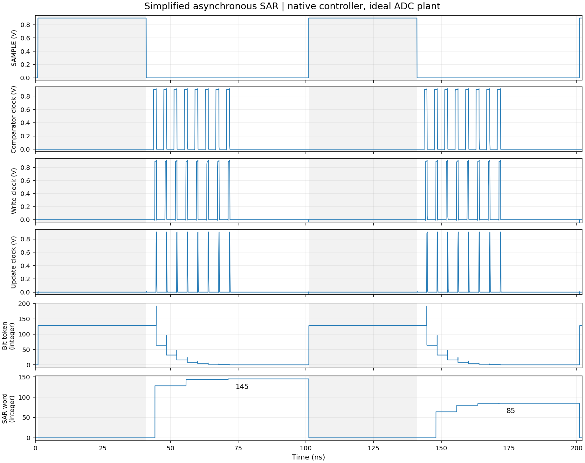
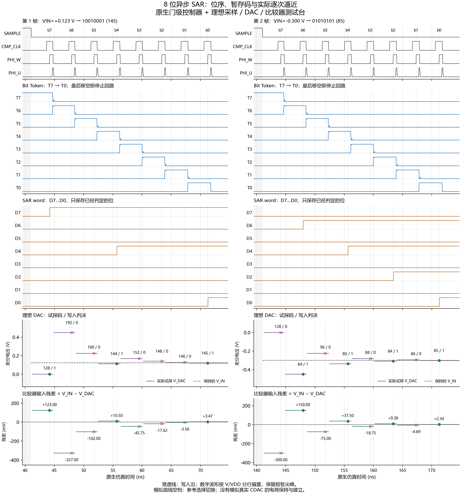
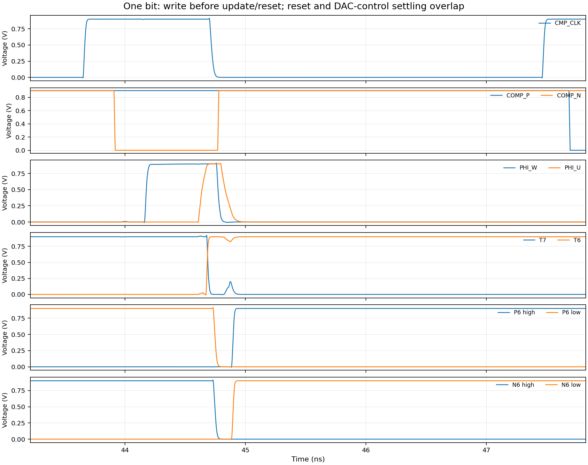
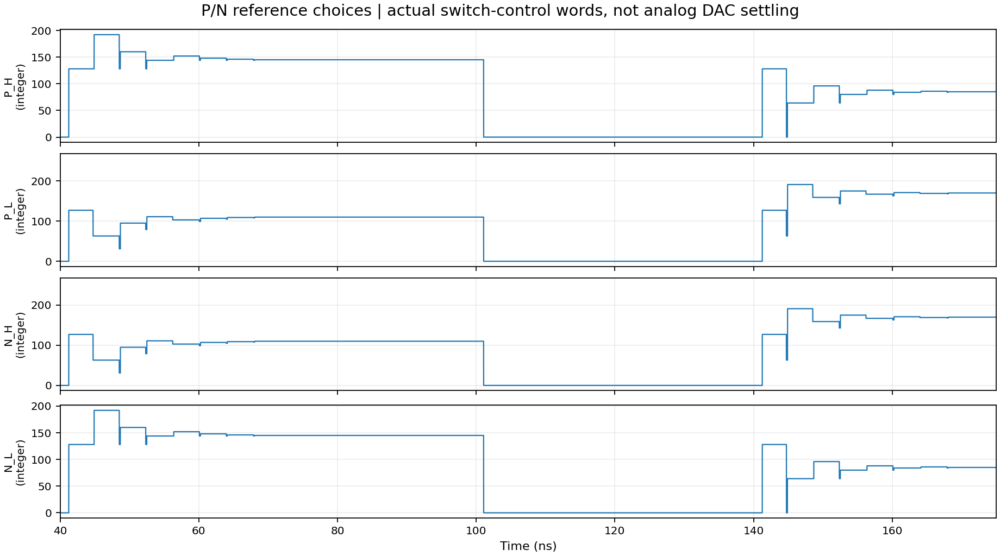
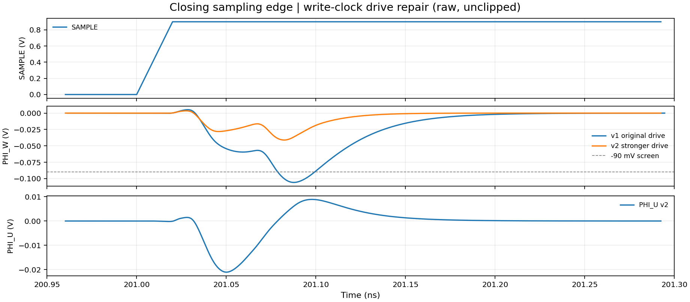

# 精简异步 SAR：采样初始化、本地位循环

2026-10-20。当前对象仍是 **8 bit、10 MS/s、0.9 V**，不是并行探索的10位
CDAC。新控制器为 `SAR_ADC_T28/sar_logic_8b_async_simple/schematic`。
旧 `sar_logic_8b_async` 及其结果保留，不能把旧版本的保护状态带回这个核心。

本版本是原生 CMOS 控制器的有界验证，不是完整物理 ADC 验收。具体结果和
未过门槛以 [验证摘要](../verification/sar8_simple/summary.json) 为准。

## 本次验证范围

Bridge0.8.0、Spectre21.1.0.509.isr12，均为APS确定性瞬态；最终版本13个
case全部 `result.ok`，功能及声明的控制时序检查通过，但FF器件应力未通过。

| 验证组 | case数 | 结果/边界 |
| --- | ---: | --- |
| TT两帧，maxstep50ps及10ps | 2 | 145、85；每帧8次比较/写入/更新，TT无CMI |
| 固定判决模式0、255、85、170 | 4 | 码字正确；不是四个真实模拟输入的ADC性能测试 |
| 快慢比较延时种子20ps、1.2ns | 2 | 165；慢种子另有位相关扩展，末位约79.62ns |
| SS0.81V125C、FF0.99V-40C | 2 | 控制器末位约74.08/67.82ns；FF有SOA警告 |
| 中途采样打断、三帧卡住/恢复 | 2 | 打断后重新MSB；卡住帧部分码160，下一帧恢复165 |
| 未修改StrongARM代表码 | 1 | 145，末位约70.31ns；采样/DAC仍是理想模型 |

全256码及全部8个位位置的卡住/恢复另有实际导出网表的功能抽象验证，
它不是256码晶体管仿真。未开启瞬态噪声，未测整机ENOB/功耗。

## 接口与 cell

唯一周期控制输入为 `SAMPLE`。比较器接口为 `COMP_P/COMP_N/CMP_CLK`；
电源为 `VDD/VSS`。输出 `D7..D0` 是工作寄存器，不是另一个保持输出银行。
`BP_H/L[7:0]`、`BN_H/L[7:0]` 分别驱动 P/N 阵列的高、低参考选择。

| Cell | 数量 | 作用 |
| --- | ---: | --- |
| `sar8s_timing` | 1 | 本地比较、写入、更新相位；只有一个比较器时钟 SR 锁存器 |
| `sar8s_bitseq8` | 1 | 8位位序链，采样时回到MSB，末位移出后为空 |
| `sar8s_bit` | 8 | 当前位保存判决，其余位保持；生成本位试探控制 |
| `sar8s_bp_p8` | 1 | P阵列8位底板参考选择和本地先断后通 |
| `sar8s_bp_n8` | 1 | N阵列8位参考选择，与P阵列按同一差分规则配合 |

完整 [cell与端口清单](../verification/sar8_simple/cells.json)。逻辑、触发器、
时钟缓冲和延时共21种原生cell；另有 `tb_sar8s_logic`、
`tb_sar8s_strongarm` 两个测试台。控制器递归展开1476个MOS、257个显式
理想电容、70个理想电阻，未做面积/功耗优化。状态单元为16个DFF
（8位序＋8工作位）及1个时钟SR，不含输出银行或多阶段FSM。

不存在独立的 `RST_N/HOLD_START/WORK_RST/ACCEPT/USED/HOLD/TRIAL/RESET_OK/`
`DEADLINE/PREPARE/FAULT/BUSY/VALID/EOC` 控制接口或状态。
门级触发器仍有内部初始化端，直接连接 `SAMPLE`，不是取消初始化动作。

## 一帧时序

1. `SAMPLE=1`：停止本地回路，比较器复位，工作码清零，位序初始化为
   `10000000`；两组参考选择关闭。必须先经过完整采样相位才能使用结果。
2. `SAMPLE`下降：参考选择进入MSB试探连接；经过首次建立间隔，
   `CMP_CLK`上升。测试台仅一个采样脉冲源，无独立43/89/90ns命令。
3. 比较器判决输出变为10或01：本地接收器及资格延时产生写入脉冲
   `PHI_W`；当前位在其上升沿写入。原始XOR不直接作为寄存器时钟。
4. 延时后产生 `PHI_U`：推进位序并复位比较器；P/N参考选择随新试探码
   更新。该脉冲不反馈门控于正在变化的位序，避免换位偏斜切碎时钟。
5. 写入/更新脉冲返回低电平后启动静默延时；覆盖比较器复位和参考控制
   传播/先断后通/预留DAC建立时间，再进行下一位。没有复位完成确认。
6. LSB先写入，随后位序移空；位序OR值只抑制下一次启动，不另存完成状态，
   不产生EOC。最终码字保持到下一次采样初始化。

采用传统二进制试探一：`CODE[i] = D[i] OR T[i]`。写入后当前试探位仍由
token保持，到更新时才改变底板，避免判决写入时改变被比较的残差。
SAR单元是边沿触发，不是整个PHI_W高电平透明的锁存器。

## 两个周期与关键间隔



测试台采样约为1–41ns、101–141ns；读取窗口为95–99ns、195–199ns。
理想采样差分输入+0.123V、-0.300V分别得到145、85。正常帧恰好8次比较、
8次写入和8次移位，没有第9次启动。

### 8位展开与逐次逼近



[可放大SVG](figures/sar8_simple/bitwise_approximation.svg)；
[两个完整采样周期逐位总览](figures/sar8_simple/bitwise_two_cycles.png)
（[SVG](figures/sar8_simple/bitwise_two_cycles.svg)）。

从上到下分别是4条局部时钟、T7..T0、D7..D0、实际试探DAC电压、比较器
输入残差。两列分别放大两个转换窗口，时间均为原生仿真的绝对时间。
数字曲线是逐行偏置的原始V/VDD，保留换位尖峰，不是重新生成的理想方波。
竖虚线标出PHI_W写入沿；模拟点的数值读取该沿前20ps的稳定波形。

- **Token**标明当前正在判定哪一位，每个PHI_U后向低位推进。
  T0也写完并移空后，不再启动第9次比较，不需要独立EOC。
- **SAR word**只保存已判决结果。判1时该位写入1，判0时保持0；
  这8条线本身不是DAC当前试探码。实际试探码为`CODE = D OR T`。
- **DAC轨迹**标注“试探码 / 写入位”：圆点为判1，叉为判0。
  第一帧试探128→192→160→144→152→148→146→145，最终10010001；
  第二帧试探128→64→96→80→88→84→86→85，最终01010101。
- **残差**取保存的`TOPP-TOPN`，`VDAC = held VIN - residual`。
  正残差判1，负残差判0。最后两帧残差分别约+3.47mV、+2.34mV；
  此8位/1.8V跨度模型的1LSB为7.03125mV，输出采用码区间下边界电压，
  不能将这些残差直接套成码中心定义的±0.5LSB量化误差。

这里“实际”指读取已有原生控制器仿真的实际控制字与理想测试台节点，
**不是实物CDAC的模拟建立波形**。采样及参考非重叠切换期间，代数DAC模型
不描述电荷保持；图中以空档表示所有P/N参考选择未同时满足互补10/90%电平
的时段，不将断开时的代数输出解释为物理电压。没有新增仿真或修改电路。

16次判决的控制字、写前/写后码字、残差和来源哈希保存在
`verification/sar8_simple/bitwise_approximation.json`，离线复现：

```powershell
E:\bridge-Agent-T28\.venv\Scripts\python.exe scripts/sar8_simple/bitwise.py
```



本次TT双帧测得写入到更新约0.460ns、写入到比较器时钟下降约0.544ns，
相邻比较之间比较器低电平约2.755ns。它们是这组负载/网表的测量，
不是所有角点、所有真实比较器负载的固定保证。

位序在换位瞬间存在传播偏斜，原始门限解码图保留短暂双热尖峰；TT双帧
观察到约7ps量级，而不是每个时刻均严格单热。验收检查的是每次写入时
位选唯一、顺序为128→64→…→1，且比较至写入后100ps内底板控制不改变。
该瞬态处于更新/建立窗口，不能把它作为额外写入时钟。



两组底板选择稳态互补，采样/非重叠期间允许同时关闭。
控制信号0.5VDD门限下未见同一底板高低参考同时有效；这不等于已经证明
真实开关电流无直通，也不等于验证了真实CDAC的0.25LSB建立误差。

## 跨帧下冲与限制



第一版同一简化架构PHI_W最低约-105.8mV并触发SOA警告；只加入更强的本地
写入时钟缓冲后，TT双帧降到约-41.1mV且未打印/抑制CMI警告。
maxstep从50ps收紧到10ps复测。这个对比支持驱动敏感性，不是唯一耦合根因证明；
也不能把“没有多余逻辑边沿”说成“没有模拟下冲”。

FF/0.99V/-40C功能通过，但器件SOA警告仍是未通过门槛，未关闭模型检查、
放宽器件限值或裁剪波形。其他未完成项包括：真实CDAC/参考/采样开关整合，
实际负载与采样/参考非重叠，理想RC的PDK映射及容差/布局，亚稳态错误概率，
噪声、失配、功耗和版图后验证。

无EOC也无超时标志意味着：比较器若卡住，读取时可能看到部分码，不能
默认有效；下一次采样会清除工作状态并重新开始，而非保留上一帧完整输出。
完整模拟链路须证明在读取窗口前完成，或由系统另行决定异常策略。

## 来源与复现

控制器内只有 `tsmcN28/nch_mac/pch_mac` 和显式R/C，没有Verilog-A逻辑门。
测试台复用只读 `sar8a_plant` 提供理想采样/DAC和可变延时比较器；它读取
实际P阵列高参考控制字，N阵列另做互补及非重叠审计。StrongARM测试接入
未修改的 `sar_strongarm_t28`，但DAC及采样仍是理想模型，不是全管级ADC。

```powershell
E:\bridge-Agent-T28\.venv\Scripts\python.exe verification/sar8_simple/test_contract.py
E:\bridge-Agent-T28\.venv\Scripts\python.exe scripts/sar8_simple/netlist_logic.py --tag simple_v2
E:\bridge-Agent-T28\.venv\Scripts\python.exe scripts/sar8_simple/report.py
```

原始OA导出、读回、deck、PSF、波形与执行记录在忽略目录
`output/sar8_simple/`。已完成case不覆盖，重跑应使用新的`--name`；改OA后
必须先完整读回并使用新的导出`--tag`。本次没有运行256码完整晶体管扫描。
