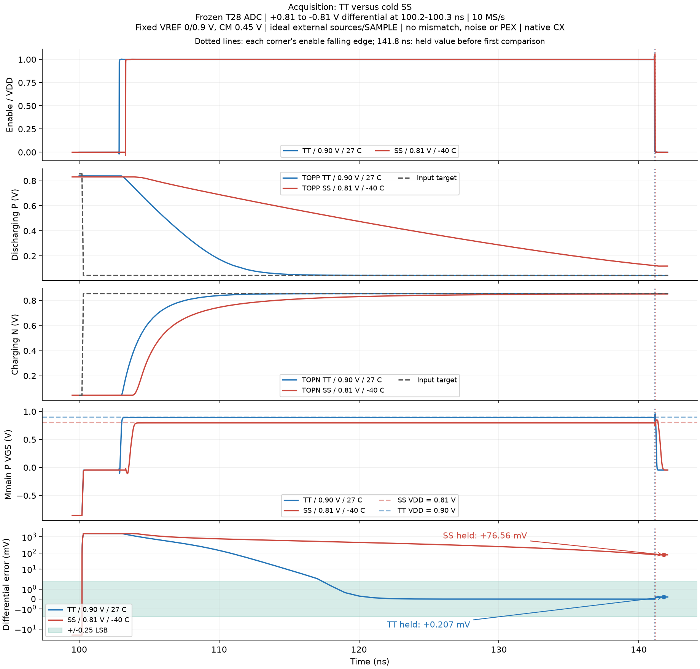
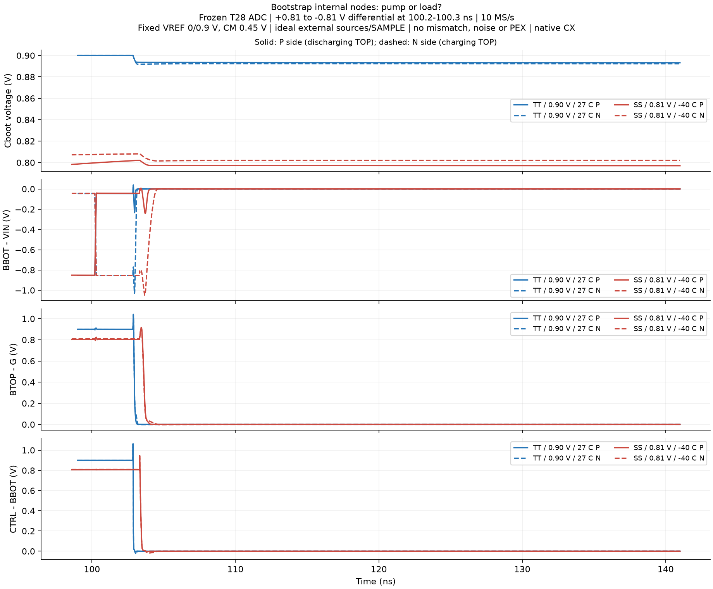
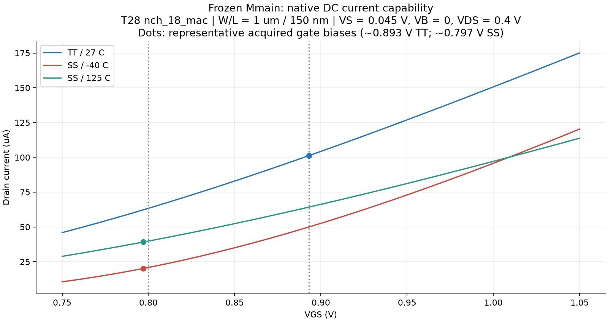

# SS 冷角 Bootstrap 采样不足定位

主瓶颈在 **Bootstrap 内的 Mmain 采样主管**：自举已经建立，但 `nch_18_mac` 在当前低栅压、SS 冷角下搬运 CDAC 电荷太慢。最严重的是向低电平放电的 P 侧，不是高输入 N 侧，也不是关断之后才注入了 76 mV。

## TT 与 SS 波形对比

复用冻结整机首批 PVT 的同一帧：100.2–100.3 ns 将差分输入从 +0.81 V 翻转为 −0.81 V，P 输入降到 0.045 V，N 输入升到 0.855 V。外部参考、输入和 SAMPLE 理想；内部为原 MOS/RC 电路，无失配、噪声或 PEX。

从上到下：实际获取使能、P 侧放电、N 侧充电、P 主管 VGS、差分采样误差。虚线是输入/供电基准，竖点线是各角的关闭沿；最后一栏使用对称对数纵轴，绿色区为 ±0.25 LSB。141.8 ns 的测量在两角首次比较之前，没有拿转换中的 DAC 电压或复位后的顶板作比较。

| 观测量 | TT / 0.90 V / 27°C | SS / 0.81 V / −40°C |
| --- | ---: | ---: |
| 实际获取窗口 | 38.26 ns | 37.84 ns |
| P 侧 VGS 首次达到各自 VDD 的 95% | 103.077 ns | 103.978 ns |
| 140 ns：P 侧 TOP，目标 0.045 V | 0.045000 V | **0.136221 V** |
| 140 ns：N 侧 TOP，目标 0.855 V | 0.855000 V | 0.852492 V |
| 140 ns：P 侧 VGS | 0.893232 V | 0.796944 V |
| 141.8 ns：差分保持误差 | +0.207 mV | **+76.559 mV** |
| 最终码，理想 12 | 12 | **23** |

SS 获取窗口只短约 0.42 ns，栅压启动慢约 0.90 ns；主要差异却持续了整个获取段。SS 关闭前 0.2 ns 已有 +82.263 mV 差分误差，关断后的 +76.559 mV 不能解释成单纯的关断电荷注入。

## 自举链路没有长期卡住

冻结拓扑中，M2 给 `Cboot(BTOP,BBOT)` 预充，Msin 将 BBOT 接到输入，M4 将 BTOP 接到 G，Mmain 则连接输入和 CDAC 顶板；M8、Maux/MRSTG 等负责相位切换及复位。主开关目前为 **W/L=1 µm/150 nm、multi=1**，不是参考开关的 3 倍倍率。

SS P 侧在 99 ns 的自举电容电压为 0.79861 V，低于 0.81 V，确有预充损失。到 110 ns：

- Cboot 电压为 0.79719 V，主管 VGS 为 0.79708 V；
- BBOT 与输入仅差 −39.9 µV，BTOP 与 G 仅差 +76.1 µV；
- CTRL 与 BBOT 相差约 24 nV，控制支路已切换到获取状态。

此后泵压基本保持，不是 Msin 没接上输入或 M4 长期没有把泵压传到 G。预充约 11 mV 的不足和切换损失仍可优化，但不足以将“几十 ns 持续缓慢放电”主要归因于泵未启动。

## 单管模型确认了电流瓶颈

另做三项原生 Spectre DC 扫描，复制原 Mmain 的全部尺寸/寄生参数，保持 VS=0.045 V、VB=0；分别检查 VDS=0.1/0.4/0.75 V。没有替换整机晶体管或改变其供电。

以 VDS=0.4 V 为例：

| 模型条件 | VGS | 漏极电流能力 |
| --- | ---: | ---: |
| TT / 27°C，接近实际栅压 | 0.893 V | **101.22 µA** |
| SS / −40°C，接近实际栅压 | 0.797 V | **20.19 µA** |
| SS / 125°C，相同栅压对照 | 0.797 V | 39.17 µA |
| SS / −40°C，假设无损泵到 0.81 V | 0.810 V | 23.43 µA |

实际 SS 冷角的放电能力约为 TT 的五分之一。即使在这个偏置点把泵压损失全部补回，也只是约 16% 的电流提升；先盲目加大 Cboot 不是最直接的修改方向。

进一步用瞬态实际 VGS/VDS 在 DC 曲线上插值：110/120 ns 预测漏极电流为 22.99/20.54 µA，输入 50 Ω 电阻测得的净回流为 23.04/20.54 µA。后者包含 Bootstrap 支路，不能冒充直接测得的 Mmain 支路电流，但两者的一致性支持主管驱动不足的定位。

SS 在 110–120 ns 的 TOPP 从 0.68969 V 降到 0.47568 V；按 1.025 pF 名义 CDAC 估算，电荷搬移电流约 21.94 µA，与上述结果相符。这个估算未包含全部寄生与底板微动，不能据此认定一个恒定 Ron。

温度与工艺在低栅压附近改变了器件的有效驱动能力；本轮没有直接提取 Vth，因此不把结果简化为已定量证明的某个阈值变化或单独体效应。放电 P 侧源端约 0.046 V，本身也不支持“高源电位体效应是这次主要误差”的说法。

## 修改方案

**先扫主管尺寸，再按栅负载补泵；采样关闭沿、CDAC 和参考复位不动。**

1. 新建对照候选，P/N 两侧 Mmain 对称扫描总宽度 **2/3/4 µm**，L 保持 150 nm，原 1 µm 为基准。用合法 PDK 参数更新指宽、指数量和扩散寄生，不能只改 W 而保留不匹配的几何参数。先不同时放大所有辅助管。
2. 观察加宽后的 G−VIN、Cboot 压降和启动时间。只有新增栅电容使泵建立明显恶化时，再分别调整 M4/Msin、预充/复位支路或 Cboot，避免多变量一起改而失去归因。
3. 同一 SS 冷角检查双向大反转、零输入恢复和两侧单端轨迹；保持误差目标 <1.7578 mV，同时比较关断前残差与关断后的注入。不能只用输出码正确掩盖残差。
4. 对入选尺寸重跑五点短测，检查全部相关端压、输入回灌、关断馈通、时序和动态功耗。加宽可能改善速度却加重馈通或 FF 过冲，不能只验 SS。

若尺寸代价或馈通过大，再讨论独立、受限的 Bootstrap 预充电源；必须重新核验所有器件端压，不能把整机 core VDD 直接抬高。提前开启采样可作次选，但当前窗口已接近 38 ns，尚无证据表明补回约 0.4 ns 就能解决问题。缩小 CDAC 会牵动噪声、失配和既有权重验证，不作为首轮修改。

上述是待验证方案，本轮未实施尺寸、电源或时序修改。

## 证据与复现

瞬态来自 `sar8_pvt_mismatch` 的 TT、SS 冷/热三例，提取 85–145 ns 全部原生时间步，原 PSF SHA256 与前次记录一致；现有 CX 瞬态实际 reltol=1e-4/maxstep=6 ns。新增单管 DC 三例 exit=0/PASS，实际 reltol=1e-6、vabstol=10 nV、iabstol=100 fA。未新增完整整机瞬态，也未改变原模型。

[瞬态测量](../verification/sar8_ss_bootstrap/transient.json) · [单管电流](../verification/sar8_ss_bootstrap/dc_current.json) · [此前独立 CDAC 隔离实验](cdac_flat_8b_device.md)。脚本位于 `scripts/sar8_ss_bootstrap/`，本地原生证据位于 `output/sar8_ss_bootstrap/`。
