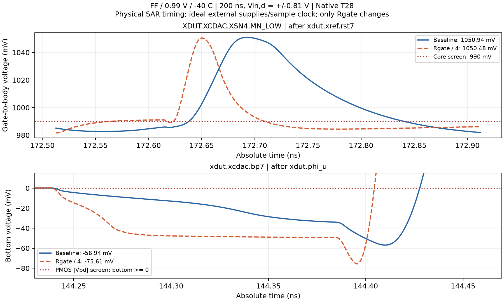
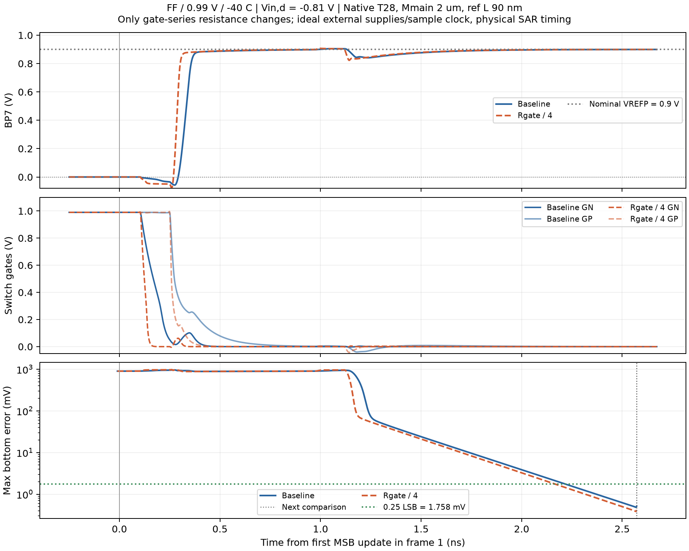
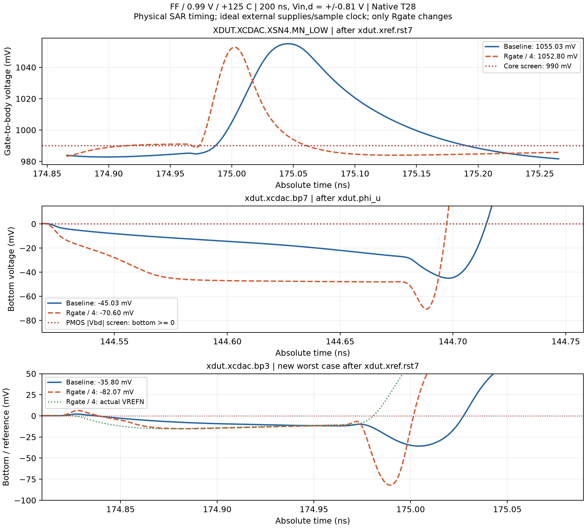
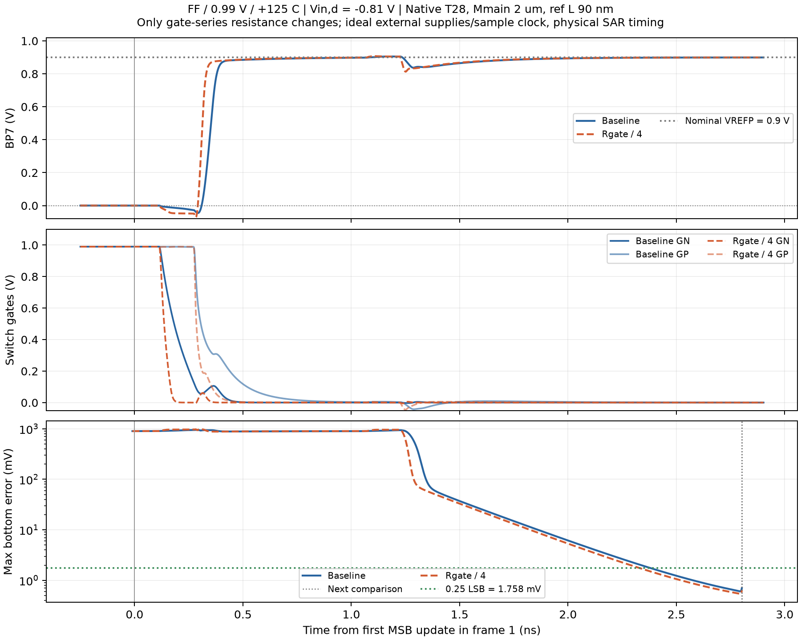

# 栅极串联电阻对照：顺序流式回收

四组已完整顺序回收，冷、热角结论一致：**Rgate/4 略微加快建立，却加深了底板下冲，不能作为过压修复版。** 本轮只读取四个既有仿真，不修改电路、不重跑、不替换基线。报告按功能、建立和器件应力分别判定，不以码字正确代替电路合格。

## 条件与口径

- T28 原生晶体管 ADC，Mmain=2 µm、参考开关 L=90 nm；FF，核心电源 0.99 V，−40°C / +125°C。
- 每组 200 ns、两帧输入差分 +0.81 / −0.81 V。输入共模 0.45 V，参考名义值 0.9 / 0 V，各有 50 Ω 源阻抗和 4 pF 去耦。
- 对照只将参考栅极串联 PDK 电阻的并联倍数增至 4 倍，即 Rgate/4。驱动 MOS、参考开关 W/L、采样时钟不变；不是“驱动 MOS 放大 4 倍”。无新增理想 keeper。
- 外部供电、参考源和采样时钟仍理想；内部 SAR 时序、栅控及 RC 为物理器件实现。没有版图寄生或失配。
- 原生日志实际设置：Spectre X CX、4 线程、`reltol=1e-7`、`maxstep=10 ps`、电压/电流绝对容差 10 nV / 100 fA、gear2only。两版同精度；不能与旧宽松精度结果直接比较改善量。

**过压口径：**检查 1833 个 MOS 的 10998 个端电压对，每个原生时间点均参与。核心/1.8 V 器件分别用项目现有 0.99 / 1.98 V 筛查线；这是项目筛查，不是完整 foundry 瞬态 SOA/寿命判定。原生 CMI 警告仍保留。

**建立口径：**从 PHI_U 上升沿起，全部 16 个底板进入各自最终参考目标的 ±0.25 LSB（±1.7578 mV），且保持到下一次比较前 10 ps。报告最慢一次建立及比较前最大残差。这是保守的底板节点诊断，不是加权 ADC INL，也不是整个转换耗时。另保存相对实际参考轨的建立结果，便于区分参考恢复与开关本身建立。

## 1. 冷角：建立稍快，负向下冲更重

| 指标，FF / −40°C | 原版 | Rgate/4 |
| --- | ---: | ---: |
| 参考开关最坏端电压 | 1.05094 V | 1.06561 V |
| 全部底板最低电压 | −56.94 mV | −75.61 mV |
| BP7 最低点所属脉冲，低于 −1 mV 时长 | 186.1 ps | 164.1 ps |
| 最慢底板建立时间 | 2.217 ns | 2.166 ns |
| 下次比较前最大底板残差 | 0.499 mV | 0.398 mV |
| 更新窗口按上述判据完成建立 | 14/14 | 14/14 |
| 两帧输出码，期望 243 / 12 | 243 / 12 | 243 / 12 |

上图对同一支路作比较：第二帧转换结束、RST7 于 172.4147 ns 发起复位后，原版 `XSN4.MN_LOW` 的 GNN4 在 172.6927 ns 达到 1.05094 V。减小串联电阻使这个过冲脉冲提前、变窄，峰值仍约 1.05048 V，没有消除超限。它是 bit7 复位时其他位栅极受到的扰动，不能误写成“bit4 自己正在复位”。

下图是第二帧 MSB 更新中的 BP7。原版最低点在 144.40995 ns，Rgate/4 在 144.39553 ns。高侧 PMOS `XSP7.MP_HIGH` 的 bulk 接 0.99 V，因此新方案最低点的 **|Vbd|=0.99−(−0.07561)=1.06561 V**；它成为新方案的最坏参考开关应力。

从上到下为 BP7、其低/高参考开关栅极 GPN7/GPP7、全部底板的最大目标误差。横轴按每版第二帧首次 MSB 更新对齐；第三行绿线为建立判据，竖虚线为下一次比较。第三行不是仅 BP7 的误差，因此 BP7 首次到达高参考后，其他底板仍可能尚未切换完成。

直接可见：Rgate/4 让栅极下降和底板充电更快，负压脉冲变短，但关断/交接阶段的负压也更深。与更陡边沿加强电容耦合的解释一致；本批没有有效保存开关端电流，尚不能定量拆分耦合、沟道电荷及互补底板反馈。−1 mV 只用于定义脉冲宽度，不是替换器件筛查线；不能只按峰值或宽度单独推断寿命。

## 2. 热角：最坏点转移到空闲复位中的 BP3

| 指标，FF / +125°C | 原版 | Rgate/4 |
| --- | ---: | ---: |
| 参考开关最坏端电压 | 1.05503 V | 1.07207 V |
| 全部底板最低电压 | −45.03 mV，BP7 | −82.07 mV，BP3 |
| 同一次 MSB 更新的 BP7 最低电压 | −45.03 mV | −70.60 mV |
| 最慢底板建立时间 | 2.379 ns | 2.329 ns |
| 下次比较前最大底板残差 | 0.606 mV | 0.539 mV |
| 更新窗口按上述判据完成建立 | 14/14 | 14/14 |
| 两帧输出码，期望 243 / 12 | 243 / 12 | 243 / 12 |

从上到下：

1. **GNN4 复位期过冲：**同一支路由 1.05503 降到 1.05280 V，仍超过 0.99 V 筛查线。
2. **转换期 BP7 下冲：**两版同一 MSB 更新事件，−45.03 → −70.60 mV，和冷角一样退化。
3. **复位期 BP3 新热点：**RST7 于 174.74529 ns 发起，Rgate/4 的 BP3 在 174.98942 ns 到达 −82.07 mV；原版同一复位窗口 BP3 最低约 −35.80 mV。`XSP3.MP_HIGH` 的 |Vbd| 因而达到 1.07207 V。不能只盯住旧的 BP7 热点。

新热点最低点的 VREFN 为 **+26.40 mV**，VREFP 为 0.87833 V；GPN3/GPP3 分别为 0.97805/0.97523 V，仍对应低参考选通的栅控状态。此时底板相对 VREFN 低约 **108.47 mV**，不是“底板跟着低参考轨一起变负”。RST7 切换引发的电容网络耦合及有限保持能力值得优先检查；仅凭这些电压不能分摊各支路电荷，也不能把栅控状态等同于已量出的沟道电流。

建立依然提前约 50 ps，但原版本来就在比较前满足本轮建立判据。这点速度收益不足以证明新方案更好，尤其不能抵消新增的过压峰值。

## 3. 采样、码字与剩余限制

采样窗口取真正送入 Bootstrap 的 `SEQ_SAMPLE` 50% 电源交点；`SAMPLE_INT` 是控制器/参考模块及旧 monitor 使用的另一节点，不能混用二者时间。第一帧从仿真初始化开始，窗口起点为截取边界，不代表已经过稳态预热。

冷角两版采样窗口与关闭沿的最大差异小于 0.001 ps。第一帧在关闭沿前 0.2 ns 的跟踪误差仍约 −1.978 mV，略超上述 ±1.758 mV；固定 41.8 ns 的保持误差约 −1.695 mV。第二帧固定 141.8 ns 的保持误差约 +0.577 mV。减小参考栅极电阻没有改善这一跟踪误差，仍需区分初始条件和静态负载等贡献；这不是用“输入瞬时值减输出旧码”制造的相位误差，而是与每帧恒定输入比较。

热角两版关闭沿及窗口差异也小于 0.001 ps；保持误差约 +0.481 / +0.516 mV。两版的转换耗时基本不变：冷角约 26.64～26.68 ns，热角约 28.53 ns，不能把它们写成上述 2.x ns 的底板建立时间。

码字由原生 D0…D7 独立解码，与 monitor 交叉核对；每帧要求 8 次比较、8 次写入、8 次更新、16 次参考捕获。参考复位顺序、复位晚于捕获、空闲期输出保持与参考初始字也独立检查。两个静态输入正确不能替代全码、1024 点频谱或完整 PVT 验证。

四组上述功能/时序检查均通过，但**整机应力没有闭合**：

| 其他模块的最坏端电压 | 冷角原版 → Rgate/4 | 热角原版 → Rgate/4 |
| --- | ---: | ---: |
| 参考驱动器 | 1.05799 → 1.05700 V | 1.03409 → 1.03355 V |
| 比较器 | 1.04363 → 1.04363 V | 1.02334 → 1.02334 V |
| 数字控制 | 1.07864 → 1.07864 V | 1.06857 → 1.06857 V |
| Bootstrap（1.98 V 筛查线） | 1.85242 → 1.85242 V | 1.84644 → 1.84644 V |

前三行仍超项目核心器件筛查线；Bootstrap 仅在这两帧、这些端电压对中未超其筛查线，不代表全部工况签核。

## 4. 回收与证据边界

原始四组约 94.87 GB ASCII PSF 保留不动。顺序运行单个流式解析器，资源上限 512 MiB，逐样本计算所有端电压峰值；仅导出 112 个必要电压列和时间列，保留原始时间分辨率。本地以 memory map 逐组分析，不将四组原始波形同时载入内存。

| 顺序 | 原生时间点数 | 解析器实测峰值 RSS | 远端解析及压缩耗时 |
| --- | ---: | ---: | ---: |
| 冷角原版 | 319432 | 7540 KiB | 388.0 s |
| 冷角 Rgate/4 | 317560 | 7540 KiB | 380.0 s |
| 热角原版 | 282775 | 7540 KiB | 321.6 s |
| 热角 Rgate/4 | 280330 | 7540 KiB | 321.3 s |

总计 1,200,097 个原生时间点，压缩后的必要波形共约 0.755 GB。7.4 MiB 是远端 C++ 解析器峰值，不是服务器全部内存或本地画图进程的内存。原始仿真四组均 exit0、tran PASS；本轮没有启动 Spectre 或终止其他进程。

验证包含稀疏更新/GROUP1 解析夹具、原生 END/200 ns/accepted-step 数、源网表 SHA256、原始文件 inode/大小/mtime 不变，以及回收文件 SHA256。没有计算整个原始 PSF 的 SHA256。每组 192 个参考端电压峰值另与回收波形交叉检查。

发现旧保存列表将名称转为小写，而原生保存请求区分大小写，日志有无效保存项警告。`allpub` 留下了必要节点电压，但请求的 MOS D/G/S/B 电流没有保存成功。因此本轮可以比较电压、建立、时序和码字，**不能声称已经量出沟道/位移电流或参考直通电荷**。后续新实验必须先验证实际保存的端口名称，再提交批量任务；本轮不改原始网表补跑。

机器可读证据位于 `verification/sar8_stress_closure/*_stream_analysis.json`、`*_stream_receipt.json`；回收波形位于忽略目录 `output/sar8_stress_closure/<case>/stream_v1/`。

## 5. 下一步建议，尚未执行

保留原版作对照，不晋升 Rgate/4。下一轮先修正并小范围验证电流保存项，再将“已保持栅极的低阻抗”和“正在切换栅极的边沿速度”拆开做单变量试验：优先低侧关断边沿整形，复核高侧交接与参考直通，并同时观察 MSB 本位和 BP3 等未切换位。必须在峰值、持续时间、建立和直通之间取得可验证的平衡，不能只继续整体加大驱动。
