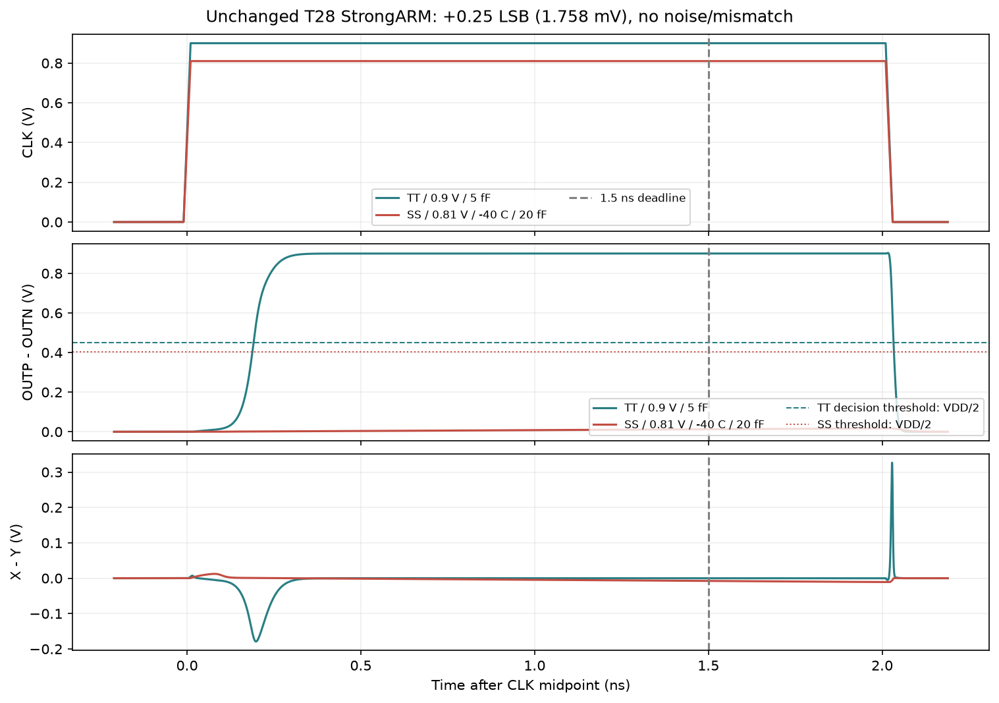
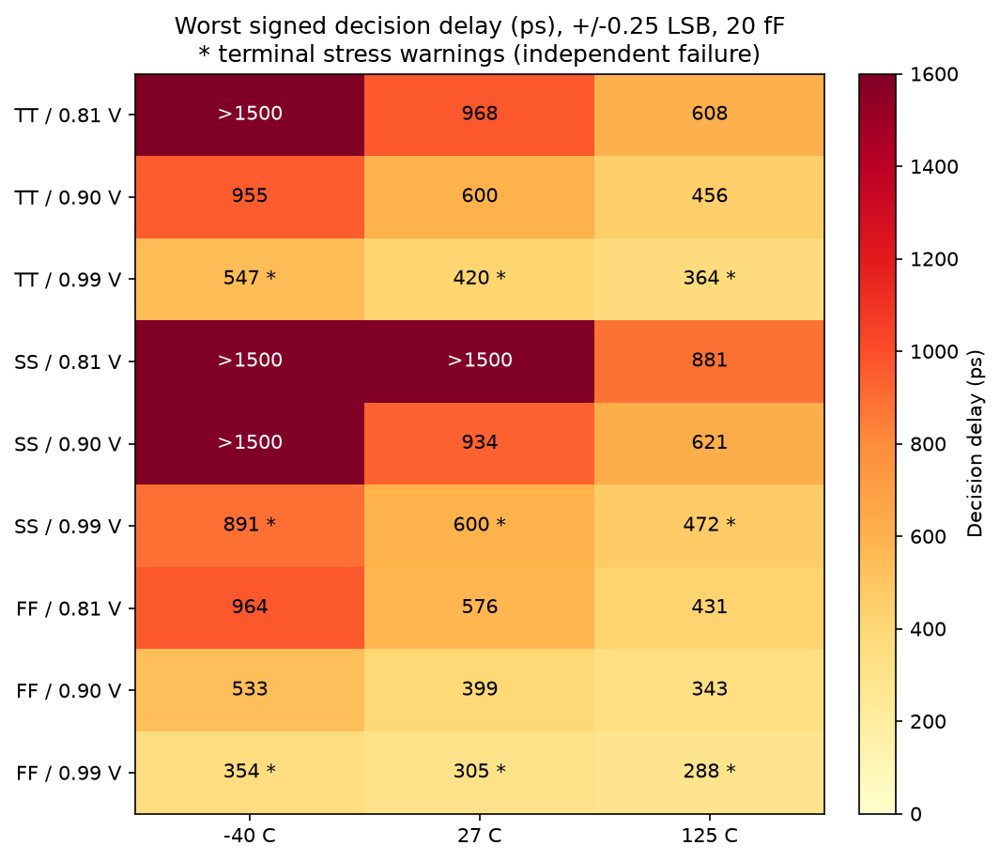
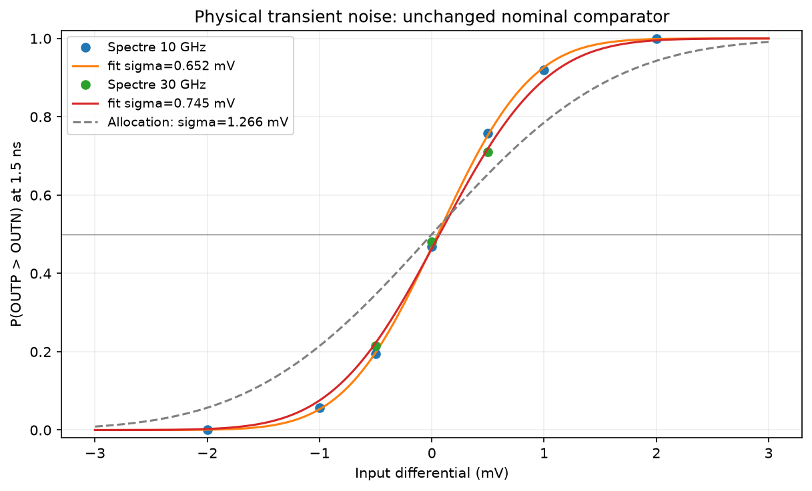
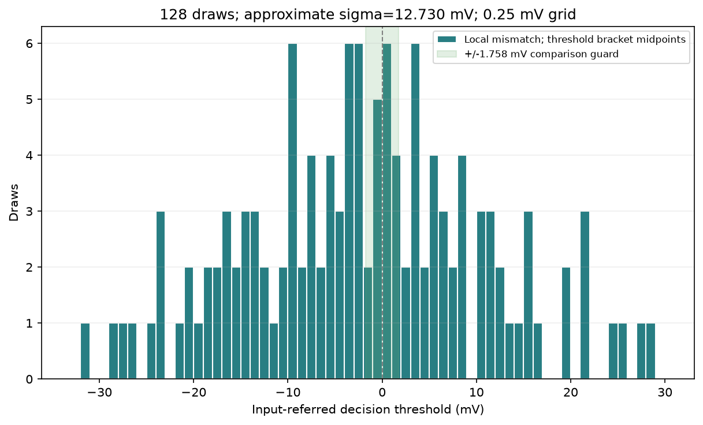
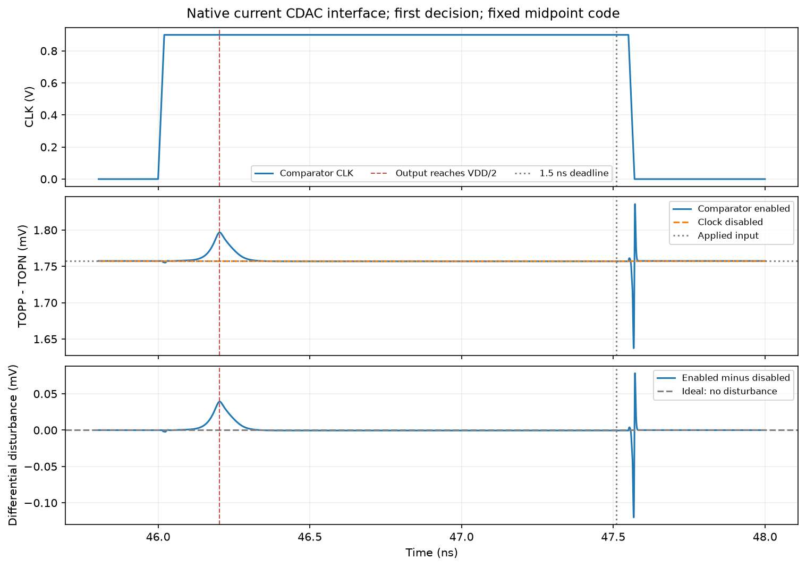

# 8-bit StrongARM：未优化管级基线

日期：2026-10-20。结论：**拓扑可以正常比较，但这组初始尺寸尚未达标**。
当前首要问题是随机失配，其次是低压/低温下的负载驱动。标称速度很好，
不能据此判定整个 PVT、噪声、失配和完整 ADC 已经通过。

## 1. 本次究竟仿了什么

- 真实 `SAR_ADC_T28/sar_strongarm_t28`，11 个 T28 `nch_mac/pch_mac`
  核心器件，工作电源 0.9 V；不是 Canvas 显示所用的 SKY130 默认模型，
  也不是 analogLib MOS 或行为比较器。
- 输入对和尾管 W/L = 1 µm / 30 nm；再生 NMOS、PMOS、四个复位 PMOS
  均为 0.5 µm / 30 nm。本轮未改变尺寸、连接或 OA 原理图。
- 使用本轮新鲜 native OA 导出，在顶层增加激励和测量。每个接受的网表都
  保持比较器 subckt 逐字相同，SHA-256：
  `e7effa6aeeac3dd126bf9d3e062009f83138a63f01cc7779cf25a9070c2b6e82`。
- Spectre 21.1 / APS。网表实验不等于已在 OA 中另存了这些测试平台。
- 当前 8-bit 差分量程 1.8 V，LSB = 7.03125 mV。不要继续使用此前
  10-bit 的 0.439 mV/0.316 mV 指标判断本轮结果。

| 项目 | 本轮目标/条件 | 测量结果 | 当前判断 |
| --- | --- | --- | --- |
| 标称判决时间 | ±1.758 mV，5 fF/输出，≤1.5 ns | 约 191 ps | 该条件满足 |
| PVT 速度 | SS/TT/FF × 0.81/0.9/0.99 V × −40/27/125°C，20 fF，双极性 | 46/54 次满足时限，4/27 个 PVT 点失败 | 未通过全范围 |
| 输入等效随机噪声 | 预算 1.265625 mV RMS | 10 GHz：0.652 mV；30 GHz 补充：0.745 mV | 标称估计低于预算，带宽未证明收敛 |
| 无失配确定性门限 | 系统 offset 预算 ±1.7578125 mV | 标称 ±0.1758 mV 均正确判决 | 仅给出有限时间门限夹限，不是精确 offset |
| 随机失配门限 | 未制定量产良率目标；与 ±1.758 mV 作参考比较 | 128 次，σ≈12.730 mV，16/128 个区间完全落在参考范围内 | 明显需要优化，不是良率认证 |
| 当前 CDAC 差分 kickback | 标称固定中点码、8 次比较时钟 | 判决时约 0.039 mV；全时段峰值约 0.120 mV | 此测试较小，不代表全部 SAR 码型 |
| 端电压应力 | 不放宽 PDK 模型限制 | 0.99 V 的 18 次 PVT 运行均有 CMI 提醒 | 不能视为应力通过 |

## 2. 速度、复位与共模

计时从 CLK 上升穿越 VDD/2 开始，终点为**正确极性的输出差分达到 VDD/2**。
要求连续三周期均在 1.5 ns 内完成，并且比较前两输出复位到 ≥0.9·VDD。
时钟周期 5 ns、上/下沿 20 ps。输出负载是每端电容，不是差分串联电容。

图中标称输出迅速分开；SS / 0.81 V / −40°C / 20 fF 在时限内只有约
12.5 mV 输出差分，没有达到 405 mV 判决标准。输入并未换成更小的值。
不能把小差分输出的正负号直接算作已完成可靠的逻辑判决。

PVT 输入共模取 VDD/2，输入过驱动均为 ±0.25 LSB。失败点（两种极性均失败）：

- TT / 0.81 V / −40°C
- SS / 0.81 V / −40°C
- SS / 0.81 V / 27°C
- SS / 0.90 V / −40°C

其他 PVT 点已满足速度的最大时延约 968 ps；所有 PVT 点的复位电平通过。
0.99 V 星号是**独立的应力问题**，不是时延失败符号。CMI 涉及再生、输入、
复位器件的端电压；部分为模型 0.99 V 限值附近的动态越界。保留全部日志及
suppressed 计数，不屏蔽提醒，也不据此直接断言器件已损坏或找到可靠性安全区。

另外进行了 SS / 0.81 V / −40°C 的共模和负载敏感性测试：

| 输入共模 | 5 fF 判决时间 | 20 fF 判决时间 |
| --- | --- | --- |
| 0.405 V | 1471 ps | 超过 1.5 ns |
| 0.450 V | 689 ps | 超过 1.5 ns |
| 0.500 V | 413 ps | 1352 ps |

这是诊断，不是擅自将 ADC 的 VCM 改成 0.5 V。它说明低共模下输入/尾管
工作点与再生驱动余量不足，输出负载会进一步拖慢。尚未完成逐管 gm、电流的
贡献拆分，不能把所有延迟只归因于某一只 MOS。

TT / 0.9 V / 5 fF 的 VCM=0.30～0.60 V 离散测试均满足时限，但不代表
rail-to-rail 输入保证。标称一周期电源能量约 10.95 fJ，理想时钟源向本单元
提供约 0.26 fJ；不包含实际时钟树、数字逻辑或整个 ADC 的能耗。

## 3. 噪声：由物理模型产生，不是指定一个 RMS 注入

使用导出网表继承的 `noise_worst` 模型和 Spectre transient noise：
`noisefmin=1k`，`noisefmax=10G`，两个 seed。输入差分
−2/−1/−0.5/0/+0.5/+1/+2 mV，每点每 seed 256 个决策，共 3584 个。
在每周期上升沿中点后 1.5 ns 取样，以输出差分 ±0.45 V 判断是否完成决策。
用实际输出正判决概率拟合 Gaussian CDF，获得有效输入等效噪声，而不是
预先把 1.266 mV 填入行为比较器。

- 10 GHz：合并 σ=0.6523 mV；分 seed 为 0.6414 / 0.6631 mV；
  拟合中心 +0.0532 mV。
- 30 GHz：同一 seed，−0.5/0/+0.5 mV 三点各 256 次补充测试；
  σ=0.7445 mV，中心 +0.0682 mV。

两者仍低于预算，但带宽与有限样本影响尚未排尽，**不能宣称噪声已经收敛或
完成 PVT 噪声验收**。周期样本可能相关，没有把样本数当作独立 BER/良率证据。
CDF 的中心也不能当作精确系统 offset。没有同时启用噪声和失配做最终统计。

## 4. 随机失配：当前最突出的问题

选择 PDK 本地失配 section，Spectre 明确报告 66 个随机变量；
`variations=mismatch`，seed=314163，不叠加瞬态噪声。
在每个物理样本内寻找输入门限，而不是用一次固定输入的输出比例代替 offset。

四次 pilot 使用逐点正反扫描。为避免 128 次密集扫描的长耗时，正式样本使用
**测试平台专用 Verilog-A 二分激励器**读取真实晶体管输出：

1. 先验证 −32 mV 和 +32 mV 确实给出两个极性且完成判决。
2. 输入只在复位阶段更新，在同样的 1.5 ns 判决时刻读取。
3. 八次二分，得到宽度 0.25 mV 的门限区间；未完成判决或越界均记 BAD。
4. 全部 128 次完成、无 BAD；用区间中点计算以下近似统计量。

| 统计量 | 结果 |
| --- | --- |
| 样本数/未截断样本 | 128 / 128 |
| 门限中点均值 | −1.9453 mV |
| 门限中点样本标准差 | 12.7297 mV（约 1.81 LSB） |
| 中点最小/最大 | −31.875 / +28.625 mV |
| 区间完全位于 ±1.7578 mV | 16 / 128 |

四次密集正反扫描未观察到方向差；它们与二分 pilot、正式运行前四次的门限
区间一致，且保存的前四次随机参数记录逐字一致。正式二分法本身**没有测量
128 次正反扫描滞回或证明全范围单调性**。

Verilog-A 只改变输入并测量，没有替换比较器、没有校准 offset。
样本均值不能直接解释成确定性的系统失调；16/128 只是本轮样本计数，
±1.758 mV 原本是系统 offset 预算，并非已批准的失配量产良率规格。
但 σ 已明显超过一个 LSB，因此这组最小沟道初始尺寸不适合直接冻结。

## 5. 当前 CDAC 接口与 kickback

使用本轮新鲜导出的 `tb_cdac8_nominal_sar`：保留实际 Bootstrap、参考开关、
约 1.025 pF/侧的当前 CDAC，以及相同 StrongARM。电容为 nominal 聚合阵列，
不是独立单元失配实验。固定中点码 128，在 46～81 ns 施加八次独立比较时钟，
与比较器始终复位的 A/B 对照；输入为 ±0.25 LSB 和零。
84 ns 结束，避开已知的 90 ns 参考复位问题，不能把复位问题算成比较器误差。

- 正负输入均八次正确完成判决，第一次约 192 ps。
- 实际达到输出判决标准时，on−off 差分输入扰动约 ±0.0392 mV，
  共模扰动约 −0.2354 mV。
- 全波形差分峰值约 0.1201 mV，主要出现在复位边沿；
  1.5 ns 截止时差分残留约 0.000528 mV。
- 比较阶段的输入共模约 0.44931～0.44966 V。

简化的 1 GΩ 保持路径 + 1.025 pF/侧电容测试也完成；比较前差分偏差约
4.1 µV，比较阶段差分扰动峰值约 0.036 mV。它没有真实参考开关和 CDAC
内部节点，不能替代上述接口测试；其比较阶段峰值不能与包含复位边沿的
0.120 mV 全时段峰值混为一谈。

这些数字针对当前固定码、标称无噪声/无失配测试。零差分的最终输出方向不能
当作正确性判定。**未执行完整八位逐次码切换、全输入范围、联合 PVT/失配或
完整 ADC FFT 验收**；不能由理想低阻输入源的测试推导 kickback 可忽略。

## 6. 下一轮建议与证据位置

先保留已认可的拓扑，安排输入对/再生对 W、L 与尾管驱动的受控扫描，
同时约束面积、失配、寄生电容、速度和 kickback。不要单纯把所有管子加宽。
明确真实后级负载后，决定是否增加输出隔离缓冲；如果直接 StrongARM 的
失配/速度/负载折衷仍不够，再讨论前置放大或校准，不在本轮擅自更换拓扑。
需要补充噪声带宽收敛、联合统计、实际 SAR 切换和最终应力检查。

配置：[strongarm8_baseline.yaml](../config/strongarm8_baseline.yaml)。
脚本：[run.py](../scripts/strongarm8/run.py)、
[analyze.py](../scripts/strongarm8/analyze.py)、
[offset_search.va](../scripts/strongarm8/offset_search.va)。
所有原始网表、PSF、日志、参数记录、逐次结果和哈希保留在忽略目录
`output/strongarm8_baseline/`，不把 PDK 模型内容或 license 信息提交到 Git。

验证共 125 个 `result.ok` 网表运行：94 个确定性测试、19 个噪声测试、
3 个失配任务（4 次密集 pilot、4 次二分 pilot、128 次二分正式统计）、
3 个保持电容测试和 6 个 CDAC A/B 测试。94 个确定性运行中 80 个满足自身
速度/复位门槛；这不是 125 个电路验收全通过。
更紧数值设置（reltol=2e-6、maxstep=0.5 ps）使标称和冷角 5 fF 的首周期
时延分别只变化 0.135 ps 和 0.042 ps，不改变上述速度结论。
五个定向 Python 检查、编译、YAML 解析、125 份 DUT/deck 哈希审核及图像
检查通过；配置仍保持 `qualified: false`。

本轮早期的 strobe 相位配置被 Spectre 拒绝，已用新名字保留正确实验；
长密集 128 次失配运行主动中止，未纳入统计。成功运行仍有继承的 SFE-1131
等提醒，`result.ok` 不意味着零 warning。最终 CMI 与 suppressed 数单列。

CIW 帮助查询曾卡住命令通道；只结束了归属本次查询的帮助进程，没有杀
Virtuoso、没有修改 OA。用户要求暂不处理显示/重连，故最终实时 CIW 回读
暂缓：这里的证明是初始新鲜 OA 导出与全部已接受网表的哈希一致，
**不是宣称当前 CIW 连接健康**。
