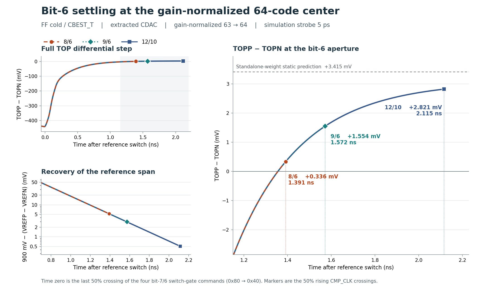

# Bit-6 aperture on the extracted 64-code center

At FF cold, the calibrated input gives an effective half-LSB of 3.373 mV. The standalone extracted weights predict a static differential of 3.415 mV for trial 0x40. At the 8/6 comparison the measured differential was 0.336 mV. The dominant transient contribution is recovery of the reference span driving the extracted CDAC.

## Reference switch and clock

All three native simulations use the fourth frame, the independently gain-normalized 64 center immediately following the normalized 63 center. Input stimulus, comparator, bootstrap, reference drivers, CBEST_T library, extracted array and test deck are byte-identical. Only the tap chain and its run metadata differ. Bit 7 was rejected, changing the trial from 0x80 to 0x40. The time origin is the last of the four 50% switch-gate crossings on bits 7 and 6 at the CDAC. Each curve stops at its own 50% rising comparator clock crossing. Samples are saved every 5 ps.

| Taps | Gate to compare (ns) | TOP zero to compare (ps) | TOPP−TOPN (mV) | VREFP / VREFN (mV) | Ref. span deficit (mV) | Physical plate bound (LSB) | Reads at 90 / 98 ns |
| --- | ---: | ---: | ---: | ---: | ---: | ---: | ---: |
| 8/6 | 1.391 | 35.7 | +0.336 | 897.295 / 2.540 | 5.245 | 0.11018 | 64 / 64 |
| 9/6 | 1.572 | 216.9 | +1.554 | 898.493 / 1.416 | 2.923 | 0.06142 | 64 / 64 |
| 12/10 | 2.115 | 760.1 | +2.821 | 899.739 / 0.246 | 0.507 | 0.02395 | 64 / 64 |

The additional high stage raises the measured bit-6 differential by 1.218 mV. On that same 9/6 center-64 frame, bit 3 later had one launch and three delivered 50% crossings. The clock and register still produced eight comparisons and eight writes. D was 64 at both reads. The 5 ps saved waveform establishes threshold recrossing but leaves the width of the short excursion unresolved. The 9/6 configuration fails the one-transition-per-bit criterion and should not replace 8/6 as wired.

At 1.391 ns after the gate switch, the longer run still holds its comparator clock low and gives +0.3366 mV. The 8/6 run gives +0.3357 mV at its clock edge. This matched-time comparison bounds the difference in sampled TOP between these two runs at that instant. It does not characterize kickback after regeneration.

## Where the differential went

For this stimulus the differential input is −428.336 mV. Rejecting bit 7 and trying bit 6 gives a static value of −428.336 + 863.724 − 431.972 = +3.415 mV from the measured individual CDAC weights. Using only the overall gain gives 0.5 × 0.959354 × 7.03125 = 3.373 mV. The difference between these static predictions is 0.042 mV.

The fixture supplies each reference through 50 Ω with a 4 pF bypass. Driving the two switched groups compresses the voltage span across the CDAC. The late span deficit follows a roughly 0.310 ns time constant, fitted from 0.75 ns through 20 ps before comparison. The existing 510-terminal bound uses the instantaneous local rails as its targets. A reduced reference span can therefore drive a TOP error even when the plates track their commanded rails.

The table uses the independently measured differential weight of each bit to estimate the TOP contribution from the measured rail motion and from the mean physical plate error relative to that rail. For bit i the approximate single-side sensitivity is weight[i] / (2 × 0.9 V). At trial 0x40 the signed sum of these sensitivities is 0.47564 V/V. Remainder is the signed difference between measured TOP and the sum of the static prediction and two estimates. It includes linear-model error and circuit effects outside the switched-plate model. The individual device contributions to this remainder have not been isolated.

| Taps | Static prediction (mV) | Rail contribution (mV) | Plate-to-local-rail contribution (mV) | Remainder (mV) | Measured TOP (mV) |
| --- | ---: | ---: | ---: | ---: | ---: |
| 8/6 | +3.415 | -2.495 | -0.241 | -0.344 | +0.336 |
| 9/6 | +3.415 | -1.390 | -0.134 | -0.337 | +1.554 |
| 12/10 | +3.415 | -0.241 | -0.024 | -0.330 | +2.821 |

Of the 2.485 mV measured improvement between 8/6 and 12/10, the reference-span estimate accounts for 2.254 mV (90.7%), the signed plate-to-local-rail term for 0.217 mV (8.7%) and the change in the remainder for 0.014 mV (0.6%).

## Consequence of one additional high stage

| Corner and taps | Fully passing frames | Frames with 8 comparisons and writes | Maximum physical plate bound (LSB) | Minimum public margin at 90 ns | Margin after 5 ns wiring reserve | DFF setup / hold slack (ps) |
| --- | ---: | ---: | ---: | ---: | ---: | ---: |
| FFC 8/6 | 8/8 | 8/8 | 0.11113 | 34.939 ns | 29.939 ns | 153.1 / 36.5 |
| FFC 9/6 | 7/8 | 8/8 | 0.08145 | 34.405 ns | 29.405 ns | 152.7 / 36.5 |
| SSC 8/6 | 8/8 | 8/8 | 0.00188 | 10.413 ns | 5.413 ns | 412.2 / 91.2 |
| SSC 9/6 | 8/8 | 8/8 | 0.00184 | 8.968 ns | 3.968 ns | 412.4 / 91.2 |

The FFC 9/6 case has 1 phase launch and 3 delivered crossings on frame 3 (nominal 128), bit 3. The analyzer requires one delivered crossing per launch.

Moving the high tap by one stage consumes 1.446 ns of worst-frame slow-cold margin and leaves 3.968 ns after reserving 5 ns for wiring. The measured decision overdrive benefits from the added delay. Adopting it would require clean phase delivery across the high-to-low timing selection, including subsequent low-bit handoffs.

The slow-cold run uses CWORST_T cells and the same extracted CDAC. Both use ideal SAR inter-cell wiring. The measured differential at a single input is not a comparator noise or offset tolerance. The selected netlist and its recorded five-corner qualification use 8/6.

[Compact native traces, source identities and corner checks](sar_bit6_reference_overlay.json) · [Original tap qualification](sar_single_edge_taps.md)
