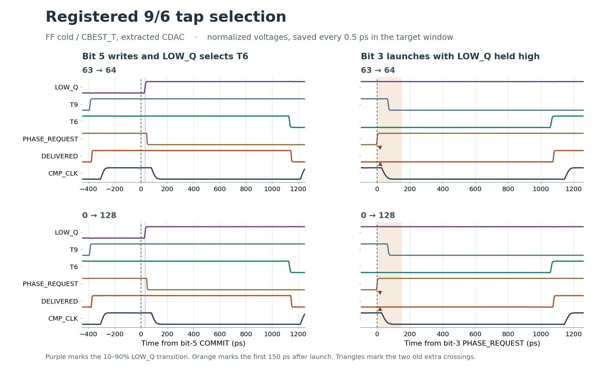

# Registered 9/6 tap selection

The bit-5 COMMIT clocks LOW_Q high through a native DFCNQ. Accepted sampling clears it. The register selects the delay tap only. The next-word decoder retains its original gates, including its combinational LOW_BITS prefix. Three matched transients use standard-cell LPE and the nominal-RC extracted CDAC with all 510 switched terminals saved. The SAR inter-cell wires are ideal.

Relative to the combinational 9/6 circuit, the selector adds one DFCNQ and one feedback OR2. The existing storage wrapper also instantiates one reset-data OR2 and one reset inverter, for a physical increase of four standard cells.

## Directed fast-cold transitions

Each transition retains the input history that produced multiple delivered phase crossings with the combinational 9/6 selector. The 63 and 64 centers use the standalone extracted CDAC gain. The reversal fixture uses the first four frames of the former eight-frame sequence (255, 255, 0, 128). Bypass capacitances, 50 Ω source impedances, transistor sampler and comparator, extracted cells and CDAC inputs match the corresponding controls.

| Input transition | 90 / 98 ns read of last frame | Bit-5 COMMIT to LOW_Q 50% | Both taps above 90% before Q10 / after Q90 | Bit-3 delivered 50% crossings, old → registered | Bit-6 TOP differential, old → registered |
| --- | ---: | ---: | ---: | ---: | ---: |
| 63 → 64 | 64 / 64 | 30.3 ps | 410.9 / 1091.3 ps | 3 → 1 | +1.554 → +1.553 mV |
| 0 → 128 | 128 / 128 | 30.3 ps | 411.3 / 1091.3 ps | 3 → 1 | -427.365 → -427.505 mV |

The guard intervals are measured at the MUX input pins. The first interval starts when both taps have exceeded 90% of VDD and ends at LOW_Q crossing 10%. The second starts at LOW_Q crossing 90% and ends when either tap first falls below 90%. At the eight comparator apertures in every frame, LOW_Q read 0, 0, 0, 1, 1, 1, 1, 1. Bits 7 through 5 used T9 and bits 4 through 0 used T6. Every accepted bit had one delivered transition of the expected polarity.

| Bit 3 at the previous failure site | T9 / T6 / LOW_Q at launch (V/VDD) | Peak DELIVERED, first 150 ps (% VDD) | Intended delivery after launch | Max saved step over directed window |
| --- | ---: | ---: | ---: | ---: |
| 63 → 64 | 1.000055 / -0.000005 / 1.000001 | 0.199% | 1.077 ns | 0.5017 ps |
| 0 → 128 | 1.000030 / -0.000005 / 1.000001 | 0.207% | 1.077 ns | 0.5010 ps |

At the normalized 64 center the registered bit-6 input was +1.553 mV. An independently simulated 24/24 settling control on the same stimulus and trials measured +3.085 mV. The difference at this comparison was -0.218 nominal LSB. The separate 510-terminal bound tests settling to the instantaneous reference pins.

The earlier combinational 8/6 circuit gave +0.336 mV at the same aperture and 10.413 ns of minimum slow-cold read margin. The additional high-group delay stage accounts for the larger bit-6 differential. Registering the select removes the two extra bit-3 crossings.

## Cold-corner read and receiver checks

| Case | Passing frames | Comparisons / writes | Minimum margin to 90 ns, combinational → registered | Setup / hold slack, 11 DFFs | Worst plate bound |
| --- | ---: | ---: | ---: | ---: | ---: |
| FF cold boundary | 4/4 | 32 / 32 | 34.422 → 34.411 ns | 153.5 / 36.5 ps | 0.06216 LSB |
| FF cold reversal | 4/4 | 32 / 32 | 34.535 → 34.525 ns | 154.0 / 36.5 ps | 0.08112 LSB |
| SS cold CWORST_T | 8/8 | 64 / 64 | 8.968 → 8.943 ns | 413.6 / 91.6 ps | 0.00185 LSB |

The least eight-frame SS-cold margin occurs at nominal input 85 (gain-corrected expected code 83, read 83). The last write was at 80.928 ns and the last output crossing was at 81.057 ns. Reserving 5 ns for wiring leaves 3.943 ns of the measured 8.943 ns. Each read window and the physical trial words were checked against reconstructed comparator decisions.

The two fast-cold directed windows cover frame time 45.5–52.0 ns at 0.5 ps nominal spacing. Other fast-cold samples and the slow-cold waveform use a nominal 5 ps spacing. Additional fast-cold Liberty checks reuse the original native waveforms. Source identities, matched netlist hashes, per-frame probes, measured time steps, compact fast-cold waveforms and native warning codes are in the [measurement data](sar_registered_9_6.json). [DUT](../../design/dut_single_edge.scs) · [Preparation commands](../../design/xtor/README.md) · [Earlier combinational 8/6 tests](sar_single_edge_taps.md)
