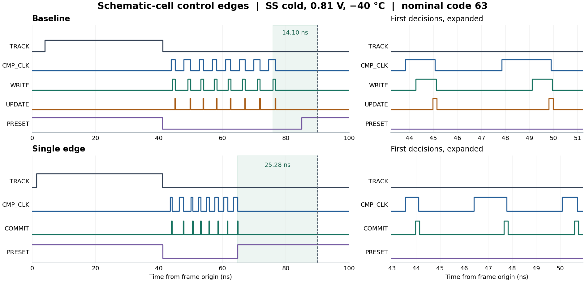
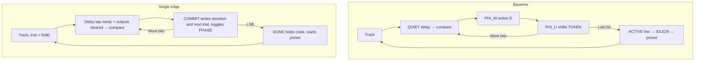

# Single-edge SAR front-end verification

One integrated native-cell SAR was tested at 10 MS/s with the transistor-level sampler, comparator, reference switches and CDAC. The conversion interval is measured from a 100 ns frame origin. The external sampling pulse is 40 ns and the two output reads are at 90 and 98 ns. The runs use 5 ps saved strobes. [DUT](../../design/dut_single_edge.scs) · [Compact native measurements and run identities](sar_single_edge_frontend.json) · [Baseline](sar_std_delay_20261119.md)

## Five project corners with standard-cell LPE

The final timing model uses the foundry typical / CWORST_T / CBEST_T cell extraction at the corresponding TT / SS / FF point. The schematic CDAC preserves the original nominal code centers for the 22-frame test. The complementary cold-corner verification replaces the CDAC with its 510-terminal extracted network. [Physical tap calibration and matched slow-cold gain](sar_single_edge_taps.md) · [Five-point LPE data, fixed-corner mismatch and restart](sar_single_edge_cell_lpe.json)

| Corner | Codes accepted / frames | Decisions reconstructed | Public margin (ns, min) | 63 → 64 read | Bit 6 TOPP−TOPN at that compare (mV) | DFF setup / hold slack (ps, min) | All screens |
| --- | ---: | ---: | ---: | ---: | ---: | ---: | --- |
| TT | 22/22 | 22/22 | 28.726 | 64 | +2.981 | 226.6 / 53.6 | pass |
| SSC | 22/22 | 22/22 | 10.155 | 64 | +3.023 | 412.1 / 91.2 | pass |
| SSH | 22/22 | 22/22 | 17.019 | 64 | +2.911 | 371.9 / 83.8 | pass |
| FFC | 22/22 | 22/22 | 34.926 | 64 | +2.359 | 152.7 / 36.5 | pass |
| FFH | 22/22 | 22/22 | 34.411 | 64 | +2.181 | 164.2 / 38.5 | pass |

| Cell-LPE local mismatch | Seed | Decision / public matches | Exact nominal | Nominal delta | Public margin (ns) | Conservative plate bound (LSB) | All screens |
| --- | ---: | ---: | ---: | ---: | ---: | ---: | --- |
| SSC | 5101 | 6/6 | 1/6 | -1 to +0 | 16.727 | 0.0015 | pass |
| SSC | 5102 | 6/6 | 1/6 | -2 to +0 | 16.376 | 0.0008 | pass |
| SSC | 5103 | 6/6 | 1/6 | +0 to +2 | 16.373 | 0.0009 | pass |
| FFC | 5101 | 6/6 | 1/6 | -1 to +0 | 33.521 | 0.0150 | pass |
| FFC | 5102 | 6/6 | 1/6 | -2 to +0 | 33.408 | 0.0140 | pass |
| FFC | 5103 | 6/6 | 1/6 | +0 to +1 | 33.423 | 0.0141 | pass |

The separate accepted restart at TT with cell LPE produced 1, 8, 8 writes over the interrupted and following two frames. The subsequent public readings were 85 and 170. Restart verdict **pass**.

## Matched timing with schematic cells

The baseline is the five-corner standard-delay v3 schematic. Each row pairs the same first 18 input histories, supply, temperature, analog blocks and reference levels. The first two timing columns measure the interval from the eighth physical decision-write edge to the 90 ns read. Gain is the difference between the two minima in that corner. The final column includes the four extra inputs and measures from the later of the final write and last public D-bus crossing through the retention read.

| Corner | °C | VDD (V) | Baseline write margin (ns) | Single-edge write margin (ns) | Gain (ns) | Single-edge public D margin, 22 frames (ns) |
| --- | ---: | ---: | ---: | ---: | ---: | ---: |
| TT | 27 | 0.90 | 29.154 | 35.936 | +6.782 | 35.767 |
| SSC | -40 | 0.81 | 14.097 | 25.275 | +11.178 | 24.696 |
| SSH | 125 | 0.81 | 17.766 | 28.619 | +10.853 | 28.380 |
| FFC | -40 | 0.99 | 35.260 | 39.912 | +4.652 | 39.797 |
| FFH | 125 | 0.99 | 34.225 | 39.376 | +5.151 | 39.275 |

The older report gives an update-to-read metric measured on a later edge. The figure uses the write edge for both designs. It follows the matched input history with the longest baseline conversion at SS cold. Shading spans the eighth write to the 90 ns read. [Source edges](sar_single_edge_frontend.json)

## Sampling and reference preset

| Corner | Last write to preset, baseline → new (ns, max) | Preset command before next track, baseline → new (ns, min) | New preset physically ready before track (ns, min) | Internal track width, baseline → new (ns, min) |
| --- | ---: | ---: | ---: | ---: |
| TT | 5.455 → 0.049 | 36.555 → 47.133 | 46.350 | 38.280 → 39.863 |
| SSC | 9.141 → 0.073 | 19.022 → 36.566 | 35.308 | 37.114 → 39.770 |
| SSH | 8.851 → 0.072 | 22.883 → 39.902 | 38.869 | 37.202 → 39.775 |
| FFC | 3.668 → 0.035 | 43.863 → 51.064 | 50.462 | 38.844 → 39.908 |
| FFH | 4.095 → 0.039 | 42.547 → 50.543 | 49.815 | 38.701 → 39.895 |

The command and track-width columns use the 18 paired histories. Physical readiness uses the 21 inter-frame intervals in each new waveform. The analyzer requires PRESET asserted, complementary reference gate words corresponding to 0x80, and a differential, weight-bounded bottom-plate error within 0.25 LSB. It measures how long those conditions hold continuously up to the next internal track opening. Removing IDLE29 saves time after the eighth write. The control and settling changes account for the separate gain before that write.

## Digital control and cell count

The state sequences below follow the normal path from tracking to reference preset. The testbench also exercises sampling during an unfinished conversion.

While a conversion is active, the lowest set bit in CODE selects the current trial. Higher bits hold accepted decisions. D exposes only the completed bits. Each qualified physical write stores one decision, starts the next trial and toggles the phase register. On the eighth write DONE takes the previous CODE0 and allows all of D to be read while PRESET independently drives 0x80 onto the CDAC.

The delayed phase provides the settling interval while the comparator resets. A new compare also requires cleared comparator outputs. One physical chain supplies an 8-stage tap for the first three comparisons and a 6-stage tap for the last five. The controller connects directly to native XOR2, MUX2, clock-buffer, flip-flop and clock-latch cells. [Controller netlist](../../design/xtor/sar/single_edge.scs)

| Digital structure | Baseline | Single edge | Change |
| --- | ---: | ---: | ---: |
| Native cells, including delay and clock | 322 | 156 | −166 (51.6% fewer) |
| Native DEL cells | 52 | 10 | −42 (80.8% fewer) |
| D flip-flops | 16 | 10 | −6 |
| DEL stages in the IDLE-to-preset path | 29 | 0 | −29 |

Counts expand the SAR, sample-clock and reference-word drivers. The new design uses eight word flip-flops, DONE, PHASE and one additional native clock latch. Area and power require separate physical measurements.

## Additional closed-loop short tests with schematic cells

The five deterministic runs exercise endpoint repeats and reversals, midscale crossings, 0x55 and 0xAA. The last two voltages sit 0.01 LSB either side of the ideal midcode transition. They accept either neighboring code. Every frame independently reconstructs the eight decisions from the buffered comparator pins at the write edges, checks the eight actual trial and reference-gate words at compare, and checks that both public reads match the reconstructed word.

| Corner | Accepted / frames | In-order and reconstructed | Midcode −0.01 / +0.01 LSB outputs | Max weighted bottom error (LSB) | Max abs. sample-close error (LSB) | Setup / hold slack (ps, min) | Write high / scalar limit (ps) |
| --- | ---: | ---: | ---: | ---: | ---: | ---: | ---: |
| TT | 22/22 | 22/22 | 127 / 128 | 0.0096 | 0.0042 | 134.2 / 27.9 | 109.8 / 19.3 |
| SSC | 22/22 | 22/22 | 127 / 128 | 0.0007 | 0.0212 | 224.9 / 43.9 | 167.4 / 30.1 |
| SSH | 22/22 | 22/22 | 127 / 128 | 0.0067 | 0.0018 | 221.0 / 44.5 | 162.5 / 26.2 |
| FFC | 21/22 | 22/22 | 127 / 128 | 0.0290 | 0.0081 | 89.1 / 18.8 | 79.2 / 15.7 |
| FFH | 21/22 | 22/22 | 127 / 128 | 0.0431 | 0.0050 | 100.2 / 20.6 | 86.0 / 15.9 |

On the schematic-cell 64-center input, FFC and FFH both read 63. The bit-6 TOP differential at comparison was −3.041 mV at FFC and −2.407 mV at FFH. In both cases the output matched all eight comparator decisions and the bottom-plate bound passed. With extracted cells the bit-6 differentials were +2.359 and +2.181 mV, respectively, and both corners read 64. The directed physical boundary test also checks this transition with the extracted CDAC.

## Fixed-corner local mismatch with schematic cells

Each cold corner uses three draws of whole-DUT local mismatch with fixed global process. Inputs in order are 255, 0, 128, 127, 85 and 170. Draw identities and nonzero sampled parameter counts in the delay chain, registers, comparator and CDAC are recorded in the JSON. Code offset is measured against nominal input code centers. A shifted analog decision can still be correctly stored by the SAR. The conservative settling metric is twice the maximum individual bottom-plate voltage error divided by the nominal LSB.

| Corner | Seed | Decision word = public D | Exact nominal codes | Code offset (LSB) | Public margin (ns, min) | Conservative bottom error (LSB, max) | All screens |
| --- | ---: | ---: | ---: | ---: | ---: | ---: | --- |
| SSC | 5101 | 6/6 | 6/6 | +0 to +0 | 28.630 | 0.0025 | pass |
| SSC | 5102 | 6/6 | 1/6 | -4 to +0 | 28.217 | 0.0021 | pass |
| SSC | 5103 | 6/6 | 1/6 | +0 to +1 | 29.186 | 0.0024 | pass |
| FFC | 5101 | 6/6 | 6/6 | +0 to +0 | 38.851 | 0.0532 | pass |
| FFC | 5102 | 6/6 | 1/6 | -4 to +0 | 38.735 | 0.0508 | pass |
| FFC | 5103 | 6/6 | 1/6 | +0 to +1 | 38.986 | 0.0519 | pass |

## Restart and register checks

At TT an accepted sampling pulse interrupts a conversion. The three conversion intervals contain 2, 8, 8 writes and 3, 8, 8 comparison rises. After restart, D equals 0x55 at 195/203 ns and 0xAA at 295/303 ns. The test requires the expected codes throughout both read windows and zero new compare or write rising edges inside each tracking window. The schematic-cell version failed the pulse check.

In the schematic-cell interruption the in-flight comparator decision produced a write rise 15.55 ps after the accepted tracking edge and a fall 36.62 ps after it. Both restarted conversions completed and held their correct public words. The corresponding TT cell-LPE run passed this directed interruption. Arbitrary-phase interruption is outside the established clock-pulse guarantee.

All ten register D inputs are measured against the common write clock. Across 11680 pin/write observations, minimum setup and hold slack are 89.1 ps and 18.8 ps. The smallest write-high margin above the corner-specific scalar reference is 63.5 ps. Liberty checks use the 30–70% clock and data slew and the conditional DFCNQ tables. TT uses the 25 °C library for the 27 °C waveform.

At the captured trace boundary, 15 setup and 330 hold observations use the largest applicable tabulated constraint. 0 setup and 0 hold observations use a clamped table edge, and 0 use a maximum constraint because the slew could not be resolved. The software regression also evaluates the native next-word gates on all 256 eight-decision histories (2,048 steps).

The PVT and local-mismatch cases retain ideal SAR inter-cell wiring. Full SAR extraction and clock skew, latch control recovery/removal, terminal reliability, FFT and statistical yield are outside this measurement. The baseline and single-edge DUT have distinct entry points. [Reproduction commands](../../design/xtor/README.md) · [Schematic-cell observations](sar_single_edge_frontend.json) · [Cell-LPE observations](sar_single_edge_cell_lpe.json)
