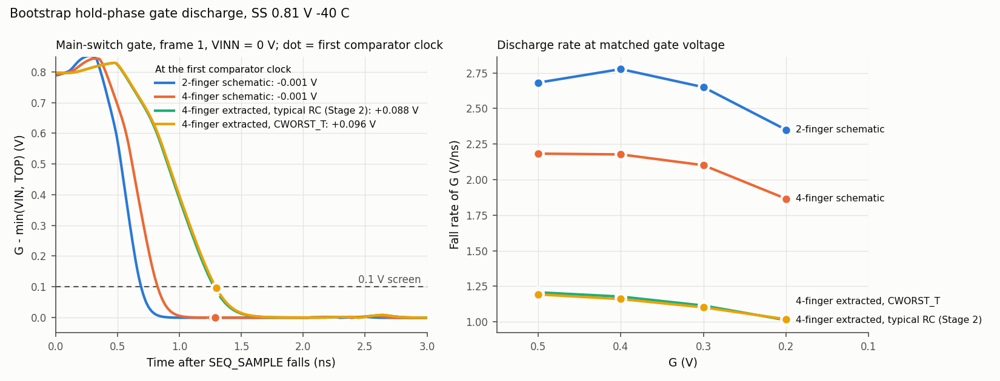

# Bootstrap boosted-gate margin and corner extractions

Follow-up to Stage 2 of the [top-level integration plan](https://github.com/chenzc24/sar-adc-t28/issues/12), run 2026-11-22. In Stage 2 the boosted-gate screen was the tightest margin in the ADC: 0.088 V against 0.1 V at SS 0.81 V −40 °C. Every corner used the typical-RC Bootstrap extraction `boot-core-20261121`. This record finds which node and phase set that value, extracts the frozen core at CWORST_T and CBEST_T, and reruns the SS-cold Stage 2 stimuli with the CWORST_T Bootstrap. The core and its OA are unchanged. [Measurements, run identities and digests](bootstrap_corner_margin_20261122.json) · [Gate traces](bootstrap_corner_margin_20261122.csv) · [Record builder](../../Layout/tools/analysis/bootstrap_corner_summary.py)

## Summary

- **Node and phase.** The screen is set by the main-switch gate G of the channel whose input sits at about 0 V (full-scale codes). It is set during the hold phase, between the fall of `SEQ_SAMPLE` and the first comparator clock about 1.3 ns later, while Maux and MRSTG discharge G. In the extracted core, G has just reached 0.1 V above the channel when that clock fires.
- **Cause.** The four-finger main switch alone does not set the 0.088 V. On the schematic it slows the discharge by 1.23–1.28×, and the gate is still fully off (−0.001 V) at the first comparison. The extracted core slows it by a further 1.81–1.88×, which is what reaches the screen.
- **Corner extractions.** All nets change by +1.4 to +4.0 % at CWORST_T and −0.3 to −2.9 % at CBEST_T.
- **SS cold with the CWORST_T Bootstrap.** All four Stage 2 stimuli pass every Stage 2 limit. The gate screen rises to **0.096 V** (0.1 V limit); every other result moves by at most 0.003 LSB and 2 ps.
- **FF hot** was not rerun with CBEST_T: the extraction does not differ materially, and its screen there is 0.001 V.
- **Routed design, not yet run.** Every run here carries the ~10 fF `CL_CMP_CLK` model load. The routed CMP_CLK of `layout_route_int` adds 5.05 fF, so the first comparator clock likely arrives earlier, and the screen may move past 0.1 V. An estimate from the Stage 2 route checks puts it at about 0.102–0.103 V. No code moved in any run here. See Scope and open items.

## Root cause

An analysis-only job ([measure_bootstrap_gate.py](../../Layout/tools/analysis/measure_bootstrap_gate.py), `prepare_all_extracted gate RUN_ID`) reads G of both channels from the retained native waveform after every sample close. In each run G is saved at one main-switch gate contact. The screen in `single_edge_lpe` is G − min(VIN, TOP) at the first comparator clock, the larger of the two channels.

Worst channel in every run: frame 1 (`verify`, full scale), channel N, VINN = 0.002 V. Times are from the 50 % fall of `SEQ_SAMPLE`; the onset is where G has fallen 50 mV.

| Bootstrap | Gate job | Onset (ns) | Below 0.1 V (ns) | First comparator clock (ns) | At that clock (V) | Fall rate at G = 0.4 V (V/ns) |
| --- | --- | ---: | ---: | ---: | ---: | ---: |
| 2-finger schematic | `sar8-sebit-ssc-cw-verify-b-gate` | 0.41 | 0.69 | 1.265 | −0.001 | 2.78 |
| 4-finger schematic | `sar8-sepl-ssc-cw-verify-r3cw-gate` | 0.46 | 0.82 | 1.290 | −0.001 | 2.18 |
| 4-finger extracted, typical (cell-LPE deck) | `sar8-sebit-ssc-cw-verify-bootx-a-gate` | 0.59 | 1.26 | 1.269 | +0.090 | 1.16 |
| 4-finger extracted, typical (Stage 2) | `sar8-allx-ssc-verify-a-gate` | 0.63 | 1.28 | 1.297 | +0.088 | 1.18 |
| 4-finger extracted, CWORST_T | `sar8-allxc-ssc-verify-a-gate` | 0.63 | 1.29 | 1.297 | **+0.096** | 1.16 |

- **Only full-scale frames are close.** At mid-scale G is still about 0.28 V at the first clock, but the channel sits at 0.45 V, so the screen reads −0.16 to −0.17 V. The screen binds only where G must fall all the way to about 0 V.
- **Decomposition.** From the two-finger schematic to the Stage 2 extraction, the time to fall below 0.1 V grows from 0.69 to 1.28 ns. Four fingers add 0.13 ns, the extraction 0.46 ns and CWORST_T 0.012 ns. At matched G (0.5–0.2 V) the fall rate drops 1.23–1.28× for four fingers, 1.81–1.88× for the extraction and 0.99–1.01× for CWORST_T. The same-deck pair (two-finger schematic against the typical extraction, both in the cell-LPE deck) gives 2.40× at 0.4 V, about the product of the two cross-deck ratios.
- **Sensitivity.** Near 0.1 V, G falls at about 0.7 V/ns, so the screen moves about 0.7 mV per ps of first-clock timing. The cell-LPE deck reads 0.090 V because its first clock comes 28 ps earlier. The Stage 2 route checks read 0.073 and 0.064 V because their RC routes delay the first clock to 1.320 and 1.336 ns. They add those routes on top of the ~10 fF `CL_CMP_CLK` model load that every Stage 2 deck carries, so they overstate the CMP_CLK load. At CWORST_T, G crosses 0.1 V 5 ps before the first clock (17 ps at typical RC).
- **Inside the extracted core.** The G net carries 2.75 fF of wiring capacitance (0.83 fF to ground, the rest to VIN, BBOT, CTRL and VOUT). Its resistance from the Maux drain to each main-switch gate is 389–392 Ω, a few picoseconds of RC.
  - The wiring capacitance explains only part of the slowdown. Two more main-switch gates slowed the schematic by 1.25×, so the four-finger gate node is about ten gate loads. At an estimated 1.5–2 fF per 1 µm × 150 nm thick-oxide gate, that is 15–20 fF, and 2.75 fF of wiring adds about 1.15–1.2×. This is an estimate from device sizes, not a measurement.
  - The remaining factor of about 1.6 is a weaker discharge in the extracted core. The candidates are not separated:
    - layout-dependent device parameters on Maux and MRSTG that the schematic omits (well proximity `sca` 1.81/1.96; diffusion lengths `sa` 815/485 nm against 155 nm), at 0.81 V, where these thick-oxide devices have little gate overdrive;
    - a later CLKSB edge at MRSTG;
    - contention from M4 turning off later.

  Separating them needs a run that saves the internal nodes (G, GRESET, CLKSB, CTRL) and the Maux/MRSTG currents. No saved waveform has them.

## Corner extractions

[bootstrap_rc_corner.py](../../Layout/tools/physical/bootstrap_rc_corner.py), started by `launch_xref_rc_corner.py SOURCE CORNER --case bootstrap`, runs on thu-wei and never opens the OA. It links the frozen GDS (`f0c6f9bb…`) and rebuilds the frozen PEX job deck. It stops unless that deck equals the recorded `c5b5e12b…` byte for byte, then changes only the xRC rules include to the foundry corner archive. DRC and LVS are inherited from `boot-core-20261121` (LVS CORRECT, the same six known DRC markers). [bootstrap_parasitics.py](../../Layout/tools/analysis/bootstrap_parasitics.py) finds the discharge path from device connectivity.

| Evidence | Rules | `extracted.scs` | G (fF) | GRESET (fF) | CLKSB (fF) | Maux drain to main gates (Ω) | All nets against typical |
| --- | --- | --- | ---: | ---: | ---: | ---: | --- |
| `boot-core-20261121` (frozen) | typical (lab deck) | `8a98b8bb…` | 2.745 | 0.117 | 1.406 | 389–392 | — |
| `boot-core-20261121-cworst-t` | CWORST_T | `95743bfd…` | 2.830 | 0.121 | 1.445 | 343–345 | +1.4 to +4.0 % |
| `boot-core-20261121-cbest-t` | CBEST_T | `cb8c1620…` | 2.674 | 0.113 | 1.376 | 438–441 | −0.3 to −2.9 % |

CWORST_T has the larger capacitance and the lower wiring resistance; CBEST_T the reverse.

## SS-cold Stage 2 stimuli with the CWORST_T Bootstrap

`prepare_all_extracted adc ssc KIND --corner-bootstrap` (run family `allxc`). Each deck equals its Stage 2 deck except for the Bootstrap files and their context entries. Stage 2 values are in parentheses; the limits are those of Stage 2.

| Stimulus | Run | Codes vs target | Compares / updates | Residual at sample close (LSB) | Signed decision error (LSB) | Read margin (ns) | Gate screen (V) | Setup / hold (ps) |
| --- | --- | --- | --- | ---: | ---: | ---: | ---: | --- |
| `verify` | `sar8-allxc-ssc-verify-a` | 7/7 exact | 8/8 | 0.054 (0.052) | 0.003 (0.003) | 7.77 (7.77) | **0.096** (0.088) | 443 / 100 |
| `extreme` | `sar8-allxc-ssc-extreme-a` | 7/8 exact, 1 at −1 | 8/8 | 0.057 (0.054) | 0.003 (0.003) | 7.88 (7.88) | 0.095 (0.087) | 443 / 100 |
| `carry` | `sar8-allxc-ssc-carry-a` | 7/7 exact | 8/8 | 0.000 (0.000) | 0.000 (0.000) | 8.02 (8.02) | < 0 | 442 / 100 |
| `restart` | `sar8-allxc-ssc-restart-a` | reads 83 and 172 | 1, 8, 8 | — | — | — | — | — |

- **Limits.** Codes within the gain-corrected target ±1, residual and plate settling ≤ 0.15 LSB, read margin ≥ 5 ns, gate screen ≤ 0.1 V. All four runs pass.
- **The −1 frame** is the input 0.01 LSB above mid-scale, as in Stage 2 (127 against 128).
- **Warnings** are the Stage 2 set. `sar8-allxc-ssc-carry-a` adds one temporary LTE relaxation in a delay-window multiplexer (SPECTRE-16780), as other Stage 2 runs had. The host swap note of `sar8-allx-ssc-verify-a` (SPECTRE-555) did not recur.
- **Resources.** Peak memory 2.25–2.37 GB under a 4 GiB reservation; 25 min (`restart`) to 99 min (`extreme`).

**FF hot was not rerun with CBEST_T.** Every CBEST_T net is within 3 % of typical, and less capacitance speeds the discharge. The FF-hot screen is 0.001 V at the first clock, 0.53 ns after close. At SS cold, a larger change (CWORST_T, up to +4 %) moved every result other than the gate screen by at most 0.003 LSB and 2 ps.

## Possible core change (not made)

The Bootstrap core is frozen at Stage 0, and nothing measured here requires a change: the screen passes in every run. It bounds the main-switch gate-source voltage at the first comparison. 0.096 V is several hundred millivolts below the threshold of the thick-oxide switch, and no code, residual or settling value moved.

The recommendation is to keep the core frozen. The routed CMP_CLK load may still take the screen a few millivolts past 0.1 V (Scope and open items). If the run with the routed load confirms that, the choice is between two options:
- record a screen exception, since a gate still that far below threshold would not be expected to move a code (the run itself would show whether one moves);
- make the change below.

If more margin is wanted, the direct change is a wider discharge path: Maux and MRSTG from 1 µm to 2 µm.
- **Expected effect, if the discharge current is the limit:** the fall rate rises toward the schematic's (about 2 V/ns), G falls below 0.1 V near 0.9 ns, and the screen reads about 0 V at the first clock.
- **Risk:** a faster gate fall moves more channel charge onto TOP. The FF-hot standalone sampling-error screen has 0.13 mV of margin (`boot-core-ffh-20261121`), so it could fail there.
- **Cost:** a core change reruns the standalone Bootstrap checks, the extraction and the pairwise ADC run.
- **Before choosing it:** the internal-node diagnostic above would show whether device strength is the limit.

## Scope and open items

- **Ideal top-level wiring**, as in Stage 2, with the ~10 fF `CL_CMP_CLK` model load on CMP_CLK. That load is two MOM units (`cfmom_2t`, lr = 2.5 µm); the CDAC's lr = 2 µm unit is 4.0 fF. The routed CMP_CLK of `layout_route_int` adds 5.05 fF, 0.62 kΩ and 2.1 ps Elmore delay to the comparator (`Layout/results/toplevel_route_internal.json`). Replacing the model with that route removes about 5 fF from the SAR clock driver, so in the routed design the first clock most likely arrives earlier, not later.
  - **Estimate, not a run.** In the Stage 2 route checks the first clock moved 23 ps for 11.1 fF of added CMP_CLK route (1×) and 39 ps for 22.2 fF (2×), about 1.8–2 ps per fF. On that basis, 5 fF less load brings the clock roughly 9–10 ps earlier. At 0.7 mV per ps, the CWORST_T screen would rise by about 6–7 mV, to about 0.102–0.103 V, just past the 0.1 V screen. No code moved at 0.096 V; whether one moves there is for the run to show.
  - **Open item:** an SS-cold run (CWORST_T Bootstrap, `verify`) with `CL_CMP_CLK` replaced by the routed ~5 fF CMP_CLK load, plus its `gate` job. It has not been run.
  - The Stage 6 routed extraction re-screens the gate in any case.
- **Deterministic runs only.** No mismatch, noise or terminal-voltage verdict. At 0.7 mV per ps, a few picoseconds of first-clock spread or a small threshold shift on Maux or MRSTG would use the remaining 3.6 mV.
- **The mechanism inside the extracted core** (layout-dependent parameters, CLKSB timing or M4 contention) is not separated; see Root cause.
- **Waveforms.** The raw waveforms of the four `allxc` runs were released after archiving. The gate jobs' other source runs belong to other experiments and keep theirs. [Release receipt](../storage/20261122-bootstrap-corner-margin-release.md)
