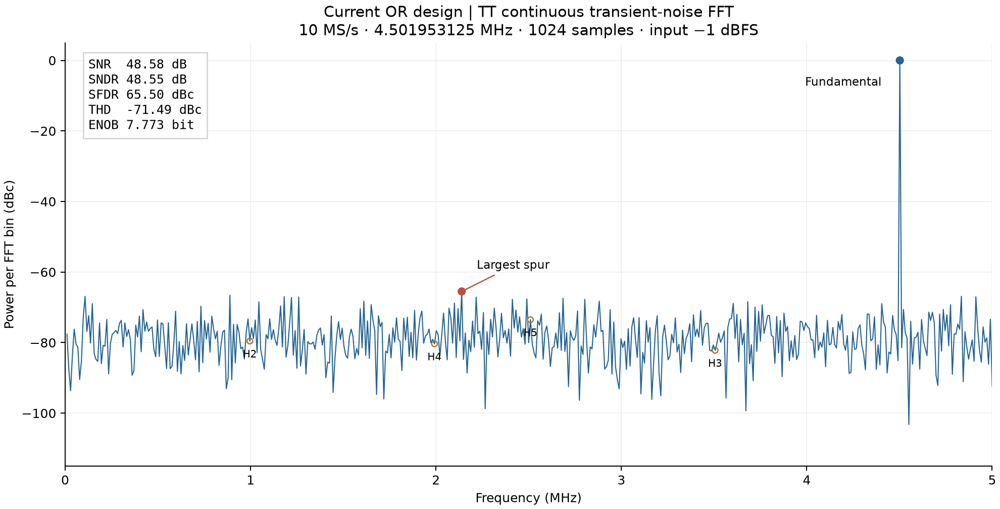

# 当前 OR 版：TT 连续1024点含噪声FFT

**已完成。SNDR 48.554dB，SNR 48.576dB，ENOB 7.773bit，SFDR 65.495dBc。** 满足项目在−1dBFS下ENOB≥7bit、SNDR≥43.9dB的工程目标，仅限本次TT、单噪声种子、无失配及无PEX条件。

运行 `sar8-resetor-noise-tt-fft1024-s101-v1`，thu-song；当前最简参考MSB D2＋数据复位OR设计 `sar8_l90_mmain2_stdcell_minref_msbd2_resetor_v1`。仿真于2026-11-16 16:28 CST结束，耗时19.61小时；服务器原生流式分析于16:34结束，耗时约366秒。仿真、分析均退出0；回收7份小结果共475745字节，无跳过文件。原波形保留，尚未删除。

## 测试条件与方法

TT、0.90V、27°C，Fs=10MS/s，Fin=4.501953125MHz（1024点中的第461频点），输入−1dBFS。连续仿真1032帧，排除8帧预热后取连续1024码；记录长度102.4µs，频率分辨率9.765625kHz，无独立运行拼接。

`noise_worst`模型噪声开启，seed101，noisescale=1，10kHz低频着色拐点、2GHz高频配置；四个外部50Ω电阻噪声包括在内。理想输入/参考/供电/时钟源无噪声，未施加外部随机时钟抖动；process/mismatch与PEX关闭。Spectre X MX、4线程，原生日志确认reltol=1e−6、trap、maxstep=10ps及噪声配置。

使用去DC、矩形窗、相干单频点FFT，保留0–Fs/2单边功率，DC/Nyquist不重复计数。SNR排除H2–H5折叠频点（102、359、204、257）；SNDR保留全部非基波、非DC频点；SFDR为最大单个非基波频点；THD为H2–H5功率之和。ENOB=(SNDR−1.76)/6.02，未补偿−1dBFS输入幅度。

服务器独立radix-2结果与本地NumPy及ADCtoolbox交叉核对，SNDR/SFDR/SNR/THD差异均小于1e−8dB；Parseval功率误差5.6e−17V²。原生波形在读码时刻的解码与VA观察器1032帧全部一致。

## 结果

| 指标 | 本次结果 |
| --- | ---: |
| SNR，排除H2–H5 | 48.576 dB |
| SNDR | 48.554 dB |
| ENOB | 7.773 bit |
| SFDR | 65.495 dBc |
| THD，H2–H5 | −71.489 dBc |
| 实测基波幅度 | −0.994 dBFS |
| 最大杂散 | 2.138672 MHz，−65.495 dBc |
| 拟合正弦后的残差RMS | 0.30149 LSB |
| 残差最大绝对值 | 0.63007 LSB |
| 输出码范围 | 13–242，未触及0/255饱和端 |
| 1032帧协议异常 | 0 |
| 观察器转换时间 | 28.807–29.201 ns |

当前含噪声记录仍得到约7.77bit的动态有效分辨率。SNR与SNDR仅差0.022dB，所计H2–H5谐波在总非基波能量中占比较小。0.30149LSB的总拟合残差接近理想均匀量化噪声RMS 1/√12≈0.28868LSB的量级，但残差包含量化、器件噪声和失真，不能把两者平方相减直接当作本电路热噪声测量。

本次没有握手超时、少位/多位或读码窗口内不稳定。有限帧功能检查不等于完整静态缺码检查。最大杂散不落在H2–H5频点；单次有限记录无法直接将其归因于某个器件或机制。

历史冻结B版含噪声结果SNDR约48.574dB，与本次约差−0.020dB，数值接近；两者设计不同、随机噪声实际轨迹也不保证相同，不能据此认定简化电路造成特定性能增减。历史无噪声A/B也不能作为当前设计的严格噪声开关配对。

## 功耗与告警

| 估计项 | 功率 |
| --- | ---: |
| VDD源向电路输送 | 47.887 µW |
| 高参考源向电路输送 | 13.200 µW |
| VDD＋高参考 | **61.087 µW** |
| 理想采样时钟源，另列净平均功率 | 0.0000704 µW |

上述是10ps保存网格上的梯形积分估计，未验证积分收敛，不含理想输入源功耗；时钟源数值不是实际时钟产生/驱动电路的完整功耗。

保留CMI端压告警，另有 `SPECTRE-16780`（不连续信号附近临时放宽LTE）和 `SPECTRE-555`（20kB swap，提示速度影响），以及原有SFE/AHDL告警。告警有次数抑制，日志列举值不等于真实最大端压。本次保存信号不能完成逐管峰值、持续时间及新SOA规则资格判定。

仅一个噪声种子；未验证噪声带宽、低频flicker、时间步长/求解器及功耗积分收敛。SNR中的噪声含量化噪声，不是纯器件噪声；H2–H5频点也含有限记录噪声贡献，THD不等于已独立分离的器件失真。

## 可复核交付

- [机器汇总及三方核对](results.json)、[原生分析输出](native_result.json)、[冻结运行配方](recipe.json)、[回收与散列回执](collection_receipt.json)。
- [全部1032帧](all_frames.csv)、[实际FFT的1024码与采样时刻](fft_codes.csv)、[单边频谱数值](spectrum.csv)。
- [频谱PNG](spectrum.png)、[频谱SVG](spectrum.svg)、[残差与逐帧转换时间](residual_timing.png)。
- [原始Spectre日志 · collection receipt](collection_receipt.json)、[仿真状态](simulation.state.json)、[分析状态](analysis.state.json)。
- 可重复生成报告的入口：`python -m tools.saradc.analysis.noise_fft_report`。全部冻结输入已保留在本地 `work/output/managed_execution/runs/sar8-resetor-noise-tt-fft1024-s101-v1/inputs/`，模型及标准库仍只读引用。
