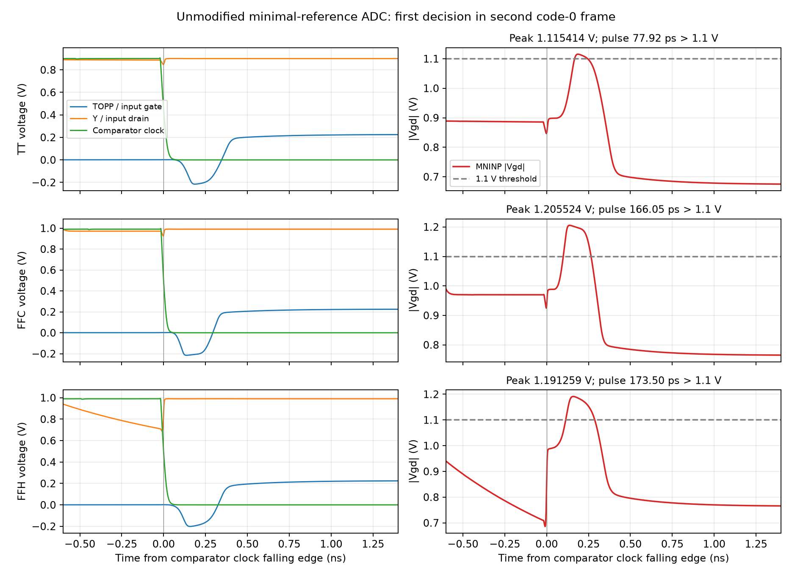

# 比较器栅漏超限：输入顶板切换下冲

对采用版 `c024fd5` 已完成的 TT、FF 冷、FF 热 2 ps 整机波形做同源只读提取。超限发生时，输入管 MNINP 的漏极 Y 已复位至 VDD，栅极 TOPP 短暂跌到地以下；本次事件不是比较器内部 Y 节点下冲。

| 工况 | 第二帧首位切换时 TOPP | 同时 Y | MNINP 最大绝对 Vgd | 本次脉冲超过 1.1 V 时间 |
| --- | ---: | ---: | ---: | ---: |
| TT | −0.215418 V | 0.899996 V | 1.115414 V | 77.916 ps |
| FF 冷 | −0.215523 V | 0.990001 V | 1.205524 V | 166.050 ps |
| FF 热 | −0.201264 V | 0.989995 V | 1.191259 V | 173.497 ps |

TT 在本项目的 100 ps/10 ns 工程筛查内，FF 两角持续时间失败；完整运行判定仍见[五点逐管报告](minimal_reference_five_corner_20261115.md)。首帧、重复低码帧和高转低帧的提取窗口均复现同一现象。

## 切换来源

首位判决为 0 后，试探状态从 `10000000` 转为 `01000000`。FF 冷、热的 CODE7 下降与 CODE6 上升分别只差 3.707 ps、4.011 ps；P 侧 BP6 下降却比 BP7 上升分别早 193.323 ps、210.823 ps（底板用 0.45 V 交点，数字端用 VDD/2）。

BP6 先下降，BP7 尚未充分抬升，形成短暂的负向电荷步进。以理想二进制位权 1/2、1/4 估算，FF 冷这一时刻的步进为 −0.213844 V，实际 TOPP 相对切换前下降 −0.216507 V；FF 热估算 −0.193773 V，实际 −0.202071 V。估算支持 CDAC 切换瞬态为主要来源，剩余差异未作寄生电荷分解。

因此先检验真实负载下 MSB 驱动的速度匹配，暂不改比较器尺寸或加入输入钳位。末级 D1 同时驱动不同权重开关，数字码边沿接近并不保证底板同时切换。

## 单变量候选

`reference=minimal_msb_d2` 仅将 MSB P/N 两侧末级反相器从原生 `INVD1BWP12T30P140` 改为同库 `INVD2BWP12T30P140`。非反相路径保留两级反相器，第一级不变。逻辑、门级数、比较器、采样相位和异步握手不变；当前默认仍为 `minimal_direct`。

TT、SS 冷/热、FF 冷/热五个整机实验的端压分析已完成，比较器均数值通过；[D2 单变量结果](msb_drive_d2_trial_20261115.md)保留全部剩余问题。ID 为 `sar8-minref-soa-<corner>-song-msbd2-v1-step2p`，每个 4 线程。18 帧激励、模型、求解设置、2 ps 最大步长和阈值与对应已完成源一致；重建逐管端点清单。五角的同源独立时序复核也已完成，90 帧码字和逐帧事件筛查通过；启动首位连续稳定余量的统计限制详见候选报告，当前默认未变。

[数值与运行溯源](comparator_input_undershoot_20261115.json)。本报告不覆盖 MC、噪声、PEX 或可靠性寿命；FF 冷 SAR DFF MM64 的独立持续时间违例仍未解决。
