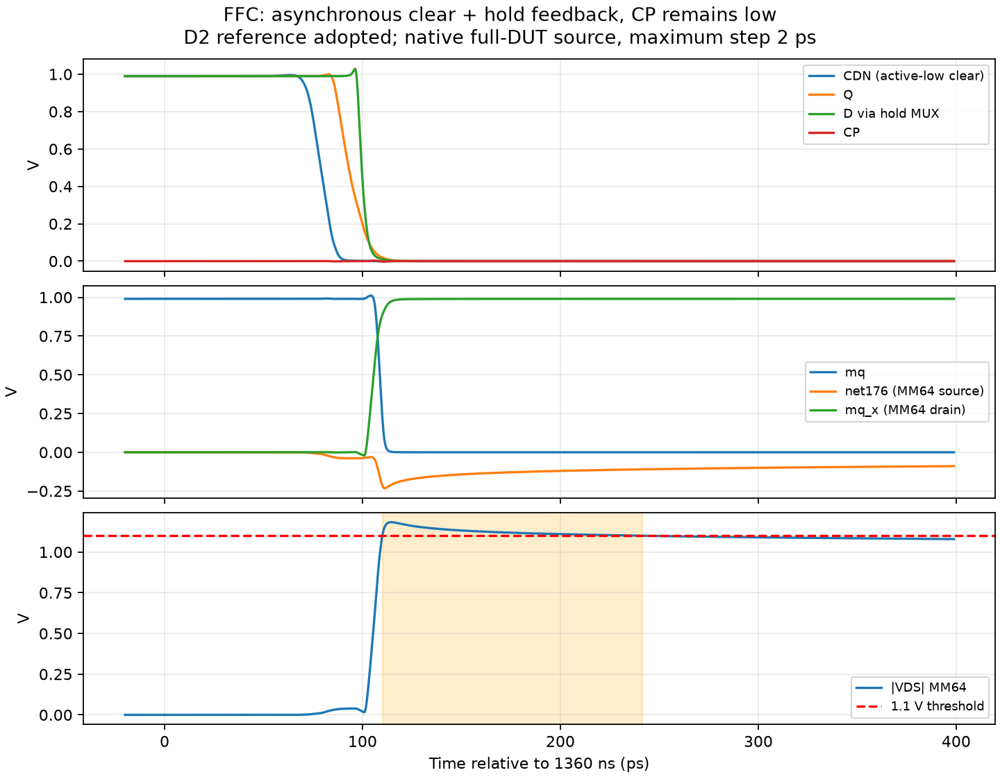

# 标准 DFF：复位反馈期间的内部下冲

当前设计已采用 MSB D2 参考驱动，提交 `c6f112b`。比较器五角端压筛查通过，FF 冷仍有 8 个 SAR 数据寄存器的 `XSTORE.XFF.MM64 Vds` 违例。本次只读分析已完成的整机原生波形，没有新增仿真或修改标准库。

## 本次确认

选取 XBIT7。18 个采样／复位窗口加一个正常转换窗口，提取全部原生点；其 **7 次 >1.1 V 脉冲均落在原存储 Q=1 后清零的窗口**。原 Q=0 的 11 个复位窗口无该阈值超限。7 次脉冲累计 920.661837 ps，与独立全历史端压统计完全一致；峰值及发生时刻也相同，没有窗口截断。

超限窗口中 CP 没有逻辑翻转。最坏峰值事件顺序如下，均为原生相邻点线性求得的半供电交点：

| 事件 | 时间 ns |
| --- | ---: |
| SAMPLE_INT 上升，提出复位 | 1360.073366 |
| 库单元 CDN 下降，异步清零有效 | 1360.078992 |
| Q 下降 | 1360.093127 |
| 外部保持 MUX 的 NEXT_D 下降 | 1360.099633 |
| 单元内部 mq 下降 | 1360.108780 |
| MM64 Vds 达峰 | 1360.114498 |

峰值同刻：MM64 漏极 mq_x 为 **0.973831676 V**，源极 net176 为 **−0.209611164 V**，栅极 clkbb 为 0.003298272 V，故 Vds 为 **1.183442840 V**。不是把不同时刻的极值相减。

该峰值事件超过 1.1 V 持续 131.525135 ps；全运行最差 10 ns 窗累计为 **131.527282 ps**，超过工程规则的 100 ps，虽峰值低于 1.29 V，仍失败。

## 电路解释与证据边界

当前实际外部连接为 `Q → 保持 MUX → D`。低有效 CDN 清零 Q 后，外部保持支路让 D 随之下降，内部 mq 再下降。

库内相关串联支路为 `mq_x — MM64 — net176 — MM65 — net184 — MM66 — VSS`；三只 NMOS 的栅极依次接 clkbb、mq、CDN。此时 clkbb 和 CDN 已低，mq 随后下降。连接和波形支持：串联节点恢复路径受限时，附近节点翻转造成负向电荷扰动，增大 MM64 Vds。没有保存这一批的逐管端流和工作区，尚不能把扰动唯一分解为某个 Cgd、沟道电荷或结电流，也未通过干预实验分离各项贡献。

**这不是本次事件中的 CP 过快证据。** 旧独立台曾做 CP 串 2 kΩ／20 kΩ 对照，内部重新整形使下冲未明显改善；那是另一套激励及旧 0.99 V 筛查，不将旧失败数量转移到本次规则。

## 标准库是否用错，能否直接换 D2

只读复核实际 170a SPICE 文件 SHA256 为 `b7b366bff01b86fbe6c9728426a1643255476f5e5e63f79b9ff14ffaa2b2fc0e`，与先前库证据一致。

| 同族原生单元 | MOS 实例数 | 端口 | MM64／65／66 相对 D1 |
| --- | ---: | --- | --- |
| DFCNQD1 | 28 | D CP CDN Q VDD VSS | 当前使用 |
| DFCNQD2 | 34 | 同序 | 连接及器件语句参数相同 |
| DFCNQD4 | 38 | 同序 | 连接及器件语句参数相同 |

更大档位改变了其他内部器件和负载，因此不能断言其应力相同；但它们没有直接加宽这条问题支路，不能把反相器 D1→D2 的成功照搬为 DFF 修复结论。标准库本体保持只读。

保留的同角 Liberty 定义采用 30%/70% slew、derate 0.5。最坏事件的 CDN 下降间隔 5.792 ps、D 下降间隔 2.342 ps，对应表坐标 11.584 ps、4.684 ps，位于已提取的 1.5–262.9 ps 输入轴内。**只说明这两个事件未显示输入 slew 越轴**；完整时序弧、状态相关 Q 负载、SPI/Liberty/PDK 正式配套仍未全部核定，不能据此宣布使用条件或可靠性全部合格。

## 下一项对照

先从这一实际清零事件建立小型原生隔离台，保留同一标准 DFF、实际输入驱动和 Q 首级负载，复现 Q=1 清零的下冲。随后仅改变复位有效期间的 D 反馈：与真实 `Q→MUX→D` 情况比较，诊断性地将 D 的下降推迟至复位释放后，保持 CP/CDN 波形不变。此项用于确认恢复路径与反馈事件的贡献，不直接作为 ADC 实现。

确认后再选择同功能库单元或外部复位／保持安排，验证异步清零优先级、恢复／移除、首帧和 8 次握手。暂不改库内部器件，也不把普通无异步复位 DFF 盲替当前单元。

本次对 XBIT7 直接取得同刻证据；另 7 位同位置违例及相同拓扑保留，未声称已逐位完成联合节点提取。原始源：`sar8-minref-soa-ffc-song-msbd2-v1-step2p`；分析：`sar8-dff-reset-ffc-msbd2-v2`。首次 v1 因服务器 Python 2 不支持 `makedirs(exist_ok=...)` 在读波形前失败，已保留并以新身份修正。回收约 11.6 MB，无跳过文件。

[机器可读证据、散列与窗口结果](dff_reset_feedback_20261115.json)。端压规则仍以 [soa_rule.yaml](../../specs/soa_rule.yaml) 为准。
