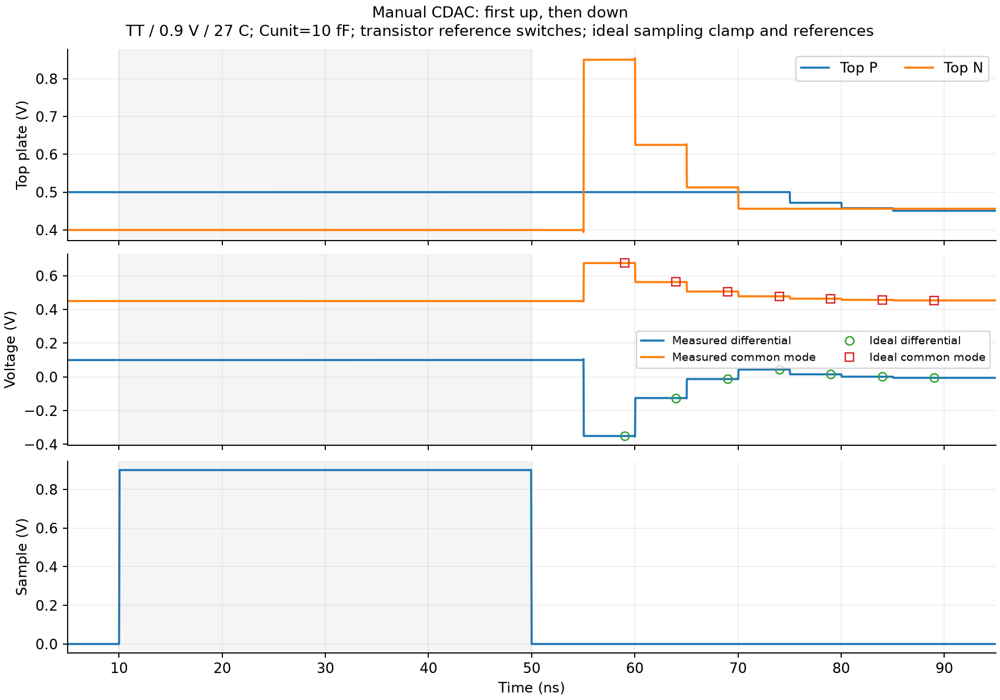
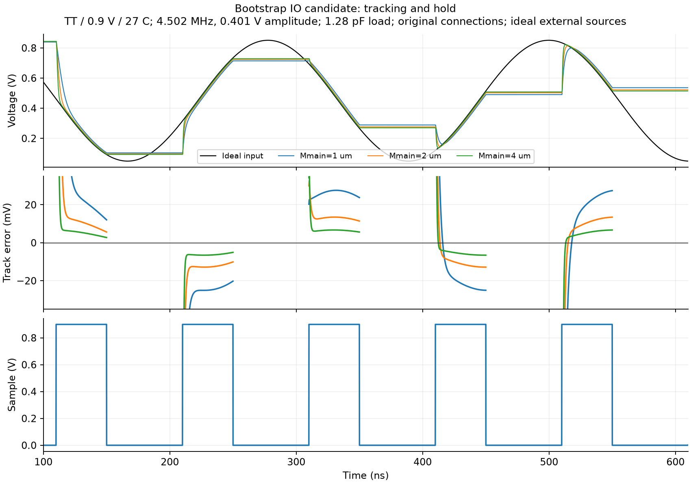
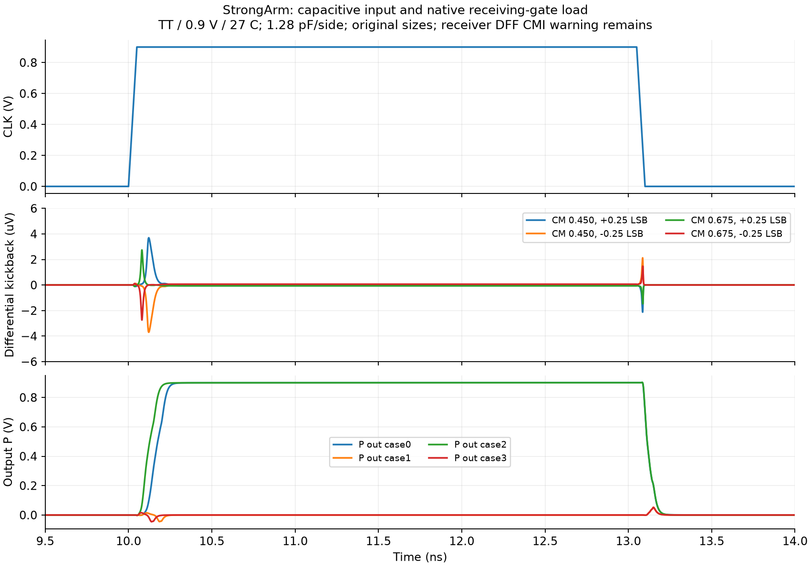
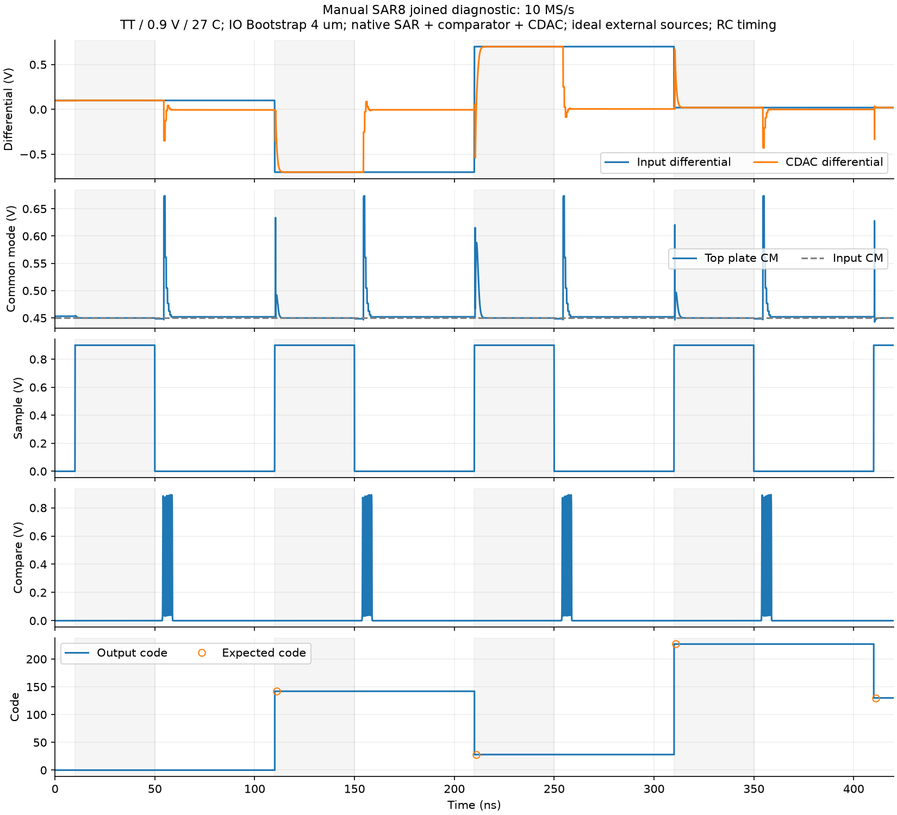
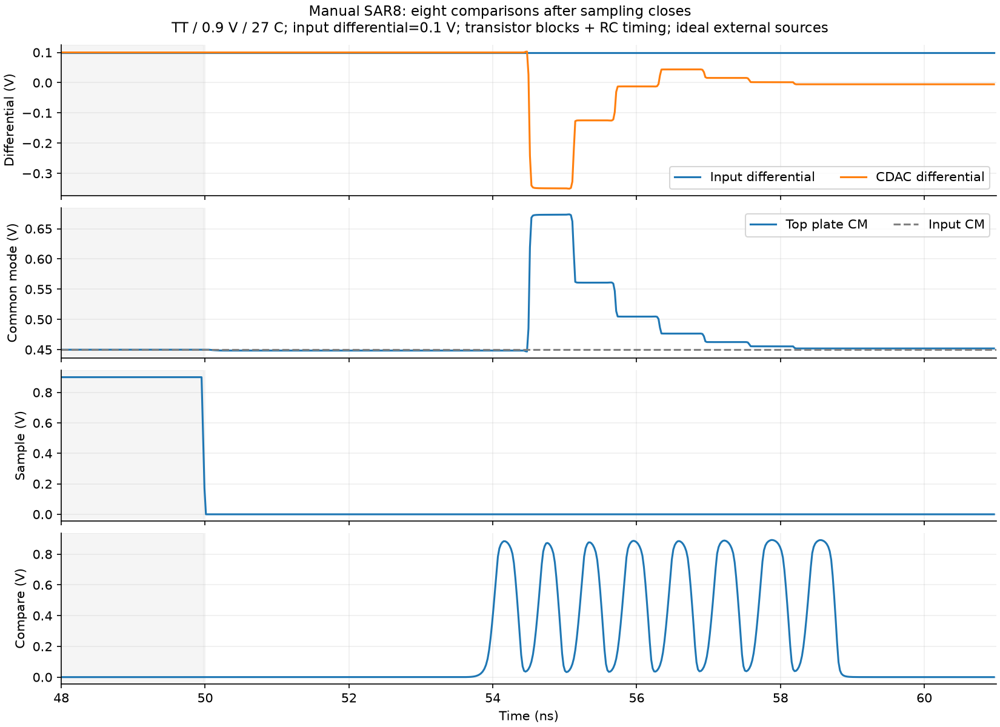

# 手搭 SAR8：网表实现与验证

目标：8-bit、10 MS/s、TT / 0.9 V / 27°C。输入、参考、电源、外部采样时钟均为理想源。原库 `SAR_ADC_T28_manual` 的 OA 未修改；以下是独立网表候选，不是已回写原理图的版本。

## 已修正的接口

- 复位：标准单元 DFCNQD1 的 CDN 低有效，改由反相采样时钟驱动，采样期间清零，转换期间释放。
- 首位：仅第一位控制跨接 P/N 两侧，使第一步向上移动电位较低的一侧；后续位保持原来的同侧向下切换。
- 输出：输出寄存器读取正侧原始判决位，移除参考栅控极性对码字的影响。

原生导出快照保存在 `output/manual_adc/native/`；原始器件参数未覆盖。注意 CDAC NMOS 的实际导出 nf=10，与先前 CDF 读取的 nf=1 不同，此次使用实际导出值。

## 模块实测

| 模块 | 条件与结果 | 当前结论 |
|---|---|---|
| SAR 逻辑 | 原生标准单元、真实参考 MOS 栅负载；0、255、85、170、128、127、1、254 共8组码全部吻合 | 接口功能通过；内部端压告警仍存在 |
| CDAC | Cunit=10 fF，每侧1.28 pF；理想采样钳位，晶体管参考开关；7步切换后4 ns的最大差模偏差2.51 µV | 第一位向上、后续向下的算法和连接吻合；尚非闭环动态精度 |
| 比较器 | 原尺寸；1.28 pF/侧保持输入；±0.25 LSB、共模0.45/0.675 V；时钟50%到VALID50%约0.113–0.163 ns，评估阶段最大差模反冲3.70 µV | 四个测试点判决正确；接收DFF有CMI告警 |
| Bootstrap | 原核心管版出现约1.75 V升压及原生CMI端压告警；保持连接改用1.8 V器件后，DC和正弦诊断均无CMI告警 | 采用IO候选继续；不能因此宣称整个ADC无过压 |

## 尺寸与时序候选

Bootstrap 12只MOS保持原连接，改用原生1.8 V模型，L=150 nm、辅助管W=1 µm；主开关扫1/2/4 µm。4.502 MHz、0.401 V幅度、1.28 pF负载下，六个保持样点去除幅度/相位/直流项后的残差RMS分别为1.075/0.437/0.210 mV，因此先选4 µm。**六点拟合只是尺寸筛选，不是ENOB结果。** 静态关断台阶约−1.24至−1.63 mV，合龙时还须核对差分抵消与采样延迟。

周期100 ns，采样高电平约40 ns，关闭沿50%点49.975 ns，之后每100 ns重复。首次采样前留10 ns预充。保留原17个延时位置和门级握手结构，以显式RC替换无法完成瞬态的理想delay元件；R=2 kΩ，C按名义50%时间配置，环路2 ns、逐位100 ps。它们是可解释的网表时序实现，尚未对应到版图器件及寄生。

## 证据与限制

详细数值：`results/module_summary.json`。脚本：`scripts/manual_adc/`。所有仿真通过managed流程，原生波形留在服务器，各运行身份为 `manual8-*`。

保留的失败：sample-base-v1模型包含语句位置错误；logic-codes-v1的PWL时间小数精度不足；logic-codes-v2的原delay模型出现minstep失败。后续使用独立新运行，未覆盖失败案例。

数字逻辑的原生CMI包括复位时 I5 内部节点、接收DFF内部节点，功能通过不等于可靠性通过。当前尚无此手搭版本的全码DNL/INL或1024点FFT指标；历史R4指标不适用于本候选。当前未含噪声、失配、PEX或完整PVT。模块功耗数值仅对应各自测试台，不能直接相加为ADC总功耗。

## 首轮合龙结果

`manual8-joined-dc-v1` 完整运行420 ns，原生0错误；分析 `manual8-joined-dc-reduce-v2` 绑定该源运行，指标计算使用全部原生点，绘图间隔20 ps。原始全点CSV导出超过限额的失败记录保留，没有重跑电路。

| 差分输入 | 预期码 | 实测码 | 采样关闭至末位时钟 |
|---|---:|---:|---:|
| +0.10 V | 142 | 142 | 8.651 ns |
| −0.70 V | 28 | 28 | 8.608 ns |
| +0.70 V | 227 | 227 | 8.596 ns |
| +0.02 V | 130 | 130 | 8.681 ns |

每帧八次比较，逐位时钟各触发一次，采样期间无比较时钟脉冲。第一次比较在采样关闭后约4.035 ns开始。注意RC的名义2 ns并不等于闭环每位耗时；实际相邻比较约0.57–0.68 ns，须按闭环波形验收。

输出寄存器在下一次采样开始时锁存上一帧结果。图中码字与输入相差这一固定延迟，不应拿当时的新输入直接相减制造误差。保持后1 ns、首轮比较前测得差分采样偏差最大约0.342 mV（此四点）；顶板共模约0.44856 V。

420 ns全区间积分：VDD供能43.27 µW、参考23.23 µW、输入两源合计2.44 µW、外部采样时钟0.029 µW，总净源功率约68.97 µW。包含启动和所选输入阶跃，理想源可以吸收能量；不是物理参考缓冲器/时钟源自身的实现功耗，也不是最坏工况功耗。

**结论：首轮模块测试与四帧闭环功能已跑通，满足这一名义条件下的10 MS/s周期；尚未达到完整8-bit电气/性能验收。** 标准单元内部CMI告警仍在，原生日志还报告大量重复告警被抑制，不能把29条显示警告理解成仅29次事件。后续优先按实际内部端压、输入slew与复位恢复定位，保留库文件不改；再做全码与较长相干正弦，验证动态采样延迟、线性度和ENOB。未据四个码字宣称无缺码或8-bit精度。

精确结果：`results/manual8-joined-dc-reduce-v2.json`；当前合龙候选：`candidate_io_v1/dut_rc.scs`。原OA保持不变。

后续定位更新：[标准单元内部端压与理想延时复核](stress_diagnosis/README.md)。RC不等价于原理想delay，当前合龙结果仅属于RC诊断候选；后续恢复理想延时主线，端压修复方案尚未实施。
