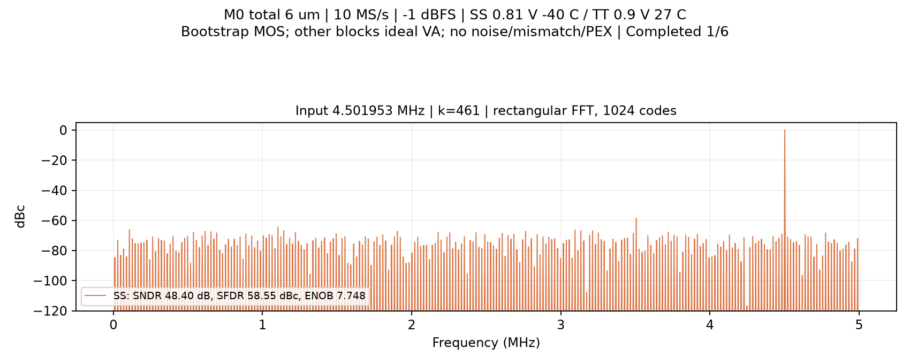
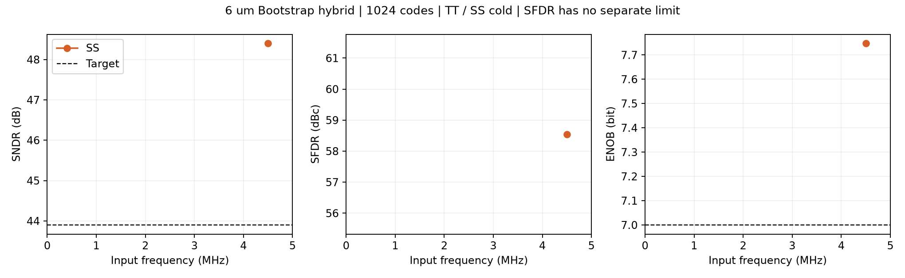

# 6 um Bootstrap：TT / SS冷角频谱

批次进行中；已完成1/6组，未完成项不填指标。

测试范围：仅Bootstrap晶体管级，其余ADC模块为理想VA。参考0.9 V、输入共模0.45 V、差分满幅1.8 V、输入−1 dBFS；10 MS/s。TT 0.9 V/27°C，SS 0.81 V/−40°C。MOS尺寸、110 ns首时钟及采样窗口/关闭沿保持不变。

每组32帧预热，再取连续1024个实际输出码。矩形窗、去DC、谐波计入SNDR；不做相位/增益校正，不做−1 dBFS满幅补偿。ENOB=(SNDR−1.76)/6.02。目标ENOB≥7（SNDR≥43.90 dB）；未找到独立8-bit SFDR门槛，因此只报告SFDR测量值。

| 工况 | 输入MHz | SNDR dB | SFDR dBc | ENOB bit | ENOB目标 | 理想对照ENOB |
|---|---:|---:|---:|---:|---|---:|
|SS|4.501953|48.401|58.547|7.7476|通过|7.8067|

当前判断：SS冷角4.502 MHz的6 um采样器在本混合测试台下达到7 bit目标，SNDR余量4.501 dB；相对同组全理想对照SNDR下降0.355 dB、SFDR下降6.271 dB。全理想对照不是TT晶体管结果。
保持6 um继续完成TT与各频点比较；现有结果不支持仅因同关闭沿码差就增宽。其余五组未齐，尚不能给出完整频段结论。

保持电压的相位/增益拟合仅用于解释，与输出码FFT独立：

|工况|输入MHz|等效滞后ps|增益偏差%|拟合残差RMS µV|同关闭沿最大码差|
|---|---:|---:|---:|---:|---:|
|SS|4.501953|1156.98|-0.06335|762.92|4|

原生Spectre X CX，单线程，conservative/maxstep50 ps；每帧连续事件观测8次比较/1次完成/无FAULT，1 ns保存波形独立核对输出码。ADCtoolbox与直接FFT交叉检查，另核对Parseval能量和基波直接投影。

边界：本试验不验证真实比较器、SAR逻辑、参考驱动、噪声、失配或版图寄生。1 ns保存间隔不能用于尖峰最大值签核；完整原生CMI日志保留。通过本试验不代表整机PVT合格。

未完成运行：manual8-bootfft-tt-k461-v1, manual8-bootfft-ss-k17-v1, manual8-bootfft-tt-k17-v1, manual8-bootfft-ss-k257-v1, manual8-bootfft-tt-k257-v1

- manual8-bootfft-ss-k461-v1：检查={"frame_timing": true, "no_fault": true, "strobe_code_agreement": true, "zero_native_CMI": true}；原生警告=['SFE-1131', 'VACOMP-2435']；实际设置={'abstol(I)': '10 fA, default 1 pA', 'abstol(V)': '10 nV, default 1 uV', 'maxstep': '50 ps, default 1.0572 us (conservative)', 'method': 'gear2only', 'reltol': '100e-09, default 100e-06 (conservative)'}