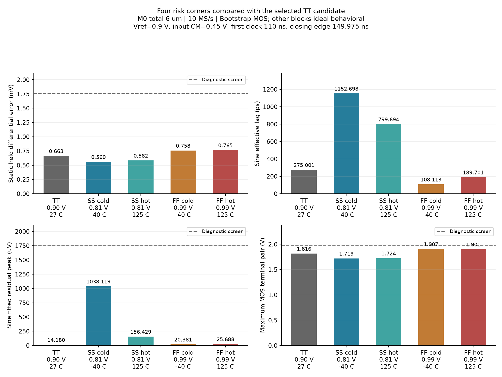
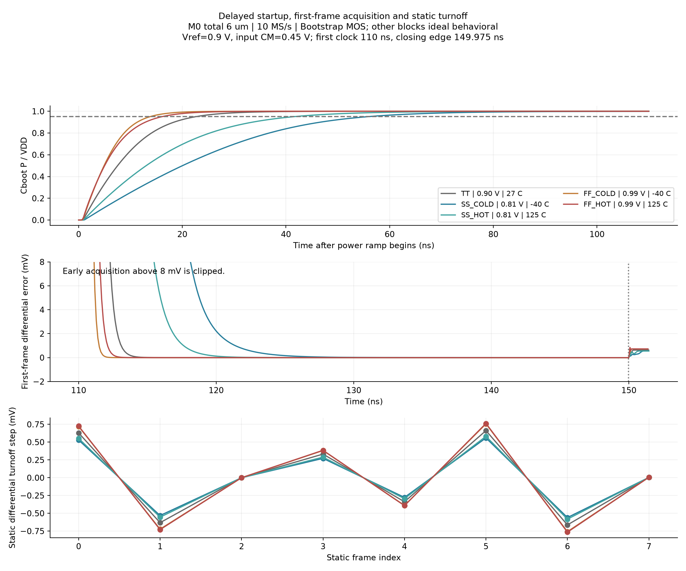
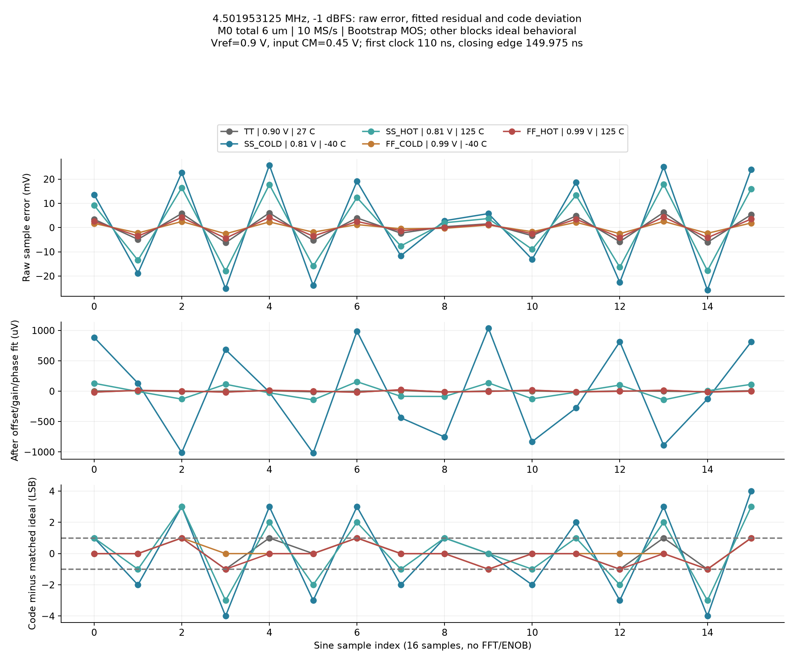

# 6 µm Bootstrap：极限工艺角短测

**结论：四个极限角的启动、静态采样和端压筛查均通过；SS冷、热角的高频码差分别达4码和3码，6 µm尚未全角合格。** SS冷角去掉首帧后仍约1.15 ns滞后，不能归为启动首帧问题。保持用户选择的6 µm候选，后续应优先定位SS动态跟踪，不把这轮结果直接推广到整机。

选用M0总宽6 µm（W=1 µm、multi=6、L=150 nm）；其余11管尺寸、12管拓扑、每侧1 pF自举电容保持不变。本页仅验证Bootstrap，比较器、SAR与参考切换均为理想行为模块，CDAC每侧等效1.28 pF。外部电源、输入、参考、时钟均为理想源。未修改OA或采用整机新基线。

电源1 ns上升；首个时钟110 ns开始，首次50%关闭沿149.975 ns，此后每100 ns重复，采样脉宽39.9 ns、边沿50 ps。参考固定0.9 V、输入共模0.45 V、差分满量程1.8 V，未随供电缩小。MOS宏角分别加载TT_18/SS_18/FF_18；其余被动模型段保持TT，测试电容为理想器件。

每角8个静态码中心＋16个4.501953125 MHz／−1 dBFS正弦样点；TT复用上一轮6 µm结果。LSB=7.03125 mV。

| 条件 | 静态保持误差峰 mV | 正弦原始误差峰 mV | 拟合滞后 ps | 拟合残差峰 µV | 最大码差 | 最大端压 V |
|---|---:|---:|---:|---:|---:|---:|
| tt / 0.90 V / 27°C | 0.663 | 6.260 | 275.0 | 14.2 | 1 | 1.8164 |
| ss_cold / 0.81 V / -40°C | 0.560 | 25.798 | 1152.7 | 1038.1 | 4 | 1.7195 |
| ss_hot / 0.81 V / 125°C | 0.582 | 17.918 | 799.7 | 156.4 | 3 | 1.7235 |
| ff_cold / 0.99 V / -40°C | 0.758 | 2.547 | 108.1 | 20.4 | 1 | 1.9070 |
| ff_hot / 0.99 V / 125°C | 0.765 | 4.377 | 189.7 | 25.7 | 1 | 1.9005 |

**保留的失败项**（阈值未放宽）：

- tt：本轮列出的诊断筛查均通过。
- ss_cold：sine:codes_within_one_of_ideal。
- ss_hot：sine:codes_within_one_of_ideal。
- ff_cold：本轮列出的诊断筛查均通过。
- ff_hot：本轮列出的诊断筛查均通过。

静态保持误差在关闭沿后1 ns测量，相对关闭沿输入值；静态关断台阶取关闭前75 ps至关闭后1 ns，包含电荷注入与时钟馈通，不能只归于沟道注入。独立静态电容保持支路用于测量漂移，排除SAR正常电荷重分配。

正弦原始误差同样相对关闭沿输入值。拟合同时去掉偏置、增益和相位：残差小不等于原始采样精度通过；单频相位换算的滞后也不是已证明的纯延时。码差相对相同外部输入/时序的全理想对照。

| 条件 | 最小预充/VDD | 静态关闭前误差峰 mV | 静态差分关断台阶峰 mV | 保持漂移峰 µV | 输入更新馈通峰 µV |
|---|---:|---:|---:|---:|---:|
| tt | 0.999999 | 0.000000 | 0.663 | 0.182 | 0.252 |
| ss_cold | 0.999014 | 0.000003 | 0.560 | 32.529 | 0.074 |
| ss_hot | 0.999897 | 0.000002 | 0.582 | 2.618 | 7.411 |
| ff_cold | 1.000000 | 0.000000 | 0.758 | 0.123 | 0.082 |
| ff_hot | 0.999973 | 0.000004 | 0.765 | 94.173 | 314.927 |

预充门槛为各角实际VDD的95%；静态关闭前误差≤0.1 LSB，保持误差≤0.25 LSB，漂移≤0.05 LSB，输入更新馈通≤0.25 LSB。低于数值容差的微小值不代表已验证该物理精度。

| 条件 | 拟合增益误差 % | 拟合偏置 µV | 去首帧滞后 ps | 去首帧残差峰 µV | VDD+时钟 µW | 输入源工作 µW |
|---|---:|---:|---:|---:|---:|---:|
| tt | -0.07995 | 0.70 | 275.0 | 14.4 | 0.457 | 1.686 |
| ss_cold | -0.05755 | 90.61 | 1150.9 | 1243.8 | 0.283 | 1.867 |
| ss_hot | -0.09588 | 12.95 | 799.4 | 167.6 | 0.349 | 1.826 |
| ff_cold | -0.08665 | -0.63 | 108.1 | 18.0 | 0.596 | 1.667 |
| ff_hot | -0.08894 | -0.76 | 189.7 | 22.7 | 0.711 | 1.737 |

功率取完整16个采样周期，不含最初供电启动能量；VDD与时钟功率只计被测Bootstrap，独立保持对照支路不计入。输入源工作单列，不是整机ADC功耗。

端压同时检查原生CMI与48个实例的六种外部MOS端压组合（包括独立保持支路），保守筛查值1.98 V。该筛查不是foundry寿命或SOA签核。

| 条件 / 测试 | 峰值 V | 时间 ns | 节点 | 对应器件/端对 |
|---|---:|---:|---|---|
| tt / dc | 1.816351 | 710.723399 | xhp.net1, 0 | XHP.M0:GB; XHP.M2:GB; XHP.M5:GB; XHP.M8:DB |
| tt / sine | 1.753617 | 610.744152 | xhn.net1, 0 | XHN.M0:GB; XHN.M2:GB; XHN.M5:GB; XHN.M8:DB |
| ss_cold / dc | 1.719474 | 712.195258 | xhp.net1, 0 | XHP.M0:GB; XHP.M2:GB; XHP.M5:GB; XHP.M8:DB |
| ss_cold / sine | 1.665443 | 612.314918 | xhn.net1, 0 | XHN.M0:GB; XHN.M2:GB; XHN.M5:GB; XHN.M8:DB |
| ss_hot / dc | 1.723515 | 711.401195 | xhp.net1, 0 | XHP.M0:GB; XHP.M2:GB; XHP.M5:GB; XHP.M8:DB |
| ss_hot / sine | 1.663829 | 611.478566 | xhn.net1, 0 | XHN.M0:GB; XHN.M2:GB; XHN.M5:GB; XHN.M8:DB |
| ff_cold / dc | 1.906979 | 710.429039 | xhp.net1, 0 | XHP.M0:GB; XHP.M2:GB; XHP.M5:GB; XHP.M8:DB |
| ff_cold / sine | 1.842253 | 610.433101 | xhn.net1, 0 | XHN.M0:GB; XHN.M2:GB; XHN.M5:GB; XHN.M8:DB |
| ff_hot / dc | 1.900550 | 710.499131 | xhp.net1, 0 | XHP.M0:GB; XHP.M2:GB; XHP.M5:GB; XHP.M8:DB |
| ff_hot / sine | 1.837570 | 610.527943 | xhn.net1, 0 | XHN.M0:GB; XHN.M2:GB; XHN.M5:GB; XHN.M8:DB |

Spectre21.1 X CX；实际reltol=1e−7、gear2only、maxstep=50 ps、vabstol=10 nV、iabstol=10 fA。电路较小，日志注明多线程关闭。原生告警与退出状态逐例保存在results.json；SFE-1131及VACOMP-2435未隐藏。所有测量使用完整原生时间点，显示波形才降采样。

本轮覆盖96个新增帧，另复用24个TT帧；不是完整PVT网格、全码扫描或FFT。未包含瞬态噪声、失配、PEX与真实比较器/SAR反冲。

显示波形校验：SS冷角100 ps降采样曲线在关闭后1 ns仍有弯曲，插值与原生测量最大相差6.361 µV，未达到原0.1 µV显示一致性目标，明确保留为未通过。表格全部取原生测量，并核对保存的原生快照；未用显示曲线重新算指标。其余条件该显示检查通过。

复现证据：[运行清单与输入散列](manifest.json) · [模型角核对](model_corner_check.json) · [数值与原生状态](results.json) · [逐帧边沿和波形校验](result_validation.json)。
