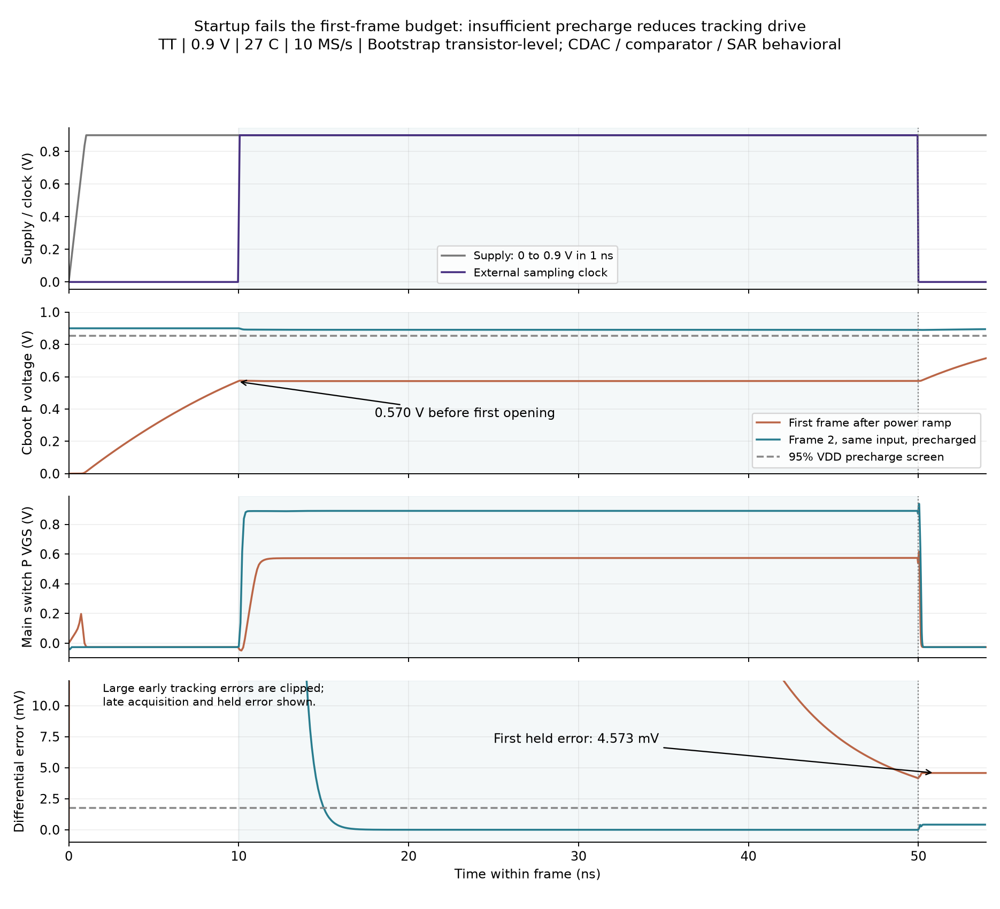
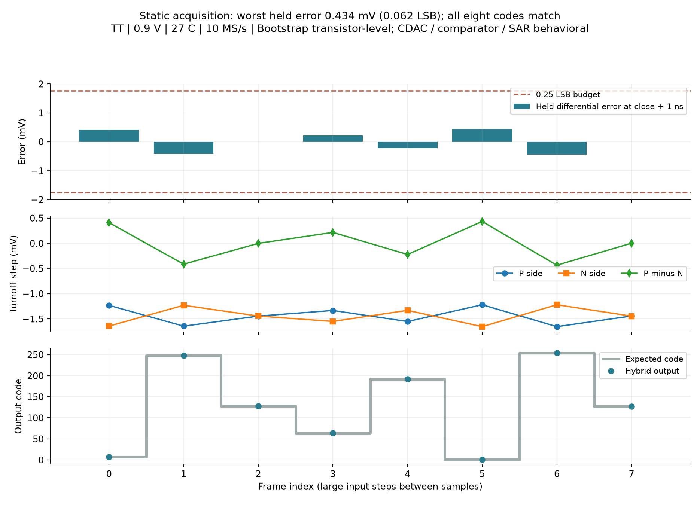
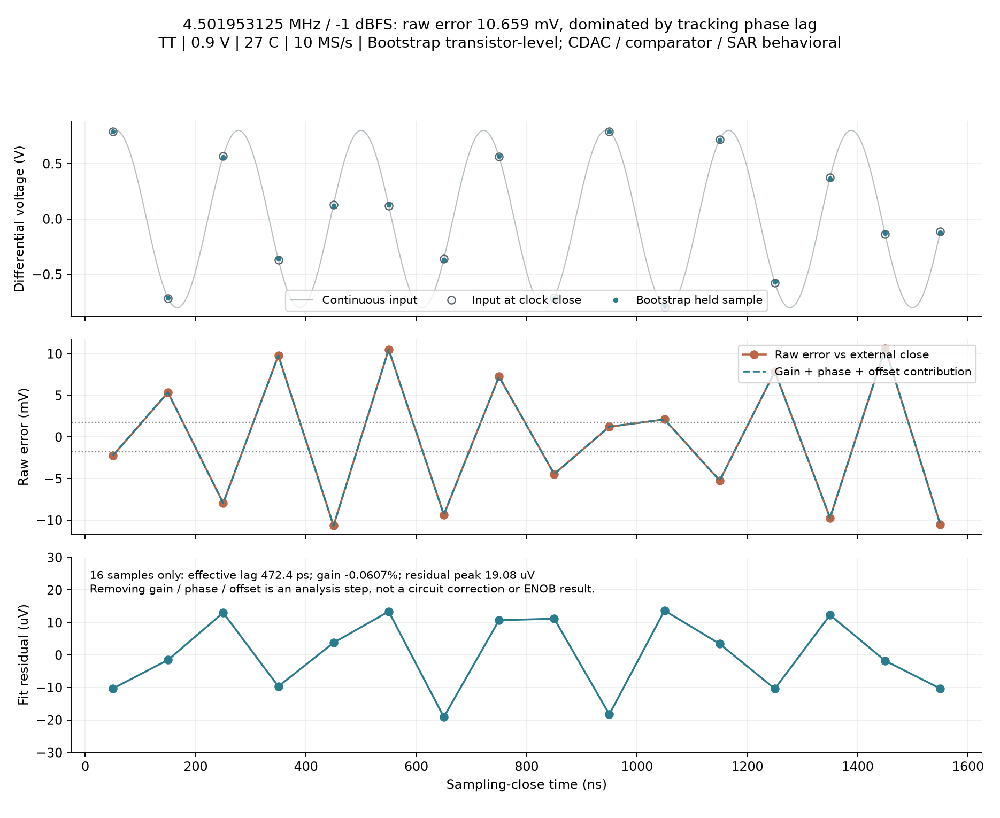

# Bootstrap单模块混合短测

当前仅Bootstrap为晶体管级：保持12管原连接，全部为1.8 V器件，L=150 nm、辅助W=1 µm、主开关4×1 µm、自举电容1 pF。两侧各一套，未调整尺寸。

CDAC为显式理想电容及行为开关，Cunit=10 fF、每侧1.28 pF，参考开关Ron=.01 Ω用于近似理想连接。比较器与SAR使用已验证的VA模型，无失调、输入寄生、反冲、噪声或失配；逻辑边沿与延时保持明确有限值。电源、参考、输入、外部采样时钟均为理想源。OA未修改。

每个TB同时包含：①真实Bootstrap＋其余行为模块的闭环；②完全行为化的同输入对照；③真实Bootstrap＋1.28 pF/侧静止负载，专用于保持测量。③不切换底板，避免把CDAC正常转换台阶当作保持误差；其功耗不计入①。

## 预先确定的指标

基于差分满量程1.8 V、8 bit，1 LSB=7.03125 mV。下表是本轮工程诊断预算，不是新增或降低ADC最终规格。

| 项目 | 短测门槛/报告内容 | 比较时点 |
|---|---|---|
| 静态建立 | 差分误差≤0.1 LSB=0.703125 mV | 关闭50%点前75 ps，此时外部时钟尚未开始下降 |
| 静态采样总误差 | 差分误差≤0.25 LSB=1.757813 mV | 关闭50%点后1 ns，比较关闭时刻的输入 |
| 单端关断台阶 | 分别报告P/N及差分，不以单端台阶直接判差分失败 | 前75 ps至后1 ns；仅静态输入可解释为关断台阶 |
| 安静保持 | 差分漂移≤0.05 LSB=0.351563 mV | 静止负载：关闭后1 ns至49 ns |
| 输入隔离 | 漂移≤0.25 LSB | 静止负载：关闭后49 ns至59 ns；DC案例中含下一帧输入大跳变 |
| 高频采样 | 原始误差、拟合增益/偏置/固定相位延迟均报告；正弦拟合残差峰值≤0.25 LSB | 16个关闭后1 ns样点，以关闭时刻为相位基准 |
| 预充 | 每帧开启前Cboot电压≥95%VDD，作为诊断筛查 | 开启50%点前100 ps |
| 端压 | 全部Bootstrap外层MOS六组端压≤1.98 V项目IO筛查值；保留原生CMI | 全部原生时间点，含启动、跟踪、关断、转换及空闲 |
| 功耗 | 两侧主测试Bootstrap的VDD＋时钟平均功率暂分配≤100 µW；输入源功另列 | 完整采样周期积分，不含伴随保持夹具 |
| 闭环 | 每帧8次比较、无FAULT；与理想对照码差≤1单独检查 | 下一采样开始后1 ns读取上一帧DO |

1.98 V是普通IO器件的保守项目筛查线，不是通过本实验获得的寿命保证；原生PDK告警独立保留。行为模型的供能不守恒，因此本实验不能给出真实整机功耗。

固定输入延迟会改变对外部时钟采样时刻的误差与码字，但不是同等大小的非线性失真。不得把去掉幅度/相位/直流项后的残差冒充未经校准的精度，16点拟合不计算或宣称ENOB/FFT指标。

## 三组短测

| 目录 | 条件 | 范围 |
|---|---|---|
| dc | TT、0.9 V、27°C；输入共模0.45 V | 8个码中心：7/248/128/64/192/1/254/127，含接近两端及大跳变；820 ns |
| startup | 同上；电源、参考和首帧输入从0在1 ns内线性升到目标；首次采样仍在10 ns开始 | 4帧7/248/7/248；420 ns；不是实现了POR |
| sine | TT、0.9 V、27°C；共模0.45 V；4.501953125 MHz、−1 dBFS差分正弦 | 16帧；1.62 µs；不是1024点FFT |

外部时钟周期100 ns、上/下降50 ps，首次关闭50%点49.975 ns，保持原窗口和关闭沿。所有输入案例、源网表散列、端压映射及预算在各目录measure.json冻结。当前模型尚未完成PVT、噪声、失配和版图寄生验证。

生成：`scripts/manual_adc/bootstrap_short_build.py`；原生流式测量：`bootstrap_short_reduce.py`。运行ID分别为 `manual8-bootshort-dc-v1`、`manual8-bootshort-startup-v1`、`manual8-bootshort-sine-v1`，使用managed流程，不覆盖任何历史结果。

## 已完成结果

**Bootstrap仍有首帧启动问题；正常预充后的静态采样通过本轮预算。高频输入存在明显相位滞后，不能把它全部解释成非线性失真，也不能宣布原始采样精度通过。** 三例均原生完成并回收，未改尺寸、时序、原拓扑或OA。

| 检查 | 实际结果 | 本轮结论 |
|---|---|---|
| 正常预充后静态建立 | 关闭前误差低于10 nV数值容差量级；最晚约开启后5.49 ns进入0.1 LSB带 | 通过；不宣称纳伏级物理精度 |
| 正常预充后静态采样 | 最大0.4343 mV＝0.0618 LSB | 通过0.25 LSB预算 |
| 单端关断台阶 | P侧约−1.22至−1.65 mV；两侧大部分相消 | 差分残差已计入上述总误差 |
| 显式上电首帧预充 | 首次开启前Cboot约0.570 V，仅63.35%VDD；要求≥0.855 V | **未通过** |
| 上电首帧建立/采样 | 关闭前4.1955 mV；保持后4.5729 mV＝0.6504 LSB | **分别未通过0.1/0.25 LSB预算** |
| 后续上电案例帧 | 预充约0.900 V，保持误差≤0.4138 mV | 恢复正常；不代表已实现启动控制 |
| 安静保持 | 静态案例差分漂移低于10 nV容差量级；正弦持续输入时最大0.107 µV | 通过0.05 LSB预算；极小值不作为真实泄漏精度保证 |
| 保持期间输入大跳变 | 静止负载差分变化最大0.167 µV | 通过0.25 LSB预算 |
| 高频原始采样误差 | 4.501953125 MHz/−1 dBFS，最大10.659 mV＝1.516 LSB | 明显超过静态误差量级，需保留时刻定义 |
| 高频拟合 | 等效滞后472.4 ps，增益−0.0607%，偏置−1.216 µV；残差峰19.08 µV、RMS11.37 µV | 拟合残差通过预算；**不是原始误差通过或ENOB结论** |
| 闭环码字/握手 | DC8帧、startup4帧均与理想对照相同；sine最大偏2码；28帧均8次比较、无FAULT | 握手通过；**正弦码差≤1要求未通过** |
| 端压 | 全48MOS外层六端差最大1.80740 V（主闭环1.80730 V）；三例无CMI | 通过1.98 V项目筛查，非PVT/可靠性签核 |

最坏端压来自DC案例约610.65 ns的采样开启阶段：P侧自举栅节点net1对地，涉及M0/M2/M5的VGB及M8的VDB。没有把不同时刻的节点极值相减。

### 首帧原因

供电和输入从0在1 ns内升到目标，10 ns便开始首次采样。1 pF自举电容尚未充满，采样期间P/N主开关VGS仅约0.574/0.570 V；正常预充后约0.89 V。首帧因此到关闭前仍未建立，后续关断又叠加台阶。图中对比的是**同一输入的第0帧和第2帧**，不是拿不同输入幅度混比。

这组证据直接支持“当前上电预充时间与充电能力不匹配”。尚未保存预充支路电流，不能据此断言某一只辅助管就是唯一瓶颈。静态常供电案例会先求DC工作点，不能替代显式上电测试。即使所选首帧输出码碰巧仍与理想一致，也不抵消模拟采样误差超预算。

### 正常采样与高频误差

关闭50%点49.975 ns作为外部采样时刻；关闭后1 ns读取保持值，尚未开始第一次比较。正常DC的单端台阶约毫伏级，但差分残差小于0.44 mV。后续CDAC转换的电压台阶不计为保持漂移，漂移另用静止负载夹具测量。

高频原始误差随正弦斜率变化。固定频率最小二乘拟合拆出偏置、幅度和相位后，残差只有19.08 µV峰值，说明这16个样点的大部分误差可用线性幅相变化解释。472.4 ps是**单频等效滞后**，包含跟踪带宽和关断采样时刻的影响；没有多频证据，不能等同于可在所有频率直接补偿的纯延迟。全行为对照约−5.51 ps，来自有限边沿的行为采样器，因此对照也不假装数学零延迟。

### 功耗与仿真边界

| 案例 | 两侧Bootstrap的VDD＋外部采样时钟 | 输入端平均供能 | 积分区间 |
|---|---:|---:|---|
| DC | 0.396 µW | 3.987 µW | 10–810 ns |
| startup | 1.823 µW | 8.181 µW | 10–410 ns |
| sine | 0.401 µW | 1.952 µW | 10–1610 ns |

VDD＋clock均低于暂定100 µW预算。输入端供能另列，不能因为VDD电流小就忽略采样负载；伴随保持夹具未计入。startup功率区间不含最初0–10 ns上电能量。这是隔离Bootstrap的端口能量统计，不是完整实现的ADC功耗。

原生Spectre21.1/CX，小电路实际禁用多线程；每例仿真约22–53 s，峰值RSS约287–291 MiB。请求reltol=1e−6，原生日志瞬态有效reltol=1e−7；gear2only、maxstep50 ps、vabstol10 nV、iabstol10 fA。未进行加速比较。

保留三类原生警告：DC/sine含SPECTRE-17191（初始DC解对高阻节点放宽容差），所以不以这两例推断真实上电状态；显式startup没有该警告。SFE-1131来自PDK五处重复几何缩放设置，经只读核对均为0.9，原生生效值也是0.9，未修改PDK。VACOMP-2435是旧环境变量弃用提示。三例都无原生CMI告警，仍只覆盖当前TT短测与外层端压筛查。

### 下一步实验建议

先解决首帧：在不改变后续100 ns周期、采样窗口和关闭沿的条件下，单独比较“启动预充等待”与“预充支路增强”，判断应由启动流程还是充电能力承担。若要求上电后10 ns就必须采样，则需提高预充能力；若允许启动等待，应显式定义首个有效输出，不能暗中丢首帧。

再针对高频跟踪做主开关尺寸单变量对照，同时看等效滞后、拟合残差、差分关断台阶和端压。尚未执行这些修改，也未扩展到PVT、噪声、失配、FFT或版图。

机器数据：[results.json](results.json)。测试台位于[dc/test.scs](dc/test.scs)、[startup/test.scs](startup/test.scs)、[sine/test.scs](sine/test.scs)；各目录measure.json保存冻结条件和指标。原生日志与波形保留在对应managed运行目录。绘图/拟合由`scripts/manual_adc/bootstrap_short_review.py`复现。
