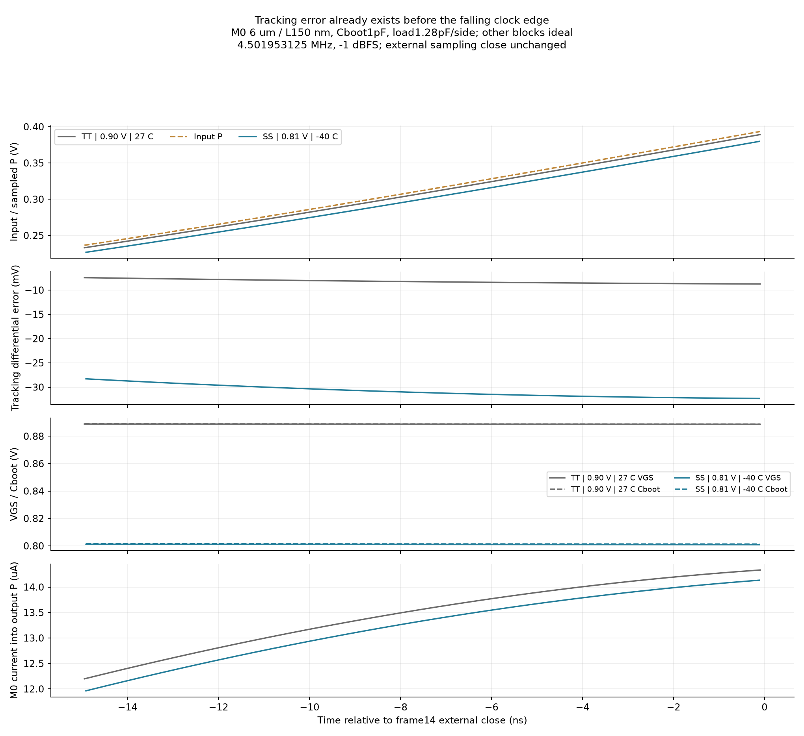
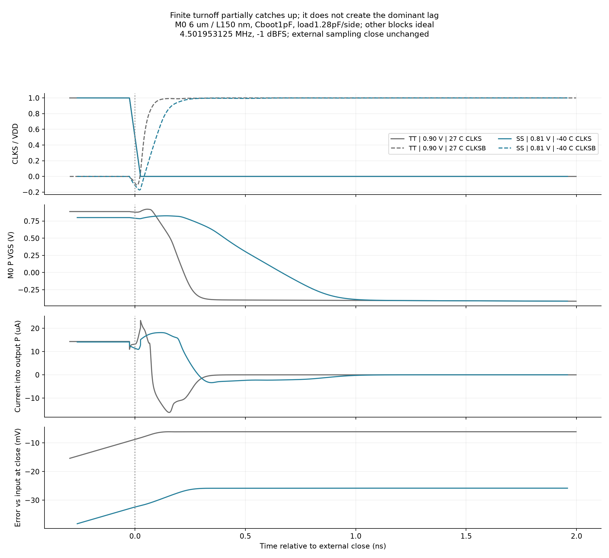
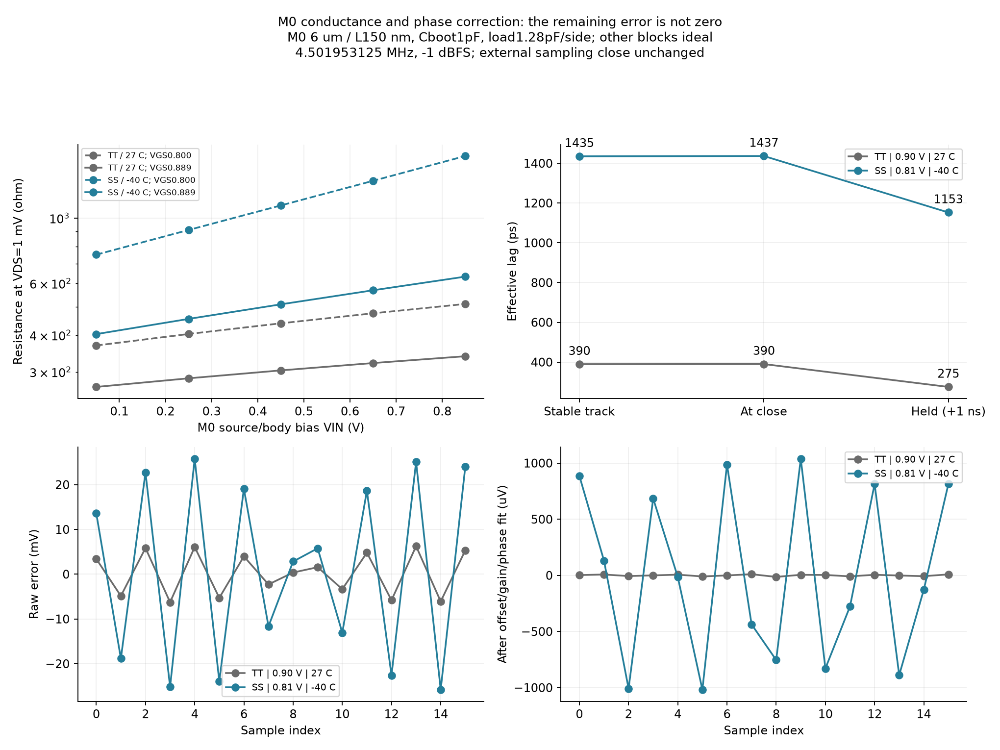

# SS冷角Bootstrap高频跟踪定位

**主要原因已定位：M0在SS冷角、低VGS下导通电阻增大，并随输入源体偏置显著变化。自举电容未塌陷；关断更慢是次要影响，反而部分补偿了跟踪滞后。**

**评价口径澄清：原来的4码差是相对于同一外部关闭沿的理想输出，不是4 LSB非线性失真。固定延迟会改变相位，但理想固定延迟本身不降低单音SNDR。因此目前证据不足以因4码差否定6 µm；原始诊断失败保留，整机/全带宽资格仍未完成。**

本轮保持M0总宽6 µm、L150 nm、每侧Cboot1 pF与1.28 pF负载；首时钟110 ns、100 ns周期、关闭沿149.975 ns+n×100 ns、50 ps边沿不变。外部输入/供电/时钟/参考理想，比较器与SAR为理想VA。输入4.501953125 MHz、−1 dBFS、CM0.45 V、参考0.9 V。TT0.9 V27°C对比SS0.81 V−40°C；无噪声/失配/PEX。

增加两组等价电流探针短测：只在M0漏端串联0 V电压源，四个Bootstrap均测漏端总电流；器件、VA、激励和时序不改。另做TT/SS独立M0导通测试，固定VDS=1 mV，扫描VGS=0.800/0.810/0.889/0.900 V及VIN=0.05/0.25/0.45/0.65/0.85 V，体端0 V。后者是诊断偏置，不是把SS整机改供电或升压。

## 1. 采样导通阶段

图取第14帧（外部关闭沿1549.975 ns），从上到下为P侧输入与输出、差分跟踪误差、M0 VGS和Cboot电压、流入输出的M0电流。SS在关闭前已落后，排除“仅关断时刻偏移造成全部误差”。电流接近并不意味着电阻接近：给相同电容跟踪相似斜率，所需电流相近；SS需要更大的输入输出压差来维持这股电流。

| 量 | TT | SS冷角 |
|---|---:|---:|
| 关闭前75 ps的跟踪滞后（相对该时刻输入） | 389.6 ps | 1435.3 ps |
| M0端电流比值所得有效电阻中位数（保持对照P侧） | 306.1 Ω | 1131.8 Ω |
| 稳定跟踪VGS范围 | 0.8874–0.8889 V | 0.8002–0.8014 V |
| 稳定跟踪Cboot范围 | 0.8873–0.8890 V | 0.8000–0.8016 V |

稳定跟踪统计窗口为非首帧的每周期35–49.8 ns。电流比值只取|I|>2 µA、|VDS|>1 mV且同号区域，避免零斜率附近除零；端电流包含位移电流，因此另用独立小VDS测试核对。保持对照的−Id与C·dV/dt相符，归一化RMS差约1.3×10⁻⁶，验证电流符号与负载关系。

自举电容和VGS都平稳。SS电容底端跟随输入的误差约±0.37 mV、顶端到栅极差小于0.10 mV；主要差别是低供电下正常VGS约0.80 V，而TT约0.889 V。SS距离理想0.81 V仅约10 mV，并非少充了90 mV。

## 2. 关断过程

外部CLKS相同；SS内部CLKSB上升较慢，M0 VGS下降、电流反转及归零相应推迟。当前漏端电流包含关断馈通/注入，不能把每个电流尖峰都当作继续导通电流。底图以外部关闭沿输入为固定参考，显示关断阶段的净更新。

| 等效相位量 | TT | SS冷角 |
|---|---:|---:|
| 外部关闭沿处的滞后 | 390.0 ps | 1436.7 ps |
| 保持值（关闭后1 ns），仍以外部关闭沿为相位参考 | 275.0 ps | 1152.7 ps |
| 关断阶段净等效追近量 | 115.0 ps | 284.0 ps |
| 保持对照：关闭后1→3.5 ns最大差分变化 | 0.007 µV | 31.742 µV |

全16帧P/N侧VGS下降至0.3 V的时刻：TT约156–210 ps，SS约394–596 ps（相对外部关闭沿）；这只是关断过程标记，不等同精确导通截止或有效采样孔径。等效追近量由相位拟合得到，包含继续跟踪及关断扰动，也不能直接当作物理延迟。SS在+1 ns仍有约32 µV尾部变化，+2 ns与+3.5 ns的相位/残差已基本一致；因此1 ns测量点不解释约26 mV的原始误差。

## 3. 独立M0证据与相位评价

VIN=0.45 V、VDS=1 mV时：

| 模型/温度 | VGS | 导通电阻 |
|---|---:|---:|
| TT / 27°C | 0.889 V | 303.5 Ω |
| TT / 27°C | 0.800 V | 438.8 Ω |
| SS / −40°C | 0.889 V | 509.1 Ω |
| SS / −40°C | 0.810 V | 988.3 Ω |
| SS / −40°C | 0.800 V | 1104.4 Ω |

在同样0.889 V栅源偏置下，SS冷角相对于TT的电阻约增大1.68倍；在SS冷角下再把VGS从0.889降到0.800 V，又增加约2.17倍。这里把工艺与温度作为联合条件，没有单独拆分二者。实际TT与SS冷角相差约3.64倍。用303.5 Ω/1104.4 Ω乘1.28 pF得到0.388/1.414 ns，与实测约0.390/1.435 ns吻合，是主要原因的直接交叉证据。

固定VGS=0.800 V、VDS=1 mV时，SS的VIN从0.05→0.85 V使电阻从751→1626 Ω，体端固定0 V，说明源体偏置对导通有明显影响；实际正弦输入会扫描这一偏置。这种随输入变化的电阻支持非恒定滞后/非线性的解释。尚未通过理想栅控替换实验证明所有残差均由M0体效应产生，不能将注入和关断的贡献完全排除。

| 误差评价 | TT | SS冷角 |
|---|---:|---:|
| 原始误差峰，相对外部关闭沿输入 | 6.260 mV | 25.798 mV |
| 仅去掉一个固定拟合相位后的误差峰 | 0.647 mV | 1.583 mV |
| 再允许增益/偏置拟合后的残差峰 | 14.180 µV | 1038.119 µV |
| 全拟合残差RMS | 7.222 µV | 751.315 µV |
| 相位对齐后、相对理想解析量化器的最大码差 | 1码 | 1码 |

若y(t)=A·sin[ω(t−τ)]且τ固定，它只改变相位，不产生新谐波，也不直接损害单音SNDR。当前SS约1.58 mV相位对齐后峰差=0.225 LSB，全拟合残差峰约0.148 LSB：主要原始误差确实是相位，剩余非线性较小但不为零。相位对齐是离线诊断，原始同关闭沿4码差记录未替换；不是已实现延迟校准，也不是1024点FFT或ENOB结论。16点单频数据不能证明整个带宽为纯延迟，不能用于噪声/失配或SFDR签核。

## 修改建议与优先级

1. **暂时保留6 µm，不为消除原始4码差而直接改电路。** 若目标是10 MS/s、ENOB≥7且允许固定采样延迟，先用SS角完整频谱和低/中/近Nyquist频点确认SNDR、SFDR、增益与相位随频率变化，再决定是否需要增宽。此前“SS码差筛查失败”应理解为时间对齐诊断失败，不能直接等同ENOB不合格。
2. 若频谱或带宽不够，优先在SS冷角单变量扫M0总宽8/10/12 µm，保持其他尺寸、Cboot、供电和外部时序不变。目标是降低导通电阻及其非线性；必须同时复核注入、自举负载、关断速度、功耗和FF端压。R∝1/W只作初步方向，不能作为最终尺寸预测。
3. **暂不优先增大Cboot或增强关断支路。** 当前Cboot不塌陷；即便SS VGS从0.800恢复到0.810 V，独立M0电阻只从1104降到988 Ω，改善约10.5%，不足以恢复TT水平。关断加快还可能减少当前的追近量，使原始滞后增大；仅当孔径变化或关断残差成为限制时，再单独优化CLKSB/放电路径。
4. 不为通过测试而提高0.81 V低角供电，也不降低输入幅度。若最终必须改善栅源过驱动，需要另行论证电压域/耐压与跨PVT端压，而不是把本次0.889 V诊断偏置直接接回电路。

本轮只定位并提出方案，未执行这些修复或全码FFT，未改OA、PDK、用户其他模块或旧结果，未commit/push。

## 证据与限制

运行：manual8-bootss-probe-tt-v1、manual8-bootss-probe-ss-v1；独立M0：manual8-bootss-m0-tt-v1、manual8-bootss-m0-ss-v1。全部原生完成并受管回收，模型/温度/激励绑定在各自冻结配方。探针结果与旧保持样点最大差TT0.000126 µV、SS0.000898 µV，未改变诊断结论。

关断图保留每个原生时间点，覆盖关闭前2.975 ns至后4.025 ns，补足旧PVT显示曲线的100 ps降采样不足；其他显示点约50 ps。原生指标与快照独立保留。三图目视检查。SFE1131/VACOMP2435等原生警告保留；无新增CMI。M0独立测试的常量电流稳态与瞬态一致。

[结果JSON](results.json) · [等价探针输入散列](manifest.json) · [TT独立M0散列](m0_tt_manifest.json) · [SS独立M0散列](m0_ss_manifest.json)
