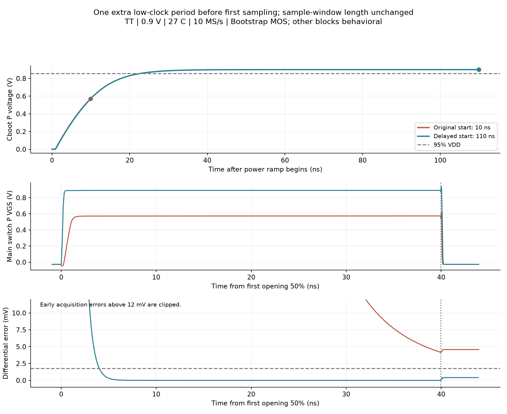
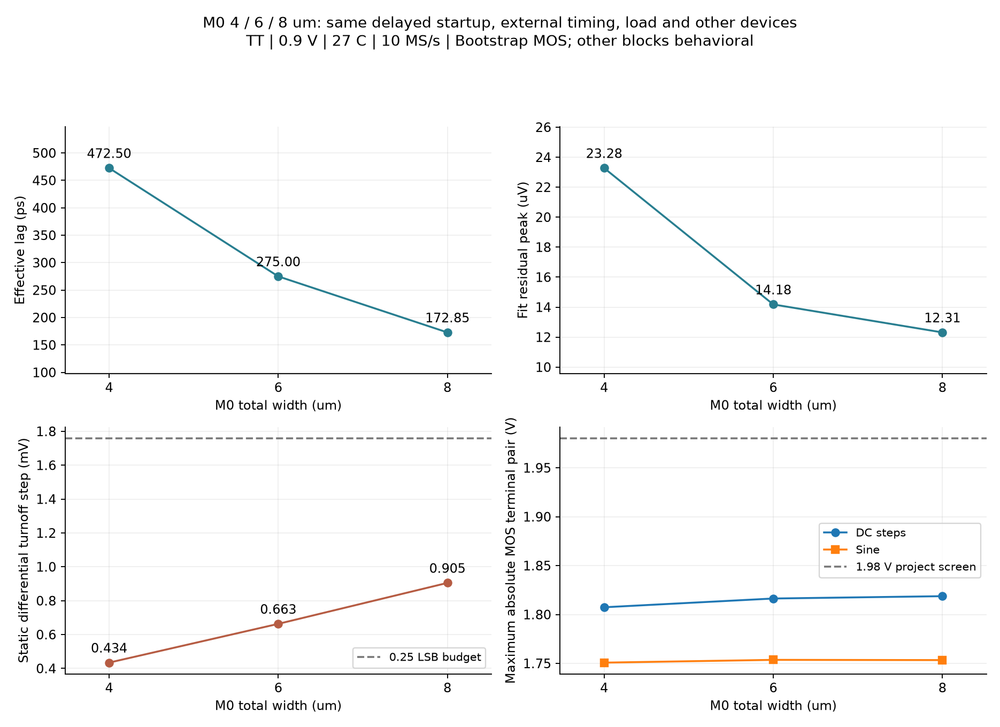
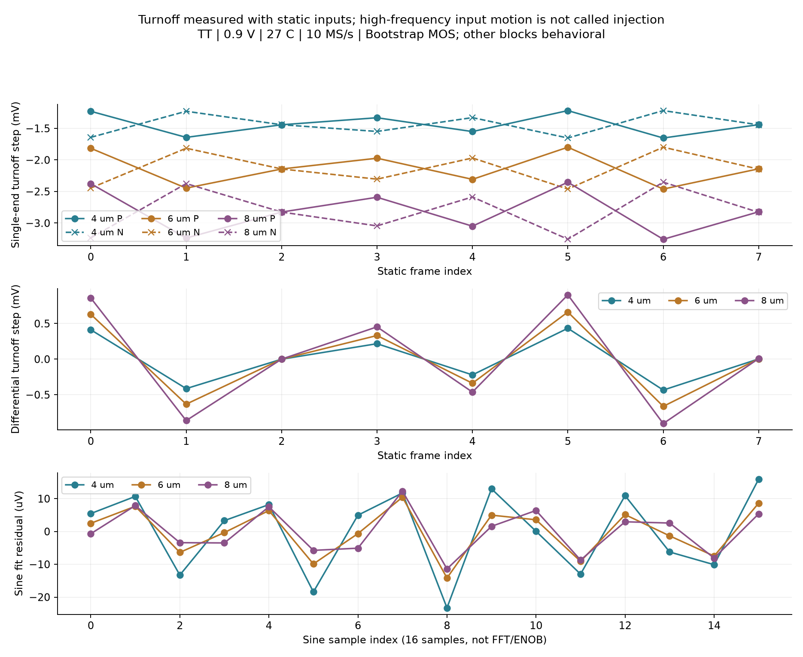

# Bootstrap启动延后与M0宽度对照

本轮仅验证用户指定的两个变量：先延后启动一个周期，再固定启动条件扫M0总宽度4/6/8 µm。没有修改OA、其他模块尺寸、PDK或旧结果。

## 固定条件与比较口径

- TT、0.9 V、27°C、8 bit、10 MS/s；电源/参考在0–1 ns理想上电。
- 首个采样时钟从10 ns延后到110 ns；50%开启点110.025 ns，关闭点149.975 ns。以后每100 ns重复。脉宽39.9 ns、上/下降50 ps不变。
- 每侧Bootstrap原12管连接不变，全部1.8 V IO器件。M0每份W=1 µm、L=150 nm、nf=1，只改变multi=4/6/8；其他管W=1 µm、L=150 nm、multi=1；Cboot=1 pF。
- 其他模块沿用理想行为模型，CDAC每侧1.28 pF、参考开关Ron=0.01 Ω、比较器无失调/噪声/反冲，SAR有限边沿和明确延时。另有全行为对照及独立静止负载夹具。
- 静态输入按同一帧序列后移100 ns，保持相同的输入建立余量；上电时刻不后移。正弦源在三个宽度间完全相同，4.501953125 MHz、−1 dBFS、差分峰值约0.8021 V。

先完成4帧启动验证；再做每个宽度8帧DC和16帧正弦，共7个独立managed运行。所有宽度对照的网表已逐文件核对，除M0实例的multi外完全相同。源文件散列、运行ID见[manifest.json](manifest.json)。

预先指标沿用[上一轮短测](../bootstrap_short_v1/README.md)：1 LSB=7.03125 mV；开启前Cboot≥0.855 V；关闭前静态误差≤0.7031 mV；保持后差分误差≤1.7578 mV；拟合残差峰值≤1.7578 mV；端压为1.98 V项目筛查，同时保留原生CMI。逐帧检查8次比较、无FAULT及与理想码差。

**关断台阶用静态输入测量**：关闭前75 ps至关闭后1 ns的顶板变化，分别报告P、N、差分；它包含电荷注入和时钟馈通，不能宣称已分离两种物理机制。正弦的对应变化还含输入运动，不能直接称为注入。

**高频使用同一关闭时刻为基准**：同时报告原始误差、单频等效滞后、增益、偏置和拟合残差。拟合残差扣除了线性幅相项，不是未经校准的采样误差，也不是FFT/ENOB。单频相位不能证明跨频率纯固定延迟。

## 启动验证

| 首帧量 | 原10 ns开始 | 延后至110 ns开始 |
|---|---:|---:|
| 开启前Cboot P | 0.57015 V | 0.89999996 V |
| 关闭前差分误差 | 4.1955 mV | 低于10 nV数值容差量级 |
| 关闭后1 ns差分误差 | 4.5729 mV | 0.41274 mV |
| 建立/保持/预充预算 | 未通过 | 通过 |

延后后4帧均8次比较、码字匹配，未见CMI；SFE-1131与VACOMP-2435警告仍保留。开启前等待足以完成本次TT预充，不意味着已实现POR或覆盖任意电源上升过程/PVT。极小建立残差不代表纳伏级物理精度。

## M0宽度对照结果

全部案例已完成并回收。下表为统一110 ns启动条件下的比较；每档8个静态输入、16个正弦样点。

| 指标 | 4 µm | 6 µm | 8 µm |
|---|---:|---:|---:|
| 高频等效滞后 | 472.50 ps | 275.00 ps | 172.85 ps |
| 高频拟合残差峰值 | 23.28 µV | 14.18 µV | 12.31 µV |
| 高频拟合残差RMS | 11.98 µV | 7.22 µV | 6.68 µV |
| 高频增益偏差 | −0.06045% | −0.07995% | −0.10513% |
| 高频原始采样误差峰值 | 10.659 mV | 6.260 mV | 4.009 mV |
| 与理想对照最大码差 | 2 | 1 | 1 |
| 静态差分关断台阶峰值 | 0.434 mV | 0.663 mV | 0.905 mV |
| 静态单端关断台阶范围（P/N合计） | −1.652～−1.218 mV | −2.461～−1.798 mV | −3.257～−2.352 mV |
| DC全时域最大端压 | 1.80740 V | 1.81635 V | 1.81873 V |
| 正弦全时域最大端压 | 1.75079 V | 1.75362 V | 1.75338 V |
| 正弦VDD＋时钟端口平均功率 | 0.402 µW | 0.457 µW | 0.511 µW |

三档的预充、静态建立、静态保持误差、保持漂移、端压和本轮拟合残差预算均通过；所有帧均8次比较、无FAULT，三档静态8码均与理想对照一致。**4 µm正弦码差≤1要求仍未通过**。三档都没有原生CMI告警，不能据此宣称PVT或可靠性合格。

差分关断台阶包含注入与馈通。它在当前充分建立的静态条件下，几乎等于关闭后1 ns的差分采样误差，三档均低于0.25 LSB＝1.758 mV预算。单端台阶较大但部分差分抵消，不能只看某一单端判差分ADC失败。

**本轮结论：M0宽度对跟踪滞后有显著影响。** 相对4 µm，6 µm降低约42%的等效滞后；8 µm降低约63%。这支持“主开关导通能力限制了高频跟踪”的解释，但宽度同时改变寄生和关断采样过程，不能把全部相位变化直接换算成测得的Ron。

增大M0也使静态关断台阶、增益偏差及部分端压峰值上升。6→8 µm仍能减少约102 ps滞后，但拟合残差峰值仅再改善约1.87 µV，差分台阶增加约0.242 mV。**6 µm是当前TT下较均衡的候选；8 µm偏向更小的跟踪滞后。** 此处只给取舍建议，未采用任一尺寸为整机/OA基线。

三档高频原始误差仍大于1.758 mV，不能因拟合残差小就宣布按外部关闭时刻定义的原始误差通过。本轮没有改变时钟来补偿相位，也没有把拟合校正写入电路。16点不是ENOB/FFT；若后续要比较动态精度，应保持采样时刻定义，另做足够点数的频谱验证。

新4 µm拟合残差23.28 µV与上一轮19.08 µV不是同一批相位样点：时钟后移100 ns后，连续正弦的采样相位集合改变。本轮三档使用完全相同的正弦激励与采样时刻，因此横向比较有效；不把这两个最大值的差直接归因于启动退化。

## 验证与边界

- 原生Spectre21.1/CX完成7例，无仿真错误。请求1线程，日志确认小电路禁用多线程；瞬态有效reltol=1e−7、gear2only、maxstep50 ps、vabstol10 nV、iabstol10 fA，设置与此前一致。
- 所有案例保留SFE-1131（PDK重复缩放）和VACOMP-2435（旧环境变量）警告；本次显式上电案例无SPECTRE-17191初值容差放宽警告。原生CMI独立核对，未屏蔽。
- 全原生点统计所有48个MOS外层六端差，包含启动/跟踪/关断/转换/保持。1.98 V是项目筛查线，不等于完整SOA签核。最大端压通常对应自举栅net1对地，既含主闭环又含伴随保持夹具。
- 关闭沿逐帧核对为149.975 ns+n×100 ns；输入散列未变，跨宽度电路差异只有M0并联倍数。显示CSV独立插值与原生保持样点一致，检查记录见[result_validation.json](result_validation.json)。
- 单例仿真约27–55 s，峰值RSS≤344 MiB，分析≤10 MiB，流式回收每例≤5.12 MB；共享队列等待单独保留，不计入仿真速度。没有重跑旧案例或修改管理资源上限。
- 功耗仅两侧Bootstrap的VDD与外部采样时钟端口，积分110 ns到第N个完整周期结束，未含初始上电能量或伴随夹具。输入端供能另为约1.69/1.69/1.70 µW，不能把上述小数值作为真实整机功耗。

原始波形与日志保留在对应managed运行目录；本目录不保存PDK模型正文。机器结果见[results.json](results.json)，输入验证见[input_validation.json](input_validation.json)。复现脚本为`scripts/manual_adc/bootstrap_width_build.py`、`bootstrap_width_reduce.py`、`bootstrap_width_review.py`。未做PVT、噪声、失配、PEX或新尺寸整机合龙，无OA/PDK修改、commit或push。
