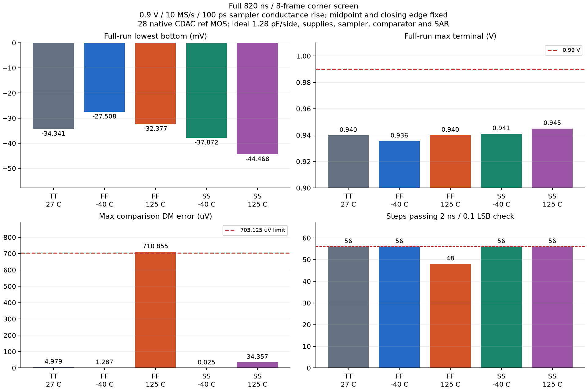
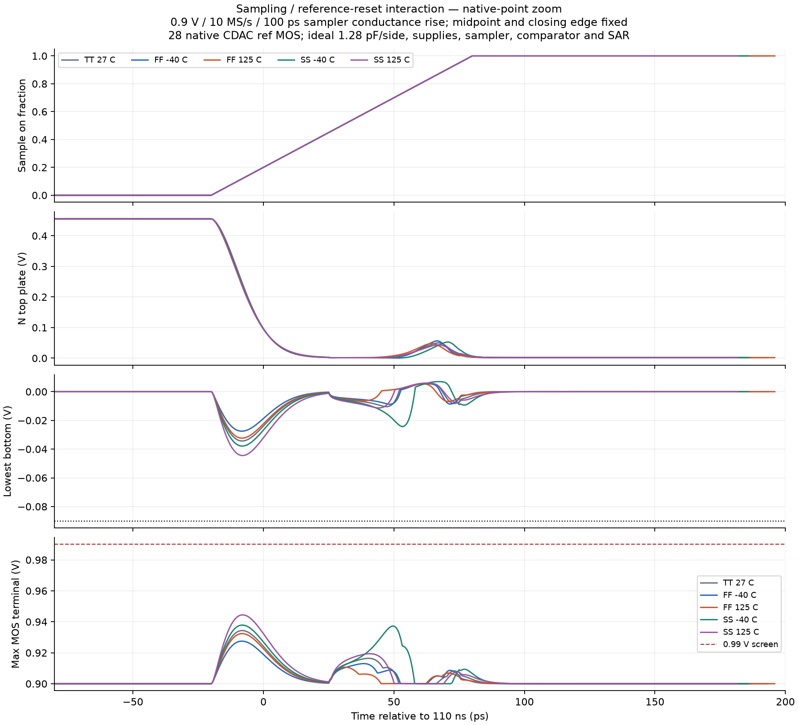

# CDAC 100 ps接通：极端工艺与温度短测

通过本轮全部短测项：TT 27 C、FF -40 C、SS -40 C、SS 125 C。未通过：FF 125 C。

**供电固定0.9 V；这是工艺/温度筛查，尚未覆盖0.81–0.99 V全供电范围，也不是整机PVT签核。**

100 ps指理想采样器接通电导的0–100%过渡。外部CLKS仍为50 ps，参考栅控仍为50 ps；采样接通中点10.030 ns、关闭中点49.980 ns（均每100 ns重复）及参考复位时序不变。

沿用原28个参考开关MOS及尺寸，双侧各1.28 pF理想电容。采样器Ron=1 Ω、比较器/SAR、电源和输入均理想；无噪声、失配、版图寄生。每角820 ns、8个代表输入码，不是256码全扫或FFT。TT复用上一轮已完成的s100，没有重跑。

| 条件 | 最低底板(mV) | 最大端压(V) | 差模误差(µV) | 建立段 | 正确码 | CMI |
|---|---:|---:|---:|---:|---:|---|
| TT 27 C | -34.341 | 0.939802 | 4.979 | 56/56 | 8/8 | 无 |
| FF -40 C | -27.508 | 0.935510 | 1.287 | 56/56 | 8/8 | 无 |
| FF 125 C | -32.377 | 0.939934 | 710.855 | 48/56 | 8/8 | 无 |
| SS -40 C | -37.872 | 0.941065 | 0.025 | 56/56 | 8/8 | 无 |
| SS 125 C | -44.468 | 0.945005 | 34.357 | 56/56 | 8/8 | 无 |

指标取820 ns全部原生点。端压筛查上限0.99 V，检查28管的全部六种端差（168对）；比较差模/共模预算均0.1 LSB=703.125 µV，保持漂移预算0.05 LSB，逐位建立预算2 ns，转换预算50 ns。器件端差筛查不代替PDK可靠性签核。

波形图显示第2帧重新采样局部窗口，表中最大值覆盖全部8帧；两者的最坏时刻可能不同。

## 最坏点与精度

- **TT 27 C**：最坏XADC.XN.XD.M12 DG，0.939802 V @ 754.415493 ns；最低底板xadc.xn.xd.net5 @ 109.991849 ns。共模误差1.253 µV，保持漂移0.000 µV，已进入预算段的建立上界27.962 ps（另有0段未进入预算），转换21.235 ns。
- **FF -40 C**：最坏XADC.XP.XD.M14 DS，0.935510 V @ 454.415146 ns；最低底板xadc.xn.xd.net5 @ 109.991742 ns。共模误差0.322 µV，保持漂移0.000 µV，已进入预算段的建立上界27.341 ps（另有0段未进入预算），转换21.235 ns。
- **FF 125 C**：最坏XADC.XP.XD.M14 DS，0.939934 V @ 54.413226 ns；最低底板xadc.xn.xd.net5 @ 109.991723 ns。共模误差179.111 µV，保持漂移0.000 µV，已进入预算段的建立上界29.292 ps（另有8段未进入预算），转换21.235 ns。
- **SS -40 C**：最坏XADC.XN.XD.M14 DS，0.941065 V @ 754.419079 ns；最低底板xadc.xn.xd.net5 @ 109.991822 ns。共模误差0.004 µV，保持漂移0.000 µV，已进入预算段的建立上界28.565 ps（另有0段未进入预算），转换21.235 ns。
- **SS 125 C**：最坏XADC.XP.XD.M14 DS，0.945005 V @ 54.415272 ns；最低底板xadc.xn.xd.net5 @ 109.992083 ns。共模误差8.655 µV，保持漂移0.000 µV，已进入预算段的建立上界29.181 ps（另有0段未进入预算），转换21.235 ns。

## FF热角残差

FF 125°C的码0、255、1、254各有末两段未达到0.1 LSB误差预算，共8段失败；最大比较差模残差0.710855 mV，比0.703125 mV预算高7.73 µV，约1.1%。不能因8个码正确就判定全部通过，也不应把这种轻微超预算描述成严重功能失效。

75–100 ns转换已结束、采样关闭且控制保持。TT/FF热角高参考持续输出电流分别为6.213/796.428 µA；接高参考的P侧1C底板压降分别为4.963/710.484 µV。理想参考端仍为0.9 V，该支路栅极接近0 V，残差没有随额外等待消失。

这些证据更符合热角关断漏电与导通开关压降形成的静态误差，而不是需要再等一点的动态建立不足。具体漏电管及电流组成尚需支路漏极/体电流测量确认；本轮未改变尺寸。该保持阶段仅高参考源输出功率就约0.717 mW，也需要关注；它不是整机功耗测量。原始抽样值见[steady_diagnostic.json](steady_diagnostic.json)。下一步优先测FF热角参考支路静态电流，再决定是否调整关断管长度；不继续盲目放缓时钟。

## 原生记录与复现

只改变MOS模型section（ttmacro/ffmacro/ssmacro_mos_moscap）与温度；未使用的无源器件模型section保持原配置。输入逐文件SHA及差异检查见[manifest.json](manifest.json)。

精确运行身份、原生设置、告警及资源见[comparison.json](comparison.json)，检查见[validation.json](validation.json)。各角完整测量保存在对应目录results.json，原始日志与波形保留于managed运行目录。

- TT 27 C：`manual8-cdac-edge-s100-tt-v1`；70272原生点；告警SFE-1131, VACOMP-2435；仿真24.23 s / 287.9 MiB，分析10.4 MiB，回收6.50 MiB。
- FF -40 C：`manual8-cdac-s100-ffcold-v1`；71378原生点；告警SFE-1131, VACOMP-2435；仿真24.15 s / 286.4 MiB，分析10.4 MiB，回收6.51 MiB。
- FF 125 C：`manual8-cdac-s100-ffhot-v1`；70959原生点；告警SFE-1131, VACOMP-2435；仿真24.83 s / 292.4 MiB，分析10.4 MiB，回收5.97 MiB。
- SS -40 C：`manual8-cdac-s100-sscold-v1`；74216原生点；告警SFE-1131, VACOMP-2435；仿真26.82 s / 292.4 MiB，分析10.4 MiB，回收6.54 MiB。
- SS 125 C：`manual8-cdac-s100-sshot-v1`；69903原生点；告警SFE-1131, VACOMP-2435；仿真24.21 s / 294.2 MiB，分析10.4 MiB，回收5.82 MiB。

Spectre 21.1 X CX，单线程；实际tran reltol=1e-7、vabstol=10 nV、iabstol=10 fA、gear2only、maxstep20 ps、conservative_sigglobal。SFE-1131为PDK重复scalefactor声明，VACOMP-2435为旧环境变量提示；无CMI不等于零告警。

未改OA、拓扑、尺寸或旧数据，未采用新整机基线。当前证据仅覆盖给定理想边界及8帧；真实Bootstrap/栅驱动、供电极端、更多输入序列和整机性能需另测。
