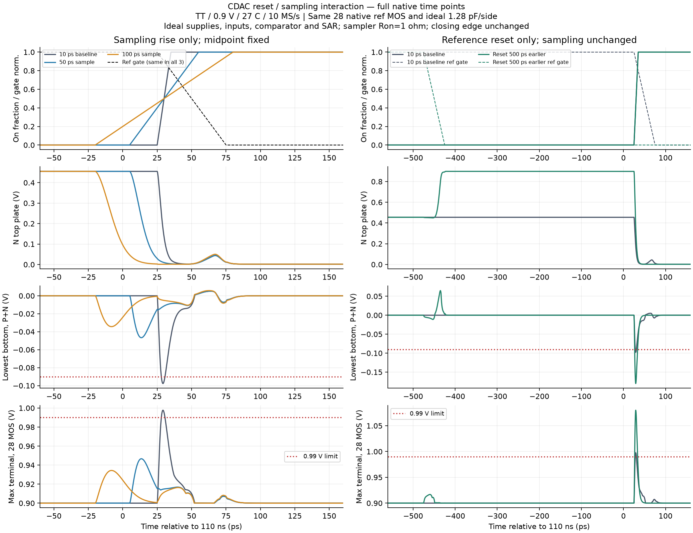
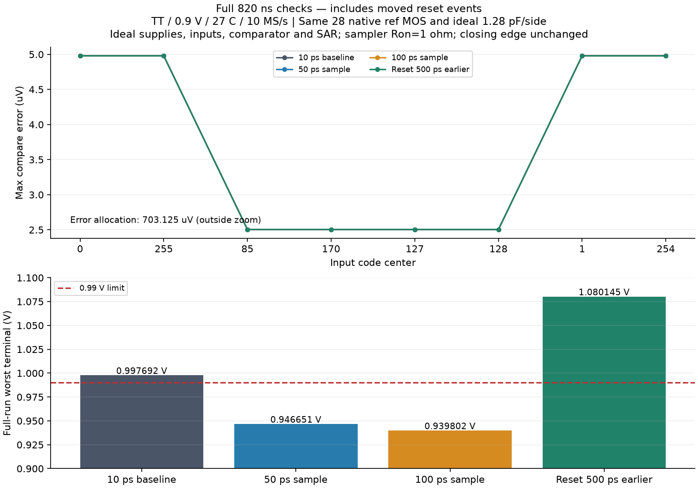

# CDAC接通边沿与提前复位：单变量短测

**结论：放缓采样接通到50/100 ps消除了本轮TT端压超限；仅提前参考复位500 ps反而加重64C支路下冲。四组功能与精度均通过，电气结论不同。**

条件：TT、0.9 V、27°C、10 MS/s，820 ns、8帧；原参考MOS尺寸、电容和外部时钟不变。电容理想，采样/比较器/SAR均为行为模型，无噪声、失配或PEX。

采样接通电导50%保持10.030 ns + n×100 ns，关闭电导50%保持49.980 ns + n×100 ns；外部采样关闭沿50%为49.975 ns + n×100 ns。10/50/100 ps为0–100%接通过渡长度，关闭过渡始终10 ps。展宽接通沿必然改变开始/结束时刻，本实验保持中点定义的采样窗口。提前复位组仅在9.525 ns + n×100 ns清除参考控制位，比原复位早500 ps，上一帧raw码及输出捕获保留。

| 对照 | 全时域底板最低(mV) | 最大端压(V) | 最长单对端压超限(ps) | 比较差模误差(µV) | 建立段通过 | 码字 |
|---|---:|---:|---:|---:|---|---|
| 10 ps baseline | -97.692 | 0.997692 | 5.036 | 4.979 | 56/56 | 8/8正确 |
| 50 ps sample | -46.651 | 0.946651 | 0.000 | 4.979 | 56/56 | 8/8正确 |
| 100 ps sample | -34.341 | 0.939802 | 0.000 | 4.979 | 56/56 | 8/8正确 |
| Reset 500 ps earlier | -180.145 | 1.080145 | 13.903 | 4.979 | 56/56 | 8/8正确 |

建立要求：控制50%后2 ns内进入并保持±0.1 LSB（703.125 µV），直到下一更新命令或采样/参考复位开始。峰值及超限时间取全部原生点；波形图保留窗口内全部原生点。最长单对端压超限为该端对全程累计超限时间，不是所有器件时长相加。

四组最大比较差模误差均约4.979 µV、共模误差约1.253 µV；转换21.235 ns，56次切换建立上界约27.962 ps（本轮强理想驱动/理想电容条件）。外部CLKS、采样电导接通50%和关闭50%均由原生波形核对一致；提前复位量实测500 ps。

## 最坏点与原生告警

- **10 ps baseline**：最坏XADC.XN.XD.M12 DS，0.997692 V @ 110.029215 ns；最低底板xadc.xn.xd.net1 @ 110.029215 ns；原生CMI-2751,CMI-2755。
- **50 ps sample**：最坏XADC.XN.XD.M5 DS，0.946651 V @ 110.013536 ns；最低底板xadc.xn.xd.net5 @ 110.013536 ns；原生无CMI告警。
- **100 ps sample**：最坏XADC.XN.XD.M12 DG，0.939802 V @ 754.415493 ns；最低底板xadc.xn.xd.net5 @ 109.991849 ns；原生无CMI告警。
- **Reset 500 ps earlier**：最坏XADC.XN.XD.M0 DS，1.080145 V @ 110.029198 ns；最低底板xadc.xn.xd.net7 @ 110.029198 ns；原生CMI-2751,CMI-2754,CMI-2755。

## 为什么提前复位反而更差

基线在重新采样前，N顶板约0.4553 V；提前复位先把低位底板恢复到高参考，采样器仍关闭，电荷守恒将N顶板恢复到上一帧采样值约0.89824 V。当前新输入却是0.001758 V。随后相同10 ps/1 Ω采样器接通，顶板需要下降约0.8965 V，约为基线0.4535 V的两倍。

已经恢复到0.9 V的低位底板获得了负向摆动余量，因此原M12峰值在该窗口降到0.91114 V；但64C底板仍接低参考，其低参考NMOS导通也不能提供零阻抗。更大的顶板快速下降将net7拉到−180.15 mV，使M0端压达到1.08015 V。最坏点仍在110.029 ns重新采样时，而不是109.525 ns提前复位沿。这组结果否定了“仅提前复位即可解决本例”的建议，不能采用它作为修复。

50/100 ps组保持接通中点，降低充放电速度；在本组有限阻抗参考开关下，下冲分别缩小到−46.65/−34.34 mV。100 ps全程最坏端压已转移到转换时M12栅漏，0.93980 V。它们支持优先研究受控采样接通速度；不等于已证明任意输入跃变、PVT或真实Bootstrap都安全。下一步应以真实采样开关的导通变化验证，暂不改参考开关尺寸或推广提前复位。

## 证据与边界

新增10 ps组用于验证拆分接通/关闭沿后的测试台等价性，原基线和结果保持。等价检查：{"same_codes": true, "dm_error_change_V": 1.3545831123451535e-12, "terminal_peak_change_V": 6.874745955842698e-07, "compare_timing_change_s": 0.0, "sampling_midpoint_error_s": 2.5055605156696628e-17, "pass": true}。

运行与输入见[manifest.json](manifest.json)，逐项结果见[comparison.json](comparison.json)。四组共用完全相同的MOS/电容、比较器、SAR和采样模型代码，仅测试参数/参考复位激励不同。实际Spectre设置及所有CMI保留在各managed运行日志；没有修改OA、尺寸、供电或采用新基线。

四例实际Spectre X CX、单线程、tran reltol=1e-7、errpreset=conservative_sigglobal、gear2only、maxstep20 ps；原生零错误完成。SFE-1131（PDK重复scalefactor声明）与VACOMP-2435（旧环境变量）告警仍保留，50/100 ps仅表示无CMI端压告警，不是零告警。

供能是理想源负载，不代表真实时钟/参考缓冲器功耗；通过本轮端压筛查也不代表PVT、真实驱动或整机已合格。
