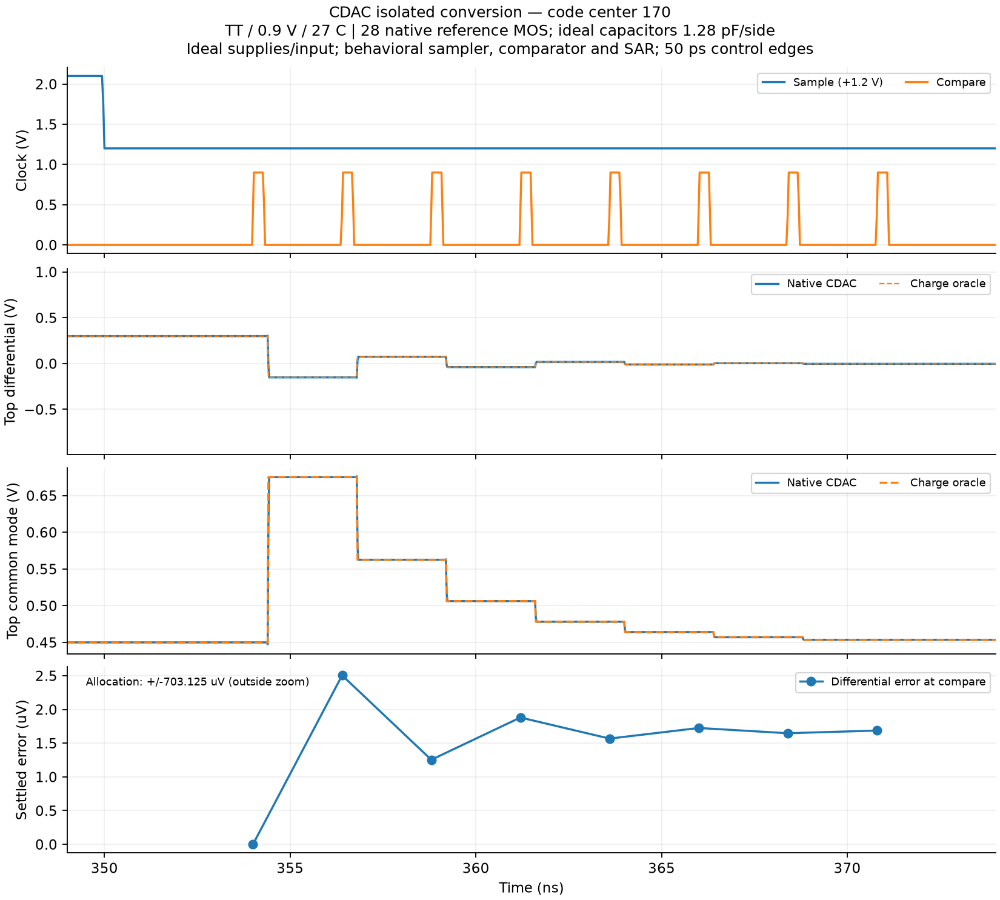
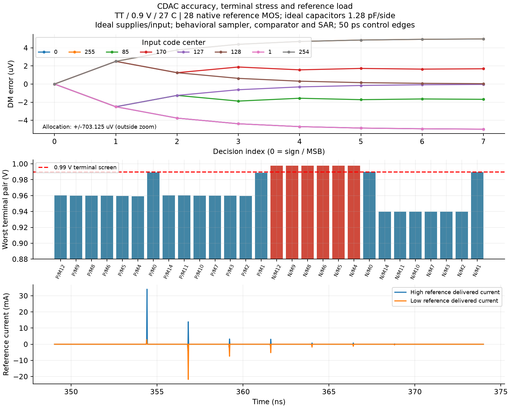
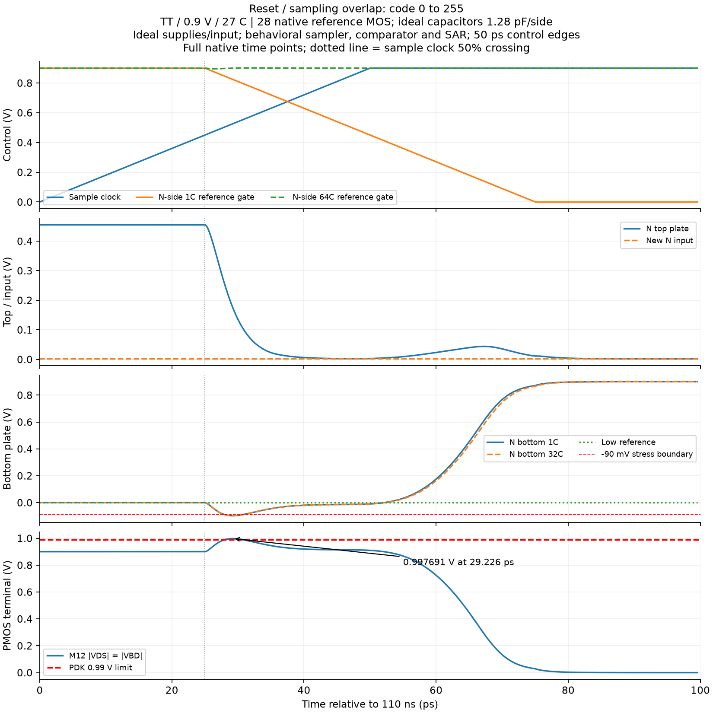

# CDAC晶体管参考开关隔离短测

结论：**存在未通过项，见表**。这是TT短测，不是PVT、全码或实际电容阵列资格验证。

## 测试边界

- 真实部分：原手搭CDAC两侧共28只参考MOS，W/L/nf/multi保持不变。
- 电容：原网表理想10 fF单位电容，每侧128 C=1.28 pF；未替换成PDK MOM，未含失配/PEX。
- 理想部分：电源、参考、输入源；采样开关使用Ron=1 Ω、无注入行为模型；比较器无失调/噪声/反冲；SAR用行为模型，控制输出50 ps/1 Ω。这里的“理想”不等于零边沿/零导通电阻。
- TT、0.9 V、27°C；100 ns周期，原外部采样窗口及关闭沿保留；参考控制更新后等待2 ns。
- 820 ns、8帧码中心0/255/85/170/127/128/1/254，首位跨接向上、其余同侧向下。

## 指标与结果

0.1 LSB及0.05 LSB是本轮预先规定的模块诊断分配，不是宣称已完成整机误差预算。LSB=7.03125 mV。

| 项目 | 本轮目标 | 实测 | 结果 |
|---|---|---|---|
| 输出码 | 8个码中心均正确 | 0, 255, 85, 170, 127, 128, 1, 254 | 通过 |
| 比较/更新次数 | 每帧8次比较、7次参考更新 | 8次 / 7次 | 通过 |
| 比较时差模误差 | ≤0.703125 mV | 最大0.004979 mV | 通过 |
| 比较时共模误差 | ≤0.703125 mV | 最大0.001253 mV | 通过 |
| 每步建立 | 2 ns后误差≤0.1 LSB并保持到下一切换 | 56/56段通过；已建立段最慢上界0.0281 ns | 通过 |
| 首次比较前保持漂移 | ≤0.351563 mV | 最大0.000000 mV | 通过 |
| 转换完成 | 采样关闭后≤50 ns | 最长21.2350 ns | 通过 |
| MOS端压 | 六组端压均≤0.99 V | 最大0.997691 V；28管×6组全时域 | **未通过** |
| 原生CMI | 不出现 | CMI-2751, CMI-2755 | **未通过** |

误差基准来自采样关闭时输入电压与电容电荷守恒，逐次使用实际参考控制状态；没有去除失调、增益或做拟合。初次比较的最大差模偏差为0.000000 mV；扣除此项后，后续切换新增偏差最大0.004979 mV，仅用于分解，不替代上述绝对误差判定。

转换/指标图中连续曲线按20 ps间隔导出用于显示；所有峰值、端压及建立检查使用全部原生时间点。比较时误差点按实际比较时钟50%交叉插值。

## 复位/采样边界的端压问题

最坏点位于第二帧重新采样：110.029226 ns，N侧1C底板约−97.691 mV，连接0.9 V高参考的PMOS M12因此出现|VDS|与|VBD|约0.997691 V，超过0.99 V约7.691 mV；线性插值估计超限累计约5.04 ps。N侧1C至32C共六条高参考PMOS支路出现同类超限。原生CMI-2751/2755也记录到此事件。

输入在100 ns从码中心0切换到255，N输入下降；110.025 ns采样时钟过50%后，行为采样器以10 ps接通，参考控制同时用50 ps边沿复位。波形显示顶板先下降、底板被电容耦合向下拉，而参考复位尚未完成。这定位了采样接通与参考恢复重叠的边界；是否主要由采样强度还是复位先后支配，仍需单变量对照。它不来自本次已理想化的数字标准单元或比较器内部。

建立测量已纠正：上一状态的检查止于下一次DAC更新命令时刻，由原生比较器有效输出50%交叉加既定50 ps捕获、100 ps更新延时确定；仍要求本次栅极50%后2 ns内建立。用下一栅极的50%或1%交叉作为旧状态终点，都会把下一次切换的耦合混入上一段。两版中间分析分别保存在results_original_window.json、results_1percent_window.json；电路、阈值和原始波形未改变。

建议下一轮保持外部采样窗口与关闭沿，单独提前参考复位，观察上述下冲是否消失；本轮没有修改拓扑或尺寸。

## 参考与驱动负载

- 高参考全820 ns净供能平均功率：17.466 µW；包含启动、复位及这组输入。
- 高参考电流绝对峰值：86.083 mA；低参考：75.809 mA。
- 参考MOS栅端正向供能对应平均：5.064 µW；是理想驱动面对的负载，不是标准单元实现功耗。
- 电源/参考可以吸收返回能量；净供能不能直接等同真实参考缓冲器功耗。当前没有给未知参考缓冲器虚构电流/功耗上限。

## 文件与限制

- 测试台：[test.scs](test.scs)；原生核心：[cdac_core.scs](cdac_core.scs)；边界：[wrappers.scs](wrappers.scs)。
- 预设指标：[measure.json](measure.json)；完整数据：[results.json](results.json)；来源：[provenance.json](provenance.json)。
- 仿真源：`manual8-cdac-isolation-tt-v1`；仅测量复核：`manual8-cdac-isolation-tt-review-v3`，原始波形留在服务器；模型、采样器和控制器没有改成新基线，OA未变。
- Spectre X CX，1线程；原生日志记录tran reltol=1e-7、errpreset=conservative_sigglobal，vabstol=1e-8、iabstol=1e-14，maxstep=20 ps；过冲附近自适应时间点远小于20 ps。
- 未覆盖PVT、参考非零阻抗、真实数字驱动、Bootstrap、真实比较器反冲、物理电容失配/寄生、全码DNL/INL及FFT。码字正确不能覆盖端压或建立失败。
