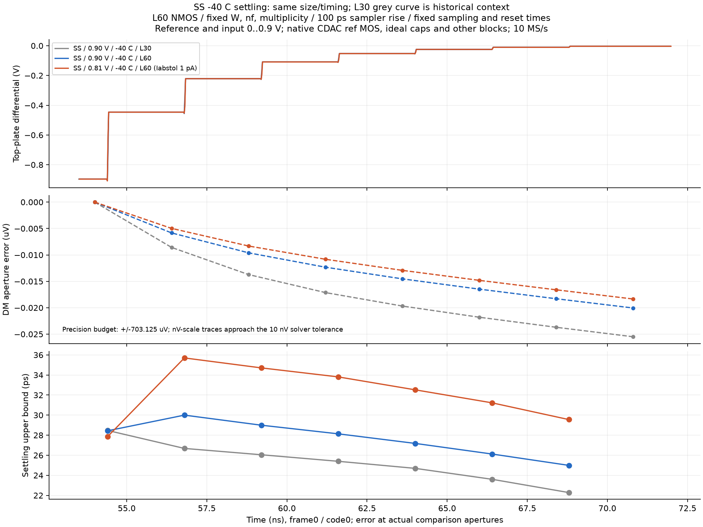
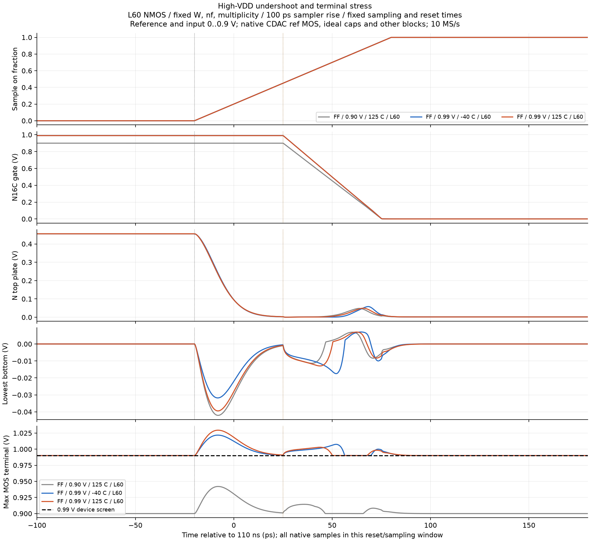

# L60参考NMOS：SS建立与高供电端压

采用用户选择的60nm候选，W、nf、并联数、PMOS、输入、采样窗口和关闭沿均保持，OA未改。四组目标工况已获得完整结果：建立和码字均通过，0.99V的FF冷/热角端压失败。SS0.81V使用下述独立数值恢复案例，原始失败完整保留；历史两组仅作对照。

**边界：REFP/REFN固定0.9/0V，输入码中心和量程不变；VDD变化影响PMOS体端、理想数字栅控与CLKS幅度。并非把参考幅度也随电源缩放。**

CDAC参考开关晶体管级，电容每侧1.28pF理想；采样器Ron=1Ω、100ps接通电导、10ps关断，比较器/SAR/电源/输入理想。外部CLKS及参考栅控仍为50ps；接通中点10.030ns、关闭中点49.980ns，每100ns重复。未包含真实Bootstrap/数字驱动、噪声、失配或PEX。

| 测试 | 最大比较差模误差(µV) | 建立通过 | 正确码 | 最低底板(mV) | 最大端压(V) | CMI |
|---|---:|---:|---:|---:|---:|---|
| SS / 0.90 V / -40 C / L30（历史） | 0.0255 | 56/56 | 8/8 | -37.872 | 0.941065 | 无 |
| FF / 0.90 V / 125 C / L60（历史） | 66.0580 | 56/56 | 8/8 | -42.071 | 0.942071 | 无 |
| SS / 0.90 V / -40 C / L60 | 0.0200 | 56/56 | 8/8 | -42.855 | 0.946468 | 无 |
| SS / 0.81 V / -40 C / L60 (Iabstol 1 pA) | 0.0183 | 56/56 | 8/8 | -48.646 | 0.948646 | 无 |
| FF / 0.99 V / -40 C / L60 | 0.0670 | 56/56 | 8/8 | -31.792 | 1.021792 | CMI-2752,CMI-2753,CMI-2754,CMI-2755 |
| FF / 0.99 V / 125 C / L60 | 59.9780 | 56/56 | 8/8 | -39.437 | 1.029437 | CMI-2752,CMI-2753,CMI-2754,CMI-2755 |

精度预算保持0.1LSB=703.125µV，逐位建立2ns、转换50ns、器件六种端差0.99V上限。8个码中心为0、255、85、170、127、128、1、254；每组820ns、64次比较、56次更新。码字正确不能替代端压通过。接近几十nV的残差已接近本次10nV电压绝对容差，只说明远低于误差预算。

## SS冷角建立

图中上行为差分顶板逐次逼近，中行为每次比较孔径残差，下行为各步进入并保持在0.1LSB内的时间上界（从该步栅极50%交叉起算，包含原生采样分辨率）。灰色是原L30，蓝色是L60的0.90V，橙色是0.81V数值恢复测试、电流绝对容差1pA。均为SS−40°C。

**原SS0.81V测试未完成**：SPECTRE-16927在1.14929ns中止，早于9.98ns首次采样；不能由此判定建立或码字失败。保留原始失败，独立恢复案例只把iabstol从10fA改为1pA（其余电路和时序不变），不混作相同容差结果。

- **SS / 0.90 V / -40 C / L60**：建立56/56，未收敛0段，最慢已收敛段上界32.93ps；2ns后最大误差0.0474µV，最大比较误差0.0200µV；转换21.235ns，码字[0, 255, 85, 170, 127, 128, 1, 254]。
- **SS / 0.81 V / -40 C / L60 (Iabstol 1 pA)**：建立56/56，未收敛0段，最慢已收敛段上界39.35ps；2ns后最大误差0.0457µV，最大比较误差0.0183µV；转换21.235ns，码字[0, 255, 85, 170, 127, 128, 1, 254]。

## 高供电下冲与端压

图显示第2帧采样/参考复位窗口的全部原生点，参考线为固定0.99V上限；表中峰值覆盖全820ns，可能出现在其他帧或阶段。依次为采样接通比例、N侧16C栅控、顶板、14个底板的最小值、168种端差最大值。竖线−20ps为采样接通开始，+25ps为CLKS上升中点/参考复位请求；外部时序未改。

- **FF / 0.99 V / -40 C / L60**：最坏`XADC.XN.XD.M5`的DB=1.021792029V，发生于109.991811ns，节点为`xadc.xn.xd.net5 / vdd`；最低底板`xadc.xn.xd.net5`=-31.792mV@109.991811ns。超限端差84对、涉及28管，码字8/8。
  峰值所在连续超限脉冲约76.24ps；全程该端差累计超限984.92ps，二者不是同一指标。
  原生电流KCL最大残差10.098nA，未通过原1nA诊断阈值；保留此数值限制，电流分解不用于更细的漏电量化结论。
- **FF / 0.99 V / 125 C / L60**：最坏`XADC.XN.XD.M5`的DB=1.029436751V，发生于109.991982ns，节点为`xadc.xn.xd.net5 / vdd`；最低底板`xadc.xn.xd.net5`=-39.437mV@109.991982ns。超限端差84对、涉及28管，码字8/8。
  峰值所在连续超限脉冲约70.03ps；全程该端差累计超限999.06ps，二者不是同一指标。

**冷角主峰的时序来源已定位**：109.980ns采样开始接通，109.991811ns出现最深下冲；此时采样电导只接通11.81%，N16C栅极仍为0.989997V，110.025ns参考复位请求尚未发生。顶板从上一轮转换电平快速移向新输入，通过CDAC电容拖低底板，而NMOS导通通路尚有有限阻抗。最坏PMOS M5为关断状态，其漏端−31.792mV、体端0.99V，所以|VDB|=1.021792V；源端仍为0.9V，|VDS|约0.931792V。这里主要超限来自体端/高栅极相对负底板的端差，不是漏源已经达到1.02V。稍后的参考复位另有次峰，不能与首峰合并归因。

因此，60nm减少FF热角静态漏电的收益保留，SS0.90V建立仍有余量；但提高供电使高电平端位于0.99V限制边界，现有下冲仍会形成超限。不能把码字正确解释为端压合格，也不能靠只加长NMOS认定过压已修复。下一步应针对采样重新接通时的底板保持/电压裕量处理，保持本次未改的尺寸和时序作为证据基线；本任务没有自动实施新的修复。

## 测量与复现

新分析器以VDD/2识别逻辑电平与事件，1%/99%门限也随VDD；参考目标仍为0.9V，误差/可靠性预算保持。旧固定0.45V门限分析器和历史结果未改。新阈值签名在0.81/0.90/0.99V验证，全部时钟及采样中点读回核对。

DUT和三个VA模型逐字节一致，仅仿真电源/外部时钟幅度、MOS模型section和温度变化（SS恢复另有明确容差变更）。全程指标使用原生点。发现电流波形扩展导出在Python2对list/tuple混合排序时遗漏部分早期窗口：不影响全程峰值/KCL计算；110ns附近电压图及最坏峰值使用独立reset_native原生导出核验，未把100ps显示抽点当作峰值证据。其他峰值按实际覆盖选择导出并核对。共享历史文件、OA及PDK均未改。

Spectre21.1 X CX、1线程；实际reltol1e-7、vabstol10nV、gear2only、maxstep20ps；原组iabstol10fA，明确标注的SS0.81V恢复组1pA，保留所有告警。

- `manual8-cdac-l60-ss090cold-v1`：仿真33.85s/289.23MiB；分析113.20s/11.38MiB；回收27.01MiB；告警SFE-1131,VACOMP-2435。
- `manual8-cdac-l60-ss081cold-i1p-v1`：仿真34.34s/286.86MiB；分析113.18s/11.38MiB；回收27.62MiB；告警SFE-1131,SPECTRE-16780,SPECTRE-16881,VACOMP-2435。
- `manual8-cdac-l60-ff099cold-v1`：仿真54.17s/288.38MiB；分析115.35s/11.38MiB；回收26.05MiB；告警CMI-2752,CMI-2753,CMI-2754,CMI-2755,SFE-1131,VACOMP-2435。
- `manual8-cdac-l60-ff099hot-v2`：仿真35.90s/288.76MiB；分析110.17s/11.38MiB；回收23.54MiB；告警CMI-2752,CMI-2753,CMI-2754,CMI-2755,SFE-1131,VACOMP-2435。

资源处理：账户48GiB限额中的大部分占用是文件缓存。经用户授权，对5个已结束运行的原始波形执行定向缓存释放，账户占用降低约2.02GiB；文件尺寸/修改时间不变，没有删除波形、终止Virtuoso或修改资源门槛。FF热角原v1在Spectre启动前明确排队超时；保留拒绝记录，在内存恢复后使用同电路/同求解设置的v2运行，未重复执行已完成仿真。

[完整数值和失败项](comparison.json) · [输入身份](manifest.json) · [测量验证](validation.json) · [SS原失败](original_ss081_failure.json)

这仍是CDAC模块的8帧筛查，未做全码/FFT或整机PVT验收；没有将候选同步至OA或采用新的整机基线。
