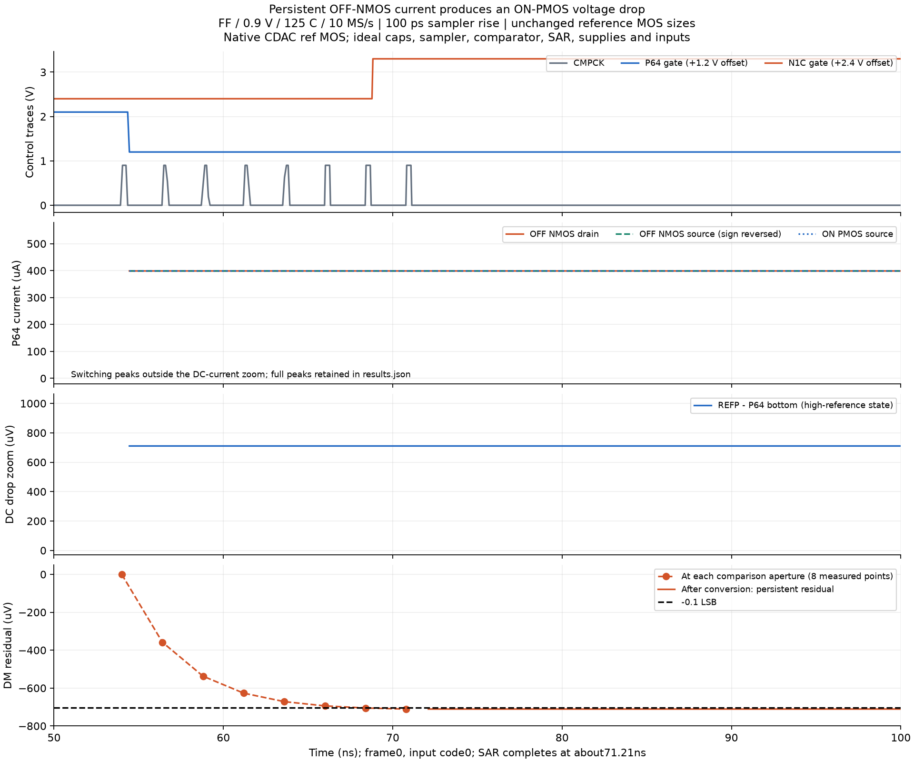
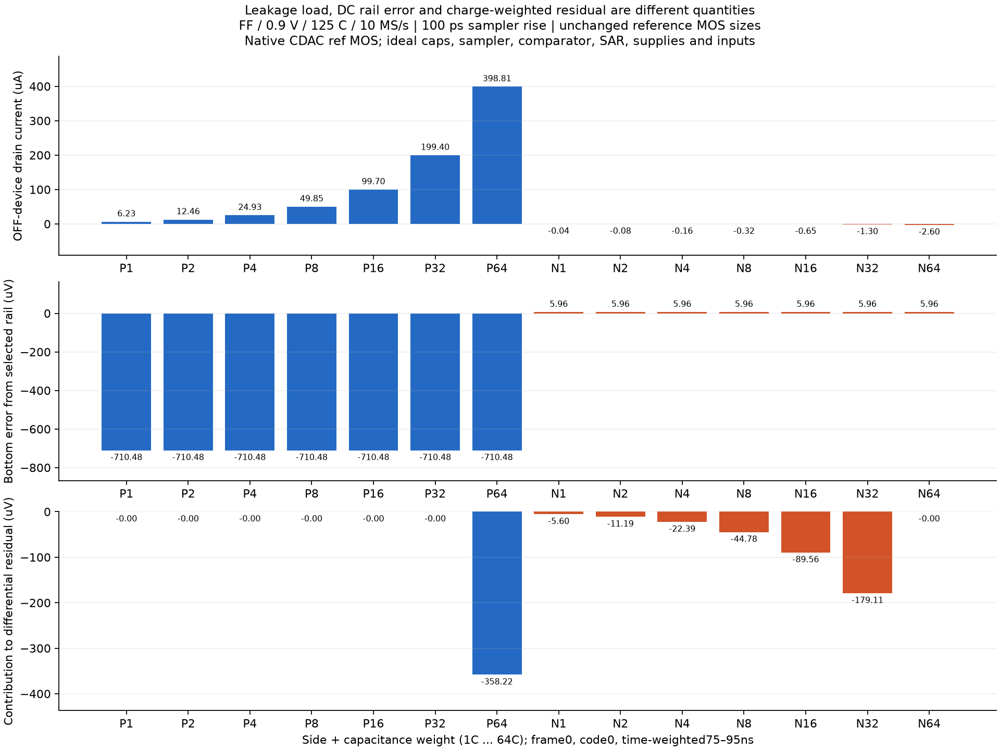

# FF热角：参考支路漏电与静态残差

本轮只补保存电流，尺寸、拓扑、模型、时序和激励均未改变。FF、0.9 V、125°C，100 ps采样电导接通、10 MS/s、820 ns、8个代表码；参考开关管级，其余模块及电容理想。

## 结论与主电流路径

码0转换完成后的75–95 ns，最大的关断支路为 **P64（xadc.xp.xd.m1）**：漏极电流398.809 µA，占高参考输出约50.08%。其VGS=1.2e-08 V，VDS=0.899290 V，栅极已经到关断电平。

路径为 **REFP → 导通PMOS → 底板 → 已关断NMOS → REFN**。同一支路PMOS的有限导通电阻使底板低于理想高参考。关断不等于零电流，测量结果需要结合下面的源/体/栅分量判断。

最大支路关断NMOS：ID=398.809 µA、IS=-398.785 µA、IG=-0.294 nA、IB=-23.939 nA；有效导通PMOS压降710.484 µV，对应压降/漏极电流约1.782 Ω。

ID与IS相抵且栅/体电流远小于ID，说明主要电流在漏源之间，不能归因于栅极未到低电平或由体电流主导。FF高温、L=30 nm的关断NMOS漏源泄漏符合这些结果；这里没有分解PDK内部亚阈值/DIBL/GIDL等模型项，不给出未经测量的微观比例。

## 哪些支路贡献最大

下表为码0、75–95 ns的时间加权均值。“残差贡献”按相对采样关闭时的底板误差变化计算，不能直接把最终底板偏差当成ADC误差。P/N表示差分两侧。

| 支路 | 关断管 | 关断ID(µA) | 每C的ID(µA) | 底板偏离目标(µV) | 差模残差贡献(µV) |
|---|---|---:|---:|---:|---:|
| P1 | m14 | 6.231 | 6.231 | -710.484 | -0.000 |
| P2 | m11 | 12.463 | 6.231 | -710.484 | -0.000 |
| P4 | m10 | 24.926 | 6.231 | -710.484 | -0.000 |
| P8 | m7 | 49.851 | 6.231 | -710.484 | -0.000 |
| P16 | m3 | 99.702 | 6.231 | -710.484 | -0.000 |
| P32 | m2 | 199.404 | 6.231 | -710.484 | -0.000 |
| P64 | m1 | 398.809 | 6.231 | -710.484 | -358.221 |
| N1 | m12 | -0.041 | -0.041 | 5.959 | -5.597 |
| N2 | m9 | -0.081 | -0.041 | 5.959 | -11.194 |
| N4 | m8 | -0.162 | -0.041 | 5.959 | -22.389 |
| N8 | m6 | -0.325 | -0.041 | 5.959 | -44.778 |
| N16 | m5 | -0.650 | -0.041 | 5.959 | -89.555 |
| N32 | m4 | -1.300 | -0.041 | 5.959 | -179.111 |
| N64 | m0 | -2.600 | -0.041 | 5.959 | -0.000 |

高参考状态的NMOS漏极电流约6.231 µA/C，随并联数成比例增长；低参考状态的关断PMOS约0.04062 µA/C，约小153倍。主要问题是一整类L=30 nm的关断NMOS漏源泄漏，64C支路只是按尺寸放大后的最大负载。码255时P/N角色交换，完整8帧见[branch_table.csv](branch_table.csv)。

注意P侧1C–32C虽持续耗流，却几乎不贡献本帧新增残差：它们采样时和转换后都处于高参考状态，压降变化接近零。相反，P64C从低切到高贡献约−358.22 µV；N侧1C–32C从高切到低合计约−352.62 µV，其中N32C约−179.11 µV。必须比较前后状态，而不能仅按最终漏电大小给残差排序。

## 电荷守恒如何解释残差

`单侧顶板误差 = 采样关闭时顶板误差 + Σ(Ci/Ctotal) × [当前底板偏离理想参考 − 采样关闭时底板偏离理想参考]`

用实际支路电压重建，码0测得差模残差-710.865 µV，重建-710.845 µV；全部8帧最大重建差19.744 nV。这把底板压降与顶板残差定量连起来，而非仅凭电流峰值推测。

| 输入码 | 参考持续输出(µA) | 实测差模残差(µV) | 电荷重建(µV) |
|---|---:|---:|---:|
| 0 | 796.428 | -710.865 | -710.845 |
| 255 | 796.428 | 710.865 | 710.845 |
| 85 | 796.428 | -240.687 | -240.680 |
| 170 | 796.428 | 240.687 | 240.680 |
| 127 | 796.428 | -5.599 | -5.597 |
| 128 | 796.428 | 5.599 | 5.597 |
| 1 | 796.428 | -710.865 | -710.845 |
| 254 | 796.428 | 710.865 | 710.845 |

高参考实际底板约0.899289516 V，低参考实际底板约0.000005959 V，两档间距约0.899283558 V，比理想0.9 V少0.716442 mV（约0.0796%）。本例主要表现为有效DAC参考跨度缩小，不等于已经测得ENOB下降或缺码。误差在比较结束后仍维持，继续等待不会消除这一静态分量。上一轮FF热角0.710855 mV残差略超0.703125 mV预算、8码仍正确的结论保留；本轮不是修复或规格放宽。

## 下一步与证据边界

优先针对关断NMOS的漏源泄漏评估沟道长度，保持W/并联数/时序不动做单变量比较，同时测Ron、低参考建立速度和端压。扩大PMOS可能降低压降，但不解决参考持续耗流；单纯延后比较也不解决稳态误差。本轮未执行尺寸修改。

28个MOS四端、14个底板节点和两条参考轨电流守恒均已核对；最大全时域KCL残差1.47e-13 A。电流正方向定义为流入器件端口，原生端口1/2/3/4对应D/G/S/B，包含瞬态位移电流，稳定保持区间才用于漏电归因。

保存信号扩展后的[等价与重建核对](validation.json)、[完整测量](results.json)、[输入散列](manifest.json)及[所有支路数据](branch_table.json)可追溯到`manual8-cdac-leak-ffhot-v1`。原始日志/波形保留在managed运行目录；无OA或PDK修改，无新基线采用。

原尺寸保持：参考NMOS W=1 µm、L=30 nm、nf=10；PMOS W=3 µm、L=100 nm、nf=10；multi按1C至64C为2至128。以上为网表参数，未重解释PDK的每指宽度语义。

只增加100个保存电流信号；原生零错误，原SFE-1131/VACOMP-2435告警保留，无CMI。实际Spectre21.1 X CX单线程，reltol=1e-7、gear2only、maxstep20 ps，与源运行一致。仿真33.77 s/RSS294.92 MiB，分析103.91 s/RSS11.43 MiB，回收14.83 MiB。

波形图控制信号为便于阅读分别纵向错开，偏移量标在图例；电流/压降展示选高参考后的DC量级，切换尖峰可能超出纵轴，原始峰值完整保留。残差圆点是实际8个比较时刻，虚线仅连接标记；比较完成后用保持波形显示持续残差，避免将切换期间理想目标跳变误认为稳定误差。
