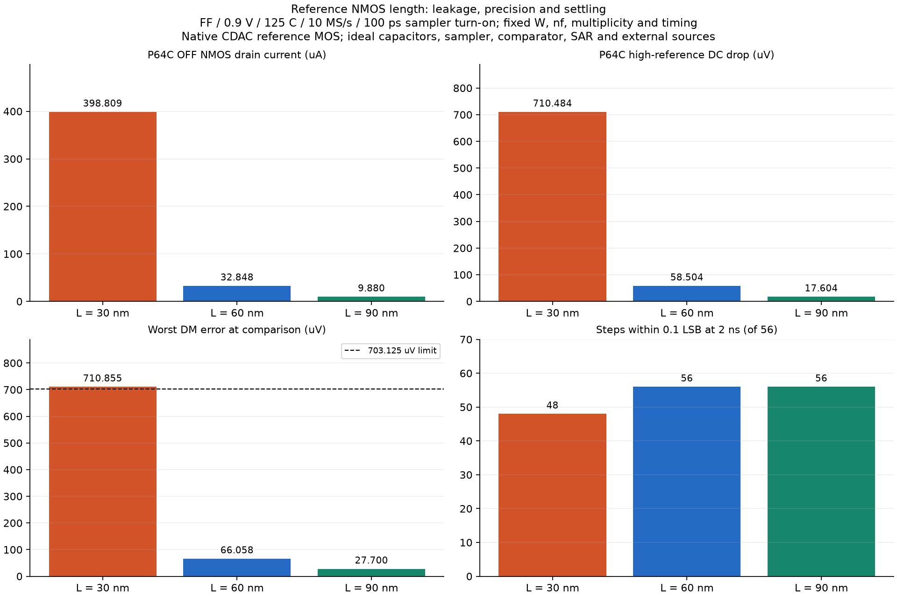
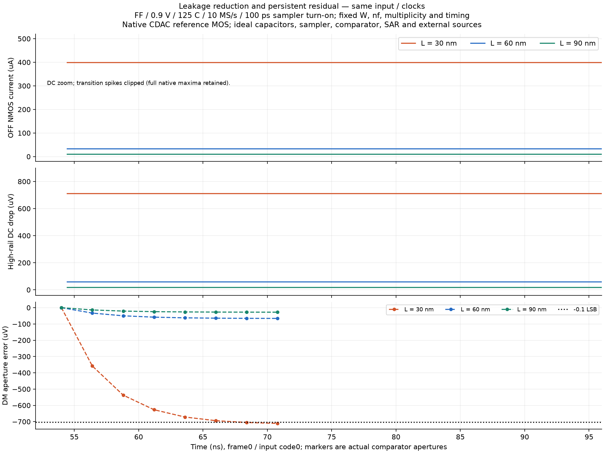
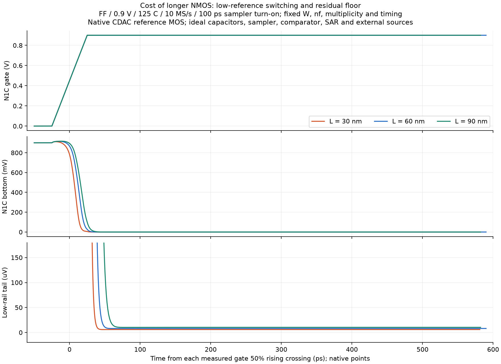

# FF热角：参考开关 NMOS 长度扫描

**60nm、90nm均通过本轮8帧短测；30nm仍有静态残差超预算。60nm已把最大比较误差从710.9µV降至66.1µV，90nm进一步降至27.7µV。**

仅将两侧14个参考NMOS的L从30nm改为60/90nm。W=1µm、nf=10、multi=2/4/8/16/32/64/128固定；PMOS仍为W=3µm、L=100nm、nf=10及原并联数。拓扑、输入、100ps采样接通过渡和全部其他时序不变，OA未改。

测试为FF、0.9V、125°C、10MS/s，双侧各1.28pF理想电容；参考开关晶体管级，采样器、比较器、SAR及外部电源/输入理想。8帧820ns，输入码中心为0、255、85、170、127、128、1、254。L30复用已完成电流测量，不重复仿真。

100ps指理想采样器电导接通时间；外部CLKS与参考栅控仍为50ps，采样接通中点10.030ns、关闭中点49.980ns，每100ns重复。采样器Ron=1Ω；未加入真实Bootstrap、栅驱动、噪声、失配或PEX。

## 结果

| NMOS L | P64C关断漏电(µA) | 高参考静态压降(µV) | 低参考静态偏移(µV) | 最大比较差模误差(µV) | 建立通过 | 正确码 |
|---|---:|---:|---:|---:|---:|---:|
| 30nm | 398.809 | 710.484 | 5.959 | 710.855 | 48/56 | 8/8 |
| 60nm | 32.848 | 58.504 | 8.065 | 66.058 | 56/56 | 8/8 |
| 90nm | 9.880 | 17.604 | 10.305 | 27.700 | 56/56 | 8/8 |

静态列取码0转换结束后75–95ns时间加权平均；高参考为P64C，低参考为N64C。比较误差取全部64个实际比较孔径。建立标准保持为2ns内进入并保持在0.1LSB=703.125µV；L30的8段因静态残差未进入预算，不能把其他已通过段的短建立时间当成全部通过。

| NMOS L | 总高参考静态电流(µA) | 高参考保持功率(µW) | N64C有效导通电阻(Ω) | 最大端压(V) | 最低底板(mV) | 最慢已建立段上界(ps) |
|---|---:|---:|---:|---:|---:|---:|
| 30nm | 796.428 | 716.786 | 2.2921 | 0.939934 | -32.377 | 29.29 |
| 60nm | 70.224 | 63.202 | 3.1021 | 0.942071 | -42.071 | 28.11 |
| 90nm | 24.648 | 22.184 | 3.9637 | 0.951536 | -51.536 | 33.33 |

有效导通电阻以静态压降/该导通支路漏极电流计算，反映当前工作点，不是独立扫VDS提取的通用Ron。参考保持功率只计0.9V参考源；不是整机功耗。端压取28管全部六种端差，共168对，筛查上限0.99V。

## 原因与取舍

L30已确认的路径是REFP → 导通PMOS → 底板 → 关断NMOS → REFN。保持W、并联数及PMOS不变，增加NMOS长度后，下面两个效应需要一起看：

- 高参考状态：关断NMOS漏电减少，流过PMOS的电流及底板压降下降。
- 低参考状态：导通NMOS电阻增大，而关断PMOS漏电仍在，底板正偏移和动态建立代价可能增加。

60nm：P64C关断漏电较30nm降低12.14倍，高参考静态压降降低12.14倍；N64C有效导通电阻变为原来的1.353倍。全部短测项通过。
90nm：P64C关断漏电较30nm降低40.36倍，高参考静态压降降低40.36倍；N64C有效导通电阻变为原来的1.729倍。全部短测项通过。

代价也已出现：最低底板从−32.38mV加深至−42.07/−51.54mV，最大端压从0.93993V升至0.94207/0.95154V；均低于本轮0.99V筛查线且无CMI，但不能忽略趋势。新增两组的最坏端压出现在采样/参考复位阶段，与转换结束后的静态漏电不是同一个指标。

60nm已足以解决当前热角精度超预算，可作为优先验证候选；90nm保留为更低漏电备选。下一步应在SS冷角检查低参考建立，并在高供电端核对下冲/端压，再定尺寸。本轮不直接采用新基线，也不能据此宣布整机PVT通过。

上两行是高参考选通后的电流和压降局部量程，切换尖峰被裁出显示范围；原生峰值保留在results.json。下行是实际比较孔径的误差点，不把切换瞬态目标跳变当作已建立误差。

该图比较码0最后一次N1C高→低参考切换，使用64–72ns保存的全部原生点。横轴对齐各自实际栅极50%交叉时刻；最后一行放大低参考残差，不能仅凭前一行波形看似重合就认为Ron未变化。

## 边界与验证

PDK只读核对：三个L均在模型列举的短沟道长度中。W=1µm由nf=10分为每指100nm，shrink0.9后模型宽90nm；三个长度均有匹配模型范围（90nm位于分段边界，列出两侧匹配，不擅自宣称实际选中哪个bin）。见legality.json。

这是L单变量电气对照：原导出扩散/LDE参数保持不变，尚未做PCell回调重算、版图DRC或OA同步。不能把模型可计算解释为物理版图已合法。

输入manifest逐文件散列及L-only反向替换核对通过；模型/激励/PMOS/采样/码序列/测量阈值一致。原生28管端口、14底板及参考源KCL由既有流式分析计算，本轮另对导出局部窗口核对四端电流和。静态电荷重建与实测差模残差的差异保留于comparison.json。

Spectre21.1 X CX，1线程，实际tran reltol=1e-7、vabstol10nV、iabstol10fA、gear2only、maxstep20ps。不同L使用同一求解设置与分析器，没有降低精度。原生日志、资源和精确运行身份：

- L30：`manual8-cdac-leak-ffhot-v1`；CMI：无；告警：SFE-1131,VACOMP-2435；仿真33.77s/294.92MiB，分析103.91s/11.43MiB，回收14.83MiB。
- L60：`manual8-cdac-nl60-ffhot-v1`；CMI：无；告警：SFE-1131,VACOMP-2435；仿真34.28s/288.70MiB，分析106.30s/11.38MiB，回收15.26MiB。
- L90：`manual8-cdac-nl90-ffhot-v1`；CMI：无；告警：SFE-1131,VACOMP-2435；仿真34.30s/286.75MiB，分析105.43s/11.41MiB，回收15.20MiB。

[比较数值](comparison.json) · [验证](validation.json) · [全部支路及8帧静态结果](branch_table.json) · [输入身份](manifest.json)

本轮仅FF/0.9V/125°C、8个代表输入；未测新的全码/FFT或全电压PVT。未采用新基线、未改OA，旧结果及原始波形保留。
