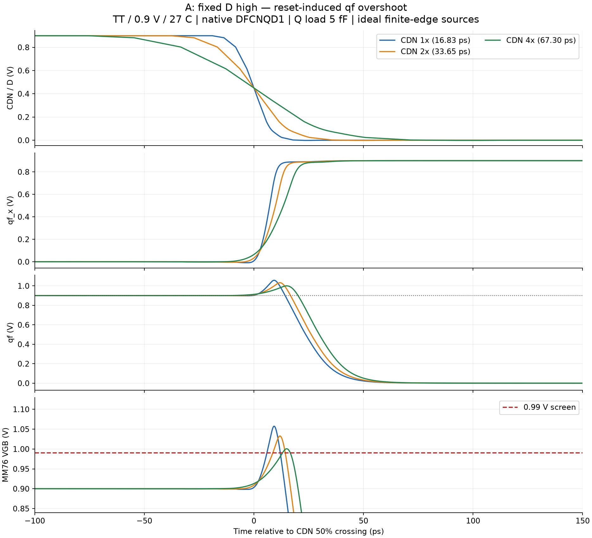
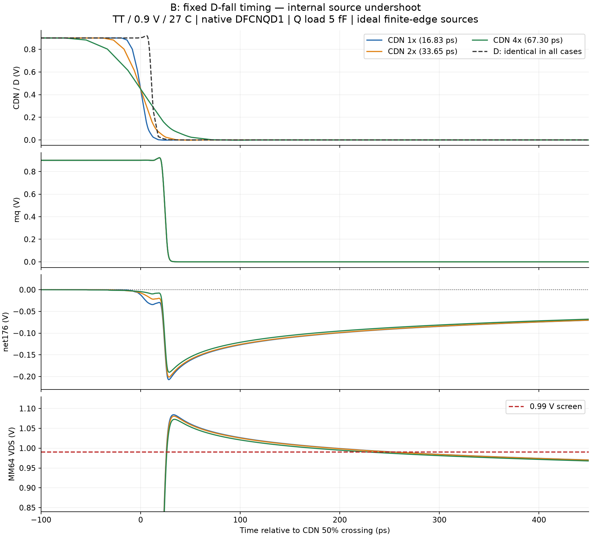
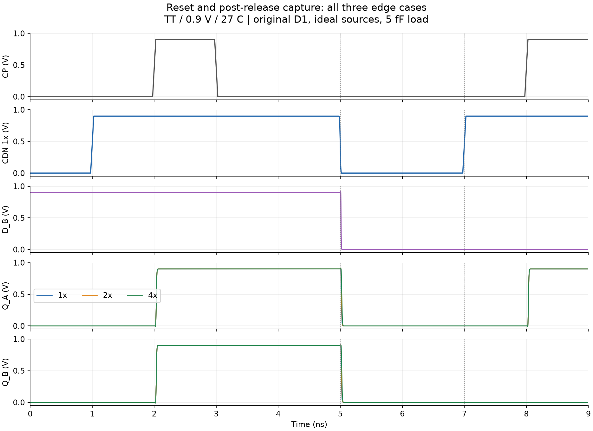

# CDN边沿三点实验

**放缓CDN能明显减轻复位qf上冲，但不能解决后级DFF内部源极下冲。三组复位和恢复捕获均正确，三组端压筛查均未通过。** 本轮仅运行三个9ns仿真，未换单元，未改OA。

条件：TT、0.9V、27°C；两个原生 `DFCNQD1BWP12T30P140`，Q各接5fF；外部电源、CP、D和CDN均为理想有限边沿源。A的D固定高，B的D按原后级CLK1波形下降。只有目标CDN下降沿的时间轴分别缩放1/2/4倍，50%时刻固定5ns，B的D下降50%固定5.011330635ns。无RC、瞬态噪声、失配和PEX。此台用于机制诊断，5fF不代表原SAR真实扇出。

## 测量结果

超限阈值维持0.99V；时长是所列峰值所在**单次连续超限区间**，由原生相邻点阈值交点插值得到。峰值使用同一原生时刻两端电压相减，不是两个节点各自极值相减。

| CDN下降90%→10% | A：MM76 VGB峰值 / 超限时长 | B：MM64 VDS峰值 / 超限时长 | Q降到0.09V所需时间* | 复位及恢复捕获 |
| --- | --- | --- | --- | --- |
| 16.83ps（1×） | 1.057358V / 6.116ps | 1.084223V / 230.474ps | 27.25ps | 通过 |
| 33.65ps（2×） | 1.032722V / 5.700ps | 1.080499V / 227.200ps | 30.28ps | 通过 |
| 67.30ps（4×） | 1.000578V / 3.596ps | 1.072681V / 204.267ps | 34.80ps | 通过 |

*从CDN的50%下降时刻起算，两个DFF相差小于0.004ps。不是从源开始下降时刻计时，也不是整机复位预算。

全部56只原生MOS的六端差均已检查；目标窗口最坏仍为B的MM64 VDS，整个9ns最坏与此一致。4×下B的qf峰值仍为1.004962V，A的qf峰值1.000578V；没有把同一节点引起的多条器件告警当成多个独立原因。逐器件清单见[comparison.json](comparison.json)。

## 波形说明

A图从上往下为CDN、qf_x、qf、MM76 VGB。CDN放慢，qf_x上升90%/10%时间从7.881ps增至11.362、17.705ps，qf尖峰随之降低。MM76栅接qf、体接地，因此VGB就是qf电压。证据支持这条复位反馈耦合对边沿敏感；4×仍比0.99V高10.58mV，不能称为修复。

B图从上往下为CDN与固定D下降、mq、net176、MM64 VDS。三条mq下降几乎重合，90%→10%为5.527/5.523/5.526ps。net176最低值分别为−207.18/−201.24/−190.10mV；MM64的D=mq_x、S=net176，源极负压造成较大的VDS。net176的最低时刻与VDS峰值时刻不必相同。

结合已核对连接，mq下降作用于MM65栅，CDN下降关闭MM66的对地串联通路；本实验与“快速内部跳变、耦合以及弱恢复路径共同造成下冲”的解释一致。CDN变慢对这条内部mq跳变几乎无影响，因此后级峰值只降低11.54mV，持续时间仍约204ps。已保存所选MOS四端总流并核对KCL；未将总端流分解成沟道与寄生电容分量，不据此声称已经定量证明唯一耦合路径。

0–1ns初始化；2ns捕获高；5ns目标清零；7ns释放；8ns再次捕获。A最后为高、B最后为低。三条件在规定稳定窗口均满足0.1/0.9VDD逻辑电平；清零延后最多约7.55ps，未接近本诊断1ns目标。功能正常不豁免内部端压超限。

9ns内两个DFF的VDD源净供能分别28.424/28.410/28.521fJ，目标窗口供能6.704/6.690/6.800fJ。没有明显数量级增加；这是固定窗口VDD供能，未包含理想信号源的全部能量，也没有分离短路功耗，不是ADC功耗。

## 下一步选择

不继续仅靠放慢CDN扩大扫描，也不直接整机全量换单元。CDN整形可保留为首类上冲的辅助方案，当前不足以解决主瓶颈。

下一轮优先在同一两DFF小台比较 **SDFSYNCNQD1（SE/SI固定0）** 与 **GDFCNQMCOD1**：前者主从传递/反馈结构有实质变化，值得针对后级下冲测试；后者同端口，适合验证从锁存器复位路径，但仍保留关键主锁存串联结构，且CP电容约7倍。先使用原始1×CDN作单元对照，不同时叠加边沿调整。本轮没有运行这些候选，也没有采用新基线。普通DFQD1的另两类内部上冲不在此次两复位DFF覆盖范围。

## 来源、限制与验证

- 仿真：`manual8-cdn-s0-tt-v1`、`manual8-cdn-s1-tt-v1`、`manual8-cdn-s2-tt-v1`；各9ns，原生零错误结束，约12.9–13.5s。Spectre21.1.0.509，CX，实际reltol1e-6、vabstol10nV、iabstol10fA、gear2only、maxstep1ps。原始CMI-2751/52/53/54/55及SFE-1131保留。
- 原库170a SPI只引用，哈希与清点时核对一致。原PDK/模型include不变；本项目尚无该SPI与PDK正式配套/寿命许可结论，不将严格端压screen直接替代foundry寿命签核。
- 手册TT25°C页208/210确认异步清零、Q最大电容91.5231fF、CDN最低低脉宽28.2843ps、recovery −22.7608ps及removal47.5779ps；本台相邻时序留1ns以上量级间隔。完整TT27°C slew条件与可靠性许可未核定，不冒充签核。
- 回放来自既有v6的210ns显示窗口，非原生完整输入轨迹；稳定端小于0.1mV的残差衔接到电源轨，三例一致。首例复现两类问题，不能要求与原真实负载的峰值完全相同。
- 初次分析因Python2变量名覆盖在写JSON时失败。修复后通过三个 `manual8-cdn-s*-reduce-v2` analysis-only任务绑定上述完成源重新分析，没有追加仿真或覆盖旧结果。
- 所有原生时间点均回收为压缩CSV；数值逐点独立核对、持续时间插值交叉核对、稳定功能区间和所存MOS四端总流KCL检查见[validation.json](validation.json)。三张图已视觉检查。
- 原始数据在服务器各run的raw目录；本地小结果位于output/managed_execution/runs/对应run/collected；原图、JSON、失败证据保留。不commit/push，不改OA、其他模块、用户笔记或10bit实验。
