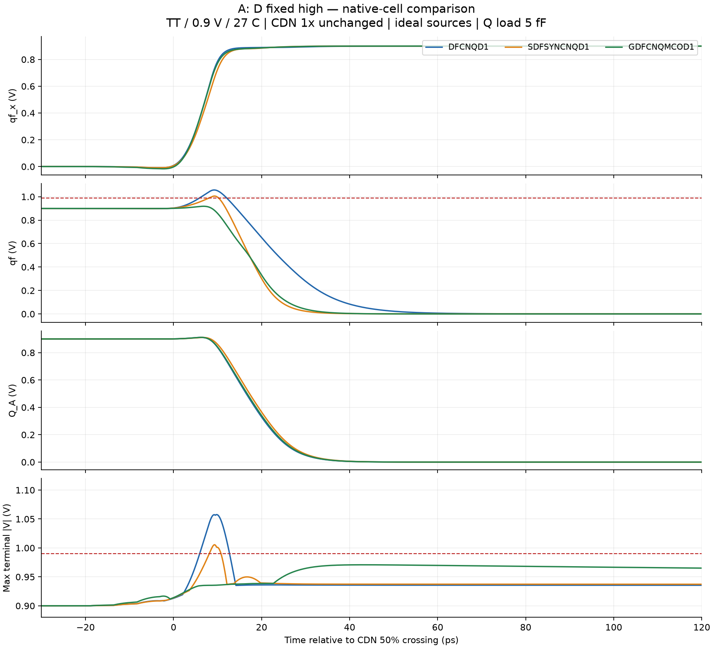
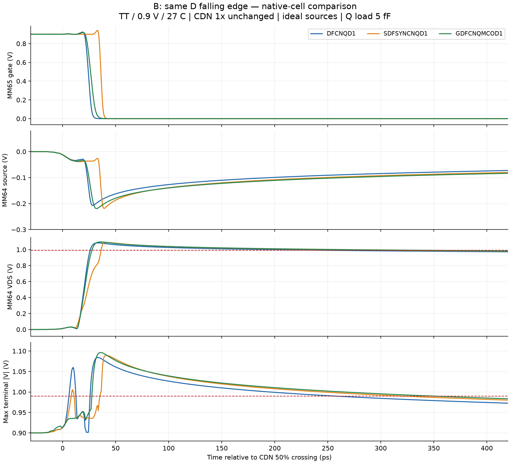
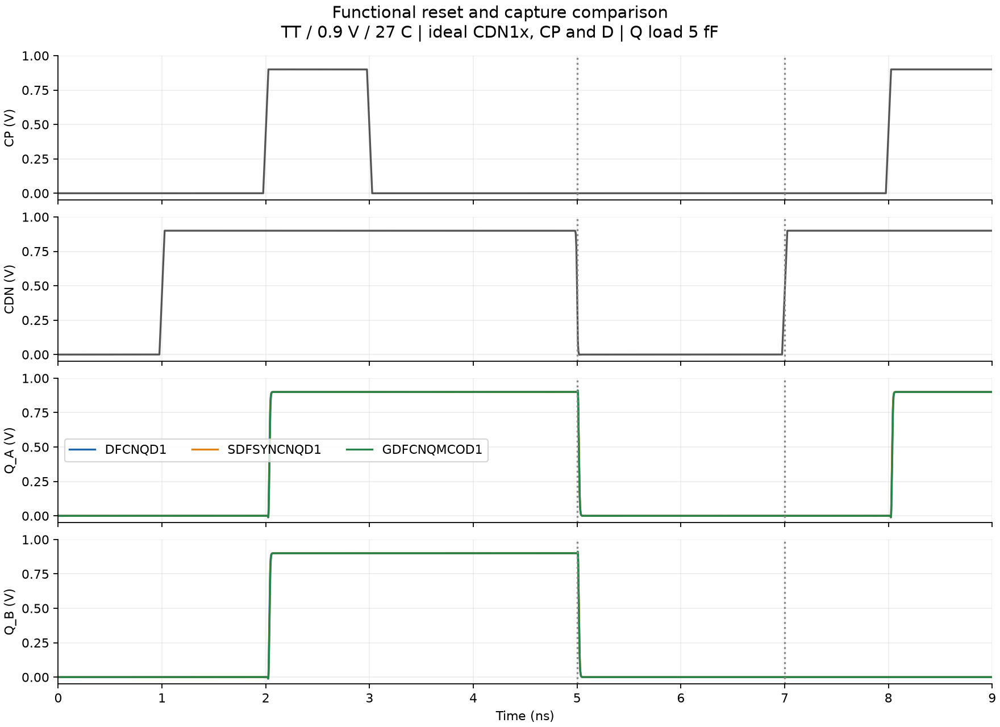

# 两种原生 DFF 结构对照

**结论：两种候选复位、捕获功能均正常，但均未解决后级内部下冲，暂不推广替换。** GDF 消除了本测试中首级的端压超限，却使后级 MM64 超限更高、更久。SDF 对首级有改善，后级同样变差。

## 同条件结果

全部为 `BWP12T30P140` 后缀。TT、0.9 V、27°C，Q 各接 5 fF；CDN、CP、D 均为理想源。沿用原始 CDN 1× 波形：下降 90–10% 为 16.825 ps，50% 在 5 ns。仅新增两个 9 ns 仿真，原 DFCNQD1 复用已有结果。

- A：D 固定高，用于观察复位引起的首级内部上冲。
- B：D 在 CDN 之后 11.331 ps 下降，用于观察后级内部下冲。D 波形在三例间完全相同。
- 0–1 ns 初始化复位，2 ns 时钟预置 Q=1，3 ns 时钟下降；5 ns 目标复位，7 ns 释放，8 ns 再次捕获 A=1、B=0。

| 单元 | A 最大端压 / 连续超限 | B MM64 最大 VDS / 连续超限 | 复位、恢复捕获 |
|---|---:|---:|---|
| 原 DFCNQD1 | 1.057563 V / 5.748 ps | 1.084223 V / 230.474 ps | 通过 |
| SDFSYNCNQD1 | 1.005447 V / 2.089 ps | 1.089457 V / 283.173 ps | 通过 |
| GDFCNQMCOD1 | 0.970827 V / 0 ps | 1.096250 V / 321.195 ps | 通过 |

阈值为 0.99 V，时长取包含峰值的连续超限区间，按原生时间点插值。A 列扫描全部晶体管的六种端电压差：原版最坏为 MM3 VGS，SDF 为 MM12 VDB，GDF 为 MM76 VDS。前一份 CDN 报告聚焦原版 MM76 VGB（1.057358 V / 6.116 ps），口径不同，数据不矛盾。本轮也检查了完整 9 ns，未发现比目标复位窗口更高的端压。

## 结构变化与波形

### A：复位上冲有所改善

四行分别为内部 qf_x、qf、输出 Q_A、全部 MOS 端压绝对值的最大包络。横轴零点是 CDN 下降的 50% 时刻。

原版 qf 峰值 1.057358 V；SDF 降到 1.005447 V，仍超过阈值；GDF 降到 0.918392 V，且该实例完整 9 ns 内全部端压不超过 0.99 V。

GDF 的从锁存复位串联链改变了控制位置：原版上管 MM76 由 qf 控制、下管 MM75 由 CDN 控制；GDF 上管由 CDN 控制、下管由 qf 控制，并改变了反馈通路。它在本夹具中有效抑制了这一类上冲。但同时还有时钟连接和尺寸等差异，不能把全部改善只归因于串联管换序。

### B：主锁存串联节点仍然下冲

四行分别为 MM65 栅极、MM64 源极、MM64 VDS、全部端压最大包络。原版/GDF 的对应节点是 mq、net176；SDF 是 net0217、net53，按电路角色对齐，并非把同名节点强行比较。

共同链路是：MM64—MM65—MM66 串联，最下方 MM66 由 CDN 控制。复位使这条对地通路关断；随后内部 MM65 栅极下降，串联内部节点出现负向跃变，MM64 漏极仍保持接近高电平，形成较大的 VDS。

| 单元 | MM64 源极最低值 | MM65 栅极下降 90–10% | MM64 VDS 峰值时刻（相对 CDN） |
|---|---:|---:|---:|
| 原 D1 | −207.176 mV | 5.527 ps | +33.116 ps |
| SDF | −218.429 mV | 3.601 ps | +41.190 ps |
| GDF | −219.154 mV | 7.886 ps | +35.917 ps |

源极最低值和最大 VDS 不一定发生在同一时间；表中 VDS 都由同一原生时间点的漏、源电压相减得到。

SDF 增加了 mq 到 net0217 的缓冲，但仍保留这条串联链。局部栅极边沿变得更陡，下冲和超限持续时间都增加。GDF 的 MM64 栅极改为直接接 CP，也改变了其他连接与尺寸，但主锁存内部节点仍下冲；它的 MM65 边沿虽更慢，结果仍更差，说明不能只用边沿速度预测应力。

连接关系、事件先后与波形支持“内部切换耦合叠加恢复通路不足”的解释。所选 MOS 四端总电流满足 KCL，独立端压计算一致；这些检查不等于已经将每一项寄生电容电流单独分解，也不证明只有一条耦合路径。

## 功能与负载代价

| 单元 | CDN 50% 到 Q_A 低于 0.1VDD | 预置 CP 到 Q_A 的 50% 延时 | 两实例 9 ns VDD 供能 | 两实例 CP 的绝对电流积分 |
|---|---:|---:|---:|---:|
| 原 D1 | 27.250 ps | 34.374 ps | 28.424 fJ | 2.035 fC |
| SDF | 28.027 ps | 35.808 ps | 34.376 fJ | 3.360 fC |
| GDF | 27.491 ps | 37.057 ps | 40.839 fJ | 15.512 fC |

GDF 的 CP 电荷负担约为原版 7.62 倍。本测试 CP 由理想源驱动，未反映真实前级驱动器的延迟和功耗。这里的供能包含初始化及测试事件，不能直接当作 ADC 平均功耗；绝对电流积分也不等于静态引脚电容。

## 下一步选择

不将任何一个候选作为全部 SAR DFF 的替代基线。GDF 可以保留为首级上冲的局部候选，但后级 MM64 未解决，且需承担时钟负载代价。SDF 当前没有显示出足以抵偿复杂度的整体优势。

下一项更有辨识力的实验是**单独改变 D 下降相对 CDN 的先后关系**，检查能否在 MM66 关断前完成主锁存内部切换，避免在恢复通路关闭后激发下冲。同时必须验证复位优先级、释放后的捕获及竞争关系，不能仅靠移走告警窗口判断通过。本轮未运行此实验。

## 证据与范围

- 新运行：`manual8-dff-syn-tt-v1`、`manual8-dff-gdf-tt-v1`；基线源 `manual8-cdn-s0-tt-v1`，分析 `manual8-cdn-s0-reduce-v2`。
- Spectre 21.1.0.509，X CX，单线程，实际 reltol=1e-6、vabstol=10 nV、iabstol=10 fA、gear2only、maxstep=1 ps。两新运行原生成功结束，CMI 等告警保留。
- 原库 SPI SHA256：`b7b366bff01b86fbe6c9728426a1643255476f5e5e63f79b9ff14ffaa2b2fc0e`，构建时远端核对一致。库内部未修改。SDF 的 SI/SE 固定低；它仍为异步低有效清零单元。
- 全部 28/42/32 只 MOS（每实例）的端节点被保存；原生流式测量与独立数组复核峰值一致，时长差小于 1e-12 ps，所选 MOS 四端总流 KCL 最大残差小于 1.4e-16 A。稳定功能窗口通过。三张图已视觉检查。
- 数据：[comparison.json](comparison.json)、[validation.json](validation.json)、[build_receipt.json](build_receipt.json)；冻结测试台在 `syn/`、`gdf/`。
- B 的 D 是固定回放源，并非由本次 A 的 Q 真实级联驱动；这便于隔离单元差异，但完整替换后级联时序会变化。5 fF 是诊断负载，不是 SAR 的真实扇出。
- 仅 TT 短测试，未覆盖 PVT、噪声、失配、寄生与完整库使用条件，不作可靠性签核。未改 OA、PDK、标准库或整机基线；未 commit/push。
