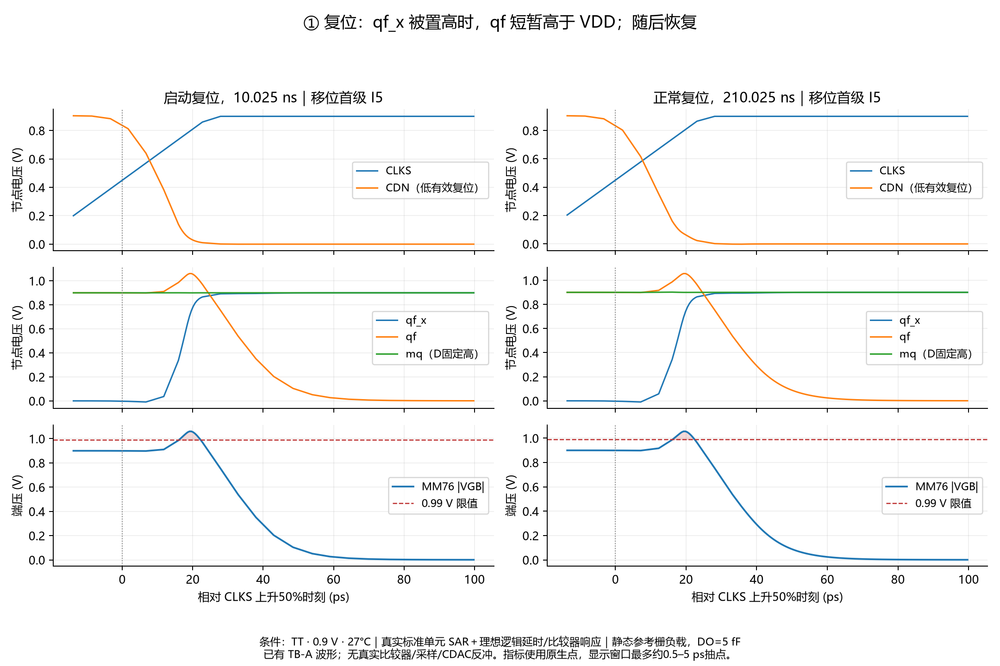
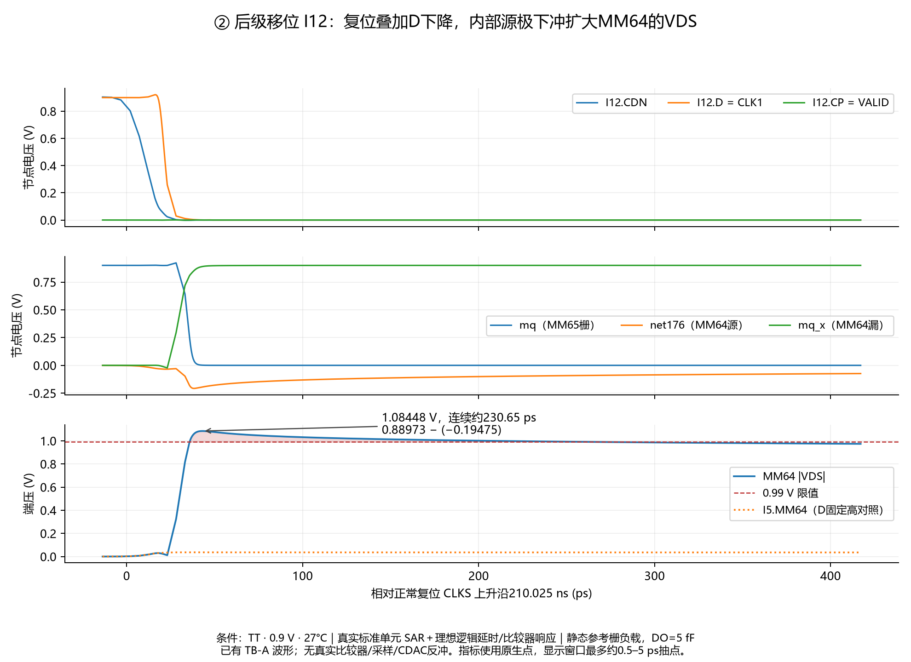
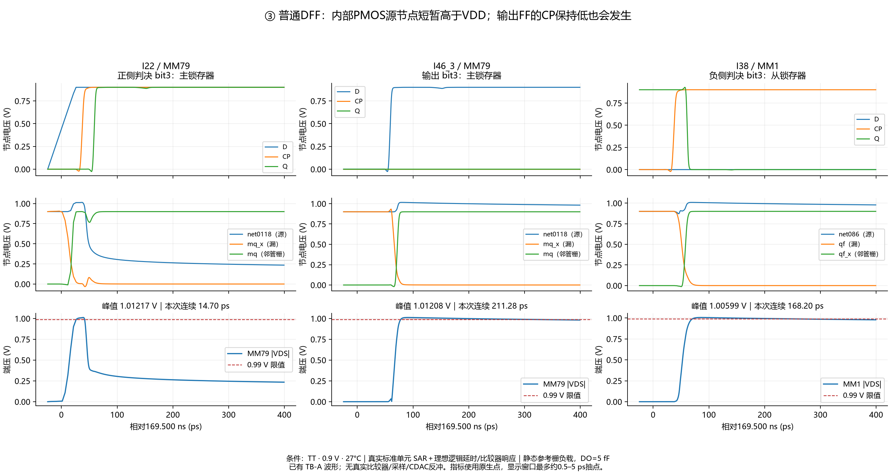
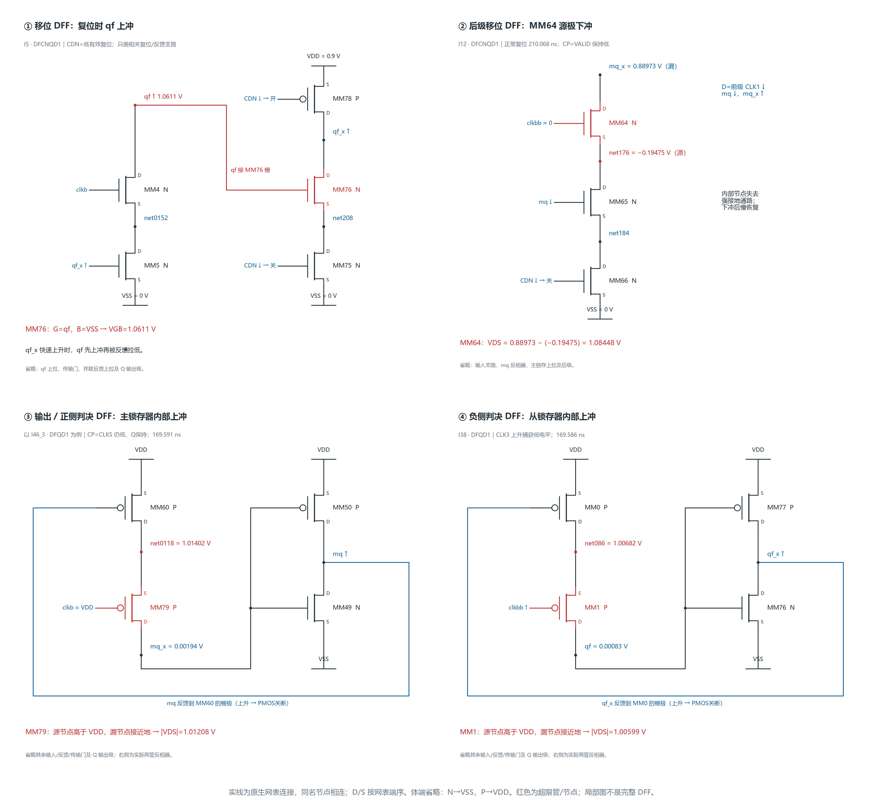

# SAR 标准单元 DFF 端压窗口分析

已有 TB-A 结果确认三类内部瞬态超限：复位节点上冲、后级移位 DFF 内部源极下冲、普通 DFF 内部 PMOS 源节点上冲。输出保持正确逻辑电平，并不代表内部节点没有活动。此次仅回收和分析已有结果，没有启动新仿真，没有修改电路或 OA。

## 条件与范围

- 源运行：`manual8-sar-a-tt-v6`，已正常完成 1.62 µs，原生退出码 0、零错误结束；CMI 告警保留。此次只分析前 220 ns，不做后续重复轮次或完整功能验收。
- TT、0.9 V、27°C，100 ns 帧周期；外部 CLKS 50 ps 上升/下降，50% 采样关闭沿为 49.975 ns + n×100 ns。
- SAR 为原生标准单元晶体管网表；移位使用 `DFCNQD1BWP12T30P140`，判决和输出使用 `DFQD1BWP12T30P140`，尺寸未改。
- 比较器用预设判决序列响应器代替，响应延时 200 ps、边沿 50 ps；逻辑延时是明确的 VA 数字传输延时（2 ns/100 ps），不是 RC。参考负载为静态 MOS 栅复制，输出每位 5 fF。没有真实比较器、Bootstrap、CDAC 的动态反冲。
- Spectre 21.1.0.509：实际 reltol=1e-6、vabstol=10 nV、iabstol=10 fA、maxstep=100 ps、gear2only。maxstep 是步长上限；尖峰处使用自适应原生小步长数据。
- 覆盖 10 个代表 DFF、248 个 MOS 的六种端电压差；不是所有 SAR 门的完整电气验收。库输入 slew、setup/hold 等使用约束尚未完成核对，不能据此直接判定库本身有缺陷。

## 关键事件

以下采用当前模型的 0.99 V 界限。持续时间指**包含所列峰值的那一次连续超限区间**，不是累计时间，也不是其他脉冲的最长时间。峰值由同一原生时间点的两个节点相减；阈值交点用相邻原生点线性插值。

| 类别 | 代表晶体管 | 端压 | 峰值 / V | 峰值时刻 / ns | 本次连续超限 / ps |
| --- | --- | --- | ---: | ---: | ---: |
| 移位首级复位 | I5.MM76 | \|VGB\| | 1.061118 | 10.044316 | 6.13 |
| 后级移位复位 | I12.MM64 | \|VDS\| | 1.084476 | 210.068059 | 230.65 |
| 正侧判决 bit3 主锁存器 | I22.MM79 | \|VDS\| | 1.012166 | 169.539072 | 14.70 |
| 输出 bit3 主锁存器 | I46_3.MM79 | \|VDS\| | 1.012078 | 169.590940 | 211.28 |
| 负侧判决 bit3 从锁存器 | I38.MM1 | \|VDS\| | 1.005994 | 169.586147 | 168.20 |

所有实例均位于 `XDUT` 内。I22.MM79 的其他脉冲最长约 193.98 ps，不能把该时长配到表中的 169.539 ns 峰值上。

## 1. 复位：内部 qf 上冲

每列从上到下为复位输入、内部节点、受影响管端压。左列是启动，右列是正常周期复位；同类现象并不限于启动。

CLKS 上升使低有效 CDN 下降，内部 qf_x 被复位置高，qf 在随后下降之前先冲到 1.061118 V。qf 正是 NMOS MM76 的栅极，体端接地，因此其 VGB 直接超限；连接同一 qf 的 MM4、MSLTn1 也会产生相关端压告警。它们是同一节点瞬态反映到多只器件，并非多个互不相关的故障。

按连接关系，CDN 下降使复位上拉 MM78 导通、下方 MM75 关断。qf_x 的快速上升与 qf 上冲同步，符合内部寄生耦合、反馈拉低尚未建立时的短暂上冲；随后反馈恢复 qf。这里的“耦合主导”是依据波形和连接得到的机制解释，尚无支路电流分解。

## 2. 后级移位：内部源极下冲，放大 MM64 的 VDS

在正常复位 210.025 ns 附近，I12 的 CDN 先下降，D=前级 CLK1 随后下降，CP=VALID 保持低。内部 mq 下降、mq_x 上升，同时 MM64 的源节点 net176 被拉到负电压。

在真正的 VDS 峰值时刻，漏端 mq_x=0.889731 V、源端 net176=−0.194746 V，因此：

`VDS = 0.889731 − (−0.194746) = 1.084476 V`

这不是供电升高，而是**一端接近 VDD，另一端低于地**。持续约 230.65 ps，明显长于前一类 qf 尖峰。

对应串联支路为 MM64—MM65—MM66：CDN 下降使底部 MM66 关断，内部节点失去强接地通路；mq 是 MM65 的栅极，其下降与 net176 下冲同步，符合关断过程中的电容耦合及弱恢复。I5 的 D 固定高，没有相同的 mq 翻转；图中其 MM64 端压作为已有数据内的对照，未出现同幅度事件。具体各管电流、结电容与沟道电荷所占比例还不能由本次数据定量区分。

## 3. 普通 DFF：数据翻转也会使内部源节点上冲

每列从上到下为 D/CP/Q、内部源漏及邻管栅极、受影响晶体管的 VDS。

**左列，正侧判决 I22.MM79：**D 上升引起主锁存器 mq_x 下降、mq 上升，内部 net0118 上冲。此峰值时 CP 已开始上升，不能描述为时钟完全静止。峰值同刻源端 1.005807 V、漏端 −0.006359 V，绝对漏源压为 1.012166 V。该次时钟切换使超限很快结束，持续约 14.70 ps。

**中列，输出 I46_3.MM79：**最能说明“外部 Q 不动，内部仍在切换”。约 169.559 ns，转换中的 bit3 判决码到达 D；此时 CP=CLKS 仍为低，Q=DO3 仍保留旧值。主锁存器可以跟随 D 变化，net0118 上冲到 1.014021 V，而漏端 mq_x 约 0.001944 V，导致 |VDS|=1.012078 V。超限出现在最终输出锁存沿之前，不是到 210.025 ns 输出锁存时才发生。

这两例中，net0118 位于 MM60 与 MM79 之间。mq 上升使 MM60 关断，邻近边沿可将内部节点推高；当另一侧也缺少强恢复通路时，节点缓慢回落。输出 FF 的该次超限持续约 211.28 ps。

**右列，负侧判决 I38.MM1：**CLK3 上升捕获低电平后，从锁存器 qf 下降、qf_x 上升，MM0 与 MM1 之间的 net086 上冲。峰值同刻源端 1.006822 V、漏端 0.000827 V，|VDS|=1.005994 V，持续约 168.20 ps。这与前两例同属内部 PMOS 源节点暂态上冲，但发生在从锁存器更新阶段。

## 能确定什么

现有数据足以定位“哪只管、哪对端、哪个时刻”，并确认这些事件在理想模拟模块条件下仍出现，不能归因于真实比较器或 CDAC 的反冲。三类现象共同指向标准单元内部节点在切换过程中暂时缺少强恢复通路，并受到邻近节点快速变化影响。

尚未保存支路电流和随时间的工作区，因此耦合路径的贡献比例、是否叠加导通电流失衡仍属于待验证机制；也不能用本次短窗口认定长期可靠性或整个库不合格。**当前结论是所列 TT 条件下端压筛查未通过，并非“数字功能正确即可忽略”。**

## 数据与复现

- 分析身份：`manual8-sar-a-v6-stress-windows-v1`，analysis-only 绑定上述已完成源；处理 42,951 个原生时刻，到 219.998419 ns。
- 分析耗时 37.034 s，峰值 RSS 约 10.6 MiB；仅回收 7,739,896 字节。约 2.36 GiB 原始波形保留远端，未整包下载。
- [精确事件数值](key_events.json)；窗口 CSV 与完整端压测量位于 `output/managed_execution/runs/manual8-sar-a-v6-stress-windows-v1/collected/derived/`。图的抽点仅用于显示，不用于峰值测量。
- 流式分析脚本：`scripts/manual_adc/sar_isolation_stress_windows.py`；本地绘图脚本：`scripts/manual_adc/sar_isolation_stress_figures.py`。三图已逐张检查。
- 本次未执行新 Spectre 测试，TB-B 未运行，未改 OA/标准库/PDK，未 commit/push。

## 内部节点拓扑对照

四图按原生库D/G/S/B连接逐管核对，只画端压相关支路，省略项已列在图底，不是完整DFF。红色标出超限管或节点，蓝色长线为实际反馈连接，并非额外电容或新增驱动。PMOS门上小圆圈表示P管；体端省略，N管接VSS、P管接VDD。D/S名称沿用网表端序。

节点位置：mq/mq_x属于主锁存器；qf/qf_x属于从锁存器；Q是单独输出反相器的输出，不能把qf直接当Q。clkb与clkbb来自CP的两级反相缓冲，切换期间并非理想互补。net176位于MM64与MM65之间；net0118位于MM60与MM79之间；net086位于MM0与MM1之间。不同单元中的同名MM编号不能互相混用。

放大图：[复位qf](04_topology_reset.png)、[移位源极下冲](05_topology_shift.png)、[主锁存内部上冲](06_topology_master.png)、[从锁存内部上冲](07_topology_slave.png)。同名SVG可缩放。相邻节点耦合的解释仍属波形/连接支持的机制推断，图中未伪造寄生电容值。无新仿真或电路修改。
