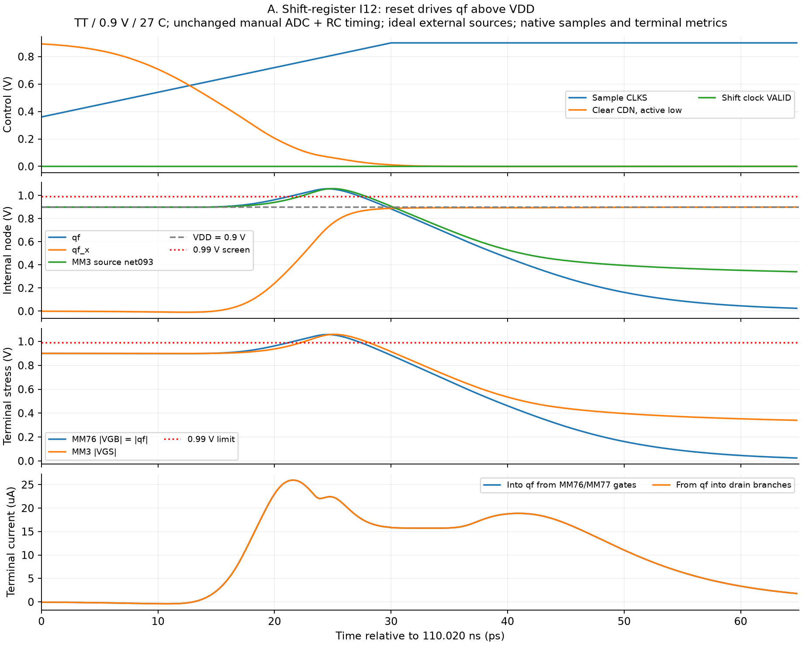
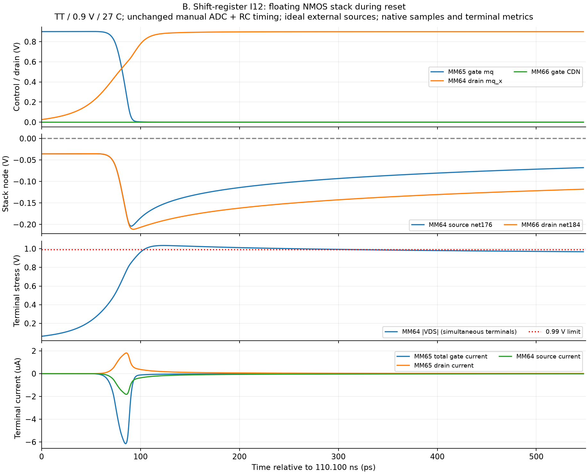
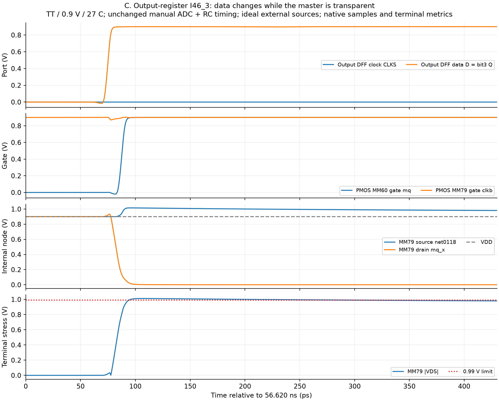

# 标准单元内部端压：复位耦合、浮置串联节点及理想延时复核

结论：在当前 TT / 0.9 V / 27°C 的手搭 ADC 网表中，超限并非同一种现象。已确认复位时的短促正向耦合、复位随后发生的 NMOS 串联节点下冲，以及转换期间数据变化引起的 PMOS 串联节点上冲。既有首帧现象，也有下一帧重复现象。当前结果是现有模型下的端压筛查，不能由此宣布整个标准库不可用，也不能把告警忽略成无害。

本轮保持 `joined_dc_v1/dut.scs` 和外部源不变，只增加内部电压/部分端口电流保存，将时长截取为120 ns。覆盖34个单元、820只MOS：8个DFCNQD1移位寄存器、24个DFQD1数据/输出寄存器、复位反相器及比较时钟缓冲器。其余组合门内部与模拟器件不在本次新增逐管扫描内。使用同一时刻的六组端电压差、0.99 V阈值；59只被测MOS有至少一组超限。代码142仍正确。

## 具体器件和阶段

表内路径均以 `XADC.XL.` 开头。数值来自全部原生时间点，持续时间采用阈值交叉插值。

| 阶段 | 代表器件及节点 | 实测 | 判断 |
|---|---|---|---|
| 首次复位约10.044 ns；第二次复位约110.045 ns | I5–I12 的 qf、net093；MM76、MM4、MSLTn1、MM3，部分状态下MSLTp1 | 首帧I12.qf=1.06124 V；MSLTn1及MSLTp1的\|VDS\|=1.06137 V；第二帧qf约1.058 V；每次超限约6 ps | CDN拉低使qf_x快速升高，经相关MOS门电容将qf推过VDD，随后下拉支路恢复 |
| 第二次复位110.19–110.42 ns | I6–I12 的 MM64，代表I12.net176 | net176最低−203.874 mV；MM64最大\|VDS\|=1.034207 V，超限213.910 ps | 内部mq下降时，已关闭的串联支路中间节点被负向耦合；恢复有限 |
| 转换期间约54–59 ns | 多个DFQD1，代表I46_3.MM79 | net0118最高1.015488 V；MM79最大\|VDS\|=1.012065 V（56.7266 ns），超限211.160 ps | 数据变化、主锁存器跟随，PMOS串联节点受到正向耦合后暂时浮置 |

其他例子：I46_7.MM79最大1.012035 V；I42.MM1最大1.007550 V，I40.MM1最大1.007545 V。全部器件、端压、时间与区间见 [stress_summary.json](stress_summary.json)。原生日志每类只显示有限次数，不能把显示出的告警清单当作完整清单。

### A：复位瞬间 qf 上冲

从上到下是复位信号、内部节点、实际器件端压、qf节点的端口电流。例图为第二次复位，比较器和VALID均未工作。

CDN下降后，复位PMOS把qf_x拉高。qf连接到MM76/MM77的栅极，同时连接到MM4/MM3和传输门的漏端。测得MM76/MM77总栅端电流向qf注入电荷，峰值约数十µA，与qf上冲同步；下拉支路随后将qf拉低。图中两组电流按qf节点KCL方向绘制，因此接近重合；它们包含位移电流，不能当作直流漏电。

这批告警在第一次比较之前就已发生，且110 ns再次发生，排除了“只在启动出现”或“由首次比较器判决反冲触发”的解释。补存内部节点后，首次复位前的锁存初态和原仿真的个别实例分布不同；不能把首帧逐实例峰值视为原波形的精确复制。第二次复位已经历确定的一次转换，是更有代表性的证据。

### B：复位后的 net176 下冲

MM64的端子是 `(mq_x, clkbb, net176, VSS)`；MM65为 `(net176, mq, net184, VSS)`；MM66为 `(net184, CDN, VSS)`。

复位使CDN变低、MM66关断；VALID保持低，clkbb也低、MM64关断。随后上一级Q清零，传到本级D，使内部mq下降。mq通过MM65的寄生电容将串联中点net176/net184拖到地以下，节点缺少强恢复通路。mq_x同时向0.9 V上升，形成MM64漏源超限。

自然对照是I5：它的D固定接VDD，mq在此次复位期间没有同样的高到低变化，没有出现I6–I12那样的MM64漏源超限。说明负向耦合依赖内部数据变化与复位关断状态的组合，不只是公共CDN边沿。

**不能用0.9 V减去最低−0.204 V，宣称VDS=1.104 V。** 两个极值不在同一时刻；实际逐点计算的最大VDS是1.034207 V。

### C：转换期间输出寄存器内的正向浮置节点

I46_3是bit3输出寄存器。此时其时钟CLKS一直为低，没有输出锁存边沿，但主锁存器仍跟随D。D上升后，内部mq上升、mq_x下降。MM60的栅极mq升高，关断PMOS并把中间节点net0118向上耦合；另一个PMOS MM79的栅极clkb也处于高电平。串联中点暂时浮置，导致MM79源端超过VDD而漏端接近零。

因此“输出寄存器还没到采样沿，内部就不会变化”不成立。图C证明这类超限可以由数据沿触发，延长比较间隔只增加恢复时间，不保证减少第一次峰值。

## 修改方案：按根因分开做

1. **保持外部采样时钟、窗口和关闭沿，先单独调整CDN驱动边沿。** 在本地复位分发处试较弱的原生缓冲档位/受控slew，针对A类qf尖峰；检查清零完成时间、下一次恢复/移除裕量及码字。不能预先承诺它也会消除B、C。
2. **B类优先做复位顺序对照。** 先清I5，再在前级Q及本级D/mq已建立后清I6，依次推进；全部在采样窗口早段完成，关闭沿保持不变。目的是避免“本级CDN已关断接地支路时，D/mq还在下降”。这是待验证的局部复位分发方案，尚未改变候选；还要核对CDAC复位期间的建立与注入。单纯放缓公共时钟不一定能改变内部再生沿。
3. **C类先在单个DFQD1上复现实际D沿和负载，再筛原生标准单元备选。** 比较同逻辑、不同驱动档/内部实现的FF，以及受控D沿对内部mq再生速度的实际影响。优先选择经相同模型验证的原生单元；不修改库内部MOS、不加入隐藏钳位或提高SOA阈值来宣称通过。若输入整形后内部再生沿仍一样，就停止无效的外部RC调参。
4. 并行核对库版本与当前PDK模型的正式匹配、输入slew/负载及动态应力适用条件。既有资料尚未证明正式配套，当前0.99 V是活跃模型的端压告警阈值，不能擅自解释成允许短脉冲，也不等同于已完成寿命评估。此项不阻止上述模块定位实验。

## 理想 delay 为什么变成了 RC

**理想延时确实存在，RC不是必要条件，也不是等价替换。** 本机Spectre21.1的 `-h delay` 明确给出四端口电压传输延时：输出零阻抗、输入无限阻抗，输出是输入推迟td后的波形。原网表端口顺序正确。

上轮 `manual8-logic-codes-v2` 在XDUT.net32（首位逐位延时输出）约10.142 ns首次报告不连续和最小步长，最后在54.1671 ns报SPECTRE-16928退出。为了继续功能检查，当时用17个RC替代了17个delay位置；这仅绕开了那次数值失败，不能证明原delay不可用。

本轮使用同一120 ns短测试台做匹配对照：

| 运行 | 最大步长 | 结果 |
|---|---:|---|
| manual8-delay-control-v1 | 200 ps | 原生0错误，首个码0正确；仍有SPECTRE-16780 |
| manual8-delay-maxstep-v1 | 5 ps | 原生0错误，首个码0正确；仍有SPECTRE-16780 |

两者原生reltol均1e-6、gear2only。因此不能断言“200 ps就是失败根因”，也不能宣布理想delay已在长序列中修好；短测试的stop窗口和初始数值条件与原25.62 µs案例不同。它们证明理想delay可以继续作为验证主线，应该定位不连续的来源、必要时采用明确传输延迟/有限边沿的行为实现，而不是因一次失败直接换实际RC。

RC的低通时间常数会改变边沿，反馈运行时其电容并非每次充分充放电；所以本候选名义2 ns参数下，闭环相邻比较实际只有约0.6 ns。该结果不能当作理想2 ns延时方案的时序验收。**上轮把RC候选推进到合龙过早：RC版的码字和功耗结果保留为该候选证据，后续应恢复理想延时主线并重新核算时序。** 本轮未改OA，也未把任何修复方案设为新基线。

## 证据身份

- `manual8-stress-baseline-v1`：保存内部节点/电流的120 ns补测，网表与上一轮合龙候选相同；原生0错误，29条显示警告，重复警告仍保留。
- `manual8-stress-zoom-v1`：绑定上项已完成源的analysis-only，在指定窗口导出**全部原生点**，三张图无时间降采样；所有峰值/持续时间来自全120 ns原生数据。
- 两个ideal-delay对照均已完成回收，未覆盖原失败案例。
- 连接映射：[native_cell_connectivity.json](native_cell_connectivity.json)；逐管结果：[stress_summary.json](stress_summary.json)；生成/分析/绘图脚本：`scripts/manual_adc/stress_*.py`。
- 当前方案未包含全PVT、噪声、失配、PEX；本轮定位完成不代表修复完成。
