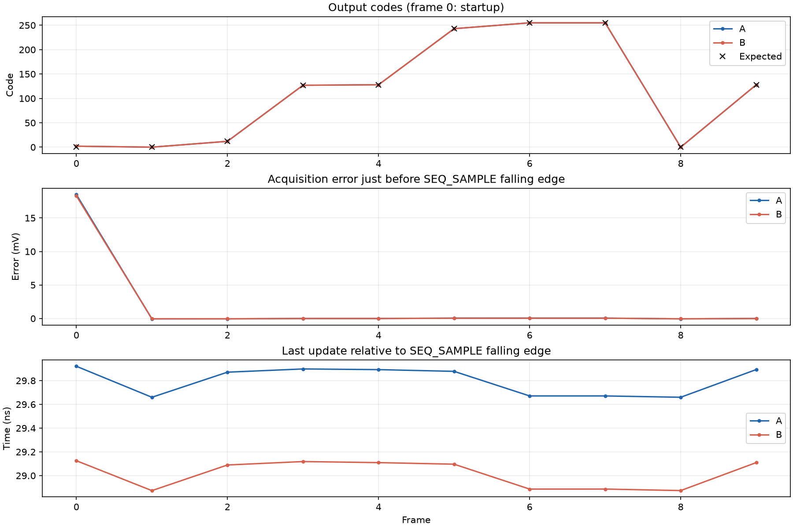
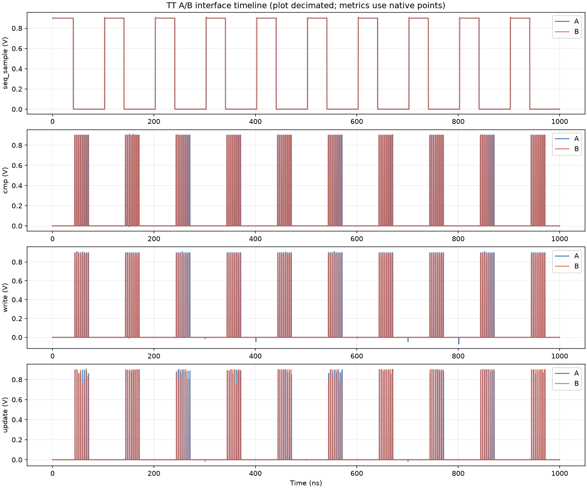

# Frozen Mmain2/L90 A/B TT short result

A: historical custom logic. B: isolated native standard-cell migration. Same 0.9V/27C/10MS/s stimulus and loads.
Stress deferred; not electrical qualification. Frame0 startup is separately reported. No FFT/PVT/MC conclusions.

|Frame|Expected|A code|B code|A timing|B timing|SEQ close B-A ps|
|---|---|---|---|---|---|---|
|0|0|2|2|True|True|5.123|
|1|0|0|0|True|True|5.201|
|2|12|12|12|True|True|5.167|
|3|127|127|127|True|True|4.547|
|4|128|128|128|True|True|4.547|
|5|243|243|243|True|True|5.167|
|6|255|255|255|True|True|5.201|
|7|255|255|255|True|True|5.200|
|8|0|0|0|True|True|5.200|
|9|128|128|128|True|True|4.548|

Full native edge lists and measured-reference DAC tail margins are in a/result.json and b/result.json. Tail metrics are not ideal DAC accuracy. Bootstrap VGS0.45V crossings are diagnostics, not physical turnoff thresholds.
Actual settings: `{"reltol": "100e-09, default 100e-06 (conservative)", "maxstep": "10 ps, default 10 ns (conservative)", "abstol(V)": "10 nV, default 1 uV", "errpreset": "conservative_sigglobal, default moderate", "abstol(I)": "100 fA, default 1 pA", "method": "gear2only"}`.

Figures generated; visual review pending. No candidate adoption or circuit change.
