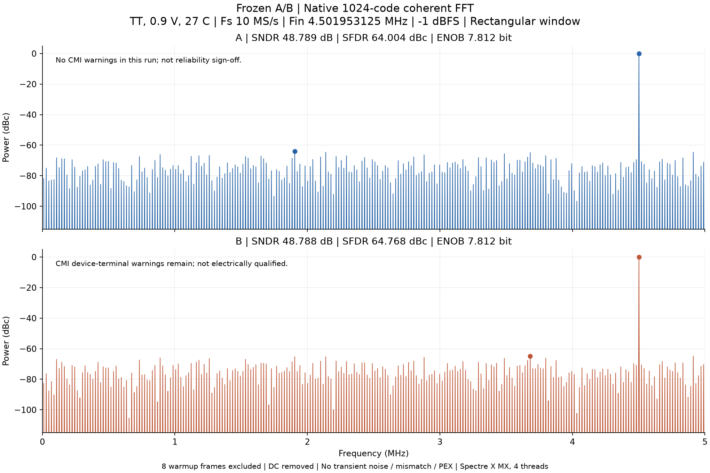

# 冻结 A/B 版本：TT 1024点频谱

A为自建数字门版本，B为相同模拟核心接原生数字标准单元版本。两版均为本次冻结网表的实际输出码，不引用旧R4指标。

TT、0.9 V、27°C，10 MS/s，输入4.501953125 MHz、−1 dBFS；连续运行1032帧，排除前8帧后取1024点。矩形窗、去直流、基波bin461。

|指标|A|B|
|---|---:|---:|
|SNDR|48.789406 dB|48.788077 dB|
|SFDR|64.003984 dBc|64.767792 dBc|
|ENOB|7.812194 bit|7.811973 bit|
|最大转换时间|30.217791 ns|29.435806 ns|
|核心+参考功耗估计|138.620922 µW|86.530560 µW|
|SNR（排除H2–H5）|48.818303 dB|48.805610 dB|
|THD（H2–H5）|-70.573135 dB|-72.736110 dB|

B−A：SNDR -0.001328 dB；SFDR +0.763807 dB。1024点中20个码不同，最大差1 LSB；差异本身不等于错码。

全部1032帧与原始波形独立解码一致；8次比较、8次写入、8次更新、16次捕获及稳定性标志均通过。频谱由原生分析器、NumPy和ADCtoolbox 0.9.1交叉核对；Parseval能量检查通过。ENOB=(SNDR−1.76)/6.02，未按−1 dBFS补偿。

[A版12图](a_toolbox_panel.png) · [B版12图](b_toolbox_panel.png) · [数值与验证](results.json)

## 告警与限制

- A本次日志没有CMI；B保留CMI-2751至2755。两者均不因此认定可靠性合格。
- 原生Spectre设置为MX、reltol=1e-6、trap、maxstep=10 ps、4线程；此前短测与CX对照不代表整个1024点记录已证明等精度。
- 无瞬态噪声、失配、抖动或版图寄生，外部源理想。SNR中的残差含确定性量化及未排除失真，不能称为热噪声实测。
- 功耗由10 ps保存点积分，未完成积分网格收敛；核心+参考不含理想输入源和时钟驱动，时钟项单列于results.json。
- 12图中的残差是输出减正弦拟合；不是输入时钟边沿误差，不能代替全码DNL/INL。全码扫描仍在运行。

## 运行身份

- A：`sar8camp-a-tt-fft1024-mm-v1`，DUT SHA256 `41d5444c4fcc3f26b097cca609474804afde2e61616c424c8a0cb8a5b2f298c4`。
- B：`sar8camp-b-tt-fft1024-mm-v1`，DUT SHA256 `f31b66c8fb35003bf7e8ad1a23d9c230b39f1f9651ccc469953e5e52ecf493ea`。
- 回收文件及校验见a_collection.json、b_collection.json；完整输出码见a_codes.csv、b_codes.csv。
