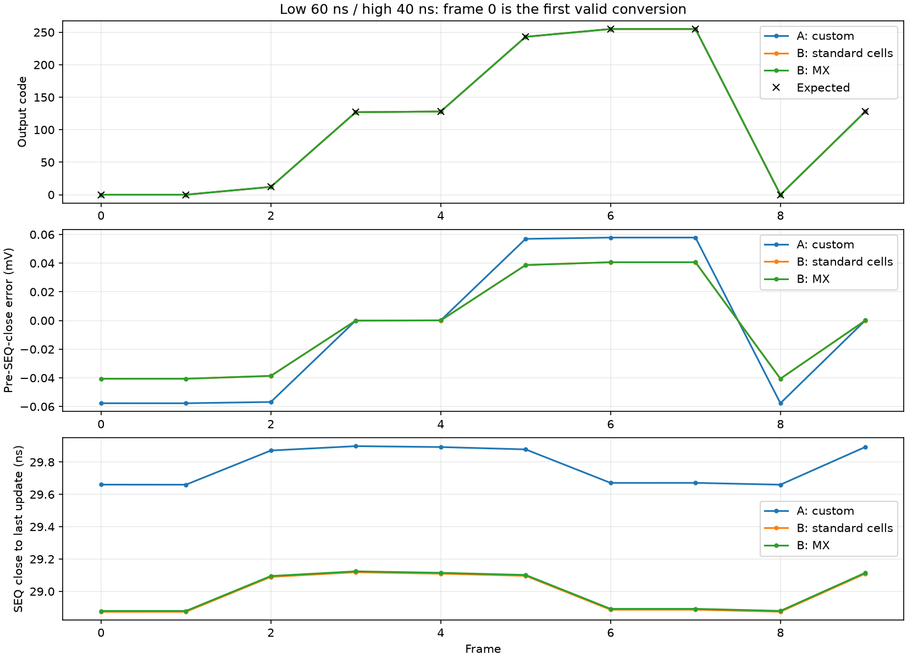

# A/B phase60 与 CX/MX 回收对比

A 为 Mmain2/L90 自建数字门冻结版，B 为相同模拟电路加标准单元数字逻辑。TT、0.9 V、27°C；初始低60 ns、高40 ns，周期100 ns。

|帧|目标|A|B|SAMPLE_INT B−A (ps)|SEQ_SAMPLE B−A (ps)|A转换 (ns)|B转换 (ns)|
|---|---|---|---|---|---|---|---|
|0|0|0|0|4.927|5.200|29.6604|28.8736|
|1|0|0|0|4.927|5.202|29.6599|28.8736|
|2|12|12|12|4.927|5.167|29.8713|29.0895|
|3|127|127|127|4.927|4.547|29.8984|29.1185|
|4|128|128|128|4.927|4.547|29.8927|29.1095|
|5|243|243|243|4.927|5.167|29.8782|29.0962|
|6|255|255|255|4.927|5.201|29.6711|28.8866|
|7|255|255|255|4.927|5.200|29.6711|28.8867|
|8|0|0|0|4.927|5.200|29.6599|28.8741|
|9|128|128|128|4.927|4.548|29.8933|29.1098|

全部有效帧（含首帧）的码字、事件次序/计数和原生观察器交叉校验：`{"a": true, "b": true, "cm": true, "mm": true}`。

|案例|仿真耗时(min)|相对B严格CX速度|实际reltol / method|数值诊断|
|---|---|---|---|---|
|a|35.413|0.979x|100e-09, default 100e-06 (conservative) / gear2only|reference|
|b|34.659|1.000x|100e-09, default 100e-06 (conservative) / gear2only|reference|
|cm|34.413|1.007x|100e-09, default 100e-06 (conservative) / gear2only|True|
|mm|5.136|6.748x|1e-06, default 1e-03 / trap|True|

cm诊断差异：`[]`。

mm诊断差异：`[]`。

四个新增 Bootstrap 内部保存名大小写错误，原生日志明确忽略，原分析因此退出。现以独立 analysis-only 运行重用原始波形，缺失内部电容电压记为 null；并未补造预充电内部波形。功能/时序所需原生信号完整。
原高电平启动的 A/B 首帧均为2而非0；相位调整后首帧0及后续9帧均须单独检查。本测试是DC初始化，不含电源爬升/POR验证。
建立诊断采用每位下次比较前实测DAC值为参考，不是理想DAC精度。求解器短测容差不等于全码/FFT精度证明；耗时包含服务器竞争。
过压告警保留，本轮按用户要求不作电气合格判定；无噪声、失配或PEX。
原有限接力程序因分析失败停止；后续执行状态另行记录，不由上述结果推断。

本次后续执行：已选择B＋MX，并提交连续1024点FFT及SS冷/SS热/FF冷/FF热四个关键码测试；TT短测作为第五点。新接力位置为原campaign下的 `continuation-v2/`，使用原完成仿真绑定的重分析结果，原失败和原始波形均保留。详细提交状态见 `priority_submission_status.json`。

A/B源参考预关闭最大误差分别为0.057842/0.040645 mV；首帧关闭后200ps误差为0.445530/0.437160 mV。每位相对实测目标的最小安静裕量为513.190/464.325 ps：B转换更快，但不能据此称所有建立裕量均增大。MX与B严格CX该裕量最大差9.284 ps。

图像已查看，标签和曲线可读。缺失内部预充电电压不影响已有功能时序信号的解码，但不能据此给出内部Cboot充电量结论。
