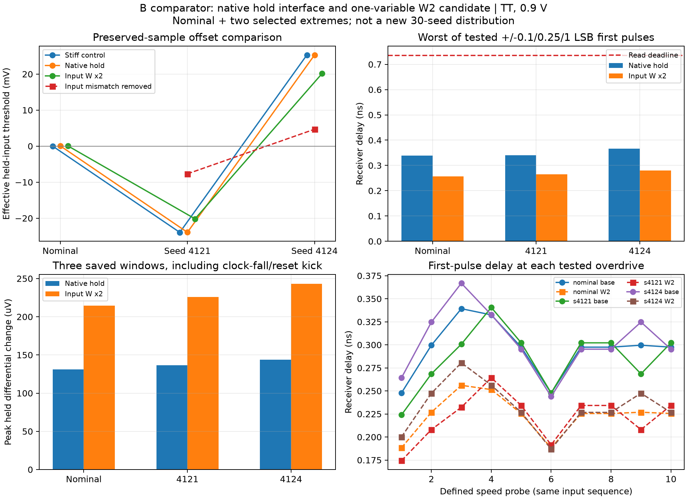
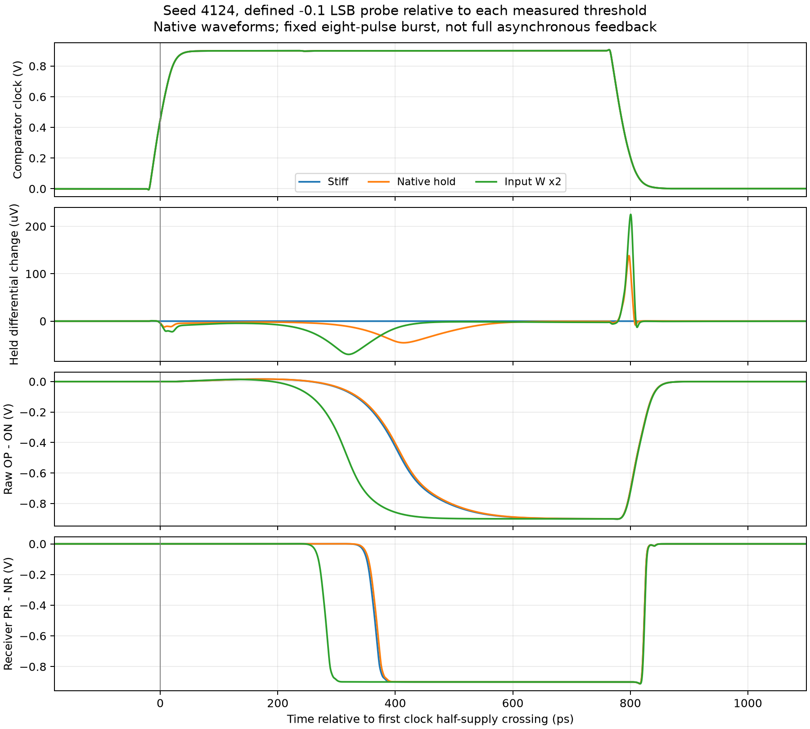

# 比较器真实保持输入复现与单变量候选

结论：真实保持输入没有消除原比较器失调，输入对是主要来源。合法W2候选使两个
极端样本幅度分别降低15.7%／20.2%，仍约±20.18mV（约2.87LSB），尚不足以采用。
已测速度探针最坏判决时间由0.367ns降至0.280ns；三个保存窗口内、包含复位沿的
差分反冲峰值由0.144mV增至0.243mV，存在明确权衡。后续应继续优化输入对有效面积
并定位其余支路，不能将这三组当作新30seed标准差或良率。

原冻结B保持不变。本轮保留名义、seed4121和seed4124的同一组随机参数，接入原生
Bootstrap、18个MOM和CDAC开关；输入/参考50Ω与参考4pF旁路保留。外部时钟仍为
先低60ns、高40ns；内部时钟重放整机实测八脉冲。首脉冲宽0.7855ns，下降沿前50ps
读判决。固定N侧低参考、P侧高参考底板字，新增前端为名义器件，未接完整SAR反馈。

| 样本 | 低阻对照门限 | 真实保持门限 | 仅去掉输入对失配 | 输入宽度×2 |
|---|---:|---:|---:|---:|
| nominal | 0.000 mV | 0.063 mV | — | 0.063 mV |
| s4121 | -23.937 mV | -23.927 mV | -7.684 mV | -20.179 mV |
| s4124 | 25.312 mV | 25.302 mV | 4.686 mV | 20.179 mV |

原始极端样本接入保持输入后，门限与低阻对照区间重叠，差异小于0.125mV搜索
分辨率；有限保持/反冲没有消除数十mV失调。输入对名义化后幅度明显缩小，说明
输入对是主要来源，其余支路仍有残余。分组试验核对其余89行随机参数完全一致，
完整比较及W2候选核对91行完全一致；没有仅凭相同seed号假定同样本。

W2只改两只输入管的宽度1µm→2µm，L=30nm、nf/multi不变，扩散面积/周长/方块数
按该宽度派生。仅测试这三个选定样本，未重新测30seed标准差、PVT、完整ADC或功耗，
没有采用为基线。速度/反冲及具体改善量见summary.json；不能据三组宣布良率通过。

名义低阻台恰好0V差分时，无噪声、对称电路未在判决窗内决出符号，原二分搜索
如实保留为无效门限。另用±62.5µV两帧均正确判决，将名义门限约束在该区间，
没有强行给0V指定输出。保持前主管VGS为负，源与顶板未被VA直接钳住。

数值复核只将名义保持台reltol从1e-6收紧到1e-7，其余不变。门限区间、速度差异
及真实告警见summary.json，所有原始LTE告警保留。CMI-2732在这里指诊断钳位电阻
1e18Ω被截为1e12Ω，并非端压告警；按实际1e12Ω解释，即使1V压差保持40ns、1pF
电容，泄漏漂移上界也仅0.04µV。原脚本限制继承导致的三个分析启动失败、网络
中断和初组源共模误设0.449V均保留；通过绑定原完成源补分析，未重跑这些仿真。

宽度4µm的三组尝试因超出模型Wmax=2.7001µm而在瞬态前被拒绝（CMI-2440），失败记录保留；本报告的有效候选为2µm。
完整运行身份和回收哈希见各results目录及collections文件。端压可靠性未签核。
