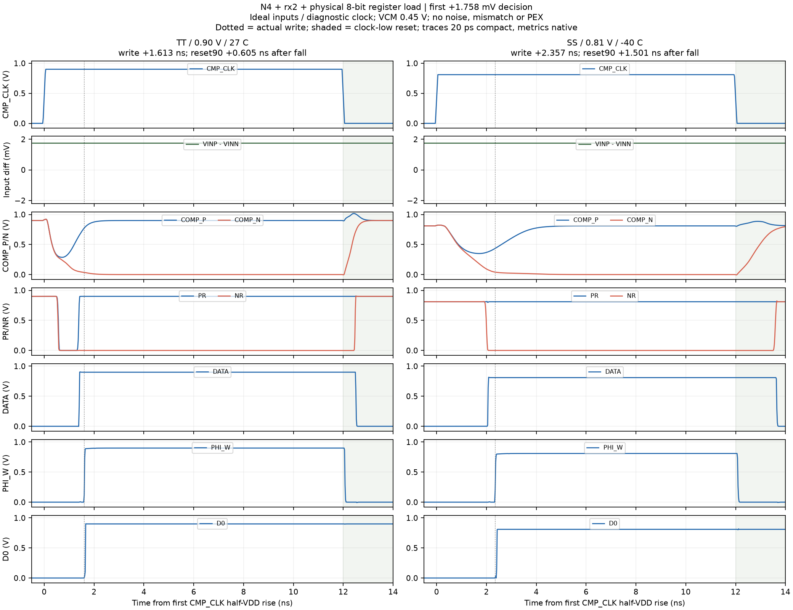

# N4/rx2 D2：TT 与 SS 冷角本地复核

两例六次写入均与预期极性一致，2,802个端压检查项均无超限。该结果限于理想输入／诊断时钟测试台。

| 次序／输入 | TT时钟→write ns | SS冷时钟→write ns | TT DATA领先 ns | SS冷 DATA领先 ns |
| --- | ---: | ---: | ---: | ---: |
| 1／+ | 1.613 | 2.357 | 0.207 | 0.295 |
| 2／+ | 1.605 | 2.292 | 0.208 | 0.295 |
| 3／- | 1.612 | 2.290 | ≥1.612 | ≥2.290 |
| 4／+ | 1.605 | 2.292 | 0.207 | 0.295 |
| 5／- | 1.612 | 2.290 | ≥1.612 | ≥2.290 |
| 6／- | 1.612 | 2.290 | ≥1.612 | ≥2.290 |

DATA领先以原生半电源交越定义。负输入时DATA本周期已经为低且没有交越，表中只给从比较沿开始的下界；不能借用上一周期的边沿算成精确setup裕量。尚未分配或验证setup/hold。

原样sar8p_bit.XSTORE的CK直接接PHI_W；DFF为正沿主从结构。六次PHI_W上升沿即六次外部寄存器时钟沿。四次需要变码的D0均在写入后出现正确交越，两次重复码没有必要翻转。D0在write瞬间仍可能是旧值，不能据此判失败。内部CKB关闭主锁存器的精确采样孔径没有原生交越记录，故不声称内部孔径／setup-hold已验收。

| 实测项 | TT | SS冷 |
| --- | ---: | ---: |
| reset后四节点持续恢复至90%VDD／ns | 0.605–0.605 | 1.501–1.501 |
| 完整260ns VDD能量／pJ | 2.189795 | 1.276132 |
| 本诊断占空比平均VDD功率／µW | 8.422 | 4.908 |
| 原生时间点 | 100514 | 97630 |
| 端压超限项 | 0 / 2802 | 0 / 2802 |

90%只是复位电平的测量定义，没有新设复位时限。六次输入更新前及比较前均观察到四节点达到该电平。能量来自完整0–260ns原生梯形积分，已核对积分器区间和原生步数；没有重新回收原始大波形作第二次积分。这是467管模块及初始复位／空闲的VDD能量，不是整机或单独比较器功耗。

原生日志均为tran_d PASS、exit0；只有VACOMP-2435（弃用环境变量）和四条SFE-1131（继承模型scalefactor重复定义），没有CMI或收敛放宽告警。实际reltol=1e-7、maxstep=5ps、gear2only；日志明确禁用多线程，不能声称实际四线程加速。

TT首轮PR/NR同时低的原生区间为比较沿后0.570–1.383ns。CLK打开尾管后，两原始输出先共同下落，再由再生抬回正确一侧；TT两接收输出都发生下降交越，SS冷的PR没有下降半电源交越，因此没有同样的00阶段。这是当前动态响应的区别，不能反推已测得DC接收门限。00和预充态11的XOR均为0。两例RAW、RAW_D、DEC、PHI_W均各6次上升，每周期一次，未观察到重复有效或复位写入；台内没有独立DONE输出。原生半电源事件不能证明不存在更小的模拟脉冲，也不能外推全部输入/PVT。

TT首轮RAW/RAW_D/DEC/write分别在21.4540/21.6032/21.6255/21.6631ns上升，DATA在21.4560ns上升。207ps领先由DATA短路径与延迟RAW→DEC→write长路径形成，属于本例路径差。尚未测量寄存器真实setup/hold要求和内部CKB孔径，因此不能据此称setup已通过；SS约295ps同理。

图展示首个正输入周期；完整六周期数值与回执散列见TT_review.json和SS_cold_review.json。SS冷角首次较后续略慢，应保留历史差异，不用后续周期覆盖首轮。理想源钳住输入，因此本图不测kickback；噪声、失配、全共模与整机异步时序仍未验证。
