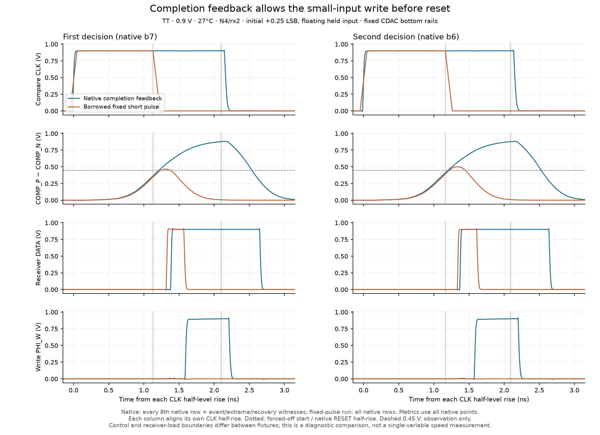
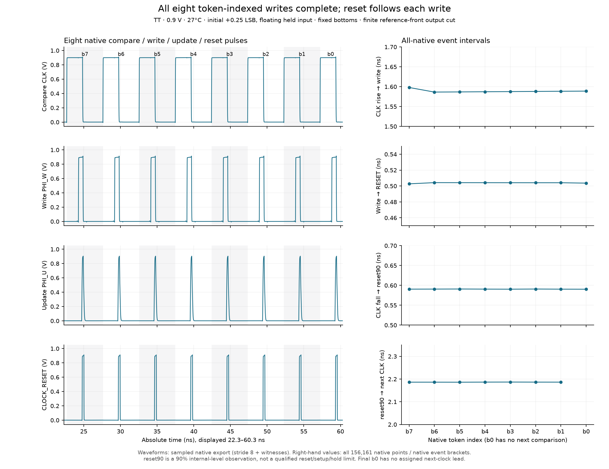
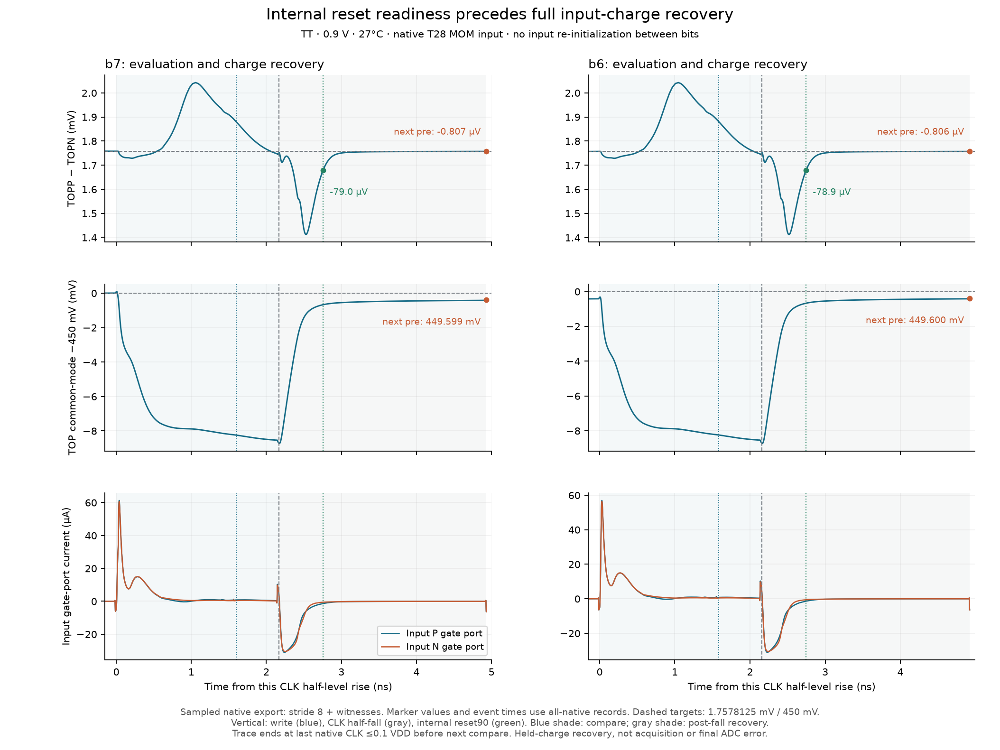

# 原生反馈：八次小输入判决完成

**结论限于本测试台：** TT、0.9V、27°C下，初始设定+0.25LSB（1.7578125mV）残差，18.1ns断开初始化后让MOM输入浮置保持，完成八次真实接收、写入、更新和复位；token依次为7→0，逐位D寄存器历史正确。D最终为全1是持续正残差的预期，不能当作ADC满量程码或全ADC精度结果。

## 为什么比人为短脉冲完整

旧诊断在CLK半电平上升后1.129/1.163ns就开始强制关断，没有产生PHI_W；关断后DATA短暂变高也不等于成功写入。恢复原生链后，接收有效信号经原生延时产生PHI_W，再经写入延时产生PHI_U，随后由CLOCK_RESET和SR触发时钟下降。写入正确性由后续原生D快照核对。

- CLK半电平上升→PHI_W半电平上升：**1.586–1.598ns**。
- PHI_W上升→CLOCK_RESET上升：**0.503–0.504ns**，随后CLK下降。
- CLK半电平下降→内部90%恢复：**0.590–0.591ns**；到下一CLK半电平上升还剩约**2.186–2.187ns**（末位没有下一次比较）。

这是原生接收/写入链触发复位的证据。新旧测试台的控制器、接收负载和时钟边沿也不同，因此不是严格单变量的速度比较。

该链仍含原生RC延时：PHI_U不是寄存器完成或参考建立的独立确认；QUIET加延时启动下一轮，也不检测TOP电荷是否恢复。

## 每位时序

| bit | CLK→写入/ns | 写入→RESET/ns | CLK下降→reset90/ns | reset90→下一CLK/ns | 下一次比较前差模残留/µV |
| --- | ---: | ---: | ---: | ---: | ---: |
| 7 | 1.598 | 0.503 | 0.590 | 2.186 | -0.807 |
| 6 | 1.586 | 0.504 | 0.591 | 2.186 | -0.806 |
| 5 | 1.587 | 0.504 | 0.591 | 2.186 | -0.807 |
| 4 | 1.587 | 0.504 | 0.591 | 2.186 | -0.807 |
| 3 | 1.588 | 0.504 | 0.590 | 2.187 | -0.807 |
| 2 | 1.588 | 0.504 | 0.591 | 2.186 | -0.806 |
| 1 | 1.588 | 0.504 | 0.590 | 2.186 | -0.807 |
| 0 | 1.589 | 0.504 | 0.590 | — | 末位无下一比较 |

以上是观测事件间隔，不是已经签核的setup/hold或reset最小裕量。事件使用相邻原生点的0.5VDD交叉估计；reset90要求COMP_P/N、X/Y、PR/NR≥0.9VDD且RAW、DEC、CLK≤0.1VDD，它只是分析定义，并未作为控制检测器。下一比较前快照取最后一个CLK≤0.1VDD的原生点，该阈值也不是晶体管真正开始响应的边界。图中小于ps的差异不作物理速度结论。

## 顶板反冲与恢复

比较期顶板共模明显下降，关断又产生输入栅端口电流和电荷恢复。这些动态并未消失。两路栅端口电流大体同向、同幅，对应以共模为主的反冲，关断反向电流对应回充；总端口电流不能直接拆成独立Cgd/Cgs贡献。两TOP节点的完整端口KCL最大残差约0.09pA。

第一轮内部达到reset90时，差模相对目标仍为**-79.0µV**；下一次比较前已回到**-0.807µV**，共模为**449.599mV**。所以内部预充恢复不等于输入电荷完全恢复。图中的关断凹陷属于上一轮比较后的反冲/恢复，不是采样获取阶段的未建立，也不能直接换算成最终ADC误差。

## 条件与尚未证明的事

- 1457MOS测试台；18个原生CDAC MOM、固定底板/理想参考，临时初始化18.1ns后完全断开；仅SAMPLE_INT启动边界。
- 参考接收/捕获和BBM保留；32个参考驱动首级输出切口显式零外部扇出。没有真实参考切换和完整ADC负载耦合。
- 所选165MOS/990项端压无超限；其余1292MOS/7752项波形筛查未完成。原生CMI日志保留，不等于寿命签核。
- 本地VDD端口0–100ns能量为**10.912755pJ**，包含本测试台控制/捕获负载，不能作为整机功耗结论。
- 无瞬态噪声、失配、PVT覆盖或版图寄生。原生日志的SFE-1131、VACOMP-2435和HOLD_P的Jacobian/DC提示均保留。

所有指标来自156,161个原生点。展示波形仅19,924行：每8个原生点取一行，并保留475个事件/极值/恢复见证时刻。完整导出范围0–100ns；图1按各自CLK沿对齐，图2裁出22.3–60.3ns，图3裁出首两轮比较与复位。图中连线只是显示连接，不是重新生成仿真数据。回收7文件/7,290,320B及gzip、解压行、绑定均复核；两遍原始数据SHA一致。

**下一项最必要验证：相反判决历史到小残差的恢复。** 在相同原生反馈/MOM负载下，用受控电荷变化构造“先负大差模、再正0.25LSB”及其对称历史，核对小输入极性、写入和复位恢复。这比连续八次同极性更能暴露上轮判决记忆；本次不建包或仿真。
