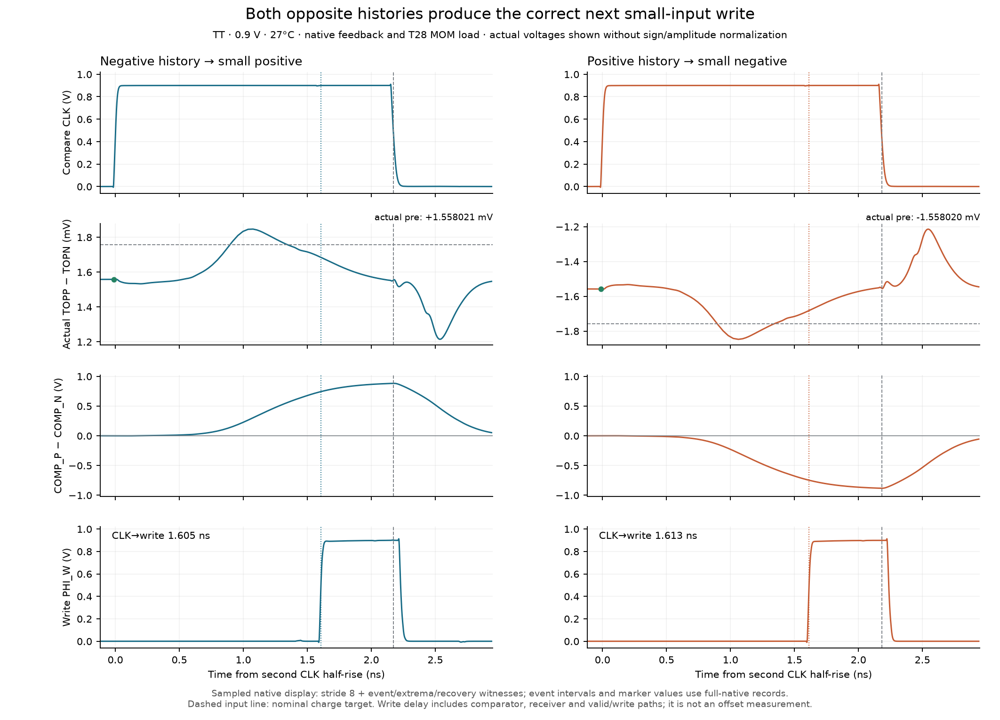
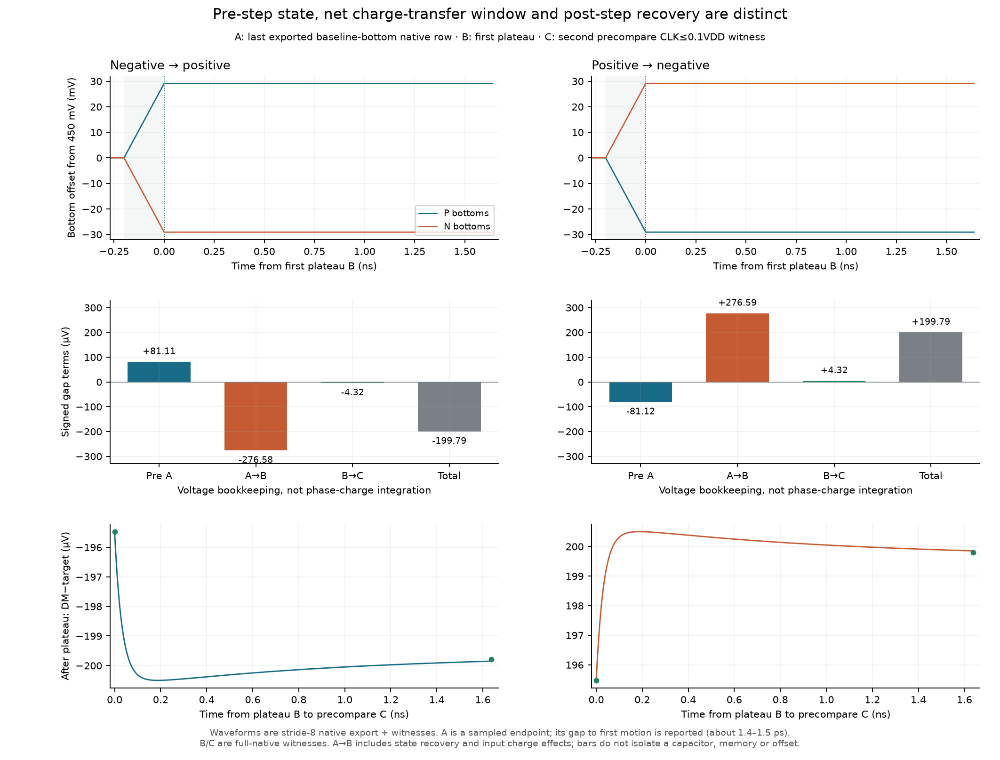

# 对称判决历史：两方向均完成，约200µV是输入电荷目标差异

**结论限于这个TT条件测试台：** 两组都在前次相反大残差判决后，对实际约±0.221585LSB的小输入正确写入；各有八次写入/更新/复位。实际TOP未重新钳位，也未按名义0.25LSB归一化。

| 历史 | 实际第二次差模/mV | 共模/mV | CLK→写入/ns | 实际−名义目标/µV |
| --- | ---: | ---: | ---: | ---: |
| 负→正 | +1.558021 | 449.591069 | 1.604954 | -199.792 |
| 正→负 | -1.558020 | 449.590950 | 1.612582 | +199.792 |

实际小残差大小近似镜像；这不等于offset或history memory为零。两次写入延迟相差约7.63ps，包含比较器、接收与有效/写入链；没有按段量分或做阈值搜索，不能归为纯比较器阈值/再生差异。

## 用已有点区分三个阶段

A取“首次运动前，底板仍为450mV的最后一个**已导出原生点**”；B是全原生记录的首个平台点；C是第二次比较前CLK≤0.1VDD的全原生见证。A不是声称的最后一个求解点，选点到首次运动相隔约1.4–1.5ps。

    C−名义小目标 = (A−名义大目标) + [(B−A)−名义步进] + (C−B)

实际底板实现与名义步进的剩余差仅为浮点舍入量，保留在JSON账目中。以下是端点电压账目，不是逐原生点相位电荷积分。

| 历史 | 阶跃前状态 A−初始目标/µV | A→B净转移偏差/µV | 平台后恢复 B→C/µV | 合计目标差/µV |
| --- | ---: | ---: | ---: | ---: |
| 负→正 | +81.11 | -276.58 | -4.32 | -199.792 |
| 正→负 | -81.12 | +276.59 | +4.32 | +199.792 |

- **阶跃前项**包含初始设定偏差、首轮反冲与复位后电气恢复，不能单独称作memory。初始设定误差本身只有约±0.246µV。
- **A→B项**是实际端点电压变化与仅MOM权重预测的差。其间输入门电荷及既有恢复仍在变化，不能把整项等同纯电容耦合损失。
- **B→C项**是底板恒定后的实际恢复，约±4.32µV；末端见证也可能包含下一CLK边沿的早期耦合。

A→B实际差模转移分别约+57.731231/−57.731219mV，MOM权重的名义步进为±58.007813mV。这里称“端点有效转移”，不把它当成已经提取的静态电容比。

表格额外数字仅供复核，不代表亚容差的物理精度；子项也会随A的选点时刻改变。

| 历史 | A时刻/ns；距首次运动/ps | A差模/mV | B差模/mV | C差模/mV | A/B/C共模/mV |
| --- | --- | ---: | ---: | ---: | --- |
| 负→正 | 24.878968；1.433 | -56.168891 | +1.562340 | +1.558021 | 449.475114 / 449.506004 / 449.591069 |
| 正→负 | 24.879531；1.493 | +56.168878 | -1.562341 | -1.558020 | 449.475096 / 449.506000 / 449.590950 |

因此，约200µV不能全归为history memory或offset。它已经体现在判决前的模拟TOP电压中。比较器阈值需要在已知实际输入、可比共模/历史条件下单独测量；本次只证明这两个实际小输入被正确接收。

## 边界与证据

TT、0.9V、27°C；1457MOS/18个原生MOM，原生异步反馈；TB仅监听事件并驱动位电容底板，dummy固定、TOP初始化后浮置。32个参考首级输出仍是有限切口。无PVT、失配、瞬态噪声或全ADC精度结论。

两组均为165MOS/990项选定端压0超限；完整1457MOS/8742项波形筛查仍未完成，完整超限数为null。原生CMI、日志与原始波形均保留；未追加仿真。

数值判决/端压指标使用各组全部原生点。图为stride8加事件/极值/恢复见证；端点账目明确使用A/B/C，未从取样电流重新提取电荷。各组原生日志、receipt与导出gzip/行SHA均复核。原始冻结包未改。

- 负→正：154,820原生点，19,773展示行，482个见证时刻。
- 正→负：150,636原生点，19,238展示行，482个见证时刻。
