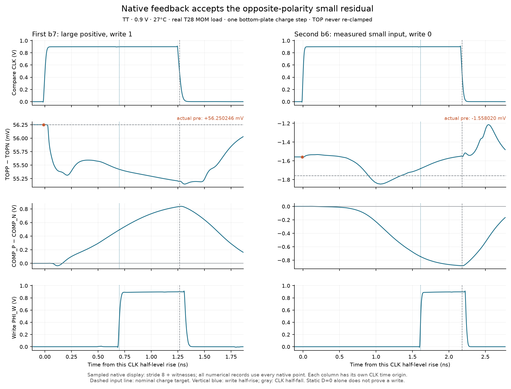
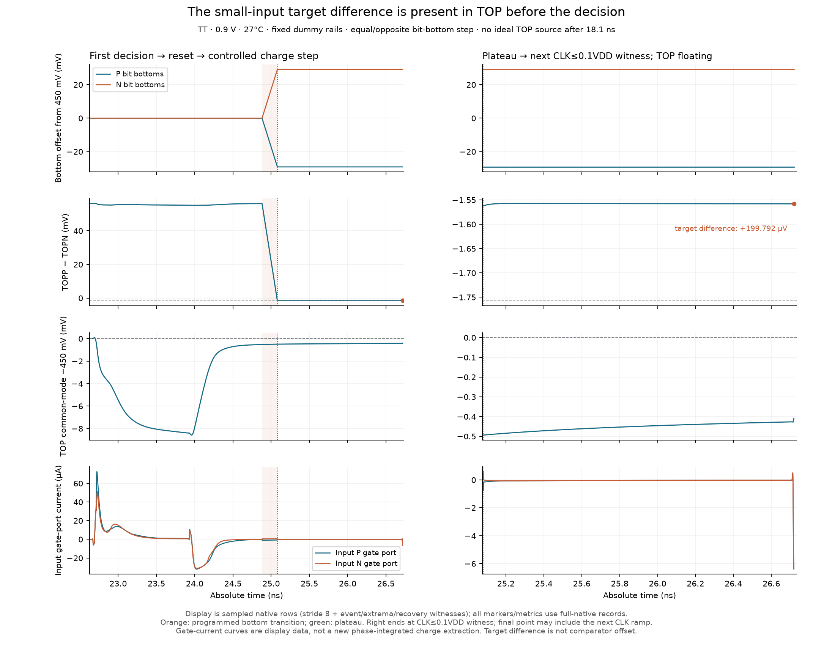

# 正大残差→负小残差：单组记录

**在声明的TT测试台中，前次相反判决没有阻止第二次小输入正确写入。** 首轮实际差模+56.250246mV；第二次实际输入为-1.558020mV（-0.221585LSB），共模449.590950mV。第二次写入延迟1.612582ns，极性与实际输入一致。八次写入/更新/复位、token7→0和D历史均正确。

## 目标差异出现在哪里

| 原生见证 | 时刻/ns | 实际差模/mV | 共模/mV |
| --- | ---: | ---: | ---: |
| 首轮比较前 | 22.674426 | +56.250246 | 450.016671 |
| 首次检测到阶跃运动，进度0.0126% | 24.881023 | +56.161787 | 449.475369 |
| 底板首次达到最终平台 | 25.080998 | -1.562341 | 449.506000 |
| 第二次比较前 | 26.718889 | -1.558020 | 449.590950 |

实际底板为420.882353/479.117647mV，符合程序的等量反向阶跃；以255/256名义电容比独立计算，目标仍为-1.757812mV、450mV共模。第二次实际差模与名义目标相差**+199.792µV**。

偏差在阶跃平台时已经有+195.472µV；此后底板保持常值的1.637891ns内，差模又变化+4.320µV。输入在第二次判决前已经直接呈现这个电压差异，**这不是一次比较器翻转阈值/offset测量**。

名义计算仅含MOM权重比，实际还含输入门端电荷、寄生和前轮反冲恢复。仅由这些端点不能把偏差定量分给某个电容或晶体管，也没有逐原生点的独立窗口电荷积分。约200µV只相当于58.0078mV名义大阶跃的约0.344%，在相减形成小残差时会明显放大相对偏差；不能据此提取0.344%的输入电容或补偿输入。

## 相位和范围

首轮内部reset90在24.548085ns出现，早于阶跃；底板在25.080998ns进入平台，早于第二次比较前见证。移动阶段CLK/PHI_W/PHI_U最大值分别23.247/5.484/112.274µV，SAMPLE_INT为0。初始化控制始终关闭，平台后的初始化支路最大电流1.429e-21A。TOP没有被理想源重新钳位。

这是1457MOS、18个真实MOM及既有接收链的条件测试，参考首级输出仍采用32节点有限切口；底板阶跃为TB受控电荷刺激。外部SAMPLE_INT关闭沿和器件/RC未改。没有PVT、噪声、失配或全ADC精度结论。165MOS/990项选定端压为0超限；**完整1457MOS/8742项波形筛查未完成，完整超限数为null**。原生CMI和全部日志保留。

指标使用全部150,636原生点；图使用19,238展示点（每8个原生点加482个见证时刻）。完整导出0–100ns，图内裁剪范围按横轴；没有从取样曲线重新计算指标。比较前快照定义为最后一个CLK≤0.1VDD的点，下一时钟边沿可能已经耦合到输入；它不是“时钟完全静止”的保证。延迟不能直接与此前实际输入不同的固定+0.25LSB结果解释为纯历史效应。

成对汇总见[对称历史报告](../paired_report.md)，各组仍使用原样实际输入。
